<!--
Ban thao bao cao theo du lieu va ma nguon dang co trong workspace.
Truoc khi nop: dien cac muc [CAN BO SUNG], xac nhan voi GVHD va doi chieu
quy dinh trinh bay ban chinh thuc cua Khoa.
-->

# ĐỒ ÁN TỐT NGHIỆP

> Bản báo cáo riêng theo mục lục cập nhật ngày 09/11, tổng hợp từ báo cáo cũ và hồ sơ hiện có của dự án.

## Phát hiện ô tô vượt đèn đỏ bằng YOLO và bộ theo dõi đa đối tượng nhận biết ngữ cảnh giao lộ

**Sinh viên thực hiện:** [CẦN BỔ SUNG]
**Mã sinh viên:** [CẦN BỔ SUNG]
**Lớp:** [CẦN BỔ SUNG]
**Ngành:** Công nghệ thông tin
**Giảng viên hướng dẫn:** [CẦN BỔ SUNG]
**Đơn vị:** Khoa Công nghệ thông tin, Trường Đại học Kiến trúc Hà Nội
**Năm thực hiện:** 2026–2027

> Đây là bản thảo nội dung báo cáo được tổng hợp từ mã nguồn, YAML, hồ sơ huấn luyện, báo cáo làm sạch và các lần chạy hiện có. Các thông tin hành chính để trong ngoặc vuông cần được sinh viên bổ sung. Những chỉ số chưa có nhãn chuẩn không được diễn giải thành độ chính xác của hệ thống.

> **Thành phần đầu báo cáo cần hoàn thiện khi dàn trang:** bìa ngoài/bìa lót; phiếu giao nhiệm vụ; kế hoạch dự kiến; bảng theo dõi thực hiện; phiếu kiểm tra tiến độ; lời cảm ơn; lời cam đoan; lời mở đầu; mục lục; danh mục bảng; danh mục hình; danh mục ký hiệu, chữ viết tắt và thuật ngữ. Đánh số trang phần đầu bằng i, ii, iii… theo hướng dẫn của Khoa. Các biểu mẫu hành chính phải lấy theo mẫu chính thức, không tự dựng nội dung thay cho chữ ký/xác nhận.

---

# LỜI CẢM ƠN

Trong quá trình thực hiện đồ án, em đã nhận được sự hướng dẫn và góp ý của giảng viên hướng dẫn, sự hỗ trợ của thầy cô trong Khoa Công nghệ thông tin, cùng sự động viên của gia đình và bạn bè. Em xin chân thành cảm ơn các thầy cô đã trang bị kiến thức nền tảng về lập trình, xử lý ảnh và trí tuệ nhân tạo; cảm ơn giảng viên hướng dẫn đã định hướng để em từng bước hoàn thiện đề tài.

Em cũng xin cảm ơn các cá nhân và tổ chức đã công bố những công cụ, thư viện và tài liệu mã nguồn mở phục vụ nghiên cứu, đặc biệt là Python, PyTorch, Ultralytics YOLO, OpenCV và Roboflow. Các nguồn dữ liệu được sử dụng trong quá trình thực hiện được tổng hợp, gán nhãn và quản lý phục vụ mục đích học tập, nghiên cứu.

Do thời gian và kinh nghiệm còn hạn chế, báo cáo khó tránh khỏi thiếu sót. Em kính mong nhận được góp ý của quý thầy cô để đề tài được hoàn thiện hơn.

**Sinh viên thực hiện**
[CẦN BỔ SUNG HỌ TÊN]

---

# LỜI CAM ĐOAN

Em xin cam đoan đồ án này là kết quả nghiên cứu và triển khai của bản thân dưới sự hướng dẫn của giảng viên hướng dẫn. Những nội dung kế thừa từ công trình, tài liệu, thư viện hoặc công cụ của tác giả khác đều được nêu nguồn trong phần tài liệu tham khảo. Dữ liệu và kết quả thực nghiệm được trình bày theo hồ sơ hiện có; các kết quả suy luận tự động không được xem là kết luận pháp lý về hành vi vi phạm.

Em xin chịu trách nhiệm về lời cam đoan này.

**Sinh viên thực hiện**
[CẦN BỔ SUNG HỌ TÊN]

---

# LỜI MỞ ĐẦU

Báo cáo trình bày quá trình xây dựng hệ thống phân tích video giao thông từ dữ liệu, thiết kế thuật toán, cài đặt đến các lần kiểm thử đã lưu. Các kết quả được giới hạn theo bằng chứng hiện có; những nội dung cần biểu mẫu, ảnh hoặc ground truth được đánh dấu để bổ sung trước khi nộp.

# TÓM TẮT

Đồ án xây dựng một hệ thống phân tích video giao thông nhằm hỗ trợ phát hiện ô tô đi qua vạch dừng trong thời gian đèn tín hiệu đỏ. Hệ thống sử dụng mô hình YOLO đã được huấn luyện trên bộ dữ liệu sáu lớp gồm xe buýt, ô tô con, xe tải và ba trạng thái đèn giao thông. ByteTrack tích hợp trong Ultralytics là lựa chọn mặc định; cả CLI và giao diện web đều cho phép chọn thêm module ByteTrack tự cài. Các cờ association/lifecycle/stitching nâng cao và bộ preset ablation A–F chỉ cấu hình qua CLI, không tự bật khi phân tích trên web. Đèn tín hiệu được suy luận trên vùng ảnh quan tâm (ROI) đã cấu hình; kết quả màu được làm ổn định theo lịch sử ngắn. Bộ kiểm tra hình học dùng điểm đại diện của bbox (mặc định là tâm, có thể cấu hình thành tâm cạnh dưới), xác nhận giao cắt trên đoạn vạch hữu hạn và chỉ ghi nhận sự kiện nếu trạng thái đèn tại thời điểm giao cắt là đỏ.

Quy trình dữ liệu bắt đầu từ ảnh CCTV do sinh viên thu thập/gán nhãn và các nguồn Roboflow; các lớp phương tiện được chuẩn hóa, bổ sung Bus/Truck, rồi ghép với một mẫu dữ liệu đèn. CSV thống kê sau clean ghi nhận 11.672 cặp ảnh–nhãn và 31.509 bbox hợp lệ. Theo xác nhận của sinh viên, khi tải bộ clean lên Roboflow có bốn cặp ảnh–nhãn tải lên lỗi; bản export dùng trong lần train có 11.668 cặp. Thứ tự lớp trong YAML export khác YAML clean trên máy, vì vậy mã lớp được đối chiếu theo tên trước khi train. Mô hình được huấn luyện 70 epoch bằng YOLO26s với kích thước ảnh 640, batch 4 và optimizer AdamW. Ở epoch có mAP50–95 cao nhất trong `results.csv` (epoch 70), các chỉ số validation được ghi nhận là Precision 0,92017, Recall 0,84876, mAP50 0,91845 và mAP50–95 0,68871.

Trong lần chạy suy luận được lưu cho video mẫu 2568 × 1440, hệ thống xử lý đủ 950 khung hình với tốc độ trung bình 11,49 FPS trên GPU 0; ghi nhận 7 ID phương tiện và không ghi nhận sự kiện vi phạm. Kết quả này chỉ mô tả một lần chạy, chưa được đối chiếu với bộ nhãn chuẩn cho video nên không đại diện cho độ chính xác tổng quát. Hệ thống cung cấp giao diện dòng lệnh và giao diện web chạy cục bộ để cấu hình ROI, theo dõi tiến độ, xem video đầu ra và rà soát các sự kiện do AI đề xuất.

**Từ khóa:** phát hiện đối tượng, YOLO, ByteTrack, ROI, đèn giao thông, vạch dừng, video giao thông.

---

# MỤC LỤC

> Bản báo cáo được sắp xếp theo mục lục cập nhật ngày 09/11. Ký hiệu `[H]` là hình, `[B]` là bảng; đánh số theo chương. Cập nhật số trang tự động sau khi dàn trang.

- Phần đầu thuyết minh
- Mở đầu
  - 0.1. Tóm tắt nhiệm vụ đề tài được giao
  - 0.2. Lý do chọn đề tài
  - 0.3. Ý nghĩa khoa học và thực tiễn
  - 0.4. Giới hạn đề tài và kết quả đạt được
  - 0.5. Bố cục đồ án
- Chương 1. Cơ sở lý thuyết
  - 1.1. Mô tả bài toán
    - 1.1.1. Bài toán phát hiện ô tô vượt vạch dừng khi đèn đỏ
    - 1.1.2. Quy định pháp luật liên quan
    - 1.1.3. Các khó khăn và thách thức kỹ thuật
  - 1.2. Thị giác máy tính và bài toán theo dõi đối tượng
    - 1.2.1. Phát hiện đối tượng và họ mô hình YOLO
    - 1.2.2. Theo dõi đa đối tượng: SORT, DeepSORT, ByteTrack, Kalman, Hungarian
    - 1.2.3. Xử lý ảnh: trạng thái đèn, hình học vạch dừng, phép chiếu phối cảnh
    - 1.2.4. Các chỉ số đánh giá phát hiện, theo dõi và sự kiện
  - 1.3. Định hướng giải quyết
    - 1.3.1. Hướng tiếp cận tổng quát
    - 1.3.2. Hướng cải tiến bộ theo dõi
  - 1.4. Nghiên cứu liên quan, nhận xét và khoảng trống nghiên cứu
- Chương 2. Phân tích thiết kế hệ thống
  - 2.1. Phân tích yêu cầu
  - 2.2. Kiến trúc tổng thể
  - 2.3. Thiết kế các module
  - 2.4. Thiết kế thuật toán phát hiện vi phạm
  - 2.5. Thiết kế dữ liệu và giao diện
- Chương 3. Xây dựng hệ thống
  - 3.1. Công cụ và công nghệ sử dụng
  - 3.2. Xây dựng bộ dữ liệu
  - 3.3. Huấn luyện mô hình phát hiện
  - 3.4. Cài đặt và tích hợp hệ thống
  - 3.5. Kiểm thử phần mềm
  - 3.6. Đóng góp của sinh viên
- Chương 4. Thực nghiệm và đánh giá kết quả
  - 4.1. Thiết lập thực nghiệm
    - 4.1.1. Bộ video thử nghiệm
    - 4.1.2. Gán nhãn ground truth cấp sự kiện vi phạm
    - 4.1.3. Các chỉ số đánh giá
  - 4.2. Đánh giá bộ theo dõi
    - 4.2.1. So sánh các thuật toán theo dõi
    - 4.2.2. Thiết kế ablation và kết quả
  - 4.3. Đánh giá hệ thống ở cấp sự kiện vi phạm
    - 4.3.1. Kết quả tổng thể
    - 4.3.2. Kết quả theo từng điều kiện
    - 4.3.3. Phân tích độ nhạy tham số
    - 4.3.4. Hình ảnh minh họa kết quả
  - 4.4. Tốc độ xử lý và khả năng triển khai
  - 4.5. Phân tích lỗi và thảo luận
    - 4.5.1. Phân loại các trường hợp lỗi
    - 4.5.2. Ưu điểm và nhược điểm
    - 4.5.3. Khả năng ứng dụng thực tế, quyền riêng tư và đạo đức dữ liệu
- Kết luận và hướng phát triển
- Tài liệu tham khảo
- Phụ lục

---

# DANH MỤC CÁC BẢNG

Danh sách số hiệu và tiêu đề Bảng 1.1–1.4, Bảng 2.1–2.5, Bảng 3.1–3.14, Bảng 4.1–4.9 và Bảng K.1 được tạo tự động sau khi dàn trang.

# DANH MỤC CÁC HÌNH

Danh sách số hiệu và tiêu đề Hình 1.1–1.4, Hình 2.1–2.14, Hình 3.1–3.7 và Hình 4.1–4.6 được tạo tự động sau khi dàn trang. Các sơ đồ Mermaid cần được render thành ảnh nếu phần mềm dàn trang không hỗ trợ Mermaid; hình cần ảnh/video thực tế được ghi chú tại vị trí tương ứng.

# DANH MỤC KÝ HIỆU, CHỮ VIẾT TẮT VÀ THUẬT NGỮ

| Từ viết tắt | Tiếng Anh | Diễn giải |
|---|---|---|
| AP | Average Precision | Độ chính xác trung bình theo lớp |
| CNN | Convolutional Neural Network | Mạng nơ-ron tích chập |
| CCTV | Closed-Circuit Television | Camera giám sát |
| FPS | Frames Per Second | Số khung hình xử lý mỗi giây |
| GPU | Graphics Processing Unit | Bộ xử lý đồ họa |
| HOTA | Higher Order Tracking Accuracy | Chỉ số đánh giá theo dõi đa đối tượng |
| HSV | Hue, Saturation, Value | Không gian màu sắc, độ bão hòa, độ sáng |
| IDF1 | ID F1 Score | F1 theo danh tính đối tượng |
| IDSW | Identity Switches | Số lần đổi danh tính track |
| IoU | Intersection over Union | Tỷ lệ giao trên hợp giữa hai hộp |
| mAP | mean Average Precision | Trung bình AP qua các lớp |
| MOT | Multiple Object Tracking | Theo dõi nhiều đối tượng |
| MOTA | Multiple Object Tracking Accuracy | Chỉ số tổng hợp độ chính xác MOT |
| NMS | Non-Maximum Suppression | Loại bỏ hộp dự đoán trùng lặp |
| ROI | Region of Interest | Vùng quan tâm |
| YAML | YAML Ain't Markup Language | Định dạng cấu hình dữ liệu |

---

# MỞ ĐẦU

## 0.1. Tóm tắt nhiệm vụ đề tài được giao

Nhiệm vụ triển khai trong phạm vi sản phẩm hiện có là xây dựng hệ thống xử lý video giao thông, phát hiện các lớp phương tiện và màu đèn, theo dõi phương tiện qua thời gian, cấu hình vạch dừng/ROI theo camera, rồi phát sinh sự kiện ứng viên khi track cắt qua vạch trong lúc đèn đỏ. Sản phẩm cần có đầu ra để rà soát và thử nghiệm được qua CLI hoặc giao diện web cục bộ.

> **Cần đối chiếu phiếu giao nhiệm vụ chính thức:** thay hoặc bổ sung đoạn tóm tắt trên bằng đúng mục tiêu, sản phẩm và tiêu chí nghiệm thu ghi trong phiếu của Khoa/GVHD.

## 0.2. Lý do chọn đề tài

Camera giao thông tạo ra lượng video lớn, nhưng việc theo dõi thủ công liên tục tốn nhân lực và khó bảo đảm khả năng rà soát đồng nhất. Bài toán xác định một phương tiện có đi qua vạch dừng khi đèn đỏ hay không còn đòi hỏi kết hợp đồng thời nhiều dấu hiệu: vị trí phương tiện theo thời gian, trạng thái đèn tại đúng thời điểm cắt vạch, hướng chuyển động và hình học của vạch dừng. Một hộp phát hiện đơn lẻ không đủ để kết luận giao cắt; hệ thống cần duy trì danh tính phương tiện giữa các khung hình và phân tích quỹ đạo.

Đề tài được lựa chọn nhằm vận dụng thị giác máy tính và học sâu vào video giao thông, đồng thời xây dựng một quy trình có thể kiểm tra lại: dữ liệu được gán nhãn, mô hình được huấn luyện, ROI được cấu hình theo camera, sự kiện được ghi thành dữ liệu và ảnh bằng chứng. Sản phẩm hướng đến mục đích nghiên cứu và hỗ trợ rà soát; không thay thế quy trình xác minh của cơ quan có thẩm quyền.

## 0.3. Ý nghĩa khoa học và thực tiễn

Về học thuật, đề tài minh họa việc ghép nối phát hiện đối tượng, theo dõi đa đối tượng và quy tắc hình học theo thời gian trong một pipeline thống nhất. Việc lưu track, trạng thái đèn tại frame giao cắt và cấu hình ROI tạo cơ sở để kiểm tra lại đường đi từ dự đoán đến sự kiện ứng viên. Module tracker tự cài giúp khảo sát cách association/lifecycle ảnh hưởng đến kết quả, nhưng chưa được chứng minh cải thiện bằng ground truth.

Về thực tiễn, video gắn nhãn và danh sách sự kiện giúp người vận hành tìm các đoạn cần xem lại. Sản phẩm chỉ hỗ trợ rà soát; không thay thế xác minh của con người hoặc quy trình pháp lý.

## 0.4. Giới hạn đề tài và kết quả đạt được

Đối tượng là video đã ghi từ camera giao thông cố định; các lớp detector gồm `bus`, `car`, `truck`, `green`, `red`, `yellow`. ROI và vạch được thiết lập thủ công cho từng góc quay. Hệ thống không nhận dạng biển số, không tính tốc độ vật lý, không hiệu chỉnh phối cảnh sang tọa độ thực địa và không đưa ra kết luận pháp lý. Kết quả hiện có gồm bộ clean thống kê 11.672 ảnh/31.509 bbox, checkpoint huấn luyện 70 epoch có số liệu validation, pipeline CLI/web và các lần chạy video được mô tả tại Chương 4. Chưa có ground truth sự kiện/tracking để tính độ chính xác hệ thống.

## 0.5. Bố cục đồ án

Chương 1 trình bày bài toán, cơ sở lý thuyết và định hướng giải pháp; Chương 2 phân tích, thiết kế hệ thống; Chương 3 trình bày công cụ, dữ liệu, huấn luyện, cài đặt, kiểm thử và đóng góp; Chương 4 trình bày thực nghiệm, đánh giá và thảo luận. Báo cáo kết thúc bằng kết luận, hướng phát triển, tài liệu tham khảo và phụ lục.

---

# PHẦN 1 – ĐẶT VẤN ĐỀ VÀ ĐỊNH HƯỚNG GIẢI PHÁP

**Khối lượng dự kiến:** không quá 20 trang theo đề cương của Khoa.
**Nhiệm vụ:** mô tả bài toán, kiến thức nền tảng và lý do lựa chọn các thành phần kỹ thuật.

# CHƯƠNG 1. CƠ SỞ LÝ THUYẾT

## 1.1. Mô tả bài toán

### 1.1.1. Bài toán phát hiện ô tô vượt vạch dừng khi đèn đỏ

Đầu vào của hệ thống là chuỗi khung hình \(I_1, I_2, \ldots, I_T\) từ một camera cố định. Với mỗi khung hình, hệ thống cần xác định hộp phương tiện, lớp phương tiện, hộp đèn và lớp màu đèn; đồng thời liên kết các phát hiện phương tiện qua thời gian thành các track có ID ổn định. Một sự kiện ứng viên được tạo khi quỹ đạo của một track đi từ phía tiếp cận qua vạch dừng, giao điểm nằm trên đoạn vạch đã cấu hình và trạng thái đèn tại thời điểm giao cắt là đỏ.

### 1.1.2. Quy định pháp luật liên quan

Hệ thống chỉ tạo sự kiện kỹ thuật để hỗ trợ rà soát; việc xác định hành vi vi phạm và áp dụng chế tài thuộc thẩm quyền của cơ quan/người có thẩm quyền. Căn cứ pháp lý cần đối chiếu theo thời điểm hoàn thiện báo cáo, bao gồm Luật Trật tự, an toàn giao thông đường bộ số 36/2024/QH15 và Nghị định số 168/2024/NĐ-CP cùng văn bản sửa đổi, bổ sung hoặc thay thế nếu có.

**Bảng 1.1. Văn bản pháp luật cần đối chiếu khi hoàn thiện báo cáo**

| Văn bản | Phạm vi liên quan | Tình trạng nội dung trong bản thảo |
|---|---|---|
| Luật số 36/2024/QH15 | Quy tắc chấp hành tín hiệu và vạch dừng | Cần trích đúng điều, khoản áp dụng |
| Nghị định số 168/2024/NĐ-CP | Chế tài hành vi không chấp hành đèn tín hiệu | Cần xác nhận mức phạt hiện hành, đối tượng và điều khoản |
| Văn bản sửa đổi/thay thế (nếu có) | Hiệu lực tại thời điểm nộp | Cần kiểm tra trên nguồn pháp luật chính thức |

Không đưa mức phạt cụ thể vào báo cáo trước khi xác nhận điều khoản, đối tượng áp dụng và hiệu lực văn bản tại ngày nộp.

### 1.1.3. Các vấn đề cần giải quyết

1. **Phát hiện vật thể nhỏ và đa tỷ lệ:** đèn tín hiệu thường chỉ chiếm một vùng nhỏ trong toàn khung hình; xe có thể bị che khuất hoặc có kích thước thay đổi theo khoảng cách.
2. **Theo dõi qua thời gian:** phương tiện bị che khuất, thay đổi kích thước hoặc detector bỏ lỡ ở một vài frame có thể làm track bị ngắt hoặc đổi ID.
3. **Xác định trạng thái đèn:** cần tránh đổi trạng thái theo một dự đoán đơn lẻ và phải xử lý khoảng thời gian không có phát hiện.
4. **Kiểm tra hình học:** một phương tiện ở phía bên kia vạch ngay từ frame đầu không đồng nghĩa với việc nó vừa vượt vạch trong video.
5. **Đồng bộ thời gian:** màu đèn phải được xét tại thời điểm track cắt qua vạch, không chỉ tại frame đang hiển thị sau đó.

Trong phạm vi đồ án, hệ thống xác định giao cắt trên ảnh hai chiều bằng tọa độ pixel và đoạn vạch do người dùng đánh dấu. Do không có hiệu chuẩn camera và tọa độ thế giới, hệ thống không suy ra khoảng cách hay tốc độ thực tế.

## 1.2. Thị giác máy tính và bài toán theo dõi đối tượng

### 1.2.1. Phát hiện đối tượng và họ mô hình YOLO

Phát hiện đối tượng là bài toán dự đoán vị trí và lớp của nhiều vật thể trong một ảnh. Mỗi dự đoán thường gồm hộp giới hạn, nhãn lớp và độ tin cậy.

Với hộp dự đoán \(B_p\) và hộp chuẩn \(B_g\), IoU được tính:

\[
\operatorname{IoU}(B_p,B_g)=\frac{|B_p \cap B_g|}{|B_p \cup B_g|}.
\]

Precision là tỷ lệ phát hiện đúng trong số các phát hiện được đưa ra; Recall là tỷ lệ vật thể chuẩn được tìm thấy. AP là diện tích dưới đường Precision–Recall cho một lớp. mAP50 lấy AP tại IoU ngưỡng 0,50; mAP50–95 lấy trung bình AP ở nhiều ngưỡng IoU từ 0,50 đến 0,95. Các chỉ số trong `results.csv` được ghi trên tập validation.

#### 1.2.1.1. Họ mô hình YOLO

YOLO là họ mô hình phát hiện một giai đoạn, dự đoán trực tiếp hộp và lớp từ ảnh qua mạng nơ-ron. Mô hình thường được mô tả qua Backbone trích xuất đặc trưng, Neck kết hợp đặc trưng nhiều tỷ lệ và Head dự đoán hộp/lớp. Đây là mô tả khái quát; cấu trúc chi tiết thay đổi theo phiên bản. Trong dự án, mô hình khởi tạo được ghi trong `args.yaml` là `yolo26s.pt`, ảnh huấn luyện có kích thước 640. Không gọi checkpoint này là YOLO26n chỉ dựa trên tên hiển thị ở giao diện web.

**Hình 1.1. Sơ đồ khái quát Backbone–Neck–Head của detector YOLO**
*Nguồn: cần vẽ lại theo tài liệu chính thức của đúng phiên bản YOLO được sử dụng; đây không phải sơ đồ kiến trúc chi tiết của YOLO26s.*

### 1.2.2. Theo dõi đa đối tượng

Tracking-by-detection nhận các hộp do detector tạo ở mỗi frame, sau đó liên kết chúng với các track trước đó. ByteTrack sử dụng các phát hiện có độ tin cậy cao ở lượt liên kết chính và tận dụng các phát hiện độ tin cậy thấp ở lượt tiếp theo để giữ track khi vật thể bị che khuất hoặc detector kém chắc chắn. Dự án giữ `model.track(..., tracker="bytetrack.yaml")` của Ultralytics làm chế độ mặc định, đồng thời có module tùy chọn `tracker/` tự triển khai trạng thái track, Kalman xyah, IoU/Hungarian, liên kết hai lượt và quản lý track mất dấu. Tham số baseline được đối chiếu với `bytetrack.yaml` của phiên bản Ultralytics cài trong môi trường; module tự cài không gọi API tracking của Ultralytics.

Các ý tưởng thường dùng trong MOT gồm dự đoán vị trí bằng bộ lọc Kalman và gán cặp bằng thuật toán Hungarian. SORT chủ yếu ghép theo chuyển động và IoU; DeepSORT bổ sung đặc trưng ngoại hình; ByteTrack khai thác detection điểm thấp ở lượt ghép thứ hai. Đây là so sánh định tính theo cơ chế, không phải kết quả benchmark trên dữ liệu đồ án.

**Bảng 1.2. So sánh định tính một số bộ theo dõi đa đối tượng**

| Phương pháp | Cơ chế nổi bật | Điểm mạnh | Giới hạn liên quan |
|---|---|---|---|
| SORT | Kalman và gán theo IoU | Đơn giản, chi phí tính toán thấp | Dễ mất liên kết khi che khuất hoặc detection gián đoạn |
| DeepSORT | SORT kết hợp đặc trưng ngoại hình | Có thêm tín hiệu nhận dạng khi đối tượng gần nhau | Cần trích đặc trưng và tăng chi phí tính toán |
| ByteTrack | Hai lượt ghép, có dùng detection confidence thấp | Có thể duy trì track khi confidence suy giảm | Vẫn phụ thuộc chất lượng detector và ngưỡng association |
| ByteTrack tự cài trong đồ án | Kalman xyah, association hai lượt, các tùy chọn mở rộng | Cho phép kiểm tra/tùy biến logic | Chưa có benchmark MOT ground truth để khẳng định cải thiện |

Buffered IoU mở rộng hộp dự đoán trước khi tính IoU nhằm giảm độ nhạy với sai số vị trí; directional gating điều chỉnh association theo hướng chuyển động; NSA Kalman điều chỉnh nhiễu đo theo confidence. Đây là cơ chế được khảo sát trong code, chưa có số liệu ground truth để kết luận mức cải thiện.

**Hình 1.2. Hai giai đoạn liên kết detection của ByteTrack**
*Nguồn: cần vẽ sơ đồ theo mô tả thuật toán trong tài liệu ByteTrack, phân biệt detection confidence cao và thấp.*

**Hình 1.3. Minh họa IoU và Buffered IoU**
*Nguồn: cần tạo hình minh họa hình học; không dùng làm kết quả thực nghiệm.*

### 1.2.3. Kỹ thuật xử lý ảnh hỗ trợ

Phép chiếu homography mô tả ánh xạ phối cảnh giữa hai mặt phẳng, có thể dùng để chuẩn hóa vùng mặt đường hoặc so sánh vị trí xe trong hệ tọa độ bird-eye view khi biết các điểm tương ứng. Trong phiên bản hiện tại, hệ thống chưa hiệu chuẩn camera và chưa dùng homography; vạch dừng, ROI và quỹ đạo đều được xét trực tiếp trên tọa độ pixel của ảnh. Vì vậy không suy ra khoảng cách hay tốc độ thực địa từ kết quả.

ROI là vùng đa giác giới hạn phần ảnh được dùng cho một chức năng. ROI phương tiện giảm việc xét các vùng không thuộc làn cần theo dõi. ROI đèn tập trung suy luận vào cụm tín hiệu nhỏ. Tọa độ ROI được lưu ở độ phân giải video gốc và cần thiết lập riêng cho mỗi góc camera.

HSV tách thành phần màu sắc khỏi thành phần độ sáng tương đối. Trong dự án, màu dự đoán của đèn được kiểm tra thêm qua các pixel có độ bão hòa và độ sáng đủ cao trong một patch quanh hộp dự đoán. Bước này là hiệu chỉnh heuristic, không thay thế mô hình và có thể không đáng tin khi ảnh mờ, cháy sáng hoặc vùng patch lẫn nền.

Histogram màu HSV còn được dùng như một tín hiệu phụ trong bước nối track: so sánh histogram vùng đối tượng giữa track vừa mất và detection mới. Tín hiệu này không phải embedding nhận dạng, nhạy với ánh sáng và nền, nên chỉ kết hợp với khoảng cách hình học và thời gian.

### 1.2.4. Các chỉ số đánh giá theo dõi

IDF1 đo mức khớp danh tính giữa track dự đoán và ground truth; MOTA tổng hợp lỗi false negative, false positive và ID switch; IDSW đếm số lần danh tính dự đoán đổi trong quá trình theo dõi. HOTA cân bằng chất lượng phát hiện và association theo nhiều ngưỡng. Các chỉ số này cần annotation track theo frame và công cụ đánh giá tương ứng. Bộ dữ liệu hiện có chỉ có nhãn detection YOLO; báo cáo không tự suy diễn các chỉ số MOT.

Ở cấp sự kiện, TP là sự kiện hệ thống phát hiện khớp với ground truth theo video, hướng xe và khoảng dung sai thời gian đã quy định; FP là sự kiện AI không có nhãn tương ứng; FN là sự kiện ground truth bị bỏ sót. Từ đó tính Precision = TP/(TP+FP), Recall = TP/(TP+FN) và F1 = 2×Precision×Recall/(Precision+Recall). Quy tắc ghép và dung sai phải được xác định trước khi đánh giá; các chỉ số này chưa được tính vì dự án chưa có ground truth sự kiện.

### 1.2.5. Công cụ

**Bảng 1.3. Công cụ sử dụng trong dự án**

| Công cụ | Vai trò trong dự án |
|---|---|
| Python | Ngôn ngữ cài đặt pipeline và công cụ xử lý dữ liệu |
| PyTorch | Nền tảng thực thi và huấn luyện mô hình |
| Ultralytics | API YOLO, huấn luyện, validation và ByteTrack tích hợp |
| OpenCV | Đọc/ghi video, tiền xử lý ảnh, ROI, HSV và vẽ kết quả |
| NumPy, SciPy | Tính toán ma trận/vector và gán cặp Hungarian trong tracker tự cài |
| Roboflow | Quản lý bộ dữ liệu, gán nhãn/xuất dữ liệu YOLO |
| Flask, Waitress | Server giao diện web chạy cục bộ |

## 1.3. Định hướng giải quyết

### 1.3.1. Sơ đồ hướng tiếp cận

Pipeline được tổ chức như sau:

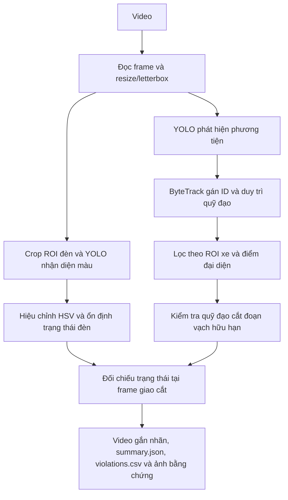

Mô hình học sâu tạo phát hiện; bộ theo dõi duy trì ID; module hình học và trạng thái đèn đưa ra sự kiện ứng viên. Cách phân rã này cho phép xác định lỗi nằm ở khâu detector, cấu hình ROI, tracking hay luật giao cắt.

**Hình 1.4. Sơ đồ hướng tiếp cận detect → track → phân tích đèn → xét vi phạm**
*Nguồn: tổng hợp theo pipeline của đồ án.*

### 1.3.2. Hướng cải tiến bộ theo dõi

Đồ án giữ ByteTrack Ultralytics làm baseline và có thêm một phiên bản ByteTrack tự cài. Các hướng khảo sát gồm chọn điểm đại diện bottom-center, Buffered IoU, directional gating, NSA Kalman, kéo dài vòng đời track theo tín hiệu đèn/vùng chờ và nối lại track gần vạch. Các cải tiến này là lựa chọn thử nghiệm, không mặc định được xem là tốt hơn; cần so sánh trên video cố định và có ground truth tracking.

## 1.4. Các nghiên cứu liên quan, nhận xét và khoảng trống nghiên cứu

Các hướng SORT, DeepSORT và ByteTrack lần lượt thể hiện cách ghép theo chuyển động, bổ sung đặc trưng ngoại hình và khai thác detection confidence thấp. Đồ án sử dụng ByteTrack làm baseline và xây dựng triển khai tùy chọn; không đề xuất detector hoặc thuật toán tracking nền mới.

**Bảng 1.4. Đối chiếu phương pháp liên quan và phạm vi của đồ án**

| Hướng/phương pháp | Cơ chế được kế thừa | Khác biệt trong đồ án | Hạn chế đánh giá hiện tại |
|---|---|---|---|
| SORT [3] | Kalman, IoU và Hungarian | Dùng làm nền tảng lý thuyết association | Không có bộ ground truth MOT |
| ByteTrack [2] | Ghép detection confidence cao/thấp | Có baseline Ultralytics và bản tự cài | Chưa tính HOTA/IDF1/MOTA trên nhãn chuẩn |
| Detector YOLO [1] | Phát hiện hộp và lớp | Fine-tune sáu lớp cho bối cảnh dự án | Chỉ có metric validation, chưa có metric test độc lập |
| Pipeline đồ án | Kết hợp detector, tracker, đèn, ROI và luật vạch | Tạo sự kiện ứng viên có bằng chứng rà soát | ROI thủ công, chưa có ground truth sự kiện |

Điểm khác biệt của đồ án không nằm ở việc đề xuất một kiến trúc phát hiện mới. Trọng tâm là xây dựng bộ dữ liệu sáu lớp theo nhu cầu đề tài, kết hợp mô hình detector với tracker và quy tắc hình học, cung cấp cấu hình ROI theo camera và tạo đầu ra có thể rà soát. Các hạn chế về nhãn chuẩn cho video, hiệu chuẩn camera và đánh giá tracking được trình bày ở Chương 4.

---

# PHẦN 2 – CÁC KẾT QUẢ ĐẠT ĐƯỢC

**Khối lượng dự kiến:** 35–50 trang theo đề cương của Khoa; đây là phần trọng tâm cần bổ sung hình, sơ đồ và phân tích theo nhận xét của giảng viên hướng dẫn.
**Nhiệm vụ:** trình bày thiết kế, quy trình dữ liệu, huấn luyện, hiện thực, thực nghiệm và đóng góp của sinh viên.

# CHƯƠNG 2. PHÂN TÍCH VÀ THIẾT KẾ

## 2.1. Phân tích yêu cầu

### 2.1.1. Yêu cầu chức năng

1. Nhận một video và đọc độ phân giải, FPS, số frame.
2. Nạp checkpoint YOLO có các lớp phương tiện và màu đèn phù hợp.
3. Cho phép cấu hình ROI phương tiện, ROI đèn, hai đầu vạch dừng và hướng đi qua vạch.
4. Phát hiện đèn và phương tiện; gán ID track cho phương tiện.
5. Làm ổn định trạng thái đèn và kiểm tra điều kiện giao cắt theo ID.
6. Ghi video có hộp, ID, ROI, vạch và trạng thái đèn; xuất báo cáo JSON/CSV và ảnh bằng chứng nếu có sự kiện.
7. Cho phép chạy bằng CLI hoặc giao diện web cục bộ; hỗ trợ theo dõi tiến độ và lưu từng phiên phân tích.

**Hình 2.1. Biểu đồ use case của hệ thống**

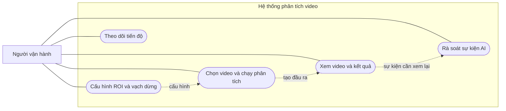

### 2.1.2. Yêu cầu phi chức năng

- Cấu hình ROI phải đúng độ phân giải của video; không tái sử dụng ROI chỉ vì hai video có cùng kích thước.
- Lỗi thiếu video, checkpoint, config hoặc không mở được đầu ra phải được thông báo.
- Có thể chạy CLI trên CPU hoặc thiết bị được chỉ định; web hiện yêu cầu GPU CUDA.
- Video tải lên web tối đa 500 MB; các phiên và kết quả được lưu trong `.webdata/jobs/<id>/`.
- Kết quả phải giữ được mối liên hệ giữa video, config, checkpoint, sự kiện và ảnh bằng chứng.

**Bảng 2.1. Yêu cầu chức năng và phi chức năng**

| Mã | Loại | Yêu cầu | Ưu tiên |
|---|---|---|---|
| F01 | Chức năng | Nhận video và đọc metadata khung hình | Cao |
| F02 | Chức năng | Phát hiện phương tiện/đèn và gán ID track | Cao |
| F03 | Chức năng | Cấu hình ROI, vạch dừng, hướng và điểm đại diện | Cao |
| F04 | Chức năng | Ghi video, summary, CSV và ảnh bằng chứng | Cao |
| F05 | Chức năng | Cung cấp CLI và giao diện web cục bộ | Trung bình |
| NF01 | Phi chức năng | Kiểm tra cấu hình ROI đúng kích thước video | Cao |
| NF02 | Phi chức năng | Thông báo lỗi khi thiếu đầu vào hoặc không mở được đầu ra | Cao |
| NF03 | Phi chức năng | Giữ liên hệ giữa job, config, checkpoint và kết quả | Cao |
| NF04 | Phi chức năng | Chạy CLI trên CPU; web hiện yêu cầu CUDA | Trung bình |
| NF05 | Phi chức năng | Giới hạn video tải lên web ở 500 MB | Trung bình |

### 2.2. Kiến trúc tổng thể và sơ đồ luồng xử lý

#### 2.2.1. Sơ đồ kiến trúc tổng thể

Hệ thống có ba lớp:

1. **Lớp suy luận:** nạp YOLO, tiền xử lý, phát hiện đèn/phương tiện và theo dõi phương tiện.
2. **Lớp nghiệp vụ:** quản lý trạng thái đèn, kiểm tra quỹ đạo qua đoạn vạch, quyết định tạo sự kiện.
3. **Lớp giao tiếp và lưu trữ:** CLI hoặc web; ghi video, JSON, CSV, ảnh bằng chứng và metadata theo job.

CLI khởi động pipeline qua `main.py` và `Code/06_run_detection.py`. Web tiếp nhận video/cấu hình ở `web_app.py`, sau đó `web_worker.py` gọi cùng pipeline trong tiến trình phân tích riêng. Giao diện web không đưa video lên dịch vụ inference bên ngoài; dữ liệu được xử lý cục bộ theo cấu hình của ứng dụng.

**Hình 2.2. Kiến trúc tổng thể: video → YOLO → tracker → luật vi phạm → đầu ra**

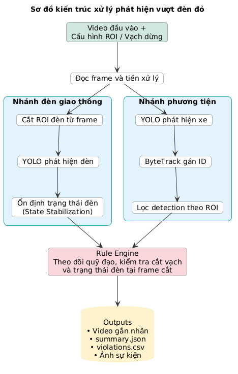

*Nguồn: hình minh họa do sinh viên cung cấp, sắp xếp lại vào phụ lục hình của báo cáo.*

#### 2.2.2. Lưu đồ luồng xử lý mỗi khung hình

Mỗi frame được đọc và tiền xử lý; nhánh phương tiện chạy detector và tracker, nhánh đèn phát hiện trạng thái trên ROI. Pipeline sau đó cập nhật quỹ đạo, kiểm tra điều kiện giao cắt, ghi lớp phủ và lưu bằng chứng khi có sự kiện.

**Hình 2.3. Lưu đồ xử lý frame từ đọc ảnh đến ghi bằng chứng**

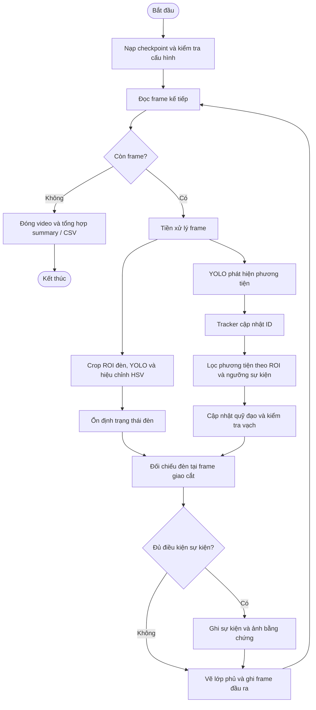

## 2.3. Thiết kế các module

### 2.3.1. Thu nhận và tiền xử lý video

OpenCV đọc lần lượt từng frame. Ảnh suy luận được resize giữ nguyên tỷ lệ và thêm viền letterbox về kích thước mục tiêu. Sau suy luận, tọa độ hộp phương tiện được ánh xạ từ ảnh đã letterbox về tọa độ video gốc để so sánh với ROI và vạch dừng. Mặc định pipeline không bật bước khử nhiễu NLM/sharpen.

### 2.3.2. Phát hiện ô tô bằng YOLO

Tên lớp lấy từ checkpoint và được gom thành nhóm xe và nhóm màu đèn. Phương tiện được phát hiện trên ảnh suy luận toàn khung hình. Mặc định các lớp xe được chuyển vào API `model.track` với ByteTrack YAML của Ultralytics; người dùng có thể chọn tracker này hoặc tracker tự cài qua CLI hay giao diện web. Với cấu hình web mặc định, `light_conf=0,25` và `vehicle_conf=0,6`; nếu không truyền `track_conf`, ngưỡng dự đoán của Ultralytics là giá trị nhỏ hơn giữa hai ngưỡng này. Tracker tự cài dùng `track_conf=0,1` mặc định để giữ detection điểm thấp cho lượt ghép thứ hai. `vehicle_conf` là ngưỡng xét quỹ đạo/sự kiện, không quyết định việc vẽ hộp: hộp track thuộc lớp xe có tâm trong ROI vẫn được vẽ khi confidence thấp hơn ngưỡng sự kiện. Bộ theo dõi tự cài giữ các trạng thái New/Tracked/Lost/Removed và dùng Kalman xyah cùng Hungarian trên chi phí IoU. Các tùy chọn cải tiến association được tắt mặc định: biou mở rộng hộp theo hệ số riêng cho hai giai đoạn ghép; directional gating cộng chi phí cho dịch chuyển đủ nhanh nhưng ngược hướng luồng xe; NSA Kalman nhân nhiễu đo \(R\) với \(1-\text{conf}\). Các cờ CLI `--biou`, `--dir-gating`, `--nsa-kalman` cho phép bật riêng từng cải tiến. Tùy chọn `--signal-lifecycle` nối thêm ngữ cảnh đèn và vùng hàng chờ để nới thời gian giữ một track Lost đang dừng khi đèn đỏ, cùng khoảng grace sau khi chuyển xanh. Tùy chọn `--stitch` so khớp vùng lân cận vạch, khoảng cách ground point và histogram HSV để tái sử dụng ID track vừa mất; mỗi lần nối được ghi ra log và ID đó tiếp tục được dùng ở bước khử trùng sự kiện.
Suy luận phương tiện được thực hiện trên ảnh toàn khung hình, sau đó các hộp được ánh xạ về tọa độ ảnh gốc để áp dụng ROI. Confidence detector phục vụ việc tạo các phát hiện đầu vào; `vehicle_conf` được dùng ở bước quyết định có cập nhật quỹ đạo và xét sự kiện. Cơ chế này tách việc hiển thị hộp track trong ROI khỏi ngưỡng tạo sự kiện.

### 2.3.3. Theo dõi đối tượng bằng bộ theo dõi tự cài

Module `tracker/` quản lý các track theo trạng thái New/Tracked/Lost/Removed, dự đoán bằng Kalman xyah và ghép bằng Hungarian trên chi phí IoU. Các tùy chọn association/lifecycle gồm Buffered IoU, directional gating, NSA Kalman, signal-aware lifecycle và stitching; chúng tắt mặc định. Mỗi tùy chọn có cờ CLI tương ứng, ngoại trừ preset chạy theo cấu hình A–F qua script ablation.

**Hình 2.4. Sơ đồ lớp của module `tracker/`**

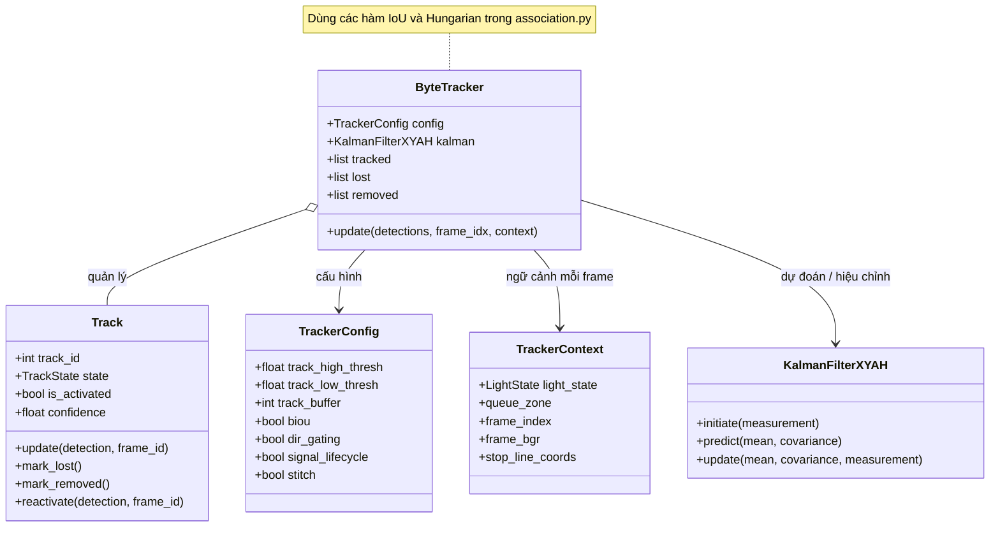

**Hình 2.5. Sơ đồ trạng thái track New/Tracked/Lost/Removed**

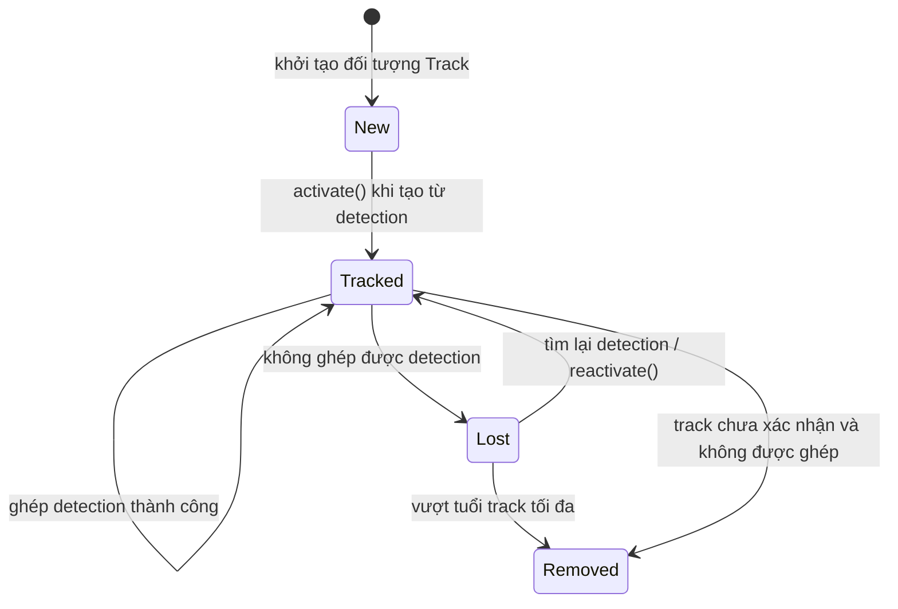

`New` là trạng thái khởi tạo ngắn: `from_detection` gọi `activate()` ngay, nên track mới chuyển sang `Tracked` trong cùng bước tạo. Track chưa xác nhận được biểu diễn bằng cờ `is_activated`, không phải một trạng thái riêng.

Để chạy ablation nhất quán, CLI có sáu preset: A dùng Ultralytics; B dùng tracker tự cài; C thêm điểm tiếp đất `bottom_center`; D thêm biou và directional gating; E thêm signal lifecycle; F thêm stitch. NSA Kalman không nằm trong chuỗi preset và được giữ tắt để các mức so sánh tương ứng đúng các thay đổi đã nêu. `scripts/run_ablation.py` chạy sáu preset tuần tự trên cùng đầu vào bằng CPU, lưu MOT, sự kiện, log và FPS theo từng preset, đồng thời tạo file tổng hợp. Đây là công cụ ghi nhận kết quả chạy, không tự động chứng minh preset nào chính xác hơn; đánh giá chất lượng cần video có ground truth. Với cấu hình Test 6 hiện có, không khai báo `QUEUE_ZONE_POLYGON`, nên E/F cảnh báo và không thể thực hiện phần kéo dài tuổi track theo vùng hàng chờ; tính năng này đã được kiểm tra riêng bằng chuỗi giả.

### 2.3.4. Nhận diện trạng thái đèn tín hiệu

Vùng bao của đa giác ROI đèn được cắt từ frame gốc, resize/letterbox riêng rồi đưa vào YOLO với ngưỡng `light_conf` mặc định 0,25. Hộp đèn được ánh xạ lại về tọa độ ảnh gốc và kiểm tra tâm hộp nằm trong ROI đa giác. Màu dự đoán được hiệu chỉnh bằng HSV ở patch quanh tâm đèn.

Lịch sử tối đa năm kết quả gần nhất được dùng để ổn định trạng thái. Khi một màu xuất hiện tối thiểu ba lần trong lịch sử, trạng thái được cập nhật theo màu đó. Nếu không có detection mới trong hơn hai giây theo FPS video, trạng thái được đặt thành `unknown`. Vì vậy ROI vẽ thiếu bóng đèn, cắt sát mép hoặc lệch khỏi cụm tín hiệu sẽ làm tăng khoảng thời gian `unknown`; mỗi camera cần được cấu hình và xem lại trên video đầu ra.

**Hình 2.6. Sơ đồ trạng thái đèn red/green/yellow/unknown**

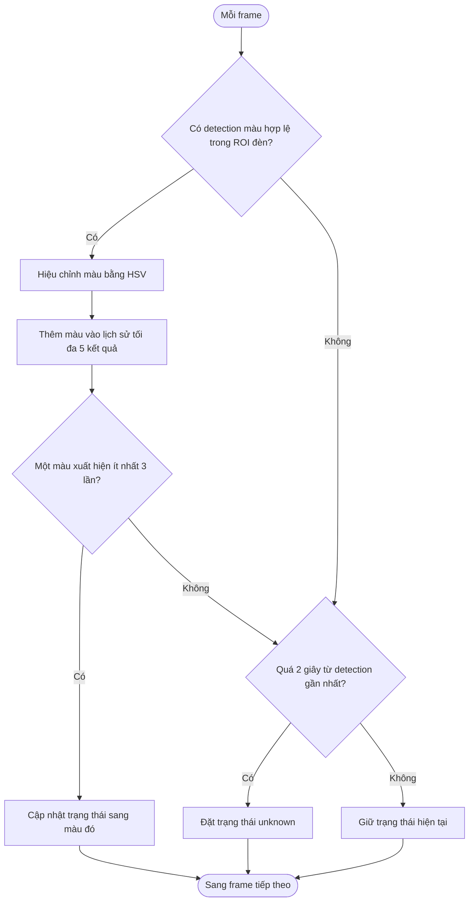

**Bảng 2.2. Quy tắc cập nhật trạng thái đèn**

| Tình huống | Quy tắc theo code | Kết quả |
|---|---|---|
| Có detection màu trong ROI | Hiệu chỉnh dự đoán bằng HSV và thêm vào lịch sử tối đa 5 kết quả | Cập nhật trạng thái khi một màu đạt ít nhất 3 lần |
| Không có detection mới trong thời gian ngắn | Giữ trạng thái gần nhất | Trạng thái không đổi |
| Không có detection mới quá 2 giây theo FPS video | Đánh dấu trạng thái hiện tại không xác định | `unknown` |

### 2.3.5. Thiết lập vạch dừng, vùng quan tâm và hướng dòng xe

File JSON chứa `FRAME_SIZE`, `VEHICLE_DETECT_ROI_POLYGON`, `RED_LIGHT_DETECT_ROI_POLYGON`, `STOP_LINE_COORDS`, `CROSSING_DIRECTION` và ngưỡng vượt vạch. Các trường tùy chọn gồm `GROUND_POINT_MODE`, `TRAFFIC_FLOW_DIRECTION`, `QUEUE_ZONE_POLYGON` và `STITCH_MARGIN`; giao diện web cho chọn `center` hoặc `bottom_center` ở bước thiết lập ROI, còn config cũ không có `GROUND_POINT_MODE` tiếp tục mặc định dùng `center`. Nếu không có hướng luồng xe, hệ thống suy ra vector đơn vị từ pháp tuyến vạch dừng và `CROSSING_DIRECTION`. `QUEUE_ZONE_POLYGON` là đa giác vùng xe dừng, được kiểm tra nằm trong ảnh; muốn bật vòng đời theo tín hiệu phải khai báo trường này. `STITCH_MARGIN` xác định dải pixel quanh đoạn vạch để xét nối, mặc định 40 pixel ảnh gốc. Bộ cấu hình có giao diện GUI chọn đa giác xe, đa giác đèn và hai điểm vạch. `load_config` kiểm tra cấu hình có đúng kích thước ảnh, các điểm nằm trong khung hình và chiều cắt thuộc `up` hoặc `down`.

**Hình 2.7. Ảnh chụp công cụ cấu hình ROI `05_roi_config.py`**
*Cần chụp màn hình công cụ trên video mẫu; che thông tin nhạy cảm nếu có.*

Khi bật `signal_lifecycle`, mỗi lần cập nhật tracker nhận `TrackerContext` gồm trạng thái đèn, vùng chờ đổi sang tọa độ inference và frame index. Track Lost đủ điều kiện khi điểm đại diện cuối còn trong polygon và tốc độ Kalman nhỏ hơn `stationary_speed_threshold`; lúc đèn đỏ dùng `max_age_red` thay vì `track_buffer`. Track đứng yên đủ điều kiện cũng được đặt các vận tốc Kalman về 0 khi dự đoán. Khi chuyển xanh, mức tuổi kéo dài duy trì `green_grace_frames`, sau đó trở lại giới hạn bình thường.

Khi bật `stitch`, module lưu snapshot track Lost trong `stitch_window` frame. Track mới phải nằm trong dải `STITCH_MARGIN` quanh vạch; ứng viên được lọc theo khoảng cách ground point và tương đồng histogram H-S tính bằng `cv2.compareHist`, rồi xếp hạng bằng điểm kết hợp khoảng cách, thời gian và histogram. Nếu đạt các ngưỡng cấu hình, track mới kế thừa ID cũ. Ngưỡng khoảng cách mặc định 80 pixel ảnh gốc, tương đồng histogram 0,55, điểm ghép 0,65 và cửa sổ 60 frame; đây là giá trị khởi đầu, không phải kết quả tối ưu hóa.

Vạch dừng được biểu diễn bởi hai đầu mút, tạo thành một đoạn hữu hạn. Quy ước hướng `up`/`down` phải được chọn theo góc nhìn camera, không suy ra chỉ từ hướng xe trên bản đồ.

### 2.3.6. Phát hiện vi phạm

Với vạch có điểm đầu \(A\), vector hướng \(v=B-A\), hệ thống tính pháp tuyến đơn vị \(n\). Điểm đại diện \(p_t\) được lấy từ tâm bbox hoặc tâm cạnh dưới theo `GROUND_POINT_MODE`; nếu trường cấu hình không có thì mặc định là `center`. Khoảng cách có dấu:

\[
d_t=(p_t-A)\cdot n.
\]

Một track được “armed” khi từng quan sát ở phía tiếp cận với \(d_t\) vượt ngưỡng dương. Khi hai điểm liên tiếp đổi dấu qua đường chứa vạch, hệ thống nội suy giao điểm và chiếu nó lên đoạn \(AB\). Chỉ giao điểm có hình chiếu nằm trong đoạn hữu hạn mới được giữ. Track được xác nhận vượt qua khi đi quá ngưỡng âm; frame sự kiện được gắn với frame nội suy giao cắt.

Sự kiện chỉ được tạo nếu trạng thái tại frame giao cắt được lưu là đỏ và ID chưa được ghi nhận trước đó. Cơ chế này hạn chế tính nhầm xe đã ở phía sau vạch từ đầu video và tránh ghi trùng một ID trong cùng lượt xử lý. Tuy nhiên, mất track, đổi ID, ROI không đúng hoặc trạng thái đèn `unknown` tại frame giao cắt đều có thể làm bỏ sót sự kiện.

### 2.3.7. Lưu bằng chứng và dữ liệu đầu ra

**Bảng 2.3. Các tệp đầu ra của pipeline**

| Tệp | Nội dung |
|---|---|
| `annotated.mp4` | Video có lớp phủ ROI, vạch, hộp, ID và trạng thái đèn |
| `summary.json` | Video/checkpoint/config, tracker và ngưỡng tracking, FPS, frame, thống kê màu/trạng thái và sự kiện |
| `violations.csv` | Bảng sự kiện; chỉ có header nếu không có sự kiện |
| `tracks.txt` | Hộp và ID theo từng frame ở dạng MOT để rà soát track |
| `preview.jpg` | Khung hình dùng làm ảnh xem trước |
| `id*_crop.jpg` | Ảnh cắt phương tiện khi tạo sự kiện |
| `id*_full.jpg` | Ảnh toàn cảnh tại thời điểm lưu bằng chứng |

**Hình 2.8. Cấu trúc tệp đầu ra và quan hệ giữa video, track, summary, CSV và ảnh bằng chứng**

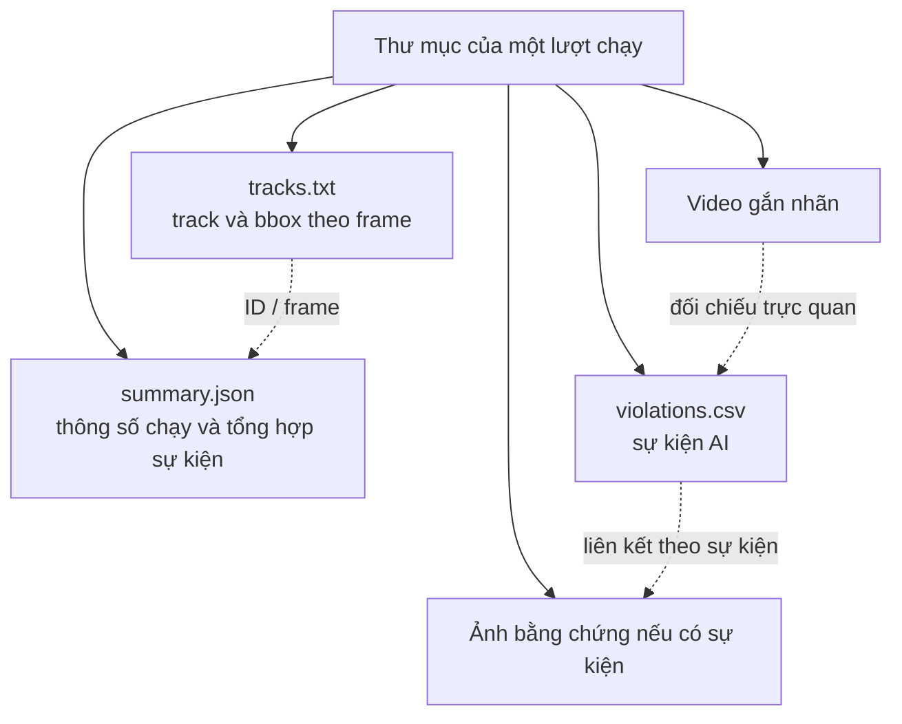

## 2.4. Thiết kế thuật toán phát hiện vi phạm

### 2.4.1. Điều kiện vi phạm

Một sự kiện ứng viên chỉ được tạo khi có track hợp lệ đạt `vehicle_conf`, quỹ đạo đã được “armed” ở phía tiếp cận, quỹ đạo cắt qua đoạn vạch hữu hạn theo đúng hướng, vượt qua ngưỡng xác nhận và trạng thái đèn tại frame giao cắt là đỏ. Mỗi ID chỉ được ghi nhận một lần trong cùng lượt xử lý. Đây là quy tắc kỹ thuật của hệ thống, không phải kết luận pháp lý.

### 2.4.2. Điểm tham chiếu của xe so với vạch

Điểm kiểm tra được lấy từ tâm bbox (`center`) hoặc tâm cạnh dưới (`bottom_center`). Hai lựa chọn đều là xấp xỉ vị trí xe trên mặt đường; `bottom_center` không khẳng định chính xác vị trí bánh trước. Vạch là đoạn hữu hạn \(AB\); hệ thống tính pháp tuyến đơn vị \(n\), sau đó dùng khoảng cách có dấu:

\[
d_t=(p_t-A)\cdot n.
\]

**Hình 2.9. Minh họa quỹ đạo xe, vạch dừng và khoảng cách có dấu ở hai phía ngưỡng**
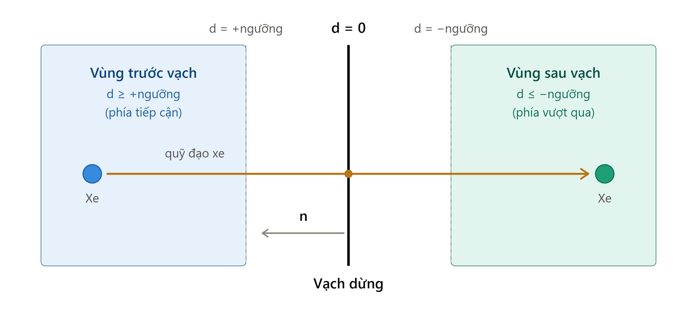

*Nguồn: hình minh họa do sinh viên cung cấp. Hình giải thích quy ước hình học, không phải ảnh CCTV hay kết quả thực nghiệm.*

### 2.4.3. Phân biệt xe chờ, xe vượt vạch và xe đã ở trong giao lộ

Track chỉ được “armed” sau khi quan sát ở phía tiếp cận vạch đủ ngưỡng. Khi điểm tham chiếu đổi dấu, giao điểm được nội suy và kiểm tra có nằm trên đoạn hữu hạn \(AB\) hay không; track chỉ được xác nhận sau khi đi qua ngưỡng phía bên kia. Xe xuất hiện ngay từ đầu video ở phía sau vạch không tự động bị tính là vừa vượt vạch.

**Hình 2.10. Lưu đồ điều kiện armed → cắt đoạn → vượt ngưỡng → kiểm tra đèn đỏ**

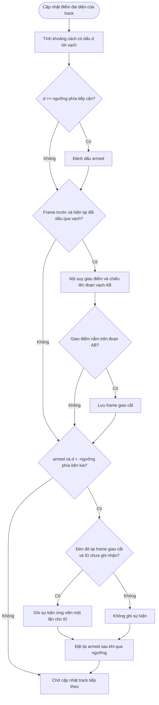

Xe đã ở phía sau vạch ngay từ đầu không được armed; giao cắt ngoài đoạn hữu hạn \(AB\) không được tính. `threshold` là ngưỡng cấu hình của `LineCrossing` (mặc định 20 pixel trong CLI).

### 2.4.4. Xử lý che khuất, mất ID và ID switch

Tracker tự cài duy trì track Lost trong giới hạn `track_buffer`; khi bật `signal_lifecycle`, track Lost có điểm cuối trong `QUEUE_ZONE_POLYGON`, tốc độ thấp và bối cảnh đèn phù hợp có thể được giữ lâu hơn. Directional gating phạt ghép cặp ngược hướng, BIoU mở rộng hộp ở các giai đoạn association, NSA Kalman điều chỉnh nhiễu đo theo confidence. Các cơ chế này giảm rủi ro trong một số tình huống nhưng chưa được đánh giá trên nhãn ID chuẩn.

`stitch` lưu snapshot track Lost trong một cửa sổ frame, rồi so khớp detection mới gần vạch theo khoảng cách ground point và tương đồng histogram H-S. Nếu đạt các ngưỡng, ID cũ được kế thừa; nếu không thì track mới giữ ID mới. Nối track cần rà soát trên ảnh/video vì hai xe gần nhau có thể bị ghép nhầm.

**Hình 2.11. Lưu đồ vòng đời track theo trạng thái đèn và vùng chờ**

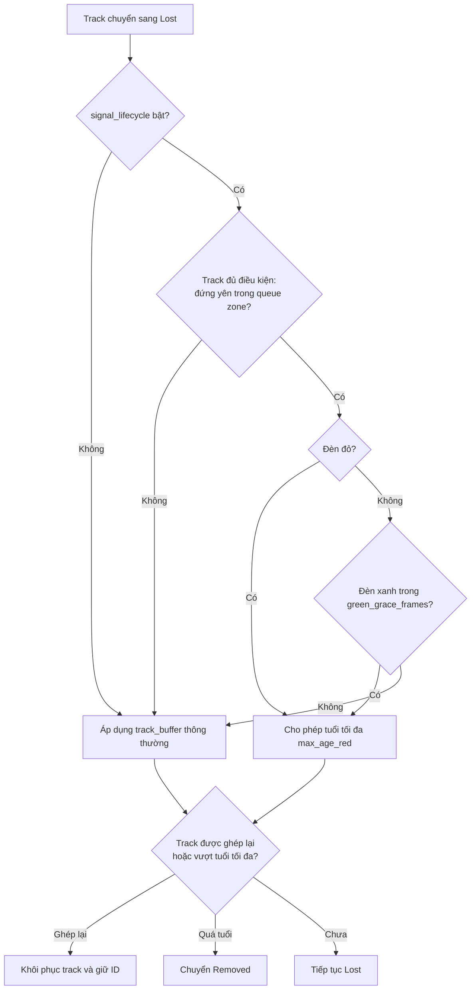

Phần kéo dài tuổi chỉ áp dụng cho track đủ điều kiện theo vùng chờ; nếu không khai báo `QUEUE_ZONE_POLYGON`, không có track nào được hưởng phần mở rộng này.

**Hình 2.12. Lưu đồ nối track tại vùng vạch**

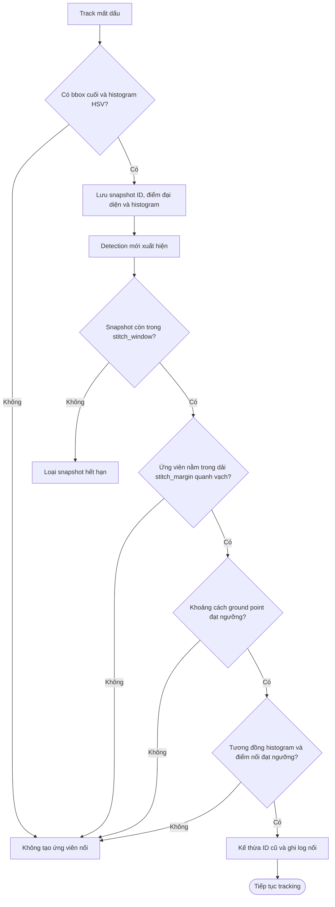

### 2.4.5. Cơ chế tránh báo trùng

Tập `captured` ngăn cùng một `track_id` tạo nhiều sự kiện trong một lượt phân tích. Nếu tracker đổi ID sau che khuất, cơ chế này không bảo đảm nhận ra đó là cùng một phương tiện; stitching có thể giúp kế thừa ID trong các trường hợp đạt ngưỡng nhưng cũng có khả năng nối sai. Vì vậy đầu ra cần được người vận hành rà soát.

### 2.4.6. Bảng tham số và cách chọn tham số

Các giá trị dưới đây là giá trị mặc định trong `TrackerConfig`, không phải giá trị tối ưu hóa từ validation. Chưa có quy trình quét tham số trên tập validation có ground truth; khoảng quét do đó chưa được xác định.

**Bảng 2.4. Tham số tracker mặc định**

| Tham số | Mặc định | Ý nghĩa | Khoảng quét đã thực hiện |
|---|---:|---|---|
| `track_high_thresh` | 0,25 | Ngưỡng detection cho lượt ghép điểm cao | Chưa thực hiện |
| `track_low_thresh` | 0,10 | Ngưỡng thấp cho lượt ghép thứ hai | Chưa thực hiện |
| `new_track_thresh` | 0,25 | Ngưỡng tạo track mới | Chưa thực hiện |
| `track_buffer` | 30 frame | Tuổi track giữ ở trạng thái mất dấu | Chưa thực hiện |
| `match_thresh` | 0,80 | Ngưỡng chi phí association | Chưa thực hiện |
| `biou_b1`, `biou_b2` | 1,2; 1,1 | Hệ số mở rộng hộp cho hai giai đoạn ghép | Chưa thực hiện |
| `max_age_red` | 120 frame | Tuổi track tối đa khi lifecycle theo đèn được bật | Chưa thực hiện |
| `green_grace_frames` | 30 frame | Grace period sau khi chuyển xanh | Chưa thực hiện |
| `stitch_window` | 60 frame | Cửa sổ tìm track Lost để nối | Chưa thực hiện |
| `stitch_distance_threshold` | 80 px | Khoảng cách ground point tối đa | Chưa thực hiện |
| `stitch_histogram_threshold` | 0,55 | Tương đồng histogram tối thiểu | Chưa thực hiện |
| `stitch_score_threshold` | 0,65 | Điểm nối tối thiểu | Chưa thực hiện |
| `stitch_margin` | 40 px | Dải quanh vạch để tìm ứng viên nối | Chưa thực hiện |

**Bảng 2.5. Cờ và preset ablation A–F**

| Preset | Tracker | Điểm đại diện | BIoU / hướng | Lifecycle đèn | Stitch | NSA Kalman |
|---|---|---|---|---|---|---|
| A | Ultralytics | Theo cấu hình | Tắt | Tắt | Tắt | Tắt |
| B | Tự cài | Theo cấu hình | Tắt | Tắt | Tắt | Tắt |
| C | Tự cài | `bottom_center` | Tắt | Tắt | Tắt | Tắt |
| D | Tự cài | `bottom_center` | Bật | Tắt | Tắt | Tắt |
| E | Tự cài | `bottom_center` | Bật | Bật | Tắt | Tắt |
| F | Tự cài | `bottom_center` | Bật | Bật | Bật | Tắt |

## 2.5. Thiết kế giao diện và lưu trữ dữ liệu

### 2.5.1. Giao diện web/CLI

Ứng dụng VIA chạy cục bộ qua Flask/Waitress. Người dùng tải video, đánh dấu vùng xe/đèn và hai đầu vạch, rồi theo dõi tiến độ. Bốn mục cấu hình nâng cao — hướng phương tiện qua vạch, điểm đại diện, bộ theo dõi phương tiện và tinh chỉnh độ tin cậy — là bốn phần thu gọn độc lập, mặc định đóng; lựa chọn được lưu cùng job. Người dùng có thể chọn ByteTrack Ultralytics hoặc ByteTrack tự cài. Worker riêng nhận cấu hình tracker, ngưỡng và ROI để chạy pipeline, cập nhật ảnh xem trước và trạng thái job. Các cải tiến ablation nâng cao của tracker tự cài hiện chỉ cấu hình qua CLI. Video đầu ra được mã hóa H.264 để phát trên trình duyệt. Mỗi job có thư mục riêng trong `.webdata/jobs/`, tránh ghi đè kết quả CLI trong `Output/`.

Giao diện có trang rà soát sự kiện AI để đánh dấu xác nhận, không vi phạm, chưa chắc hoặc chưa xem và ghi chú. Trạng thái rà soát là thông tin người dùng bổ sung; nó không thay đổi sự kiện gốc trong `violations.csv` và không phát hiện các sự kiện mà mô hình bỏ sót.

**Hình 2.13. Ảnh chụp giao diện cấu hình ROI và các mục tùy chọn**
*Cần chụp giao diện web hiện tại, thể hiện riêng bốn mục thu gọn; không có ảnh chụp giao diện trong thư mục tài liệu.*

### 2.5.2. Cấu trúc tệp đầu ra

Mô tả tên file, định dạng và các trường/cột được tổng hợp tại Bảng 2.3. `tracks.txt` lưu hộp và ID theo frame ở dạng MOT; `summary.json` lưu thông số lượt chạy và sự kiện; `violations.csv` lưu sự kiện AI; ảnh crop/toàn cảnh được tạo khi có sự kiện.

### 2.5.3. Sơ đồ tuần tự luồng chính

Luồng web gồm trình duyệt gửi video/cấu hình tới Flask, worker gọi pipeline dùng chung, callback cập nhật trạng thái/ảnh xem trước, sau đó worker lưu video và báo cáo để giao diện hiển thị.

**Hình 2.14. Sơ đồ tuần tự trình duyệt – Flask – worker – pipeline – kho job**

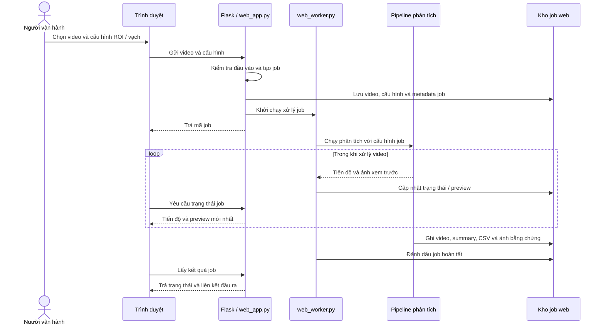
---

# CHƯƠNG 3. XÂY DỰNG HỆ THỐNG

**Nhiệm vụ:** trình bày công cụ, dữ liệu, huấn luyện mô hình, cài đặt tích hợp, kiểm thử và phần việc do sinh viên thực hiện.

## 3.1. Công cụ và công nghệ sử dụng

Các công nghệ được lựa chọn theo vai trò trong sản phẩm. YOLO/PyTorch phục vụ huấn luyện và phát hiện; OpenCV xử lý video, ROI và ảnh; NumPy/SciPy hỗ trợ hình học và ghép cặp trong tracker tự cài; Flask/Waitress cung cấp giao diện web cục bộ. Ultralytics cung cấp API YOLO và ByteTrack baseline. Bảng 1.3 nêu công cụ và chức năng nền tảng; Bảng 3.12 trình bày cấu trúc mã nguồn tích hợp.

| Công nghệ | Vai trò triển khai |
|---|---|
| Python | Ngôn ngữ chính cho pipeline, tracker, công cụ dữ liệu và web worker |
| PyTorch, Ultralytics YOLO | Huấn luyện/validation và suy luận phát hiện đối tượng |
| OpenCV, NumPy | Đọc/ghi video, tiền xử lý, ROI, HSV và phép tính hình học |
| SciPy | Thuật toán Hungarian trong tracker tự cài |
| Flask, Waitress | API và giao diện web chạy cục bộ |
| Roboflow | Quản lý/gán nhãn và export dữ liệu YOLO |

**Môi trường thực nghiệm:** các thông tin phần cứng/phần mềm đã xác minh được tổng hợp ở Bảng 3.9; thông tin máy train chưa có trong hồ sơ được giữ ở trạng thái cần bổ sung.

## 3.2. Xây dựng bộ dữ liệu

### 3.2.1. Nguồn dữ liệu

Ảnh do sinh viên tự tìm kiếm và thu thập từ camera CCTV giao thông và các luồng CCTV công khai trên YouTube. Sinh viên tự gán nhãn bằng Roboflow hơn 2.000 ảnh trong project `NhanDienGiaoThong`; ngoài ra, sinh viên sử dụng dataset `KLTN-vehicles` lấy từ Roboflow. Sau khi chuẩn hóa nhãn và loại lớp xe máy không thuộc phạm vi đề tài, hai nguồn được ghép thành bộ dữ liệu phương tiện ban đầu. Vì số mẫu bus và truck trong bộ ban đầu còn ít, sinh viên bổ sung riêng các dataset Bus và Truck. Tiếp đó, khoảng một nửa dữ liệu từ project Traffic Light Detection được đưa vào bộ sáu lớp, rồi bộ ghép được làm sạch. Workspace hiện không lưu đủ metadata về số clip gốc, độ phân giải/FPS của từng nguồn hay điều kiện thời tiết/ánh sáng; không suy ra các trường này từ số ảnh.

**Bảng 3.1. Quy mô và vai trò các project dữ liệu theo ảnh chụp Roboflow**

| Project hiển thị trên Roboflow | Số ảnh hiển thị | Vai trò trong quy trình |
|---|---:|---|
| NhanDienGiaoThong | 2.078 | Ảnh sinh viên tự thu thập và tự gán nhãn |
| KLTN-vehicles | 2.310 | Dataset có sẵn; loại lớp xe máy và chuẩn hóa nhãn trước khi ghép |
| Bus | 1.000 | Bổ sung mẫu xe buýt |
| Truck | 1.016 | Bổ sung mẫu xe tải |
| Traffic Light Detection | 9.710 | Nguồn dữ liệu đèn; sử dụng khoảng một nửa |
| DATADOANNEW | 11.668 | Project Roboflow lưu bộ dữ liệu tổng hợp sau clean |

Các số này là ảnh chụp số lượng từng project tại thời điểm ghi nhận; không cộng các nguồn thành tổng dataset vì `DATADOANNEW` là project đích sau tổng hợp, không phải nguồn độc lập. Riêng nguồn Traffic Light có số liệu không nhất quán: ảnh chụp Roboflow ghi 9.710 ảnh, README trong thư mục dữ liệu cục bộ ghi 1.176 ảnh, trong khi đếm các split train/valid/test của chính thư mục đó được 10.886 ảnh và 10.886 nhãn. Script ghép hiện trỏ tới thư mục cục bộ này. Vì vậy, 9.710 là số trên ảnh chụp, không dùng làm mẫu số để suy ra số file đã lấy; kết quả lấy mẫu thực tế được đối chiếu tại Mục 3.2.2. Chưa có manifest hoặc lịch sử phiên bản đủ để giải thích chênh lệch.

Sau khi làm sạch, sinh viên tải bộ dữ liệu lên Roboflow để lưu trữ tại project `DATADOANNEW`; bản export dùng train được tải vào `[dataset export-yolo26 tr?n m?y hu?n luy?n]`.

**Hình 3.1. Ví dụ ảnh từ các góc camera/điều kiện thu thập**
*Cần chọn ảnh CCTV được phép sử dụng, làm mờ biển số và thông tin nhận dạng trước khi đưa vào báo cáo.*

**Bảng 3.2. Metadata kỹ thuật và điều kiện thu thập cần hoàn thiện**

| Trường | Thông tin hiện có |
|---|---|
| Nguồn | CCTV giao thông và CCTV công khai trên YouTube |
| Số ảnh theo project | Có số liệu Roboflow tại Bảng 3.1 |
| Số clip gốc | Chưa thống kê |
| Độ phân giải/FPS từng nguồn | Chưa thống kê |
| Điều kiện thời tiết, thời gian, góc camera | Chưa lập bảng tổng hợp |

### 3.2.2. Tiền xử lý dữ liệu

Luồng dưới đây phân biệt bước gộp ban đầu được mô tả từ quy trình của sinh viên với các bước có script trong workspace. Nhánh augmentation ngoại tuyến là một công cụ riêng; không được nhầm với dữ liệu export đã dùng trong lần train được báo cáo.

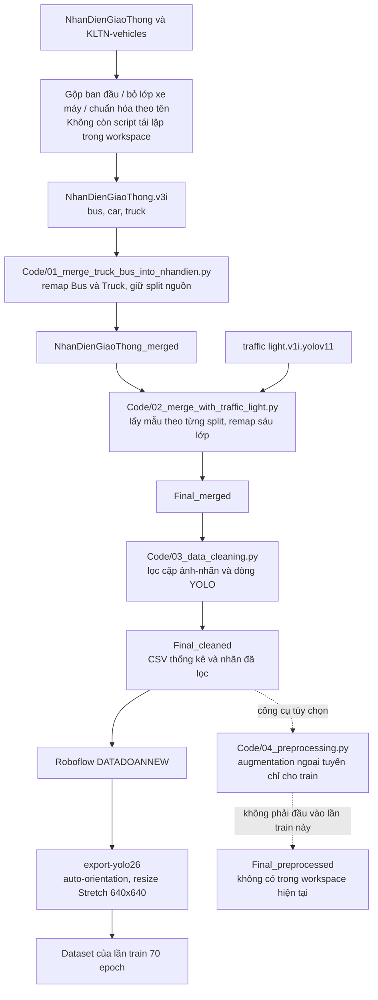

#### Chuẩn hóa thứ tự lớp trong bộ dữ liệu gộp

Trong `[dataset Final_cleaned tr?n m?y hu?n luy?n]\data.yaml`, thứ tự lớp trên máy là:

**Bảng 3.3. Thứ tự lớp trong YAML gộp và làm sạch**

| ID trên YAML gộp/làm sạch | Tên lớp | Ý nghĩa |
|---:|---|---|
| 0 | bus | Xe buýt |
| 1 | car | Ô tô con |
| 2 | truck | Xe tải |
| 3 | green | Đèn xanh |
| 4 | red | Đèn đỏ |
| 5 | yellow | Đèn vàng |

Đây là thứ tự dùng để mô tả các bước gộp và clean trên máy. Các script xử lý trong `[th? m?c x? l? d? li?u c?c b?]` tạo `Final_merged` và `Final_cleaned` theo mapping này.

#### Ghép bộ dữ liệu giao thông ban đầu

Bộ dữ liệu phương tiện ban đầu được tạo bằng cách ghép project `NhanDienGiaoThong` do sinh viên tự thu thập/gán nhãn với project `KLTN-vehicles` tải từ Roboflow. Hai nguồn có các lớp phương tiện chung; riêng KLTN có thêm lớp xe máy nên lớp này được loại khỏi phạm vi bộ dữ liệu, sau đó nhãn được chuẩn hóa theo tên lớp trước khi ghép. Tên lớp và ID nguồn phải được đối chiếu bằng YAML của từng phiên bản, không mặc định ID giống nhau chỉ vì tên lớp giống nhau.

Trong thư mục xử lý hiện có, các script được lưu phục vụ những bước bổ sung Bus/Truck, ghép Traffic Light và clean; không thấy script riêng cho thao tác ghép ban đầu giữa `NhanDienGiaoThong` và `KLTN-vehicles`. Vì vậy, mô tả bước ghép ban đầu ở đây dựa trên quy trình do sinh viên cung cấp, chưa thể tái lập đầy đủ chỉ từ các script hiện lưu.

#### Bổ sung bus và truck

Do số lượng mẫu bus và truck trong bộ phương tiện ban đầu còn thấp, hai nguồn `Bus` và `Truck` được bổ sung riêng. Script `Code/01_merge_truck_bus_into_nhandien.py` giữ mapping `bus=0`, `car=1`, `truck=2` của bộ nền, remap `bus=0 → 0` và `truck=0 → 2`, đồng thời thêm prefix theo nguồn vào tên file để hạn chế trùng tên. Script giữ nguyên split train/valid/test của từng nguồn, không hoán đổi ảnh giữa các split. YAML của các nguồn Bus và Truck đều có một lớp ID 0; YAML của bộ nền có ba lớp `bus`, `car`, `truck`. Bước gộp ban đầu giữa `NhanDienGiaoThong` và `KLTN-vehicles` không có script trong workspace nên không thể tái lập chỉ từ các file hiện lưu.

#### Bổ sung và lấy mẫu dữ liệu đèn

`Code/02_merge_with_traffic_light.py` đọc từng split của thư mục nguồn cục bộ, không chuyển ảnh qua lại giữa train/valid/test. Trong mỗi split, script nhóm file nhãn theo tập class ID xuất hiện trong ảnh, đặt mục tiêu chọn \(\lceil N/2\rceil\) file, rồi phân bổ gần một nửa cho từng nhóm class-combination. Phần làm tròn được chọn để tổng bình phương sai lệch giữa số instance từng lớp được chọn và mục tiêu tỷ lệ gần một nửa là nhỏ nhất. Sau đó, file trong từng nhóm được xáo trộn bằng `random.Random` với seed lần lượt là 0 cho train, 1 cho valid và 2 cho test; cùng đầu vào và cùng mã sẽ cho cùng lựa chọn.

ID nguồn của Traffic Light được ánh xạ sang thứ tự trên máy: `green=0 → 3`, `red=1 → 4`, `yellow=2 → 5`. Các dòng nhãn được remap, ảnh và label được thêm prefix `TL_`. Bộ gốc không bị thay đổi. Cách lấy một nửa theo nhóm nhãn giúp giảm lượng ảnh đèn nhưng vẫn giữ gần tương quan lớp; nó không bảo đảm số instance từng lớp chính xác bằng một nửa do ảnh có thể chứa nhiều nhãn, file lỗi hoặc thiếu ảnh.

Đối chiếu thư mục cho thấy `Final_merged` có 3.810 ảnh đèn ở train, 1.089 ở valid và 545 ở test, tổng 5.444 ảnh. Các con số đúng bằng mục tiêu lấy \(\lceil N/2\rceil\) theo từng split của 7.620/2.177/1.089 ảnh đang có trong thư mục nguồn cục bộ; không suy ra chúng từ con số 9.710 trên ảnh chụp Roboflow.

#### Làm sạch nhãn YOLO

Sau khi ghép dữ liệu phương tiện với dữ liệu đèn, script `03_data_cleaning.py` làm sạch `Final_merged` và ghi kết quả riêng vào `Final_cleaned`; dữ liệu nguồn không bị ghi đè. Quy trình này loại các dòng nhãn không hợp lệ, các ảnh/nhãn không còn cặp hợp lệ và chỉ giữ ảnh còn ít nhất một bbox hợp lệ. Việc clean kiểm tra cấu trúc, class ID, tọa độ và cặp file; không đồng nghĩa với việc kiểm duyệt lại tính đúng đắn ngữ nghĩa của từng nhãn.

Script kiểm tra ba split và từng cặp ảnh–nhãn:

1. Tìm ảnh và file label cùng stem; cặp thiếu ảnh hoặc thiếu label được ghi nhận và không đưa vào danh sách cặp hợp lệ.
2. Bỏ dòng trắng; mỗi dòng nhãn phải có đúng năm trường theo định dạng YOLO detection: `class_id x_center y_center width height`.
3. Kiểm tra class ID là số nguyên trong `[0,5]`; bốn tọa độ phải là số hữu hạn.
4. Kiểm tra tâm nằm trong `[0,1]`, width/height thuộc `(0,1]`, và toàn bộ hộp không vượt biên ảnh.
5. Dòng hợp lệ được giữ nguyên. Dòng không hợp lệ bị loại và ghi nguyên nhân vào `cleaning_report.csv`.
6. Hộp có diện tích dưới `0,0005` (0,05% diện tích ảnh) hoặc trên `0,90` (90%) chỉ được cảnh báo, không tự xóa. Quy tắc này đặc biệt quan trọng với đèn nhỏ: kích thước nhỏ không đủ căn cứ để bỏ nhãn.
7. Ảnh chỉ được sao chép khi sau lọc còn ít nhất một dòng nhãn hợp lệ. File nhãn rỗng hoặc toàn dòng sai định dạng không được đưa sang bộ clean.

Kết quả kiểm đếm từ các CSV clean hiện có:

**Bảng 3.4. Đối soát cặp ảnh–nhãn và bbox qua các bước xử lý**

| Split | `Final_merged` cặp ảnh–nhãn | `Final_cleaned` cặp theo CSV | Export train cặp ảnh–nhãn | Bbox hợp lệ sau clean |
|---|---:|---:|---:|---:|
| Train | 8.182 | 8.166 | 8.163 | 21.945 |
| Valid | 2.342 | 2.335 | 2.334 | 6.394 |
| Test | 1.175 | 1.171 | 1.171 | 3.170 |
| **Tổng** | **11.699** | **11.672** | **11.668** | **31.509** |

`Final_merged` là số cặp đếm trực tiếp trong ba split; `Final_cleaned` lấy từ `class_distribution.csv` và số dòng nhãn hợp lệ; export train được đếm trong thư mục `export-yolo26` và mọi ảnh đều có nhãn cùng stem. Tỷ lệ split của bộ clean theo CSV xấp xỉ 70%/20%/10%. Trong `cleaning_report.csv` có 87 dòng nhãn bị loại và 27 cặp mà mọi dòng đều không hợp lệ; cả 87 dòng bị loại đều sai số trường so với định dạng detection năm trường (21 dòng từ file có prefix `MERGED_`, 66 từ `TL_`). Một số dòng có rất nhiều tọa độ, phù hợp với khả năng nhãn polygon/segmentation hoặc định dạng khác; script clean không chuyển polygon thành bbox mà loại dòng đó. Cần xác minh nguồn nhãn trước khi kết luận đó là lỗi gán nhãn. Báo cáo còn có 2.232 bản ghi cảnh báo kích thước bbox được giữ nguyên; đây là số bản ghi cảnh báo, không phải số ảnh độc nhất.

Theo xác nhận của sinh viên, bốn cặp ảnh–nhãn bị lỗi trong lúc tải lên Roboflow; điều này giải thích chênh lệch số lượng 11.672 cặp trong CSV clean so với 11.668 cặp của bản export dùng train. Đối chiếu số lượng theo split cho thấy export ít hơn ba cặp ở train, một ở valid và không chênh ở test. Tuy nhiên, chưa có log upload hoặc danh sách tên file để khẳng định chính xác bốn cặp bị lỗi là các cặp nào. Đây là lỗi ở bước upload, không phải kết quả của bước lọc nhãn clean.

Ngoài chênh lệch upload đã nêu, khi kiểm tra trực tiếp thư mục `Final_cleaned` trong workspace hiện tại, có ba ảnh JPG không có nhãn cùng stem (một ở train, hai ở test) và ba file `.txt` nằm trong `test/images`. Các file này không được tính vào số cặp trong CSV hay bản export. Đây là tình trạng của bản thư mục hiện có; chưa đủ căn cứ xác định chúng phát sinh ở bước nào.

Phân bố bbox sau clean theo YAML trên máy:

**Bảng 3.5. Phân bố bbox sau clean theo lớp và split**

| Lớp | Train | Valid | Test | Tổng |
|---|---:|---:|---:|---:|
| bus | 2.408 | 691 | 330 | 3.429 |
| car | 11.344 | 3.317 | 1.682 | 16.343 |
| truck | 3.052 | 915 | 445 | 4.412 |
| green | 1.953 | 587 | 263 | 2.803 |
| red | 2.065 | 587 | 296 | 2.948 |
| yellow | 1.123 | 297 | 154 | 1.574 |
| **Tổng** | **21.945** | **6.394** | **3.170** | **31.509** |

Lớp `car` chiếm khoảng 51–53% bbox trong mỗi split; lớp `yellow` ít hơn các lớp khác. Bởi vậy phân bố dữ liệu không đồng đều hoàn toàn. Script clean chỉ kiểm tra cấu trúc và phạm vi hình học; nó không thể khẳng định nhãn đúng ngữ nghĩa, phát hiện ảnh trùng lặp, hoặc biết một bbox có ôm đúng vật thể hay không. Các bước này cần rà soát trực quan bổ sung.

**Hình 3.2. Phân bố bbox theo lớp trong bộ dữ liệu clean**
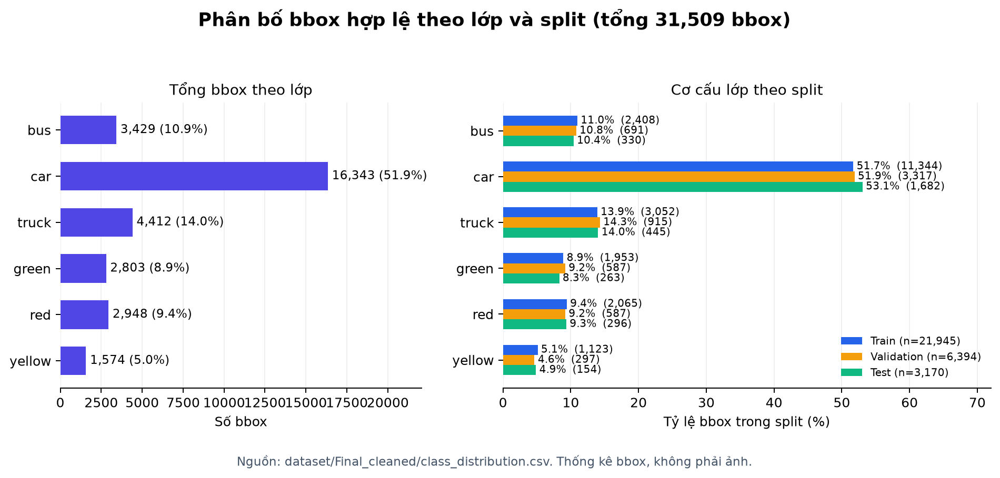

*Nguồn: `dataset/Final_cleaned/class_distribution.csv`; biểu đồ thể hiện số bbox, không phải số ảnh hay độ chính xác của mô hình.*

### 3.2.3. Gán nhãn dữ liệu

Sinh viên tự gán nhãn bằng Roboflow hơn 2.000 ảnh trong project `NhanDienGiaoThong`. Project `KLTN-vehicles` và các nguồn Bus, Truck, Traffic Light Detection được dùng theo nhãn có sẵn sau khi loại lớp ngoài phạm vi và chuẩn hóa class mapping theo tên. Bộ lớp thống nhất sau cùng gồm `bus`, `car`, `truck`, `green`, `red`, `yellow`. Nhãn detection YOLO mô tả class và bounding box; dữ liệu hiện có không chứa nhãn ID liên tục kiểu MOT hoặc nhãn frame vi phạm để đánh giá sự kiện.

**Bảng 3.6. Quy tắc lớp detection trong dataset**

| Nhãn | Đối tượng được gán | Ghi chú |
|---|---|---|
| `bus` | Xe buýt | Phương tiện |
| `car` | Ô tô con | Phương tiện |
| `truck` | Xe tải | Phương tiện |
| `green` | Tín hiệu đèn xanh | Trạng thái đèn |
| `red` | Tín hiệu đèn đỏ | Trạng thái đèn |
| `yellow` | Tín hiệu đèn vàng | Trạng thái đèn |

**Hình 3.3. Ví dụ nhãn bbox cho phương tiện và đèn tín hiệu**
*Cần bổ sung ảnh gán nhãn thực tế từ Roboflow; dữ liệu hiện không có CVAT/ID MOT để minh họa gán nhãn theo chuỗi.*

Không có hồ sơ về việc hai người gán độc lập, đo IoU giữa người gán hoặc quy trình phân xử bất đồng. Vì vậy không báo cáo độ đồng thuận gán nhãn; kiểm tra clean xác nhận cú pháp/tọa độ, không chứng minh tính đúng đắn ngữ nghĩa.

### 3.2.4. Chia tập dữ liệu

Các split Train/Valid/Test được giữ riêng trong các bước ghép dữ liệu; script lấy mẫu đèn xử lý từng split riêng, không chuyển ảnh qua lại. Tỷ lệ ảnh clean xấp xỉ 70%/20%/10%. Chưa xác minh được toàn bộ nguồn được chia theo clip/giao lộ, vì vậy không khẳng định độc lập theo camera hoặc không rò rỉ cảnh giữa các split.

Thống kê số ảnh và bbox từng split trình bày tại Bảng 3.4.

### 3.2.5. Tăng cường dữ liệu

Workspace có script `Code/04_preprocessing.py` để tạo bản ngoại tuyến `dataset/Final_preprocessed`, nhưng thư mục đầu ra này hiện chưa tồn tại và `args.yaml` của lần train trỏ tới export Roboflow `export-yolo26`; vì vậy không có bằng chứng script ngoại tuyến được dùng để tạo dữ liệu của lần train. Script dự kiến giữ nguyên validation/test và tạo tối đa năm biến thể cho mỗi ảnh train có ít nhất một lớp thuộc `{bus, truck, green, red, yellow}`: lật ngang với xác suất 0,5, xoay trong khoảng \(-15^\circ\) đến \(15^\circ\) với xác suất 0,7, rồi điều chỉnh độ sáng/tương phản. Bounding box được biến đổi theo ảnh và cắt về biên; cả các nhãn trong ảnh đủ điều kiện đều được giữ/biến đổi, kể cả `car` nếu ảnh đó có nhiều lớp. Seed ngoại tuyến là 42. Đây là mô tả khả năng của script, không phải số mẫu đã thực sự sinh.

README của export `DATADOANNEW` ghi auto-orientation và resize 640×640 kiểu Stretch, không áp dụng augmentation ngoại tuyến. Trong lần train, tăng cường trực tuyến do Ultralytics thực hiện theo `args.yaml`, gồm HSV, lật ngang, scale/translate và mosaic; mosaic có giá trị 1,0 và đóng ở 10 epoch cuối. Không diễn giải `mosaic=1,0` thành tỷ lệ ảnh cuối cùng đã tăng cường. Cần phân biệt resize Stretch trong dữ liệu train với letterbox/crop ROI dùng ở pipeline suy luận.

**Bảng 3.7. Các tham số tăng cường chính trong hồ sơ huấn luyện**

| Tham số | Giá trị |
|---|---:|
| HSV hue / saturation / value | 0,015 / 0,7 / 0,4 |
| Translate / scale | 0,1 / 0,5 |
| Horizontal flip (`fliplr`) | 0,5 |
| Mosaic | 1,0; đóng mosaic 10 epoch cuối |
| MixUp / CutMix | 0 / 0 |

**Hình 3.4. Minh họa tiền xử lý ảnh trong export train và pipeline suy luận**
*Cần bổ sung ảnh minh họa có nguồn: resize Stretch 640×640 theo README export; letterbox/crop ROI theo pipeline suy luận. Hai thao tác thuộc hai giai đoạn khác nhau, không dùng ảnh sơ đồ thay cho ảnh thực nghiệm.*

### 3.2.6. Định dạng và lưu trữ dữ liệu

Nhãn lưu theo định dạng YOLO detection gồm `class_id x_center y_center width height`, với tọa độ chuẩn hóa theo kích thước ảnh. Dữ liệu clean trên máy được lưu tại `[dataset Final_cleaned tr?n m?y hu?n luy?n]`; bản export train ở `[dataset export-yolo26 tr?n m?y hu?n luy?n]`.

Sau khi clean, dữ liệu được tải lên project Roboflow `DATADOANNEW` làm bản lưu/trung gian. README của bản export ghi định dạng YOLO26, 11.668 ảnh, auto-orientation, resize 640×640 kiểu Stretch và không augmentation. YAML export ghi:

```yaml
nc: 6
names:
  - bus
  - car
  - green
  - red
  - truck
  - yellow
```

Sau khi đưa bộ clean lên project Roboflow `DATADOANNEW` và tải phiên bản export về để train, thứ tự lớp trong YAML export khác với thứ tự trong `Final_cleaned/data.yaml`. Mapping theo **tên lớp** từ YAML trên máy sang YAML export dùng khi train là:

**Bảng 3.8. Mapping class ID từ YAML clean sang export train**

| Tên lớp | ID YAML gộp/clean trên máy | ID YAML export dùng train |
|---|---:|---:|
| bus | 0 | 0 |
| car | 1 | 1 |
| truck | 2 | 4 |
| green | 3 | 2 |
| red | 4 | 3 |
| yellow | 5 | 5 |

ID số của một lớp có thể khác giữa hai phiên bản mà không làm thay đổi ý nghĩa lớp, miễn là nhãn đã được export/remap nhất quán theo tên. Vì vậy, khi mô tả thao tác gộp/clean phải dùng thứ tự lớp trên máy như các bảng ở trên; khi mô tả huấn luyện phải nêu thứ tự của `export-yolo26/data.yaml`. Không được lấy ID số từ giai đoạn này gán thẳng cho giai đoạn kia nếu chưa đối chiếu tên. `train.py` kiểm tra thứ tự export đúng bằng danh sách `bus, car, green, red, truck, yellow`, và model trả tên lớp theo thứ tự export. Pipeline inference lấy tên từ checkpoint nên lớp `truck` vẫn được gọi theo tên dù ID đổi.

README của bản export `DATADOANNEW` ghi 11.668 ảnh; CSV clean ghi 11.672 cặp ảnh–nhãn (8.166 train, 2.335 valid và 1.171 test). Theo xác nhận của sinh viên, bốn cặp bị lỗi khi upload lên Roboflow. Số lượng export khớp với số clean sau khi trừ bốn cặp, nhưng chưa có log/tên file upload lỗi để đối chiếu định danh từng cặp.

## 3.3. Huấn luyện mô hình phát hiện

Lần huấn luyện được đối chiếu trong báo cáo sử dụng dataset export YOLO26 từ Roboflow, với sáu lớp theo đúng thứ tự trong YAML export ở Mục 3.2.6.

### 3.3.1. Môi trường phần cứng và phần mềm

Hồ sơ train xác nhận thiết bị `GPU 0`, đường dẫn dữ liệu, checkpoint khởi tạo và các tham số chạy. Không có bản ghi đủ tin cậy về model GPU cụ thể, VRAM, CPU, RAM, hệ điều hành hoặc phiên bản Python/PyTorch/CUDA của chính máy đã thực hiện lần train; cần lấy từ máy train hoặc log môi trường trước khi nộp.

**Bảng 3.9. Môi trường thực nghiệm có thể xác minh**

| Thành phần | Thông tin có căn cứ | Thông tin cần bổ sung |
|---|---|---|
| Thiết bị huấn luyện | GPU 0 theo `args.yaml` | Model GPU, VRAM |
| CPU/RAM | Chưa có trong hồ sơ train | Cấu hình máy thực tế |
| Hệ điều hành | Chưa có trong hồ sơ train | Phiên bản trên máy train |
| Python/PyTorch/CUDA | Có file requirements trong project | Xác nhận phiên bản thực chạy |
| Dữ liệu/model | `export-yolo26/data.yaml`, `yolo26s.pt` | Không cần bổ sung |

### 3.3.2. Siêu tham số huấn luyện

Hồ sơ `args.yaml` ghi training script dùng `export-yolo26/data.yaml`, với `train/images`, `valid/images`, `test/images`; split validation được dùng trong quá trình huấn luyện. Script tìm `data.yaml` theo thứ tự `export-yolo26`, `export-yolov11`, `export-yolov8`, còn hồ sơ lần chạy xác nhận lựa chọn `export-yolo26`.

**Bảng 3.10. Siêu tham số huấn luyện theo `args.yaml`**

| Tham số | Giá trị ghi trong hồ sơ |
|---|---|
| Mô hình khởi tạo | `yolo26s.pt` |
| Số epoch | 70 |
| Kích thước ảnh | 640 |
| Batch | 4 |
| Thiết bị train | GPU 0 |
| Optimizer | AdamW |
| Learning rate ban đầu (`lr0`) | 0,005 |
| Learning rate cuối (`lrf`) | 0,1 |
| Patience | 200 |
| Workers | 4 |
| Seed | 0; deterministic bật |
| Mosaic | 1,0 |
| Resume | False |
| Dữ liệu | `datasets/export-yolo26/data.yaml` |

Script `train.py` kiểm tra đúng class order trước khi train và thiết lập trọng số dương cho BCE theo lớp: bus 1,000; car 0,458; green 1,106; red 1,079; truck 0,881; yellow 1,476. Đây là trọng số loss, không phải hệ số confidence lúc suy luận. Việc sử dụng chúng trong báo cáo được mô tả theo mã train; nếu nộp bản cuối, nên kèm log train thể hiện dòng `[Custom BCE] pos_weight` để xác nhận đoạn monkeypatch đã được gọi trong lần chạy tạo checkpoint.

### 3.3.3. Kết quả validation

Từ `results.csv`, có 70 dòng kết quả tương ứng 70 epoch. Epoch 70 có mAP50–95 cao nhất trong file:

**Bảng 3.11. Kết quả detector tổng hợp tại epoch 70**

| Epoch | Precision | Recall | mAP50 | mAP50–95 |
|---:|---:|---:|---:|---:|
| 70 | 0,92017 | 0,84876 | 0,91845 | 0,68871 |

Đây là các số đo trên validation theo pipeline Ultralytics. Precision và Recall là chỉ số tổng hợp, không thể dùng để suy ra trực tiếp xác suất một sự kiện vượt đèn được xác nhận đúng. mAP50–95 thấp hơn mAP50 cho thấy điểm số giảm khi yêu cầu hộp dự đoán khớp chặt hơn ở các ngưỡng IoU cao hơn.

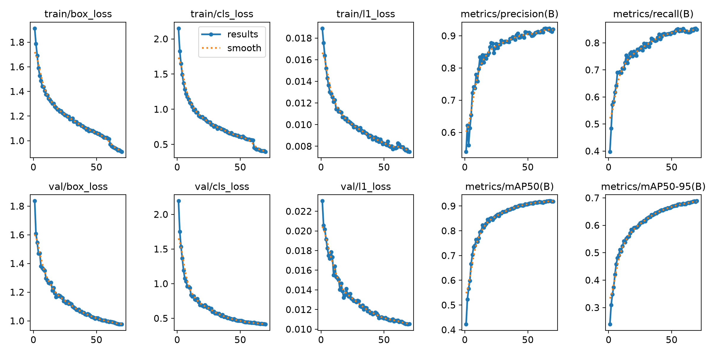

**Hình 3.5. Đường cong loss và các chỉ số validation theo epoch**
*Nguồn: `runs/do_an_tn/results.png` từ hồ sơ huấn luyện.*

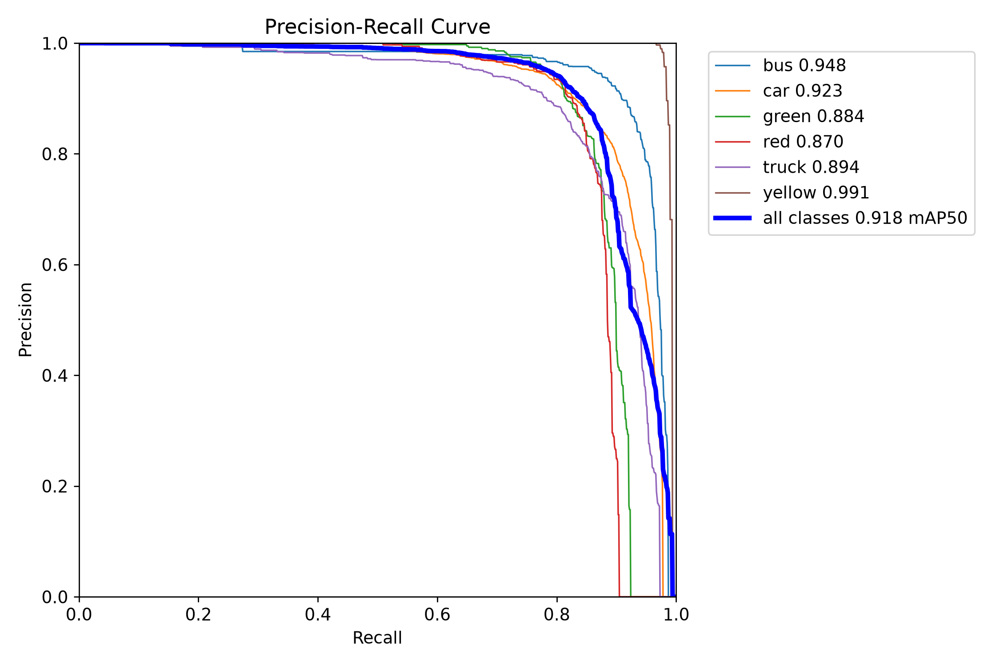

**Hình 3.6. Đường cong Precision–Recall của detector trên validation**
*Nguồn: `runs/do_an_tn/BoxPR_curve.png` từ hồ sơ huấn luyện.*

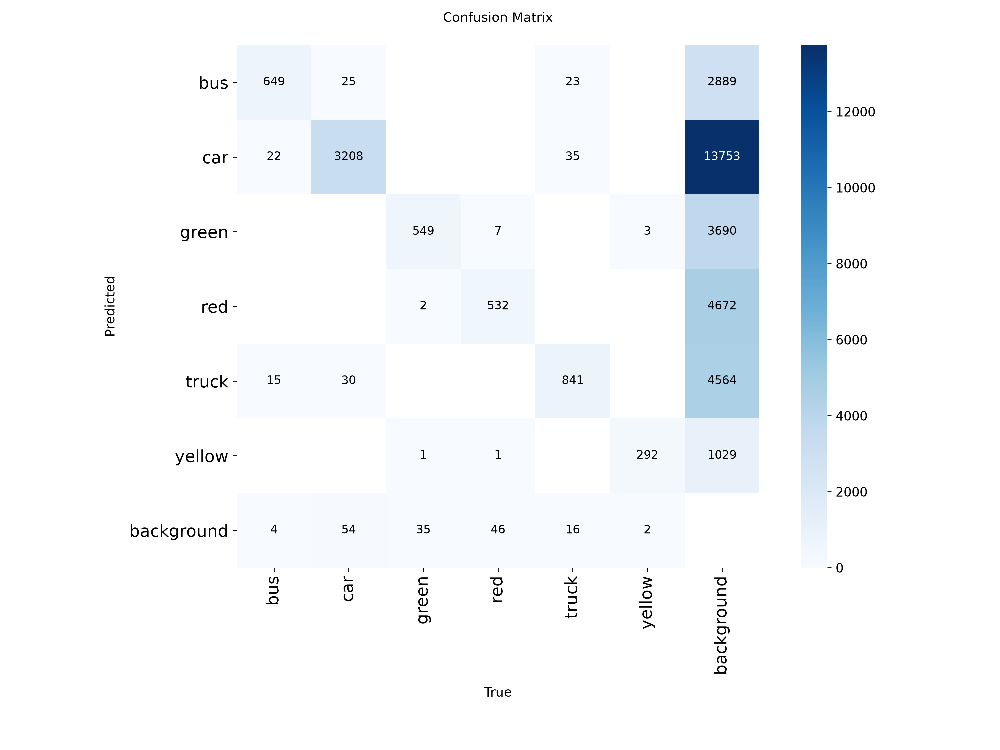

**Hình 3.7. Ma trận nhầm lẫn của detector trên validation**
*Nguồn: `runs/do_an_tn/confusion_matrix.png` từ hồ sơ huấn luyện.*

Chưa có bảng Precision/Recall/mAP tách riêng theo từng lớp trong bản ghi được đối chiếu; cần chạy hoặc khôi phục báo cáo validation per-class nếu muốn đưa bảng này vào bản nộp.

**Chưa có căn cứ để báo cáo mAP trên tập test:** hồ sơ hiện có xác nhận validation trong quá trình train, nhưng chưa tìm thấy báo cáo đánh giá độc lập trên split `test`. Không trình bày chỉ số validation như chỉ số test.

## 3.4. Cài đặt và tích hợp hệ thống

### 3.4.1. Cấu trúc mã nguồn

Các tệp chính:

**Bảng 3.12. Cấu trúc mã nguồn chính**

| Tệp/thư mục | Chức năng |
|---|---|
| `main.py` | Điểm vào ứng dụng CLI |
| `Code/05_roi_config.py` | GUI cấu hình đa giác xe, đa giác đèn và vạch |
| `Code/06_run_detection.py` | Pipeline suy luận, ByteTrack, đèn, giao cắt và ghi kết quả |
| `tracker/` | Triển khai ByteTrack tự cài, association, lifecycle, stitching và preset |
| `scripts/run_ablation.py` | Chạy tuần tự các preset A–F trên CPU và tổng hợp kết quả |
| `project_paths.py` | Các đường dẫn project dùng chung |
| `web_app.py` | API và giao diện web cục bộ |
| `web_worker.py` | Worker chạy model, tiến độ và mã hóa video kết quả |
| `web/` | HTML, CSS, JavaScript cho ứng dụng VIA |
| `config/roi_config.json` | ROI của video mẫu trên máy |
| `models/best.pt` | Checkpoint dùng mặc định trong project |
| `[dataset Final_cleaned tr?n m?y hu?n luy?n]\` | Dataset clean trên máy và báo cáo thống kê |

### 3.4.2. Cài đặt các module chính

Các module được phân vai trong Bảng 3.12. Pipeline inference dùng chung cho CLI và web; `web_app.py`/`web_worker.py` xử lý phiên web, còn `tracker/` cung cấp backend ByteTrack tự cài và các tùy chọn mở rộng.

CLI mặc định dùng `models/best.pt`, CPU, ByteTrack Ultralytics và `config/roi_config.json`; có thể chọn tracker tự cài bằng `--tracker bytetrack`. Giao diện web dùng `models/best.pt`, GPU CUDA 0 và mặc định là ByteTrack Ultralytics; có thể đổi tracker trong phần cấu hình riêng của job. Các tham số CLI gồm `--weights`, `--video`, `--config`, `--device`, `--imgsz`, `--light-conf`, `--vehicle-conf` và `--track-conf`. Nếu không chỉ định `--track-conf`, Ultralytics dùng giá trị nhỏ hơn giữa `light_conf` và `vehicle_conf`, còn tracker tự cài dùng 0,1. Ngưỡng `vehicle_conf` lọc bước xét quỹ đạo/sự kiện, không ẩn hộp track hợp lệ trong ROI.

### 3.4.3. Giao diện hệ thống

Giao diện web có luồng tải video, cấu hình ROI/vạch, lựa chọn các mục tùy chọn, tiến độ xử lý, xem đầu ra và rà soát sự kiện. CLI cho phép chạy pipeline theo tham số dòng lệnh và công cụ ROI riêng. Ảnh chụp giao diện cần bổ sung tại Hình 2.13.

## 3.5. Kiểm thử phần mềm

### 3.5.1. Kiểm thử đơn vị và kiểm thử chức năng

Trong mã nguồn có các kiểm thử đơn vị cho parser/cấu hình, detector, association, lifecycle, geometry, stitching, preset, API web, worker và các mục giao diện. Không có báo cáo tổng hợp kết quả chạy test được lưu cùng lần audit này; số lượng test pass phải được chạy lại trên môi trường chuẩn trước khi đưa vào báo cáo.

**Bảng 3.13. Phạm vi kiểm thử phần mềm**

| Nhóm | Nội dung kiểm thử | Kết quả cần ghi khi chạy lại |
|---|---|---|
| Pipeline detection | Lọc ROI/confidence, giao cắt, đầu ra | Cần chạy test suite |
| Tracker tự cài | Association, Kalman, lifecycle, stitching, preset | Cần chạy test suite |
| Web/API/worker | Lưu cấu hình, truyền tracker, tiến độ và job | Cần chạy test suite |
| UI | Bốn mục thu gọn độc lập và lựa chọn tracker | Cần chạy test suite |

### 3.5.2. Kiểm tra tính đúng đắn của bộ theo dõi

Phép kiểm tra baseline đã lưu trước đây báo cáo hai chế độ cho kết quả ghép ID/hộp tương đương trên một lần chạy Test 6 với confidence được cố định. Đây là kiểm tra tương đương giữa các triển khai, không phải xác nhận ID đúng theo ground truth. Chi tiết và hạn chế được nêu ở Mục 4.2.1.

## 3.6. Đóng góp của sinh viên

Phần sinh viên trực tiếp thực hiện theo thông tin và hiện vật của dự án:

1. Tìm kiếm và thu thập ảnh từ video CCTV giao thông và CCTV công khai; tự gán nhãn hơn hai nghìn ảnh giao thông bằng Roboflow.
2. Kết hợp dữ liệu NhanDienGiaoThong và KLTN-vehicles; loại lớp xe máy ngoài phạm vi, chuẩn hóa nhãn theo tên, rồi bổ sung Bus và Truck do số mẫu hai lớp này còn ít.
3. Chọn khoảng một nửa dữ liệu đèn theo split và phân bố class-combination, remap sang bộ sáu lớp.
4. Xây dựng và chạy bước kiểm tra nhãn YOLO, loại bỏ dòng sai định dạng, bỏ cặp không còn bbox hợp lệ, giữ các bbox nhỏ hợp lệ và xuất báo cáo thống kê.
5. Đưa dữ liệu đã xử lý lên project Roboflow `DATADOANNEW` làm nơi lưu trữ, tải export-yolo26 để huấn luyện; đối chiếu thứ tự lớp theo tên và điều chỉnh mã train để kiểm tra class order, thiết lập trọng số loss theo lớp.
6. Tích hợp checkpoint vào pipeline phát hiện, ROI, logic trạng thái đèn, giao cắt vạch và lưu bằng chứng; triển khai thêm baseline ByteTrack bằng NumPy/SciPy và công cụ đối chiếu hai tracker.
7. Xây dựng giao diện cục bộ để cấu hình, chọn tracker, theo dõi, xem và rà soát kết quả.

Phần kế thừa gồm kiến trúc và trọng số khởi tạo YOLO, API YOLO/ByteTrack của Ultralytics ở chế độ mặc định, thư viện OpenCV/PyTorch và các công cụ Roboflow. Module ByteTrack tự cài là phần triển khai lại thuật toán nền để học tập và đối chiếu; báo cáo không xem ByteTrack gốc là thuật toán do sinh viên tự phát minh.

**Bảng 3.14. Phân loại phần tự thiết kế, dùng lại có điều chỉnh và dùng nguyên**

| Hạng mục | Phân loại | Mô tả |
|---|---|---|
| Quy trình gộp/remap/clean dữ liệu | Tự xây dựng và điều chỉnh | Script theo nguồn, class map và quy tắc clean của dự án |
| Training script và mapping class | Dùng lại có điều chỉnh | Dựa trên Ultralytics, thêm kiểm tra class order và trọng số loss |
| Detector YOLO và weights khởi tạo | Dùng lại | Kiến trúc/pretrained model từ Ultralytics |
| ByteTrack baseline | Dùng lại | API tracking của Ultralytics |
| ByteTrack tự cài | Tự triển khai theo thuật toán đã công bố | Association, trạng thái và các tùy chọn mở rộng; không tuyên bố thuật toán nền là phát minh mới |
| Luật giao cắt, ROI và đầu ra sự kiện | Tự xây dựng cho pipeline | Cấu hình pixel theo camera và luật hình học |
| Giao diện VIA/web | Tự xây dựng trên thư viện nền | Quản lý job cục bộ, lựa chọn tracker và rà soát sự kiện |

---


# CHƯƠNG 4. THỰC NGHIỆM VÀ ĐÁNH GIÁ KẾT QUẢ

**Nhiệm vụ:** đánh giá detector, tracker và hệ thống theo video, nhãn chuẩn, tốc độ xử lý và các giới hạn đã xác định.

## 4.1. Thiết lập thực nghiệm

### 4.1.1. Bộ video thử nghiệm

Các lần chạy dưới đây là lượt xử lý phần mềm, không phải video có ground truth. Video mẫu có số liệu summary được lưu trong `Output/`; Test 6 có nhiều job lịch sử với ROI/ngưỡng khác nhau; smoke A–F chỉ xử lý 30 frame.

**Bảng 4.1. Bộ video và vai trò các lần chạy được lưu**

| Video/lượt chạy | Số frame | Thiết bị | Vai trò | Ground truth |
|---|---:|---|---|---|
| `samples/video.mp4` | 950 | GPU 0 | Kiểm tra đầu ra pipeline mẫu | Không có |
| `Test 6.mp4`, job ngày 03/11/2026 | 1.771 | GPU 0 | Kết quả lịch sử, checkpoint không còn | Không có |
| `Test 6.mp4`, job ngày 09/11/2026 | 1.771 | GPU 0 | Lượt web dùng `models/best.pt` | Không có |
| Smoke A–F | 30 mỗi preset | CPU | Kiểm tra pipeline có chạy hết | Không có |

### 4.1.2. Gán nhãn ground truth cấp sự kiện vi phạm

Hiện chưa có bộ ground truth cấp sự kiện hoặc tracking được lưu trong dự án; vì vậy không thể tính TP, FN, FP, precision/recall/F1 sự kiện hay HOTA/IDF1/MOTA. Để hoàn thiện thí nghiệm, cần gán nhãn độc lập trên từng video: mã video, thời điểm/frame bắt đầu và giao cắt, ID phương tiện, trạng thái đèn tại thời điểm giao cắt, kết quả sự kiện (vi phạm/không vi phạm/không xác định) và ghi chú trường hợp bị che khuất. Chia train/validation/test theo clip hoặc camera để tránh các khung gần nhau lọt vào nhiều tập. Hai người gán có thể được dùng để kiểm tra nhất quán; tỷ lệ đồng thuận chỉ được báo cáo sau khi thực sự đo và xử lý bất đồng.

**Tình trạng hiện tại:** các video trong Bảng 4.1 đều chưa có ground truth; nội dung trên là quy trình cần thực hiện, không phải kết quả đã đo.

### 4.1.3. Các chỉ số đánh giá

Detector có Precision, Recall, mAP50 và mAP50–95 trên validation như Bảng 3.11. Đánh giá tracking cần HOTA, IDF1, MOTA, IDSW và nhãn ID theo frame; đánh giá vi phạm cần phân loại sự kiện đúng, bỏ sót, báo giả và trùng. Các nhãn ground truth tương ứng chưa có trong dự án nên những chỉ số này chưa thể tính. FPS là tốc độ xử lý của từng lần chạy, không phải thước đo độ chính xác.

**Bảng 4.2. Chỉ số có thể báo cáo và tình trạng dữ liệu**

| Cấp đánh giá | Chỉ số | Tình trạng |
|---|---|---|
| Detector | Precision, Recall, mAP50, mAP50–95 | Có trên validation; chưa có báo cáo test độc lập |
| Tracking | HOTA, IDF1, MOTA, IDSW | Chưa tính; thiếu ground truth MOT |
| Sự kiện | TP, FN, FP, trùng, precision, recall | Chưa tính; thiếu nhãn sự kiện chuẩn |
| Tốc độ | FPS, thời gian xử lý, số frame | Có cho một số job; phải gắn với cấu hình cụ thể |

`Output/summary.json` và `Output/RUN_REPORT.md` lưu kết quả chạy trên video mẫu:

**Bảng 4.3. Kết quả lần chạy video mẫu**

| Chỉ số | Giá trị ghi nhận |
|---|---:|
| Độ phân giải | 2568 × 1440 |
| FPS nguồn | 30 |
| Tổng frame / đã xử lý | 950 / 950 |
| Thời lượng video | 31,67 giây |
| Thiết bị | GPU 0 |
| Thời gian xử lý | 82,69 giây |
| Tốc độ trung bình | 11,49 FPS |
| ID phương tiện duy nhất | 7 |
| Frame phát hiện đỏ / xanh / vàng | 646 / 303 / 0 |
| Trạng thái đỏ / xanh / unknown | 647 / 301 / 2 |
| Sự kiện được ghi nhận | 0 |

Lệnh tái tạo lần chạy theo báo cáo hiện có:

```powershell
.\.venv\Scripts\python.exe -X utf8 .\main.py `
  --weights .\models\best.pt `
  --video .\samples\video.mp4 `
  --config .\config\roi_config.json `
  --output .\Output `
  --device 0 --headless
```

Kết quả không có sự kiện không chứng minh video không có vi phạm; cần có nhãn chuẩn độc lập và kiểm tra ảnh/video để kết luận. Video này cũng không phải `Test 6.mp4`.

#### Lượt chạy Test 6 và khả năng tái lập

Trong `.webdata/jobs/` có một job Test 6 hoàn tất ngày 03/11/2026, ghi đủ 1.771 frame, 19 track, ba sự kiện tại các frame 233, 316 và 1333, tốc độ 13,25 FPS. `summary.json` của job này trỏ đến checkpoint `[checkpoint c? tr?n m?y]`, hiện không còn; job không lưu hash checkpoint, backend tracker hay `track_conf` thực tế. Vì vậy đây chỉ là số liệu lịch sử, không được xem là lần chạy có thể tái lập bằng checkpoint hiện tại.

Một job web được lưu ngày 09/11/2026 dùng `models/best.pt`, ByteTrack Ultralytics, `track_conf=0,25`, xử lý 1.771/1.771 frame ở 10,95 FPS, ghi nhận 19 track và ba sự kiện tại các frame 227, 311, 1333. Đây là kết quả mô tả một lần chạy, không có ground truth để xác nhận sự kiện đúng hay sai. Các job Test 6 khác trong kho có kết quả khác (có job ghi 28 track hoặc bốn sự kiện) và dùng cấu hình ROI/ngưỡng khác nhau; không thể xem chênh lệch đó là bằng chứng cải thiện của model hay tracker.

Trong các lần phân tích khác, ROI đèn thay đổi giữa các job; số frame `unknown` vì thế khác nhau đáng kể. Để đánh giá hợp lệ, phải cố định video, checkpoint, config ROI, confidence, thiết bị và phiên bản code. Không so sánh số sự kiện giữa các lần chạy nếu một trong các điều kiện này thay đổi.

### 4.2.1. So sánh các thuật toán theo dõi

Ở phép so sánh baseline được lưu từ giai đoạn trước, hai chế độ chạy cùng `Test 6.mp4` (1.771 frame), GPU 0, cấu hình ROI và `--track-conf 0.1`. Kết quả được ghi trong báo cáo cũ như sau; job không lưu hash checkpoint, vì vậy đây là số liệu lịch sử. Số ID ghép khớp qua các frame không thay cho ground truth.

**Bảng 4.4. Kết quả so sánh baseline hai tracker trong một lần chạy lịch sử**

| Chỉ số | Ultralytics | ByteTrack tự cài |
|---|---:|---:|
| ID đủ điều kiện xét sự kiện | 19 | 19 |
| Số sự kiện ứng viên | 3 | 3 |
| Frame sự kiện được ghi trong phép so sánh | 233, 329, 1333 | 233, 329, 1333 |
| ID MOT duy nhất | 28 | 28 |
| Frame có ghép hộp cùng ID, IoU > 0,5 | 1.771/1.771 | 1.771/1.771 |
| FPS ghi nhận | 22,79 | 12,04 |

Đây là phép kiểm tra tính tương đương giữa hai triển khai theo một lần chạy; không tính IDF1/MOTA/HOTA và không chứng minh ID chính xác ngoài video thử. Tracker tự cài chậm hơn API trong phép đo được ghi nhận.

### 4.2.2. Thiết kế ablation (cấu hình A–F) và kết quả

Cấu hình chi tiết A–F được nêu tại Bảng 2.5; trong chuỗi preset, NSA Kalman được giữ tắt. Lượt smoke hiện có chỉ chạy tối đa 30 frame trên CPU, do đó chưa phải ablation đánh giá chất lượng.

**Bảng 4.5. Kết quả smoke A–F trên 30 frame CPU**

| Preset | Frame | ID duy nhất | Sự kiện | FPS CPU |
|---|---:|---:|---:|---:|
| A | 30 | 4 | 0 | 2,60 |
| B | 30 | 4 | 0 | 2,65 |
| C | 30 | 4 | 0 | 2,59 |
| D | 30 | 4 | 0 | 2,67 |
| E | 30 | 4 | 0 | 2,63 |
| F | 30 | 4 | 0 | 2,63 |

Cấu hình thử không có `QUEUE_ZONE_POLYGON`; E/F phát cảnh báo và không kiểm tra được phần kéo dài vòng đời track theo vùng chờ. Kết quả chỉ xác nhận các preset chạy hết số frame đã đặt; không chứng minh preset nào có chất lượng tốt hơn.

**Hình 4.1. Biểu đồ cột so sánh A–F**
*Chỉ vẽ sau khi có full run với video, config và thiết bị cố định; smoke 30 frame không nên trình bày như so sánh chất lượng.*

### 4.3.1. Kết quả tổng thể cấp sự kiện vi phạm

Các con số dưới đây là số sự kiện AI sinh ra, không phải số vi phạm đúng. Không có nhãn chuẩn để phân loại sự kiện đúng, bỏ sót, báo giả hoặc trùng.

**Bảng 4.6. Số sự kiện AI ghi nhận và giới hạn xác minh**

| Lượt chạy | Sự kiện AI | Số đúng | Số bỏ sót | Số báo giả/trùng |
|---|---:|---|---|---|
| Video mẫu 950 frame | 0 | Chưa xác minh | Chưa xác minh | Chưa xác minh |
| Test 6 job web 09/11/2026 | 3 | Chưa xác minh | Chưa xác minh | Chưa xác minh |
| Test 6 job lịch sử 03/11/2026 | 3 | Chưa xác minh | Chưa xác minh | Chưa xác minh |

### 4.3.2. Kết quả theo từng điều kiện

Chưa có nhãn chuẩn và metadata đủ để phân nhóm kết quả theo ngày/đêm, mật độ xe hoặc góc quay. Không thể suy ra tỷ lệ đúng theo điều kiện chỉ từ số sự kiện do hệ thống sinh ra. Trước khi báo cáo mục này, cần gán nhãn ground truth, cố định checkpoint/ROI/ngưỡng và ghi điều kiện cho từng clip; nếu không có clip thuộc một nhóm thì ghi rõ “chưa có dữ liệu”, không ngoại suy.

- Ngày/đêm: chưa có thống kê theo clip và nhãn sự kiện.
- Mật độ phương tiện: chưa có ngưỡng phân nhóm hoặc số liệu đối chiếu.
- Góc quay/giao lộ: chưa có metadata chuẩn hóa để so sánh.

### 4.3.3. Phân tích độ nhạy tham số

Chưa có sweep tham số trên tập validation có ground truth. Các ngưỡng hiện dùng là giá trị mặc định hoặc giá trị khởi đầu; không gọi chúng là tối ưu.

**Bảng 4.7. Các tham số cần khảo sát và trạng thái thí nghiệm**

| Tham số | Giá trị mặc định/khởi đầu | Kết quả quét |
|---|---:|---|
| `biou_b1`, `biou_b2` | 1,2; 1,1 | Chưa thực hiện |
| `max_age_red` | 120 frame | Chưa thực hiện |
| `green_grace_frames` | 30 frame | Chưa thực hiện |
| `stitch_distance_threshold` | 80 px | Chưa thực hiện |
| `stitch_histogram_threshold` | 0,55 | Chưa thực hiện |
| `stitch_score_threshold` | 0,65 | Chưa thực hiện |

**Hình 4.2. Độ nhạy theo BIoU, max_age_red và ngưỡng stitch**
*Chỉ bổ sung sau khi chạy sweep với validation có ground truth; hiện chưa có dữ liệu để vẽ.*

### 4.3.4. Hình ảnh minh họa kết quả

**Hình 4.3. Sự kiện điển hình: khung toàn cảnh và ảnh crop phương tiện**
*Cần lấy từ job Test 6 đã chọn, kiểm tra lại frame/sự kiện và làm mờ biển số trước khi đưa vào báo cáo.*

**Hình 4.4. Quỹ đạo một track qua vạch, có chú thích ID và trạng thái đèn**
*Cần dựng từ `tracks.txt` và video đầu ra; chưa có hình quỹ đạo đã lưu.*

**Hình 4.5. Ví dụ nối track đúng và tình huống nối nhầm (nếu có)**
*Chưa có trường hợp nối thực tế thỏa ngưỡng trong video Test 6; không tạo hình minh họa như thể là kết quả đã quan sát.*

Mã nguồn hiện không ghi tệp `stitches.csv`; thông tin nối track được ghi log khi có thao tác nối. Do đó chưa thể lập bảng nhật ký nối từ `stitches.csv` như đề cương gợi ý; cần bổ sung xuất log có cấu trúc nếu nội dung này là yêu cầu nghiệm thu.


## 4.4. Tốc độ xử lý và khả năng triển khai

**Bảng 4.8. FPS của các lượt chạy đã lưu**

| Lượt chạy | Thiết bị | FPS | Ghi chú |
|---|---|---:|---|
| Video mẫu, 950 frame | GPU 0 | 11,49 | Pipeline project hiện hành |
| Test 6 job web 09/11/2026 | GPU 0 | 10,95 | 1.771 frame, Ultralytics |
| Baseline Ultralytics | GPU 0 | 22,79 | Phép so sánh lịch sử; cấu hình không lưu hash |
| ByteTrack tự cài | GPU 0 | 12,04 | Cùng lượt so sánh lịch sử |
| Smoke A–F | CPU | 2,59–2,67 | 30 frame/preset |

Các số FPS không nên so sánh trực tiếp nếu khác phiên bản mã, ROI, ngưỡng, checkpoint, cấu hình máy hoặc kích thước đầu vào. Ứng dụng web chạy cục bộ và yêu cầu CUDA; CLI có thể dùng CPU. Chưa có kiểm thử triển khai nhiều camera hoặc đo tải đồng thời.

## 4.5. Phân tích lỗi và thảo luận

### 4.5.1. Phân loại các trường hợp lỗi

**Bảng 4.9. Nhóm lỗi/rủi ro và tình trạng thống kê**

| Nhóm nguyên nhân | Biểu hiện có thể gặp | Bằng chứng hiện có | Thống kê lỗi |
|---|---|---|---|
| Detector/đèn | Mất detection đèn, nhầm màu do ROI/ánh sáng | Có frame `unknown` trong summary một số job | Chưa gán nhãn chuẩn |
| Tracking | Mất ID/đổi ID khi che khuất | Có module lifecycle/stitching; chưa có GT MOT | Chưa định lượng |
| Cấu hình hình học | ROI/vạch/hướng không khớp góc camera | Config được vẽ riêng theo video | Chưa tổng hợp lỗi theo clip |
| Quyết định sự kiện | Bỏ sót/báo giả/trùng | Có sự kiện AI trong summary | Chưa phân loại vì thiếu GT |

**Hình 4.6. Ca thất bại điển hình: che khuất, mất track hoặc nhận sai đèn**
*Cần trích frame có lỗi đã được người rà soát xác nhận; không có bộ ảnh lỗi đã gán nhãn trong hồ sơ hiện tại.*


### 4.5.2. Ưu điểm và nhược điểm

#### Ưu điểm

- Có quy trình xử lý dữ liệu tái hiện được bằng script, có mapping class rõ và log clean.
- Lớp đèn nhỏ được giữ lại nếu nhãn hợp lệ; các hộp rất nhỏ chỉ cảnh báo thay vì xóa theo diện tích.
- Detector, tracker, trạng thái đèn, ROI và luật giao cắt được tách thành các bước có thể kiểm tra.
- ROI được lưu theo độ phân giải gốc, giúp video đầu ra thể hiện trực quan cấu hình.
- Web lưu riêng từng job, có tiến độ, đầu ra video và quy trình rà soát sự kiện.
- Web cho phép chọn riêng tracker Ultralytics hoặc tracker tự cài; bốn nhóm cấu hình hướng, điểm đại diện, tracker và confidence có thể mở/đóng độc lập.

#### Hạn chế

- Dữ liệu thu thập từ nhiều nguồn có khác biệt về góc camera, độ phân giải, ánh sáng, chất lượng nén và quy tắc nhãn; làm sạch cú pháp không thay được kiểm duyệt ngữ nghĩa.
- Lớp car chiếm tỷ lệ bbox cao hơn rõ rệt; lớp yellow ít hơn. Trọng số loss giảm phần nào ảnh hưởng mất cân bằng nhưng không thay thế việc bổ sung dữ liệu khó và đánh giá per-class.
- Ở giai đoạn Roboflow, thứ tự lớp khác YAML clean trên máy; nếu không đối chiếu theo tên, sai ID có thể làm hỏng huấn luyện/inference. Training script hiện kiểm tra export order, nhưng bản báo cáo và quy trình phát hành dataset cần lưu mapping và version.
- Đèn nhỏ, ROI lệch, crop quá chặt hoặc ánh sáng thay đổi có thể làm detector không trả tín hiệu; sau hai giây mất detection, trạng thái chủ động chuyển sang `unknown`.
- Cả hai tracker kế thừa giới hạn của detector và có thể đổi ID khi che khuất hoặc xe đi gần nhau. Module tự cài có các tùy chọn biou, directional gating và NSA Kalman nhưng chưa có ground truth MOT để kết luận chúng cải thiện độ chính xác. Phép so sánh Test 6 hiện chỉ kiểm tra baseline với các cờ tắt và chứng minh hai triển khai cho kết quả trùng trong điều kiện chạy đã cố định; điều này không chứng minh chất lượng tổng quát. FPS bản tự cài còn thấp hơn API trong lần đo này.
- Kết quả smoke A–F chỉ chạy 30 frame trên CPU; các cải tiến ablation chưa được đánh giá trên tập video dài có ground truth. Giao diện web cho chọn hai backend tracker nhưng chưa bật các cờ cải tiến ablation của tracker tự cài.
- Nối track được kiểm thử bằng chuỗi giả và đã chạy trên toàn Test 6, nhưng lần chạy video không tạo trường hợp ghép lại thỏa các ngưỡng hiện tại. ROI lưu cho Test 6 cũng chưa có `QUEUE_ZONE_POLYGON`, nên vòng đời theo tín hiệu mới được kiểm tra bằng chuỗi giả. Cần cấu hình vùng/histogram phù hợp và đánh giá trên tập MOT/vi phạm có ground truth trước khi kết luận cải thiện.
- Điểm kiểm tra mặc định là tâm hộp; có thể chọn tâm cạnh dưới để gần điểm tiếp xúc mặt đường hơn, nhưng điểm này vẫn chỉ là xấp xỉ và có thể chưa phản ánh chính xác vị trí bánh trước.
- Luật giao cắt phụ thuộc vào hai đầu vạch và hướng cấu hình bằng tay. Camera rung, thay đổi khung hoặc vạch bị che có thể làm sai kết quả.
- Chưa có số liệu test mAP độc lập và bộ ground truth vi phạm; do đó chưa thể tuyên bố hệ thống đạt một tỷ lệ chính xác cụ thể.

### 4.5.3. Khả năng ứng dụng thực tế, quyền riêng tư và đạo đức dữ liệu

Hệ thống phù hợp vai trò công cụ hỗ trợ tìm đoạn video để con người rà soát trong điều kiện camera cố định, ROI và vạch được thiết lập thủ công. Chưa đủ căn cứ để triển khai như hệ thống tự động ra quyết định hoặc xử phạt.

Video giao thông có thể chứa biển số và thông tin nhận dạng cá nhân. Khi đưa hình vào báo cáo hoặc chia sẻ kết quả, cần chỉ sử dụng dữ liệu có quyền khai thác, làm mờ biển số/người không liên quan, giới hạn quyền truy cập vào video và thư mục job, đồng thời quy định thời hạn lưu/xóa dữ liệu theo yêu cầu của đơn vị quản lý. Hệ thống hiện không nhận dạng biển số; sự kiện do AI đề xuất phải được người có thẩm quyền kiểm tra độc lập.

# KẾT LUẬN VÀ HƯỚNG PHÁT TRIỂN

## 1. Kết quả đạt được

Đồ án đã xây dựng được pipeline phân tích video giao thông gồm phát hiện xe/đèn, theo dõi ID xe bằng ByteTrack tích hợp hoặc module ByteTrack tự cài, cấu hình ROI, kiểm tra giao cắt vạch và lưu bằng chứng. Giao diện web hiện cho phép chọn backend tracker và lưu lựa chọn theo job; các cải tiến association/lifecycle/stitching nâng cao vẫn chỉ cấu hình qua CLI. Trên Test 6, phép so sánh baseline ghi nhận hai tracker cho cùng 19 ID đủ điều kiện, cùng ba frame sự kiện và cùng kết quả ghép ID/hộp khi dùng chung confidence; đây là kết quả trong một cấu hình thử, không phải đánh giá theo ground truth. Bộ dữ liệu sáu lớp được gộp theo YAML trên máy, kiểm tra annotation YOLO và tạo báo cáo clean. Bộ clean có 11.672 ảnh gắn nhãn với 31.509 bbox hợp lệ; sau đó dữ liệu được lưu trên Roboflow và export lại để train với class order của export.

Checkpoint được huấn luyện 70 epoch. Hồ sơ validation ghi Precision 0,92017, Recall 0,84876, mAP50 0,91845 và mAP50–95 0,68871 ở epoch 70. Lần chạy video mẫu đã xử lý 950/950 frame ở 11,49 FPS trên GPU 0, ghi nhận 7 ID và không ghi nhận vi phạm. Đây là đầu ra của một lần suy luận, không thay thế đánh giá bằng nhãn chuẩn.

**Bảng K.1. Việc đã hoàn thành và nội dung chưa hoàn thành**

| Hạng mục | Trạng thái |
|---|---|
| Gộp/remap/clean dataset sáu lớp | Hoàn thành theo báo cáo clean hiện có |
| Huấn luyện detector và validation | Hoàn thành; chưa có đánh giá test độc lập |
| Pipeline CLI/web, ROI và event output | Đã triển khai |
| Tracker tự cài và preset A–F | Đã triển khai; smoke 30 frame, chưa đánh giá MOT ground truth |
| Bộ ground truth sự kiện/tracking | Chưa có |
| Quét độ nhạy tham số và thống kê lỗi | Chưa thực hiện |
| Đối chiếu hiệu lực pháp luật, biểu mẫu và hình minh họa | Cần hoàn thiện trước khi nộp |

## 2. Hạn chế

Các hạn chế chính là chưa có tập ground truth cho sự kiện vi phạm và MOT, chất lượng nhận diện đèn còn nhạy với ROI/crop, class order khác giữa YAML clean và export, phân bố lớp chưa cân bằng, tracker có thể đổi ID, và tọa độ tâm hộp chưa phản ánh điểm tiếp xúc của xe với mặt đường. Cấu hình ROI được vẽ thủ công, nên cần được kiểm tra trên toàn video trước khi chạy chính thức.

## 3. Hướng phát triển

1. Khóa version dữ liệu và checkpoint; lưu mapping class ID xuyên suốt từ nguồn, clean, Roboflow export đến model.
2. Thiết lập tập test độc lập và ground truth theo frame cho trạng thái đèn, bbox/ID xe và sự kiện giao cắt.
3. Tăng dữ liệu đèn đỏ/yellow ở điều kiện khó; rà soát nhãn có box nhỏ, box trùng, ảnh nén và trường hợp đèn bị che.
4. Thử so sánh phát hiện đèn trên full-frame và crop ROI với cùng checkpoint/cùng video/cùng config; chọn cách ổn định dựa trên kết quả đo, không dựa vào một vài frame.
5. Xem xét điểm tham chiếu bottom-center hoặc vùng bánh trước, nhưng chỉ thay đổi sau khi định nghĩa nhãn chuẩn và kiểm thử trên video.
6. Đánh giá tracker bằng IDF1/MOTA và ground truth; lưu các lần đổi ID, mất track và lỗi nối đối tượng.
7. Mở rộng lớp xe máy, nhận dạng biển số hoặc triển khai Jetson/TensorRT khi có dữ liệu, yêu cầu pháp lý và thiết bị phù hợp.
8. Cải thiện quy trình rà soát người dùng; các sự kiện AI cần được con người xác nhận trước khi dùng trong bất kỳ quy trình nghiệp vụ nhạy cảm nào.

---

# TÀI LIỆU THAM KHẢO

> Cần đối chiếu năm, phiên bản và mẫu trích dẫn theo Phụ lục tài liệu tham khảo của Khoa trước khi nộp.

[1] G. Jocher, A. Chaurasia, and J. Qiu, “Ultralytics YOLO,” tài liệu và mã nguồn Ultralytics, https://docs.ultralytics.com/, truy cập ngày 09/11/2026.

[2] Y. Zhang, P. Sun, Y. Jiang, D. Yu, F. Weng, Z. Yuan, P. Luo, W. Liu, and X. Wang, “ByteTrack: Multi-Object Tracking by Associating Every Detection Box,” in *European Conference on Computer Vision (ECCV)*, 2022.

[3] A. Bewley, Z. Ge, L. Ott, F. Ramos, and B. Upcroft, “Simple Online and Realtime Tracking,” in *2016 IEEE International Conference on Image Processing (ICIP)*, 2016.

[4] R. E. Kalman, “A New Approach to Linear Filtering and Prediction Problems,” *Journal of Basic Engineering*, vol. 82, no. 1, pp. 35–45, 1960.

[5] H. W. Kuhn, “The Hungarian Method for the Assignment Problem,” *Naval Research Logistics Quarterly*, vol. 2, pp. 83–97, 1955.

[6] OpenCV, “OpenCV Documentation,” https://docs.opencv.org/, truy cập ngày 09/11/2026.

[7] Roboflow, “Roboflow Documentation: Datasets, Annotation, and Export Formats,” https://docs.roboflow.com/, truy cập ngày 09/11/2026.

[8] Python Software Foundation, “Python Documentation,” https://docs.python.org/3/, truy cập ngày 09/11/2026.

[9] Quốc hội nước Cộng hòa xã hội chủ nghĩa Việt Nam, *Luật Trật tự, an toàn giao thông đường bộ số 36/2024/QH15*, 2024. Cần kiểm tra hiệu lực và quy định áp dụng tại thời điểm hoàn thiện báo cáo.

[10] Chính phủ nước Cộng hòa xã hội chủ nghĩa Việt Nam, *Nghị định số 168/2024/NĐ-CP quy định xử phạt vi phạm hành chính về trật tự, an toàn giao thông trong lĩnh vực giao thông đường bộ*, 2024. Cần kiểm tra văn bản sửa đổi/thay thế và cách viện dẫn theo yêu cầu của giảng viên.

---

# PHỤ LỤC

## PHỤ LỤC A. MÃ NGUỒN CHÍNH VÀ LỆNH CHẠY

### A.1. Các module mã nguồn chính

| Tệp/thư mục | Phần mã nguồn nên trích hoặc tham chiếu |
|---|---|
| `Code/06_run_detection.py` | Pipeline detector, tracking, trạng thái đèn, giao cắt, summary/CSV |
| `tracker/` | Kalman, association, trạng thái track, lifecycle, stitching và preset |
| `scripts/run_ablation.py` | Điều phối chạy A–F và lưu kết quả từng preset |
| `web_app.py`, `web_worker.py` | API, job, worker và luồng tiến độ của web |
| `Code/05_roi_config.py` | Công cụ cấu hình ROI/vạch trên frame |
| `[th? m?c x? l? d? li?u c?c b?]\01_merge_truck_bus_into_nhandien.py` | Ghép nguồn bus/truck vào bộ dữ liệu phương tiện và chuẩn hóa class ID |
| `[th? m?c x? l? d? li?u c?c b?]\02_merge_with_traffic_light.py` | Lấy mẫu dữ liệu đèn, ghép thành bộ sáu lớp và remap nhãn |
| `[th? m?c x? l? d? li?u c?c b?]\03_data_cleaning.py` | Kiểm tra và làm sạch nhãn YOLO, xuất báo cáo clean |

Không chép toàn bộ source code vào nội dung chính; lựa chọn các đoạn tiêu biểu, ghi rõ tên tệp, phiên bản và vị trí trong phụ lục theo yêu cầu của Khoa.

### A.2. Các đường dẫn quan trọng

- Dữ liệu clean tại máy: `[dataset Final_cleaned tr?n m?y hu?n luy?n]\`
- YAML clean tại máy: `[dataset Final_cleaned tr?n m?y hu?n luy?n]\data.yaml`
- Thư mục xử lý và script ghép/clean: `[th? m?c x? l? d? li?u c?c b?]\` (`01_merge_truck_bus_into_nhandien.py`, `02_merge_with_traffic_light.py`, `03_data_cleaning.py`)
- Project Roboflow lưu dataset sau clean: `DATADOANNEW`
- Dataset Roboflow export dùng train: `[dataset export-yolo26 tr?n m?y hu?n luy?n]\`
- YAML train: `[dataset export-yolo26 tr?n m?y hu?n luy?n]\data.yaml`
- Hồ sơ train: `[th? m?c x? l? d? li?u c?c b?]\Train\runs\do_an_tn\args.yaml`
- Kết quả theo epoch: `[th? m?c x? l? d? li?u c?c b?]\Train\runs\do_an_tn\results.csv`
- Checkpoint train: `[th? m?c x? l? d? li?u c?c b?]\Train\runs\do_an_tn\weights\best.pt`
- Checkpoint project: `models/best.pt`

### A.3. Chạy CLI

```powershell
.\.venv\Scripts\python.exe main.py `
  --weights .\models\best.pt `
  --video .\samples\video.mp4 `
  --config .\config\roi_config.json `
  --output .\Output\run_01 `
  --device 0 --headless
```

Với video mới, tạo config riêng từ video đó:

```powershell
.\.venv\Scripts\python.exe Code\05_roi_config.py `
  --video ".\test_videos\Test 6.mp4" `
  --output .\config\Test_6.json
```

Sau đó dùng đúng config:

```powershell
.\.venv\Scripts\python.exe main.py `
  --weights .\models\best.pt `
  --video ".\test_videos\Test 6.mp4" `
  --config .\config\Test_6.json `
  --output .\Output\Test_6 `
  --device 0 --headless
```

### A.4. Thông tin cần bổ sung trước khi nộp

- Họ tên, mã sinh viên, lớp và giảng viên hướng dẫn.
- Phiếu giao nhiệm vụ, kế hoạch, theo dõi tiến độ và chữ ký theo yêu cầu Khoa.
- Ảnh chụp môi trường phần cứng thực tế dùng train (CPU/GPU/RAM) và phiên bản Python/PyTorch/CUDA; chỉ điền khi kiểm tra được từ máy train.
- Hình ảnh pipeline, giao diện ROI, video gắn nhãn, ví dụ đúng/sai và confusion matrix.
- Kết quả đánh giá trên tập test; kết quả gán nhãn chuẩn và rà soát sự kiện video.
- Xác nhận với giảng viên về trích dẫn pháp lý, tên đề tài và quy định trình bày hiện hành.

## PHỤ LỤC B. CẤU HÌNH HUẤN LUYỆN VÀ ROI MẪU

Hồ sơ đầy đủ `args.yaml` và YAML dataset nằm trong thư mục Train nêu tại Phụ lục A. Các siêu tham số chính được tóm tắt tại Bảng 3.10; trích kèm `args.yaml` nguyên gốc khi đóng gói báo cáo cuối.

ROI mẫu chỉ phù hợp với `samples/video.mp4` có kích thước 2568×1440; không áp dụng trực tiếp cho camera khác:

```json
{
  "FRAME_SIZE": [2568, 1440],
  "VEHICLE_DETECT_ROI_POLYGON": [[850, 100], [1570, 100], [2000, 450], [2550, 1240], [2567, 1439], [150, 1439], [450, 700]],
  "RED_LIGHT_DETECT_ROI_POLYGON": [[2440, 55], [2567, 55], [2567, 365], [2440, 365]],
  "STOP_LINE_COORDS": [150, 1245, 2550, 1305],
  "CROSSING_DIRECTION": "up",
  "GROUND_POINT_MODE": "center",
  "STITCH_MARGIN": 40,
  "VIOLATION_THRESHOLD": 20,
  "NOTE": "Sample configuration for samples/video.mp4 at 2568x1440. Reconfigure for another camera. Vehicles already beyond the line at the start are not counted."
}
```

## PHỤ LỤC C. BẢNG KẾT QUẢ CHI TIẾT TỪ CÁC JOB ĐÃ LƯU

Các số liệu sau lấy từ summary và metrics đã lưu trong workspace. Checkpoint, ROI, confidence hoặc phiên bản code giữa các job có thể khác; bảng chỉ là kiểm kê đầu ra, không phải so sánh công bằng và không có nhãn chuẩn để đánh giá đúng/sai.

**Bảng C.1. Tóm tắt các lượt chạy đã được đối chiếu trong báo cáo**

| Video/job | Frame | FPS | ID/track được báo cáo | Sự kiện AI | Trạng thái |
|---|---:|---:|---:|---:|---|
| `samples/video.mp4` | 950 | 11,49 | 7 | 0 | Summary project hiện hành |
| Test 6, 03/11/2026 | 1.771 | 13,25 | 19 | 3 | Checkpoint đường dẫn cũ không còn |
| Test 6, web 09/11/2026 | 1.771 | 10,95 | 19 | 3 | Ultralytics, `track_conf=0,25` |

Các kết quả chi tiết của smoke A–F nằm ở Bảng 4.5 (30 frame cho mỗi preset). Các sự kiện trong bảng này là đầu ra AI, không phải số vi phạm đã được xác nhận.

## PHỤ LỤC D. HÌNH ẢNH BỔ SUNG

Các hình huấn luyện được lưu kèm tại `docs/figures/`: `results.png`, `BoxPR_curve.png` và `confusion_matrix.png`. Hình chụp CCTV, ROI, track qua vạch, tình huống nối track và ca thất bại cần bổ sung sau khi chọn video phù hợp, xác nhận quyền sử dụng và làm mờ biển số.
