<!--
Ban thao bao cao theo du lieu va ma nguon dang co trong workspace.
Truoc khi nop: dien cac muc [CAN BO SUNG], xac nhan voi GVHD va doi chieu
quy dinh trinh bay ban chinh thuc cua Khoa.
-->

# ĐỒ ÁN TỐT NGHIỆP

> Bản báo cáo riêng theo mục lục cập nhật ngày 09/11, tổng hợp từ báo cáo cũ và hồ sơ hiện có của dự án.

## Phát hiện ô tô vượt đèn đỏ bằng YOLO và bộ theo dõi đa đối tượng nhận biết ngữ cảnh giao lộ

**Sinh viên thực hiện:** [CẦN BỔ SUNG]
**Mã sinh viên:** [CẦN BỔ SUNG]
**Lớp:** [CẦN BỔ SUNG]
**Ngành:** Công nghệ thông tin
**Giảng viên hướng dẫn:** [CẦN BỔ SUNG]
**Đơn vị:** Khoa Công nghệ thông tin, Trường Đại học Kiến trúc Hà Nội
**Năm thực hiện:** 2026–2027

> Đây là bản thảo nội dung báo cáo được tổng hợp từ mã nguồn, YAML, hồ sơ huấn luyện, báo cáo làm sạch và các lần chạy hiện có. Các thông tin hành chính để trong ngoặc vuông cần được sinh viên bổ sung. Những chỉ số chưa có nhãn chuẩn không được diễn giải thành độ chính xác của hệ thống.

> **Thành phần đầu báo cáo cần hoàn thiện khi dàn trang:** bìa ngoài/bìa lót; phiếu giao nhiệm vụ; kế hoạch dự kiến; bảng theo dõi thực hiện; phiếu kiểm tra tiến độ; lời cảm ơn; lời cam đoan; lời mở đầu; mục lục; danh mục bảng; danh mục hình; danh mục ký hiệu, chữ viết tắt và thuật ngữ. Đánh số trang phần đầu bằng i, ii, iii… theo hướng dẫn của Khoa. Các biểu mẫu hành chính phải lấy theo mẫu chính thức, không tự dựng nội dung thay cho chữ ký/xác nhận.

---

# LỜI CẢM ƠN

Trong quá trình thực hiện đồ án, em đã nhận được sự hướng dẫn và góp ý của giảng viên hướng dẫn, sự hỗ trợ của thầy cô trong Khoa Công nghệ thông tin, cùng sự động viên của gia đình và bạn bè. Em xin chân thành cảm ơn các thầy cô đã trang bị kiến thức nền tảng về lập trình, xử lý ảnh và trí tuệ nhân tạo; cảm ơn giảng viên hướng dẫn đã định hướng để em từng bước hoàn thiện đề tài.

Em cũng xin cảm ơn các cá nhân và tổ chức đã công bố những công cụ, thư viện và tài liệu mã nguồn mở phục vụ nghiên cứu, đặc biệt là Python, PyTorch, Ultralytics YOLO, OpenCV và Roboflow. Các nguồn dữ liệu được sử dụng trong quá trình thực hiện được tổng hợp, gán nhãn và quản lý phục vụ mục đích học tập, nghiên cứu.

Do thời gian và kinh nghiệm còn hạn chế, báo cáo khó tránh khỏi thiếu sót. Em kính mong nhận được góp ý của quý thầy cô để đề tài được hoàn thiện hơn.

**Sinh viên thực hiện**
[CẦN BỔ SUNG HỌ TÊN]

---

# LỜI CAM ĐOAN

Em xin cam đoan đồ án này là kết quả nghiên cứu và triển khai của bản thân dưới sự hướng dẫn của giảng viên hướng dẫn. Những nội dung kế thừa từ công trình, tài liệu, thư viện hoặc công cụ của tác giả khác đều được nêu nguồn trong phần tài liệu tham khảo. Dữ liệu và kết quả thực nghiệm được trình bày theo hồ sơ hiện có; các kết quả suy luận tự động không được xem là kết luận pháp lý về hành vi vi phạm.

Em xin chịu trách nhiệm về lời cam đoan này.

**Sinh viên thực hiện**
[CẦN BỔ SUNG HỌ TÊN]

---

# LỜI MỞ ĐẦU

Báo cáo trình bày quá trình xây dựng hệ thống phân tích video giao thông từ dữ liệu, thiết kế thuật toán, cài đặt đến các lần kiểm thử đã lưu. Các kết quả được giới hạn theo bằng chứng hiện có; những nội dung cần biểu mẫu, ảnh hoặc ground truth được đánh dấu để bổ sung trước khi nộp.

# TÓM TẮT

Đồ án xây dựng một hệ thống phân tích video giao thông nhằm hỗ trợ phát hiện ô tô đi qua vạch dừng trong thời gian đèn tín hiệu đỏ. Hệ thống sử dụng mô hình YOLO đã được huấn luyện trên bộ dữ liệu sáu lớp gồm xe buýt, ô tô con, xe tải và ba trạng thái đèn giao thông. Các lượt web được chọn làm kết quả chính (Test 6 Demo có ReID, Test 7 và Test 8) có metadata xác nhận dùng ByteTrack tự cài và appearance ReID; cấu hình vạch trong các lượt này dùng tâm bbox (`center`) làm điểm kiểm tra vượt vạch. Web hiện mặc định chọn tracker tự cài và bật ReID; CLI mặc định dùng ByteTrack Ultralytics nếu không chỉ định khác. Đèn tín hiệu được suy luận trên vùng ảnh quan tâm (ROI) đã cấu hình; kết quả màu được làm ổn định theo lịch sử ngắn. Bộ kiểm tra hình học xác nhận giao cắt trên đoạn vạch hữu hạn và chỉ ghi nhận sự kiện nếu trạng thái đèn tại thời điểm giao cắt là đỏ.

Quy trình dữ liệu bắt đầu từ 2.078 ảnh CCTV do sinh viên tự thu thập, gán nhãn trên Roboflow, áp dụng lật ngang (flip H) để tăng dữ liệu và resize 640×640. Trong thư mục `NhanDienGiaoThong.v3i.yolo11`, có 732 ảnh thuộc các split train/valid/test có từ `flip` trong tên file (515 train, 148 valid, 69 test). Bộ này được ghép với 2.310 ảnh `KLTN-vehicles`, tạo project `NhanDienGiaoThong.3i.yolo11` có hơn 4.300 ảnh; sau đó bổ sung dữ liệu Bus, Truck và khoảng một nửa bộ Traffic Light Detection để tạo bộ sáu lớp, rồi clean thành `Final Cleaned`. CSV trong bản clean tham chiếu ghi 11.672 cặp ảnh–nhãn và 31.509 bbox hợp lệ; đây không phải phép kiểm kê độc lập trên dữ liệu train. Bộ clean được tải lên Roboflow `DATADOANNEW`; theo xác nhận của sinh viên, một số file lỗi trong quá trình tải lên nên phiên bản còn 11.668 ảnh. Đây là bộ được tải lại từ Roboflow vào `TRAIN_DATA_ROOT\Train` để train; các thư mục dataset trong repository ổ D chỉ là bản tham chiếu/minh họa, không phải đầu vào huấn luyện. Mô hình được huấn luyện 70 epoch bằng YOLO26s với kích thước ảnh 640, batch 4 và optimizer AdamW. Ở epoch có mAP50–95 cao nhất trong `results.csv` (epoch 70), các chỉ số validation được ghi nhận là Precision 0,92017, Recall 0,84876, mAP50 0,91845 và mAP50–95 0,68871.

Các job web đã lưu gồm Test 6 Demo che khuất, Test 7 và Test 8; mỗi lượt xử lý hết video, dùng tracker tự cài và tâm bbox. Người dùng đã xem đầu ra và đánh giá sơ bộ là khá ổn. Đây là kiểm tra trực quan trên các video cụ thể, không thay thế ground truth hoặc chứng minh độ chính xác tổng quát. Hệ thống cung cấp giao diện dòng lệnh và giao diện web chạy cục bộ để cấu hình ROI, theo dõi tiến độ, xem video đầu ra và rà soát các sự kiện do AI đề xuất.

**Từ khóa:** phát hiện đối tượng, YOLO, ByteTrack, ROI, đèn giao thông, vạch dừng, video giao thông.

---

# MỤC LỤC

> Bố cục ba chương được điều chỉnh theo mẫu mục lục giảng viên Duy Tuấn viết, đồng thời giữ các nội dung phù hợp với đề tài này. Cập nhật số trang tự động sau khi dàn trang.

- Lời cảm ơn
- Lời cam đoan
- Mục lục
- Danh mục hình ảnh
- Danh mục bảng biểu
- Danh mục ký hiệu, chữ viết tắt và thuật ngữ
- Mở đầu
  - Tóm tắt nhiệm vụ đề tài được giao
  - Lý do chọn đề tài
  - Ý nghĩa khoa học và thực tiễn
  - Giới hạn đề tài và kết quả đạt được
  - Bố cục đồ án
- Chương 1. Tổng quan và cơ sở lý thuyết
  - 1.1. Giới thiệu về thị giác máy tính
    - 1.1.1. Khái niệm thị giác máy tính
    - 1.1.2. Vai trò trong giao thông thông minh
    - 1.1.3. Các bài toán cơ bản trong thị giác máy tính
  - 1.2. Các bài toán sử dụng trong đề tài
    - 1.2.1. Phát hiện đối tượng
    - 1.2.2. Theo dõi đa đối tượng
    - 1.2.3. Xử lý ảnh hỗ trợ
  - 1.3. Các thuật toán sử dụng
    - 1.3.1. Họ mô hình YOLO
    - 1.3.2. Bộ lọc Kalman và ghép cặp Hungarian
    - 1.3.3. SORT, DeepSORT và ByteTrack
    - 1.3.4. Phép chiếu homography
  - 1.4. Tổng quan về giám sát vi phạm giao thông
    - 1.4.1. Quy định về dừng xe khi đèn đỏ
    - 1.4.2. Hạn chế trong giám sát hiện nay
  - 1.5. Giới thiệu đề tài và giải pháp đề xuất
  - 1.6. Tổng kết chương
- Chương 2. Phân tích và thiết kế hệ thống
  - 2.1. Phân tích yêu cầu
    - 2.1.1. Mô tả bài toán và khó khăn kỹ thuật
    - 2.1.2. Yêu cầu chức năng
    - 2.1.3. Yêu cầu phi chức năng
  - 2.2. Kiến trúc tổng thể
    - 2.2.1. Sơ đồ kiến trúc hệ thống
    - 2.2.2. Lưu đồ xử lý mỗi khung hình
  - 2.3. Thiết kế các module
    - 2.3.1. Thu nhận và tiền xử lý video
    - 2.3.2. Phát hiện phương tiện bằng YOLO
    - 2.3.3. Theo dõi đối tượng
    - 2.3.4. Nhận diện trạng thái đèn tín hiệu
    - 2.3.5. Thiết lập vạch dừng và vùng quan tâm
    - 2.3.6. Phát hiện sự kiện vượt đèn đỏ
    - 2.3.7. Lưu bằng chứng và dữ liệu đầu ra
  - 2.4. Thiết kế thuật toán phát hiện sự kiện
    - 2.4.1. Điều kiện giao cắt và điểm tham chiếu của xe
    - 2.4.2. Phân biệt xe chờ, xe vượt vạch và xe trong giao lộ
    - 2.4.3. Xử lý che khuất, mất ID và tránh báo trùng
    - 2.4.4. Tham số và cấu hình thử nghiệm
  - 2.5. Thiết kế dữ liệu và giao diện
    - 2.5.1. Cấu trúc dữ liệu đầu vào, đầu ra
    - 2.5.2. Giao diện người dùng
    - 2.5.3. Sơ đồ tuần tự luồng chính
  - 2.6. Tổng kết chương
- Chương 3. Xây dựng, triển khai và kiểm thử hệ thống
  - 3.1. Môi trường phát triển và công nghệ sử dụng
  - 3.2. Xây dựng bộ dữ liệu
    - 3.2.1. Nguồn dữ liệu và chuẩn bị dữ liệu
    - 3.2.2. Tiền xử lý và gán nhãn
    - 3.2.3. Chia tập dữ liệu
    - 3.2.4. Tăng cường dữ liệu
  - 3.3. Huấn luyện mô hình phát hiện
    - 3.3.1. Môi trường phần cứng và phần mềm
    - 3.3.2. Siêu tham số huấn luyện
    - 3.3.3. Kết quả huấn luyện và validation
  - 3.4. Cài đặt và tích hợp hệ thống
    - 3.4.1. Cấu trúc mã nguồn
    - 3.4.2. Cài đặt các module chính
    - 3.4.3. Giao diện hệ thống
  - 3.5. Kiểm thử phần mềm
    - 3.5.1. Kiểm thử đơn vị và chức năng
    - 3.5.2. Kiểm tra bộ theo dõi
  - 3.6. Thiết lập thực nghiệm và tiêu chí đánh giá
  - 3.7. Đánh giá bộ theo dõi
    - 3.7.1. So sánh các thuật toán theo dõi
    - 3.7.2. Thử nghiệm ablation A–F
  - 3.8. Đánh giá sự kiện vượt đèn đỏ
    - 3.8.1. Kết quả các lần chạy hiện có
    - 3.8.2. Giới hạn đánh giá theo điều kiện video
    - 3.8.3. Phân tích độ nhạy tham số
  - 3.9. Tốc độ xử lý và khả năng triển khai
  - 3.10. Phân tích lỗi và thảo luận
    - 3.10.1. Các nhóm lỗi và rủi ro
    - 3.10.2. Ưu điểm và hạn chế
    - 3.10.3. Khả năng ứng dụng, quyền riêng tư và đạo đức dữ liệu
  - 3.11. Tổng hợp và đánh giá kết quả
  - 3.12. Tổng kết chương
- Kết luận và hướng phát triển
- Tài liệu tham khảo
- Phụ lục

---

# DANH MỤC CÁC BẢNG

Danh sách số hiệu và tiêu đề các bảng được tạo tự động sau khi dàn trang; phạm vi số hiệu dự kiến là Bảng 1.1–1.2, Bảng 2.1–2.5, Bảng 3.1–3.23 và Bảng K.1.

# DANH MỤC CÁC HÌNH

Danh sách số hiệu và tiêu đề các hình được tạo tự động sau khi dàn trang; phạm vi số hiệu dự kiến là Hình 1.1–1.3, Hình 2.1–2.14 và Hình 3.1–3.13. Các sơ đồ Mermaid cần được render thành ảnh nếu phần mềm dàn trang không hỗ trợ Mermaid; hình cần ảnh/video thực tế được ghi chú tại vị trí tương ứng.

# DANH MỤC KÝ HIỆU, CHỮ VIẾT TẮT VÀ THUẬT NGỮ

| Từ viết tắt | Tiếng Anh | Diễn giải |
|---|---|---|
| AP | Average Precision | Độ chính xác trung bình theo lớp |
| CNN | Convolutional Neural Network | Mạng nơ-ron tích chập |
| CCTV | Closed-Circuit Television | Camera giám sát |
| FPS | Frames Per Second | Số khung hình xử lý mỗi giây |
| GPU | Graphics Processing Unit | Bộ xử lý đồ họa |
| HOTA | Higher Order Tracking Accuracy | Chỉ số đánh giá theo dõi đa đối tượng |
| HSV | Hue, Saturation, Value | Không gian màu sắc, độ bão hòa, độ sáng |
| IDF1 | ID F1 Score | F1 theo danh tính đối tượng |
| IDSW | Identity Switches | Số lần đổi danh tính track |
| IoU | Intersection over Union | Tỷ lệ giao trên hợp giữa hai hộp |
| mAP | mean Average Precision | Trung bình AP qua các lớp |
| MOT | Multiple Object Tracking | Theo dõi nhiều đối tượng |
| MOTA | Multiple Object Tracking Accuracy | Chỉ số tổng hợp độ chính xác MOT |
| NMS | Non-Maximum Suppression | Loại bỏ hộp dự đoán trùng lặp |
| ROI | Region of Interest | Vùng quan tâm |
| YAML | YAML Ain't Markup Language | Định dạng cấu hình dữ liệu |

---

# MỞ ĐẦU

## 0.1. Tóm tắt nhiệm vụ đề tài được giao

Nhiệm vụ triển khai trong phạm vi sản phẩm hiện có là xây dựng hệ thống xử lý video giao thông, phát hiện các lớp phương tiện và màu đèn, theo dõi phương tiện qua thời gian, cấu hình vạch dừng/ROI theo camera, rồi phát sinh sự kiện ứng viên khi track cắt qua vạch trong lúc đèn đỏ. Sản phẩm cần có đầu ra để rà soát và thử nghiệm được qua CLI hoặc giao diện web cục bộ.

> **Cần đối chiếu phiếu giao nhiệm vụ chính thức:** thay hoặc bổ sung đoạn tóm tắt trên bằng đúng mục tiêu, sản phẩm và tiêu chí nghiệm thu ghi trong phiếu của Khoa/GVHD.

## 0.2. Lý do chọn đề tài

Camera giao thông tạo ra lượng video lớn, nhưng việc theo dõi thủ công liên tục tốn nhân lực và khó bảo đảm khả năng rà soát đồng nhất. Bài toán xác định một phương tiện có đi qua vạch dừng khi đèn đỏ hay không còn đòi hỏi kết hợp đồng thời nhiều dấu hiệu: vị trí phương tiện theo thời gian, trạng thái đèn tại đúng thời điểm cắt vạch, hướng chuyển động và hình học của vạch dừng. Một hộp phát hiện đơn lẻ không đủ để kết luận giao cắt; hệ thống cần duy trì danh tính phương tiện giữa các khung hình và phân tích quỹ đạo.

Đề tài được lựa chọn nhằm vận dụng thị giác máy tính và học sâu vào video giao thông, đồng thời xây dựng một quy trình có thể kiểm tra lại: dữ liệu được gán nhãn, mô hình được huấn luyện, ROI được cấu hình theo camera, sự kiện được ghi thành dữ liệu và ảnh bằng chứng. Sản phẩm hướng đến mục đích nghiên cứu và hỗ trợ rà soát; không thay thế quy trình xác minh của cơ quan có thẩm quyền.

## 0.3. Ý nghĩa khoa học và thực tiễn

Về học thuật, đề tài minh họa việc ghép nối phát hiện đối tượng, theo dõi đa đối tượng và quy tắc hình học theo thời gian trong một pipeline thống nhất. Việc lưu track, trạng thái đèn tại frame giao cắt và cấu hình ROI tạo cơ sở để kiểm tra lại đường đi từ dự đoán đến sự kiện ứng viên. Module tracker tự cài giúp khảo sát cách association/lifecycle ảnh hưởng đến kết quả, nhưng chưa được chứng minh cải thiện bằng ground truth.

Về thực tiễn, video gắn nhãn và danh sách sự kiện giúp người vận hành tìm các đoạn cần xem lại. Sản phẩm chỉ hỗ trợ rà soát; không thay thế xác minh của con người hoặc quy trình pháp lý.

## 0.4. Giới hạn đề tài và kết quả đạt được

Đề tài tập trung xây dựng hệ thống phân tích video giao thông từ camera cố định, phát hiện phương tiện và trạng thái đèn tín hiệu, theo dõi phương tiện qua các khung hình, đồng thời kiểm tra quỹ đạo so với vạch dừng để tạo sự kiện cần rà soát. Vùng quan tâm và vị trí vạch dừng được cấu hình theo từng góc quay. Đề tài chưa thực hiện nhận dạng biển số, tính tốc độ thực tế của phương tiện hoặc hiệu chuẩn camera để quy đổi tọa độ ảnh sang tọa độ ngoài thực địa; hệ thống cũng không tự đưa ra kết luận pháp lý về hành vi vi phạm. Kết quả đạt được là đã xây dựng quy trình xử lý dữ liệu, huấn luyện mô hình, tích hợp các thành phần phân tích video và cung cấp giao diện để xem, rà soát kết quả. Các số liệu thực nghiệm và đánh giá chi tiết được trình bày tại Chương 3.

## 0.5. Bố cục đồ án

Chương 1 trình bày tổng quan đề tài và cơ sở lý thuyết; Chương 2 phân tích yêu cầu, kiến trúc và thiết kế các thành phần của hệ thống; Chương 3 trình bày quá trình xây dựng dữ liệu, huấn luyện mô hình, tích hợp, kiểm thử và đánh giá thực nghiệm. Báo cáo kết thúc bằng kết luận, hướng phát triển, tài liệu tham khảo và phụ lục.

---

# CHƯƠNG 1. TỔNG QUAN VÀ CƠ SỞ LÝ THUYẾT

## 1.1. Giới thiệu về thị giác máy tính

### 1.1.1. Khái niệm thị giác máy tính

Thị giác máy tính (Computer Vision) là lĩnh vực nghiên cứu các phương pháp giúp máy tính tiếp nhận và phân tích ảnh hoặc video để trích xuất thông tin có ý nghĩa. Một hệ thống thị giác máy tính thường chuyển đổi dữ liệu pixel thành các biểu diễn như lớp đối tượng, hộp giới hạn, vùng phân đoạn, quỹ đạo hoặc sự kiện. Kết quả phụ thuộc vào dữ liệu đầu vào, góc quan sát, điều kiện ánh sáng, chất lượng cảm biến và thuật toán được lựa chọn.

Trong đề tài này, dữ liệu đầu vào là video từ camera cố định. Hệ thống phân tích từng khung hình để nhận diện phương tiện và trạng thái đèn, sau đó liên kết kết quả theo thời gian và đối chiếu quỹ đạo với vạch dừng. Do đó, đầu ra không phải một dự đoán ảnh đơn lẻ mà là chuỗi track cùng các sự kiện ứng viên có thời điểm và bằng chứng đi kèm.

### 1.1.2. Vai trò và ý nghĩa trong giao thông thông minh

Trong giao thông thông minh, thị giác máy tính có thể hỗ trợ thống kê lưu lượng, phân loại phương tiện, theo dõi dòng xe, phân tích tình trạng ùn tắc và hỗ trợ phát hiện một số sự kiện cần con người xem xét. Khả năng phân tích video giúp tận dụng hạ tầng camera sẵn có, nhưng độ tin cậy phụ thuộc vào vị trí lắp đặt, trường nhìn, độ phân giải, ánh sáng và điều kiện vận hành.

Với bài toán giám sát đèn đỏ, lợi ích tiềm năng là hỗ trợ người vận hành tìm nhanh các đoạn video cần xem lại. Hệ thống tự động chỉ đưa ra gợi ý kỹ thuật; việc xác minh sự kiện và quyết định nghiệp vụ thuộc về con người/cơ quan có thẩm quyền. Cần bảo vệ dữ liệu hình ảnh, giới hạn quyền truy cập và tránh sử dụng dự đoán tự động như bằng chứng kết luận duy nhất.

### 1.1.3. Các bài toán cơ bản trong thị giác máy tính

Các tác vụ thường gặp gồm phân loại ảnh, phát hiện đối tượng, phân đoạn ảnh, ước lượng tư thế, theo dõi đối tượng và nhận dạng sự kiện. Phân loại gán nhãn cho toàn ảnh; phát hiện đối tượng tìm đồng thời nhãn và vị trí từng vật thể; phân đoạn xác định vùng pixel thuộc vật thể; theo dõi liên kết phát hiện qua nhiều khung hình để duy trì danh tính. Nhận dạng sự kiện tổng hợp tín hiệu theo thời gian để mô tả một hành vi hoặc trạng thái.

Đề tài sử dụng phát hiện để tìm phương tiện và đèn tín hiệu; theo dõi đa đối tượng để duy trì ID phương tiện; xử lý ảnh để giới hạn vùng quan sát, ước lượng màu đèn và kiểm tra vị trí xe so với vạch. Các tác vụ này được ghép thành pipeline thay vì xem một nhãn phát hiện đơn lẻ là đủ để kết luận xe vừa vượt vạch.

## 1.2. Các bài toán sử dụng trong đề tài

### 1.2.1. Bài toán phát hiện đối tượng

Phát hiện đối tượng dự đoán hộp giới hạn, lớp và độ tin cậy cho từng vật thể trong một ảnh. Với hộp dự đoán \(B_p\) và hộp chuẩn \(B_g\), giao trên hợp được tính bằng:

\[
\operatorname{IoU}(B_p,B_g)=\frac{|B_p \cap B_g|}{|B_p \cup B_g|}.
\]

Precision đo tỷ lệ dự đoán đúng trong số dự đoán được đưa ra; Recall đo tỷ lệ đối tượng chuẩn được tìm thấy. Average Precision (AP) là diện tích dưới đường Precision–Recall cho một lớp. mAP50 là AP tại ngưỡng IoU 0,50; mAP50–95 lấy trung bình AP ở các ngưỡng IoU từ 0,50 đến 0,95. Trong báo cáo, các chỉ số này được tính ở cấp detector trên validation; chúng không thể thay thế đánh giá độ chính xác sự kiện vi phạm.

Các lớp detector của dự án là `bus`, `car`, `truck`, `green`, `red`, `yellow`. Đèn giao thông có kích thước nhỏ so với ảnh tổng thể, vì vậy hệ thống cắt vùng ROI đèn để suy luận riêng; phương tiện được phát hiện trên khung hình đã tiền xử lý.

### 1.2.2. Bài toán theo dõi đa đối tượng

Theo dõi đa đối tượng (MOT) liên kết các hộp phát hiện giữa các khung hình thành các track có ID. Cách tiếp cận tracking-by-detection dùng kết quả detector làm đầu vào, dự đoán vị trí tiếp theo của track, tính chi phí ghép giữa track và detection rồi giải bài toán gán cặp. Che khuất, detection bị bỏ lỡ, xe chạy gần nhau và thay đổi kích thước có thể gây mất track hoặc ID switch.

Bộ lọc Kalman thường được dùng để dự đoán trạng thái chuyển động từ lịch sử quan sát; thuật toán Hungarian tìm cách gán cặp có tổng chi phí nhỏ nhất. Chất lượng MOT cần được đo bằng nhãn danh tính theo từng frame và các chỉ số như IDF1, MOTA, HOTA, IDSW. Bộ dữ liệu hiện có chủ yếu là nhãn detection YOLO, do đó các chỉ số MOT không được tự suy diễn từ số ID do hệ thống xuất ra.

Ở cấp sự kiện, TP là sự kiện hệ thống khớp với ground truth theo video, hướng xe và dung sai thời gian đã định; FP là dự đoán không có nhãn sự kiện tương ứng; FN là sự kiện chuẩn bị bỏ sót. Từ đó tính Precision = TP/(TP+FP), Recall = TP/(TP+FN), F1 = 2×Precision×Recall/(Precision+Recall). Test 6 hiện có ba nhãn sự kiện dương tính; cần chốt quy ước frame/dung sai ghép và rà soát toàn video để xác định FP/FN trước khi báo cáo chỉ số tổng thể.

### 1.2.3. Bài toán xử lý ảnh hỗ trợ

ROI (Region of Interest) là vùng ảnh được chọn cho một nhiệm vụ. ROI phương tiện giới hạn khu vực cần theo dõi; ROI đèn tập trung suy luận vào cụm tín hiệu nhỏ. Trong hệ thống, các ROI và vạch dừng được thiết lập thủ công theo từng camera và lưu theo độ phân giải gốc.

Không gian màu HSV biểu diễn sắc độ, độ bão hòa và độ sáng; dự án sử dụng HSV để kiểm tra heuristic màu trong patch quanh hộp đèn và tính histogram màu hỗ trợ nối track. Tín hiệu HSV nhạy với ánh sáng, vùng nền và chất lượng ảnh, vì vậy không thay thế dự đoán của mô hình.

Hình học vạch dừng được biểu diễn bằng một đoạn thẳng hữu hạn trên ảnh. Một điểm tham chiếu của xe được so sánh với đường có hướng để xác định track đang ở phía tiếp cận hay phía sau vạch. Phép chiếu homography có thể ánh xạ giữa mặt phẳng ảnh và mặt phẳng đường khi có các cặp điểm tương ứng/hiệu chuẩn phù hợp; phiên bản hiện tại chưa hiệu chuẩn camera và chưa dùng homography, nên mọi tọa độ và ngưỡng đều tính theo pixel, không suy ra khoảng cách thực địa.

## 1.3. Các thuật toán sử dụng

### 1.3.1. Họ mô hình YOLO

YOLO là họ mô hình phát hiện một giai đoạn, dự đoán trực tiếp vị trí và lớp đối tượng từ ảnh. Kiến trúc thường được mô tả khái quát qua Backbone trích xuất đặc trưng, Neck kết hợp đặc trưng nhiều tỷ lệ và Head dự đoán hộp/lớp; cấu trúc cụ thể thay đổi theo phiên bản. Hồ sơ train ghi mô hình khởi tạo `yolo26s.pt`, kích thước ảnh 640. Không suy diễn biến thể model chỉ từ tên hiển thị trên giao diện.

**Hình 1.1. Sơ đồ khái quát Backbone–Neck–Head của detector YOLO**

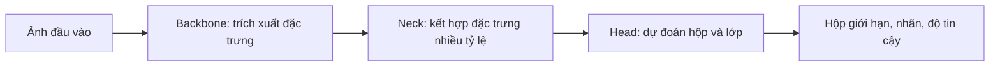

*Sơ đồ khái quát; không mô tả chi tiết nội bộ riêng của YOLO26s.*

### 1.3.2. Bộ lọc Kalman và ghép cặp Hungarian

Bộ lọc Kalman ước lượng trạng thái ẩn qua hai bước lặp. Bước dự đoán ngoại suy trạng thái từ mô hình chuyển động; bước cập nhật hiệu chỉnh dự đoán khi nhận được detection mới. Trong tracker tự cài, trạng thái bbox được biểu diễn theo tâm, tỷ lệ khung và chiều cao (XYAH), sau đó cập nhật theo quan sát. Bộ lọc làm mượt quỹ đạo nhưng không tự nhận diện danh tính và có thể trôi khi đối tượng bị mất dấu lâu.

Sau dự đoán, chi phí liên kết giữa track và detection được lập từ độ chồng lấp IoU cùng các điều kiện bổ sung nếu được bật. Thuật toán Hungarian tìm phép gán một-một có tổng chi phí tối ưu; các cặp không đạt ngưỡng bị từ chối, track còn lại có thể chuyển sang Lost và detection chưa ghép có thể tạo track mới. Kết quả phụ thuộc detector, ngưỡng và mô hình chuyển động.

### 1.3.3. Các thuật toán theo dõi: SORT, DeepSORT, ByteTrack

SORT kết hợp Kalman, IoU và Hungarian để liên kết track với detection; DeepSORT bổ sung đặc trưng ngoại hình nhằm hỗ trợ liên kết khi chuyển động/che khuất gây khó khăn; ByteTrack dùng detection confidence cao ở lượt liên kết chính và tận dụng detection confidence thấp ở lượt tiếp theo. Đây là mô tả cơ chế định tính, không phải kết quả benchmark trên dữ liệu của đồ án.

**Bảng 1.1. So sánh định tính các thuật toán theo dõi**

| Phương pháp | Cơ chế nổi bật | Điểm mạnh | Giới hạn liên quan |
|---|---|---|---|
| SORT | Kalman và gán theo IoU | Đơn giản, chi phí thấp | Dễ mất liên kết khi che khuất hoặc detection gián đoạn |
| DeepSORT | SORT kết hợp đặc trưng ngoại hình | Có thêm tín hiệu nhận dạng khi đối tượng gần nhau | Cần trích đặc trưng, tăng chi phí tính toán |
| ByteTrack | Hai lượt ghép, có dùng detection confidence thấp | Có thể duy trì track khi confidence suy giảm | Vẫn phụ thuộc detector và ngưỡng association |
| ByteTrack tự cài trong đồ án | Kalman XYAH, association hai lượt, quản lý vòng đời track | Cho phép kiểm tra/tùy biến logic | Chưa có ground truth MOT để khẳng định cải thiện |

Dự án dùng ByteTrack của Ultralytics làm baseline và có triển khai tùy chọn riêng. Buffered IoU, directional gating, NSA Kalman, signal-aware lifecycle và stitching là các hướng thử nghiệm trong tracker tự cài; chúng không mặc định bật và chưa được chứng minh cải thiện bằng ground truth.

**Hình 1.2. Hai giai đoạn liên kết detection của ByteTrack**

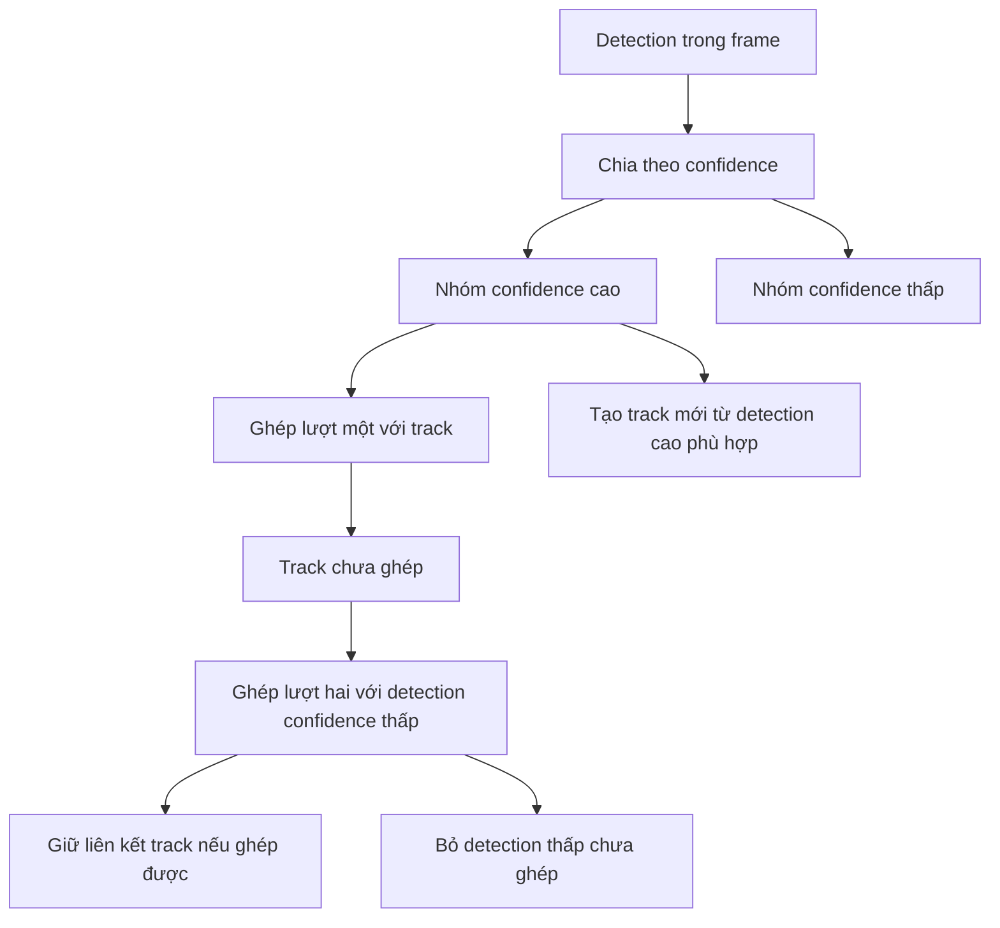

*Sơ đồ khái quát hóa; chi tiết ngưỡng và xử lý track tuân theo cấu hình triển khai.*

### 1.3.4. Phép chiếu homography

Homography là phép biến đổi phối cảnh giữa hai mặt phẳng, thường được biểu diễn bằng ma trận \(H\) xác định từ tối thiểu bốn cặp điểm tương ứng không thẳng hàng. Với điểm ảnh thuần nhất \(p=(x,y,1)^T\), điểm trên mặt phẳng đích tỷ lệ với \(Hp\), sau đó chuẩn hóa theo tọa độ thuần nhất. Có thể dùng phép biến đổi để biểu diễn mặt đường ở góc nhìn bird-eye view hoặc so sánh vị trí theo đơn vị mặt phẳng nếu đã hiệu chuẩn.

Trong đồ án, homography là kiến thức nền và hướng phát triển; code hiện tại xét vạch, ROI và quỹ đạo trực tiếp bằng pixel, chưa ước lượng ma trận H và chưa quy đổi sang mét. Vì vậy không báo cáo vận tốc/khoảng cách vật lý từ video.

## 1.4. Tổng quan về giám sát vi phạm giao thông

### 1.4.1. Quy định pháp luật về dừng xe khi đèn đỏ

Hệ thống chỉ tạo sự kiện kỹ thuật để hỗ trợ rà soát. Việc xác định hành vi vi phạm, chủ thể và chế tài thuộc thẩm quyền của cơ quan/người có thẩm quyền. Các văn bản cần đối chiếu tại thời điểm nộp gồm Luật Trật tự, an toàn giao thông đường bộ số 36/2024/QH15 và Nghị định số 168/2024/NĐ-CP cùng văn bản sửa đổi, bổ sung hoặc thay thế nếu có.

**Bảng 1.2. Văn bản pháp luật cần đối chiếu khi hoàn thiện báo cáo**

| Văn bản | Phạm vi liên quan | Nội dung cần xác minh |
|---|---|---|
| Luật số 36/2024/QH15 | Quy tắc chấp hành tín hiệu và vạch dừng | Điều, khoản áp dụng và hiệu lực tại ngày nộp |
| Nghị định số 168/2024/NĐ-CP | Chế tài hành vi không chấp hành đèn tín hiệu | Điều khoản, đối tượng và mức phạt hiện hành |
| Văn bản sửa đổi/thay thế (nếu có) | Tình trạng pháp lý hiện hành | Cần kiểm tra trên nguồn pháp luật chính thức |

Không đưa mức phạt cụ thể vào báo cáo trước khi xác nhận điều khoản, đối tượng áp dụng và hiệu lực của văn bản. Kết quả AI không phải kết luận pháp lý.

### 1.4.2. Vấn đề tồn tại trong giám sát hiện nay

Giám sát video giao thông gặp các khó khăn về ánh sáng ngày/đêm, mưa và phản xạ, độ phân giải, góc nhìn, xe nhỏ hoặc bị che khuất, mật độ phương tiện, và sai số cấu hình ROI/vạch. Đèn tín hiệu thường chỉ chiếm ít pixel; màu có thể đổi do cháy sáng hoặc nền lẫn vào ROI. Tracker có thể mất track hoặc đổi ID khi detection gián đoạn, xe đi gần nhau hoặc bị che khuất.

Một hộp xe nằm phía sau vạch trong một frame không cho biết xe vừa vượt vạch; cần theo dõi trạng thái trước–sau và xét đèn tại đúng thời điểm giao cắt. Camera rung, thay đổi góc hoặc vạch bị che có thể làm sai phép kiểm tra hình học. Các hệ thống hiện hành cũng cần xử lý quyền riêng tư, chất lượng bằng chứng và bước xác nhận của con người. Đây là các lý do hệ thống phải được đánh giá theo detector, tracking và sự kiện riêng biệt, với video/ground truth phù hợp.

## 1.5. Giới thiệu đề tài và giải pháp đề xuất

Đề tài xây dựng hệ thống phân tích video từ camera cố định, tập trung vào ô tô và vạch dừng tại khu vực tín hiệu giao thông. Mục tiêu là phát hiện phương tiện và màu đèn, theo dõi phương tiện qua thời gian, cấu hình ROI/vạch theo góc quay, rồi tạo sự kiện ứng viên khi track đi từ phía tiếp cận qua đoạn vạch trong thời gian trạng thái đèn là đỏ.

Pipeline gồm đọc và tiền xử lý frame; YOLO phát hiện phương tiện và đèn trên ROI; ByteTrack gán ID; module trạng thái đèn làm ổn định dự đoán; luật hình học kiểm tra quỹ đạo cắt đoạn vạch; cuối cùng lưu video chú thích, `summary.json`, `violations.csv` và ảnh bằng chứng nếu có. Sơ đồ chi tiết module được trình bày ở Chương 2.

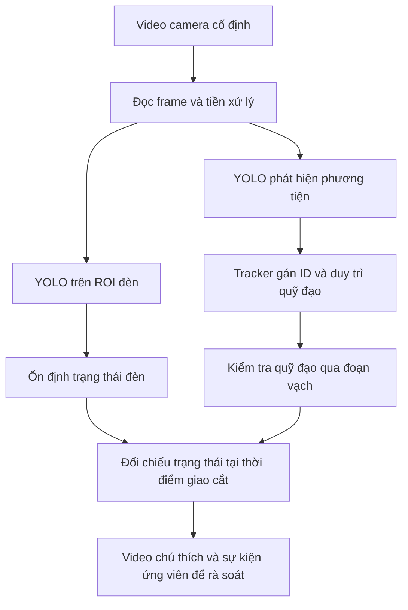

**Hình 1.3. Hướng tiếp cận tổng quát của đề tài**
*Nguồn: tổng hợp theo pipeline hiện thực.*

Phạm vi hiện tại giới hạn ở video đã ghi từ camera cố định, các lớp `bus`, `car`, `truck`, `green`, `red`, `yellow`; ROI và vạch được thiết lập thủ công. Hệ thống chưa nhận dạng biển số, chưa hiệu chuẩn phối cảnh, chưa tính tốc độ thực địa, và không thay thế việc con người xác minh sự kiện. Số liệu validation của detector không đại diện cho độ chính xác sự kiện; hiện chưa có ground truth MOT/sự kiện để kết luận chất lượng tổng quát.

## 1.6. Tổng kết chương

Chương này đã giới thiệu bài toán giám sát giao thông bằng thị giác máy tính, các thành phần phát hiện và theo dõi đối tượng, cùng những khó khăn khi xác định sự kiện xe vượt đèn đỏ từ video. Hướng tiếp cận của đề tài kết hợp mô hình YOLO, theo dõi đa đối tượng, nhận diện trạng thái đèn và kiểm tra giao cắt vạch dừng theo thời gian. Các cơ sở này được dùng để phân tích yêu cầu và thiết kế hệ thống ở Chương 2.

---

# CHƯƠNG 2. PHÂN TÍCH VÀ THIẾT KẾ HỆ THỐNG

## 2.1. Phân tích yêu cầu

### 2.1.1. Mô tả bài toán và các khó khăn kỹ thuật

Đầu vào là video từ camera cố định tại khu vực giao lộ có đèn tín hiệu và vạch dừng. Hệ thống cần phát hiện phương tiện và trạng thái đèn, duy trì ID qua các frame, rồi xác định liệu track có đi từ phía tiếp cận qua đoạn vạch trong thời gian đèn đỏ hay không. Một phát hiện đơn lẻ phía sau vạch không đủ để xác định hành vi, do đó quyết định phải dựa trên quỹ đạo, thời điểm giao cắt, hướng xe và trạng thái tín hiệu tương ứng.

Các khó khăn chính gồm đèn nhỏ/khó nhìn, thay đổi ánh sáng, xe che khuất hoặc đi sát nhau, detector bỏ sót làm track mất/đổi ID, sai lệch ROI/vạch theo từng góc camera và việc phân biệt xe dừng chờ với xe đã đi qua vạch. Chất lượng còn phụ thuộc vào độ phân giải, góc quay và cấu hình thủ công; thiếu ground truth sự kiện khiến chưa thể định lượng độ chính xác cuối của hệ thống.

### 2.1.2. Yêu cầu chức năng

1. Nhận một video và đọc độ phân giải, FPS, số frame.
2. Nạp checkpoint YOLO có các lớp phương tiện và màu đèn phù hợp.
3. Cho phép cấu hình ROI phương tiện, ROI đèn, hai đầu vạch dừng và hướng đi qua vạch.
4. Phát hiện đèn và phương tiện; gán ID track cho phương tiện.
5. Làm ổn định trạng thái đèn và kiểm tra điều kiện giao cắt theo ID.
6. Ghi video có hộp, ID, ROI, vạch và trạng thái đèn; xuất báo cáo JSON/CSV và ảnh bằng chứng nếu có sự kiện.
7. Cho phép chạy bằng CLI hoặc giao diện web cục bộ; hỗ trợ theo dõi tiến độ và lưu từng phiên phân tích.

**Hình 2.1. Biểu đồ use case của hệ thống**

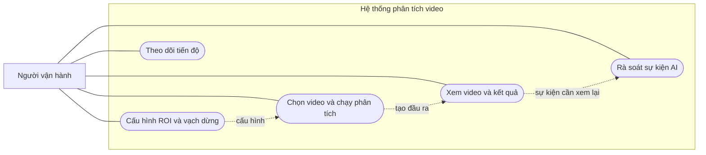

### 2.1.3. Yêu cầu phi chức năng

- Cấu hình ROI phải đúng độ phân giải của video; không tái sử dụng ROI chỉ vì hai video có cùng kích thước.
- Lỗi thiếu video, checkpoint, config hoặc không mở được đầu ra phải được thông báo.
- Có thể chạy CLI trên CPU hoặc thiết bị được chỉ định; web hiện yêu cầu GPU CUDA.
- Video tải lên web tối đa 500 MB; các phiên và kết quả được lưu trong `.webdata/jobs/<id>/`.
- Kết quả phải giữ được mối liên hệ giữa video, config, checkpoint, sự kiện và ảnh bằng chứng.

**Bảng 2.1. Yêu cầu chức năng và phi chức năng**

| Mã | Loại | Yêu cầu | Ưu tiên |
|---|---|---|---|
| F01 | Chức năng | Nhận video và đọc metadata khung hình | Cao |
| F02 | Chức năng | Phát hiện phương tiện/đèn và gán ID track | Cao |
| F03 | Chức năng | Cấu hình ROI, vạch dừng, hướng và điểm đại diện | Cao |
| F04 | Chức năng | Ghi video, summary, CSV và ảnh bằng chứng | Cao |
| F05 | Chức năng | Cung cấp CLI và giao diện web cục bộ | Trung bình |
| NF01 | Phi chức năng | Kiểm tra cấu hình ROI đúng kích thước video | Cao |
| NF02 | Phi chức năng | Thông báo lỗi khi thiếu đầu vào hoặc không mở được đầu ra | Cao |
| NF03 | Phi chức năng | Giữ liên hệ giữa job, config, checkpoint và kết quả | Cao |
| NF04 | Phi chức năng | Chạy CLI trên CPU; web hiện yêu cầu CUDA | Trung bình |
| NF05 | Phi chức năng | Giới hạn video tải lên web ở 500 MB | Trung bình |

### 2.2. Kiến trúc tổng thể

### 2.2.1. Sơ đồ kiến trúc hệ thống

Hệ thống có ba lớp:

1. **Lớp suy luận:** nạp YOLO, tiền xử lý, phát hiện đèn/phương tiện và theo dõi phương tiện.
2. **Lớp nghiệp vụ:** quản lý trạng thái đèn, kiểm tra quỹ đạo qua đoạn vạch, quyết định tạo sự kiện.
3. **Lớp giao tiếp và lưu trữ:** CLI hoặc web; ghi video, JSON, CSV, ảnh bằng chứng và metadata theo job.

CLI khởi động pipeline qua `main.py` và `Code/06_run_detection.py`. Web tiếp nhận video/cấu hình ở `web_app.py`, sau đó `web_worker.py` gọi cùng pipeline trong tiến trình phân tích riêng. Giao diện web không đưa video lên dịch vụ inference bên ngoài; dữ liệu được xử lý cục bộ theo cấu hình của ứng dụng.

**Hình 2.2. Kiến trúc tổng thể: video → YOLO → tracker → luật vi phạm → đầu ra**

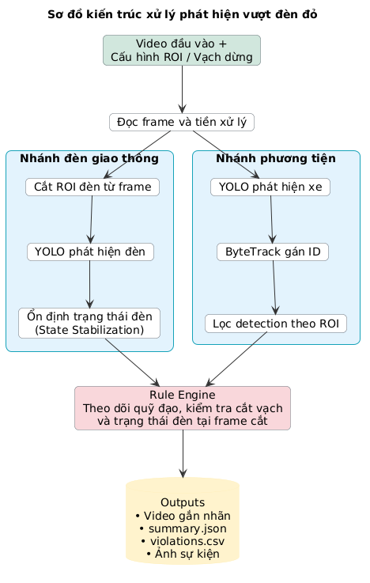

*Nguồn: hình minh họa do sinh viên cung cấp, sắp xếp lại vào phụ lục hình của báo cáo.*

### 2.2.2. Lưu đồ xử lý mỗi khung hình

Mỗi frame được đọc và tiền xử lý; nhánh phương tiện chạy detector và tracker, nhánh đèn phát hiện trạng thái trên ROI. Pipeline sau đó cập nhật quỹ đạo, kiểm tra điều kiện giao cắt, ghi lớp phủ và lưu bằng chứng khi có sự kiện.

**Hình 2.3. Lưu đồ xử lý frame từ đọc ảnh đến ghi bằng chứng**

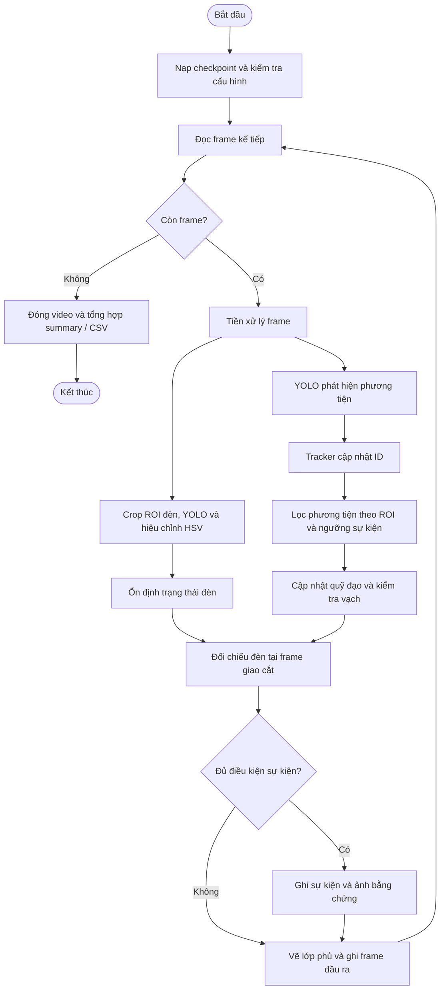

## 2.3. Thiết kế các module

### 2.3.1. Module thu nhận và tiền xử lý video

OpenCV đọc lần lượt từng frame. Ảnh suy luận được resize giữ nguyên tỷ lệ và thêm viền letterbox về kích thước mục tiêu. Sau suy luận, tọa độ hộp phương tiện được ánh xạ từ ảnh đã letterbox về tọa độ video gốc để so sánh với ROI và vạch dừng. Mặc định pipeline không bật bước khử nhiễu NLM/sharpen.

### 2.3.2. Module phát hiện ô tô bằng YOLO

Tên lớp lấy từ checkpoint và được gom thành nhóm xe và nhóm màu đèn. Phương tiện được phát hiện trên ảnh suy luận toàn khung hình. Người dùng có thể chọn ByteTrack YAML của Ultralytics hoặc tracker ByteTrack tự cài qua CLI/web. Trong các job web được dùng làm kết quả thực nghiệm của báo cáo, tracker tự cài chạy với `track_conf=0,1`, `track_buffer=60`, bật `appearance_reid` và cửa sổ tìm lại `reid_window=60` frame; ở video 30 FPS, cửa sổ này tương đương khoảng 2 giây. Web hiện mặc định chọn tracker tự cài và bật ReID; các job cũ dùng Ultralytics vẫn có thể mở nhưng không có tính năng ReID này. CLI vẫn mặc định dùng tracker Ultralytics nếu không chỉ định `--tracker`. Với Ultralytics, nếu không truyền `track_conf`, ngưỡng dự đoán là giá trị nhỏ hơn giữa `light_conf=0,25` và `vehicle_conf=0,6`. `vehicle_conf` là ngưỡng xét quỹ đạo/sự kiện, không quyết định việc vẽ hộp: hộp track thuộc lớp xe có tâm trong ROI vẫn được vẽ khi confidence thấp hơn ngưỡng sự kiện.

Tracker tự cài giữ các trạng thái New/Tracked/Lost/Removed và dùng Kalman xyah cùng Hungarian trên chi phí IoU. Mỗi đối tượng có `object_id` ổn định trong một lượt chạy, tách khỏi `track_id` nội bộ vốn có thể đổi. Khi bật ReID, tracker lưu tối đa 8 mẫu histogram màu HSV của mỗi track; detection mới chưa ghép được sẽ được so với các track vừa mất dấu cùng lớp, trong cửa sổ thời gian và cổng vị trí dự đoán. Nếu ngoại hình đủ giống và không có ứng viên cạnh tranh gần bằng, detection được gán lại `object_id` cũ nhưng tạo `track_id` mới. Cùng khung hình mất dấu cũng được xét; khi mơ hồ, tracker không tự gộp và đánh dấu cần rà soát. Đây là heuristic histogram/vị trí, không phải mô hình ReID đã huấn luyện.

Các tùy chọn association khác gồm BIoU mở rộng hộp theo hệ số riêng cho hai giai đoạn ghép; directional gating cộng chi phí cho dịch chuyển đủ nhanh nhưng ngược hướng luồng xe; NSA Kalman nhân nhiễu đo \(R\) với \(1-\text{conf}\). Các cờ CLI `--biou`, `--dir-gating`, `--nsa-kalman` cho phép bật riêng từng cải tiến. Directional gating tác động lên ghép detection với track đang hoạt động, không phải điều kiện hướng bắt buộc của bước ReID. Tùy chọn `--signal-lifecycle` nối thêm ngữ cảnh đèn và vùng hàng chờ để nới thời gian giữ một track Lost đang dừng khi đèn đỏ, cùng khoảng grace sau khi chuyển xanh. Tùy chọn `--stitch` là cơ chế riêng, chỉ tìm nối trong vùng lân cận vạch.
Suy luận phương tiện được thực hiện trên ảnh toàn khung hình, sau đó các hộp được ánh xạ về tọa độ ảnh gốc để áp dụng ROI. Confidence detector phục vụ việc tạo các phát hiện đầu vào; `vehicle_conf` được dùng ở bước quyết định có cập nhật quỹ đạo và xét sự kiện. Cơ chế này tách việc hiển thị hộp track trong ROI khỏi ngưỡng tạo sự kiện.

### 2.3.3. Module theo dõi đối tượng (bộ theo dõi đề xuất)

Module `tracking/custom_bytetrack/` quản lý các track theo trạng thái New/Tracked/Lost/Removed, dự đoán bằng Kalman xyah và ghép bằng Hungarian trên chi phí IoU. Đặc trưng histogram HSV nằm trong `tracking/reid/`; adapter cho tracker Ultralytics nằm trong `tracking/ultralytics_tracker/`. Web bật appearance ReID mặc định khi dùng tracker tự cài; ở CLI, ReID cần bật bằng `--appearance-reid`. Các cải tiến association/lifecycle như Buffered IoU, directional gating, NSA Kalman, signal-aware lifecycle và stitching là các cơ chế riêng, có cờ CLI tương ứng.

**Hình 2.4. Sơ đồ lớp của module `tracking/custom_bytetrack/`**

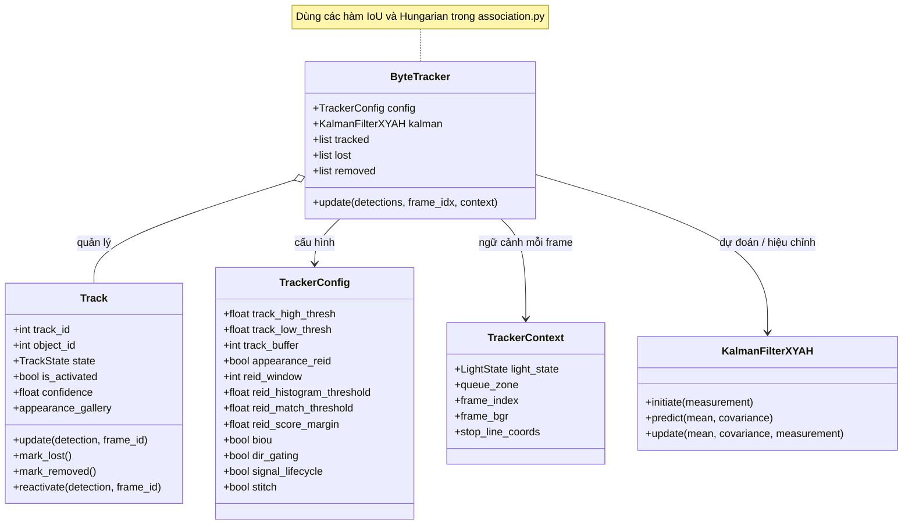

**Hình 2.5. Sơ đồ trạng thái track New/Tracked/Lost/Removed**

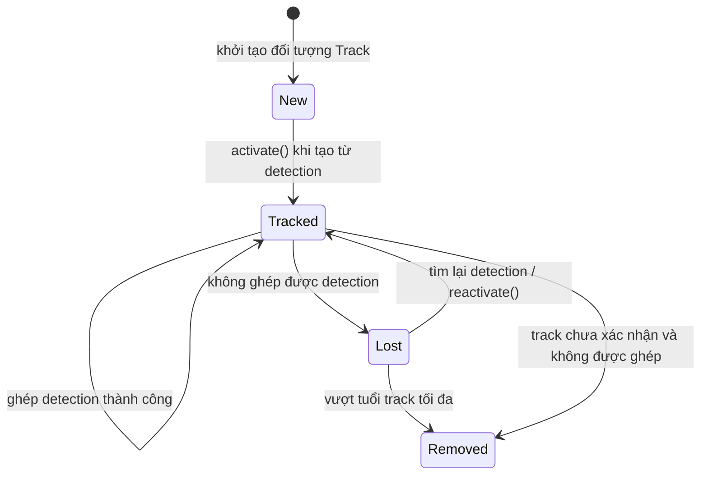

`New` là trạng thái khởi tạo ngắn: `from_detection` gọi `activate()` ngay, nên track mới chuyển sang `Tracked` trong cùng bước tạo. Track chưa xác nhận được biểu diễn bằng cờ `is_activated`, không phải một trạng thái riêng.

Để chạy ablation nhất quán, CLI có sáu preset: A dùng Ultralytics; B dùng tracker tự cài; C thêm điểm tiếp đất `bottom_center`; D thêm biou và directional gating; E thêm signal lifecycle; F thêm stitch. NSA Kalman không nằm trong chuỗi preset và được giữ tắt để các mức so sánh tương ứng đúng các thay đổi đã nêu. `scripts/run_ablation.py` chạy sáu preset tuần tự trên cùng đầu vào bằng CPU, lưu MOT, sự kiện, log và FPS theo từng preset, đồng thời tạo file tổng hợp. Đây là công cụ ghi nhận kết quả chạy, không tự động chứng minh preset nào chính xác hơn; đánh giá chất lượng cần video có ground truth. Với cấu hình Test 6 hiện có, không khai báo `QUEUE_ZONE_POLYGON`, nên E/F cảnh báo và không thể thực hiện phần kéo dài tuổi track theo vùng hàng chờ; tính năng này đã được kiểm tra riêng bằng chuỗi giả.

### 2.3.4. Module nhận diện trạng thái đèn tín hiệu

Vùng bao của đa giác ROI đèn được cắt từ frame gốc, resize/letterbox riêng rồi đưa vào YOLO với ngưỡng `light_conf` mặc định 0,25. Hộp đèn được ánh xạ lại về tọa độ ảnh gốc và kiểm tra tâm hộp nằm trong ROI đa giác. Màu dự đoán được hiệu chỉnh bằng HSV ở patch quanh tâm đèn.

Lịch sử tối đa năm kết quả gần nhất được dùng để ổn định trạng thái. Khi một màu xuất hiện tối thiểu ba lần trong lịch sử, trạng thái được cập nhật theo màu đó. Nếu không có detection mới trong hơn hai giây theo FPS video, trạng thái được đặt thành `unknown`. Vì vậy ROI vẽ thiếu bóng đèn, cắt sát mép hoặc lệch khỏi cụm tín hiệu sẽ làm tăng khoảng thời gian `unknown`; mỗi camera cần được cấu hình và xem lại trên video đầu ra.

**Hình 2.6. Sơ đồ trạng thái đèn red/green/yellow/unknown**

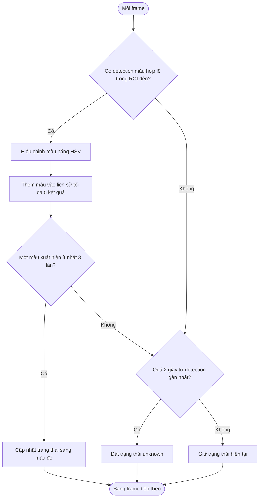

**Bảng 2.2. Quy tắc cập nhật trạng thái đèn**

| Tình huống | Quy tắc theo code | Kết quả |
|---|---|---|
| Có detection màu trong ROI | Hiệu chỉnh dự đoán bằng HSV và thêm vào lịch sử tối đa 5 kết quả | Cập nhật trạng thái khi một màu đạt ít nhất 3 lần |
| Không có detection mới trong thời gian ngắn | Giữ trạng thái gần nhất | Trạng thái không đổi |
| Không có detection mới quá 2 giây theo FPS video | Đánh dấu trạng thái hiện tại không xác định | `unknown` |

### 2.3.5. Module thiết lập vạch dừng và vùng quan tâm

File JSON chứa `FRAME_SIZE`, `VEHICLE_DETECT_ROI_POLYGON`, `RED_LIGHT_DETECT_ROI_POLYGON`, `STOP_LINE_COORDS`, `CROSSING_DIRECTION` và ngưỡng vượt vạch. Các trường tùy chọn gồm `GROUND_POINT_MODE`, `TRAFFIC_FLOW_DIRECTION`, `QUEUE_ZONE_POLYGON` và `STITCH_MARGIN`; giao diện web cho chọn `center` hoặc `bottom_center` ở bước thiết lập ROI, còn config cũ không có `GROUND_POINT_MODE` tiếp tục mặc định dùng `center`. Nếu không có hướng luồng xe, hệ thống suy ra vector đơn vị từ pháp tuyến vạch dừng và `CROSSING_DIRECTION`. `QUEUE_ZONE_POLYGON` là đa giác vùng xe dừng, được kiểm tra nằm trong ảnh; muốn bật vòng đời theo tín hiệu phải khai báo trường này. `STITCH_MARGIN` xác định dải pixel quanh đoạn vạch để xét nối, mặc định 40 pixel ảnh gốc. Bộ cấu hình có giao diện GUI chọn đa giác xe, đa giác đèn và hai điểm vạch. `load_config` kiểm tra cấu hình có đúng kích thước ảnh, các điểm nằm trong khung hình và chiều cắt thuộc `up` hoặc `down`.

**Hình 2.7. Một phần đầu ra video tại sự kiện ứng viên**
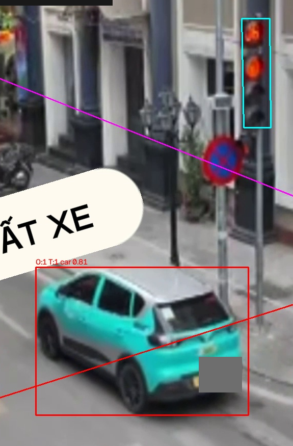

*Nguồn: job Test 6 Demo che khuất đã lưu trong `.webdata/jobs/`. Hình cho thấy lớp phủ khi xử lý, không phải ảnh chụp giao diện công cụ cấu hình hoặc toàn bộ đa giác ROI.*

Khi bật `signal_lifecycle`, mỗi lần cập nhật tracker nhận `TrackerContext` gồm trạng thái đèn, vùng chờ đổi sang tọa độ inference và frame index. Track Lost đủ điều kiện khi điểm đại diện cuối còn trong polygon và tốc độ Kalman nhỏ hơn `stationary_speed_threshold`; lúc đèn đỏ dùng `max_age_red` thay vì `track_buffer`. Track đứng yên đủ điều kiện cũng được đặt các vận tốc Kalman về 0 khi dự đoán. Khi chuyển xanh, mức tuổi kéo dài duy trì `green_grace_frames`, sau đó trở lại giới hạn bình thường.

Khi bật `stitch`, module lưu snapshot track Lost trong `stitch_window` frame. Track mới phải nằm trong dải `STITCH_MARGIN` quanh vạch; ứng viên được lọc theo khoảng cách ground point và tương đồng histogram H-S tính bằng `cv2.compareHist`, rồi xếp hạng bằng điểm kết hợp khoảng cách, thời gian và histogram. Nếu đạt các ngưỡng cấu hình, track mới kế thừa ID cũ. Ngưỡng khoảng cách mặc định 80 pixel ảnh gốc, tương đồng histogram 0,55, điểm ghép 0,65 và cửa sổ 60 frame; đây là giá trị khởi đầu, không phải kết quả tối ưu hóa.

Vạch dừng được biểu diễn bởi hai đầu mút, tạo thành một đoạn hữu hạn. Quy ước hướng `up`/`down` phải được chọn theo góc nhìn camera, không suy ra chỉ từ hướng xe trên bản đồ.

### 2.3.6. Module phát hiện vi phạm

Với vạch có điểm đầu \(A\), vector hướng \(v=B-A\), hệ thống tính pháp tuyến đơn vị \(n\). Điểm đại diện \(p_t\) được lấy từ tâm bbox hoặc tâm cạnh dưới theo `GROUND_POINT_MODE`; nếu trường cấu hình không có thì mặc định là `center`. Khoảng cách có dấu:

\[
d_t=(p_t-A)\cdot n.
\]

Một track được “armed” khi từng quan sát ở phía tiếp cận với \(d_t\) vượt ngưỡng dương. Khi hai điểm liên tiếp đổi dấu qua đường chứa vạch, hệ thống nội suy giao điểm và chiếu nó lên đoạn \(AB\). Chỉ giao điểm có hình chiếu nằm trong đoạn hữu hạn mới được giữ. Track được xác nhận vượt qua khi đi quá ngưỡng âm; frame sự kiện được gắn với frame nội suy giao cắt.

Sự kiện chỉ được tạo nếu trạng thái tại frame giao cắt được lưu là đỏ và ID chưa được ghi nhận trước đó. Cơ chế này hạn chế tính nhầm xe đã ở phía sau vạch từ đầu video và tránh ghi trùng một ID trong cùng lượt xử lý. Tuy nhiên, mất track, đổi ID, ROI không đúng hoặc trạng thái đèn `unknown` tại frame giao cắt đều có thể làm bỏ sót sự kiện.

### 2.3.7. Module lưu bằng chứng và dữ liệu đầu ra

**Bảng 2.3. Các tệp đầu ra của pipeline**

| Tệp | Nội dung |
|---|---|
| `annotated.mp4` | Video có lớp phủ ROI, vạch, hộp, ID và trạng thái đèn |
| `summary.json` | Video/checkpoint/config, tracker và ngưỡng tracking, FPS, frame, thống kê màu/trạng thái và sự kiện |
| `violations.csv` | Bảng sự kiện; chỉ có header nếu không có sự kiện |
| `tracks.txt` | Hộp và ID theo từng frame ở dạng MOT để rà soát track |
| `preview.jpg` | Khung hình dùng làm ảnh xem trước |
| `id*_crop.jpg` | Ảnh cắt phương tiện khi tạo sự kiện |
| `id*_full.jpg` | Ảnh toàn cảnh tại thời điểm lưu bằng chứng |

**Hình 2.8. Cấu trúc tệp đầu ra và quan hệ giữa video, track, summary, CSV và ảnh bằng chứng**

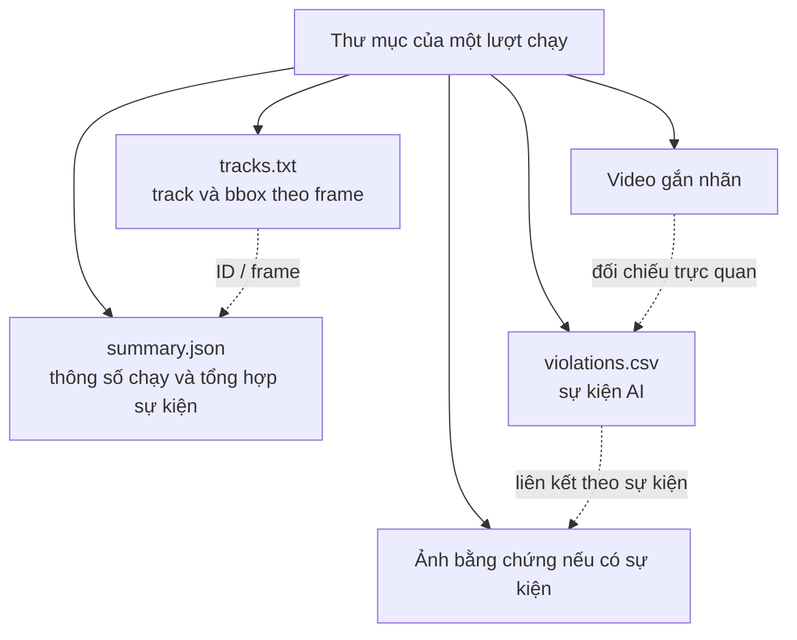

## 2.4. Thiết kế thuật toán phát hiện vi phạm

### 2.4.1. Điều kiện vi phạm và điểm tham chiếu của xe

Một sự kiện ứng viên chỉ được tạo khi có track hợp lệ đạt `vehicle_conf`, quỹ đạo đã được “armed” ở phía tiếp cận, quỹ đạo cắt qua đoạn vạch hữu hạn theo đúng hướng, vượt qua ngưỡng xác nhận và trạng thái đèn tại frame giao cắt là đỏ. Mỗi ID chỉ được ghi nhận một lần trong cùng lượt xử lý. Đây là quy tắc kỹ thuật của hệ thống, không phải kết luận pháp lý.

Điểm kiểm tra được lấy từ tâm bbox (`center`) hoặc tâm cạnh dưới (`bottom_center`). Hai lựa chọn đều là xấp xỉ vị trí xe trên mặt đường; `bottom_center` không khẳng định chính xác vị trí bánh trước. Vạch là đoạn hữu hạn \(AB\); hệ thống tính pháp tuyến đơn vị \(n\), sau đó dùng khoảng cách có dấu:

\[
d_t=(p_t-A)\cdot n.
\]

**Hình 2.9. Minh họa quỹ đạo xe, vạch dừng và khoảng cách có dấu ở hai phía ngưỡng**
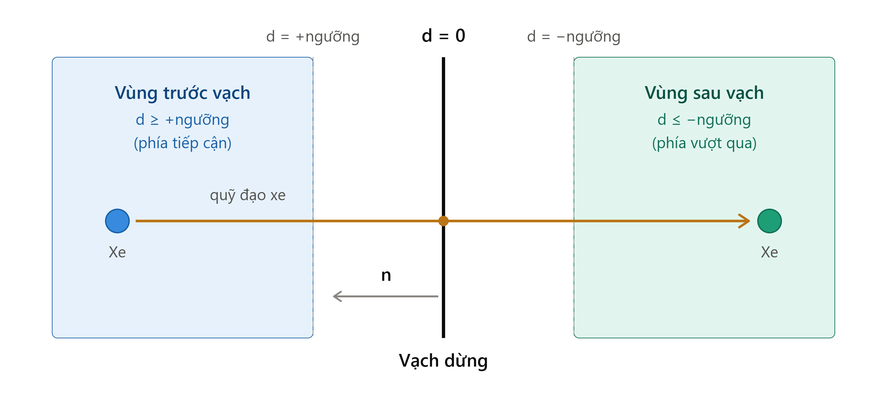

*Nguồn: hình minh họa do sinh viên cung cấp. Hình giải thích quy ước hình học, không phải ảnh CCTV hay kết quả thực nghiệm.*


### 2.4.2. Phân biệt xe chờ, xe vượt vạch, xe trong giao lộ

Track chỉ được “armed” sau khi quan sát ở phía tiếp cận vạch đủ ngưỡng. Khi điểm tham chiếu đổi dấu, giao điểm được nội suy và kiểm tra có nằm trên đoạn hữu hạn \(AB\) hay không; track chỉ được xác nhận sau khi đi qua ngưỡng phía bên kia. Xe xuất hiện ngay từ đầu video ở phía sau vạch không tự động bị tính là vừa vượt vạch.

**Hình 2.10. Lưu đồ điều kiện armed → cắt đoạn → vượt ngưỡng → kiểm tra đèn đỏ**

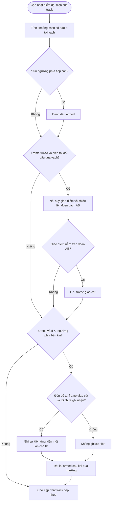

Xe đã ở phía sau vạch ngay từ đầu không được armed; giao cắt ngoài đoạn hữu hạn \(AB\) không được tính. `threshold` là ngưỡng cấu hình của `LineCrossing` (mặc định 20 pixel trong CLI).

### 2.4.3. Xử lý che khuất, mất ID và tránh báo trùng

Tracker tự cài duy trì track Lost theo `track_buffer`; khi bật `signal_lifecycle`, track Lost có điểm cuối trong `QUEUE_ZONE_POLYGON`, tốc độ thấp và bối cảnh đèn phù hợp có thể được giữ lâu hơn. Appearance ReID là cơ chế riêng: snapshot track Lost được giữ trong `reid_window=60` frame; gallery lưu tối đa 8 histogram HSV, lấy mẫu mỗi 5 frame. Detection mới được so với track cùng lớp, dựa trên histogram và vị trí dự đoán từ vận tốc. Mặc định ngưỡng histogram và điểm ghép là 0,6, khoảng cách điểm ghép tốt nhất với ứng viên thứ hai phải đạt ít nhất 0,08. Cổng vị trí nới thêm 4 pixel hệ tọa độ tracker cho mỗi frame mất dấu, tối đa 60 frame. Cho phép khoảng cách thời gian bằng 0; nếu ứng viên mơ hồ, không gộp tự động.

Khi ReID ghép thành công, `object_id` cũ được giữ nhưng `track_id` của đoạn track mới vẫn khác. Đây là heuristic appearance + vị trí, không phải mô hình ReID đã huấn luyện; histogram màu có thể nhầm các xe cùng màu. Directional gating chỉ tác động lên association của track đang hoạt động, không bắt buộc xe đi theo một chiều riêng trong ReID. BIoU và NSA Kalman cũng tác động ở association thông thường. `--stitch` là cơ chế tùy chọn khác, giới hạn quanh vạch và dùng khoảng cách ground point cùng histogram; cần rà soát khả năng ghép nhầm.

**Hình 2.11. Lưu đồ vòng đời track theo trạng thái đèn và vùng chờ**

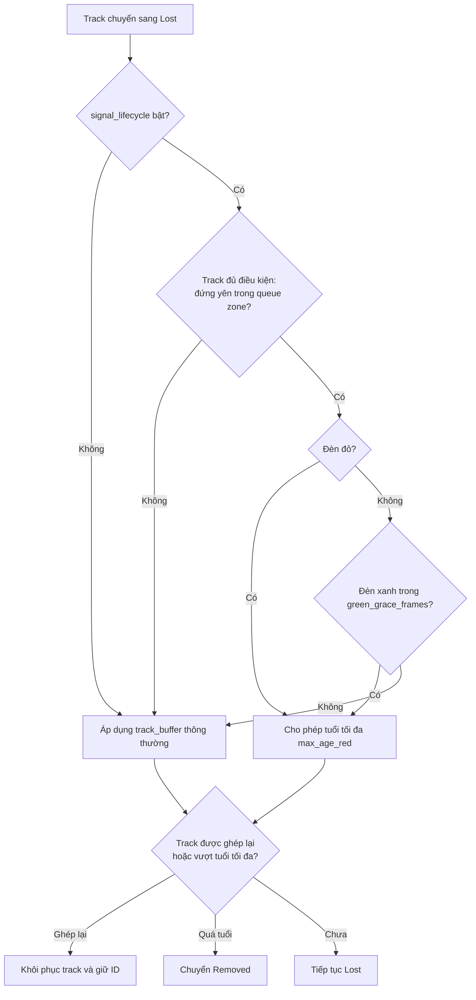

Phần kéo dài tuổi chỉ áp dụng cho track đủ điều kiện theo vùng chờ; nếu không khai báo `QUEUE_ZONE_POLYGON`, không có track nào được hưởng phần mở rộng này.

**Hình 2.12. Lưu đồ appearance ReID khi track mất dấu**

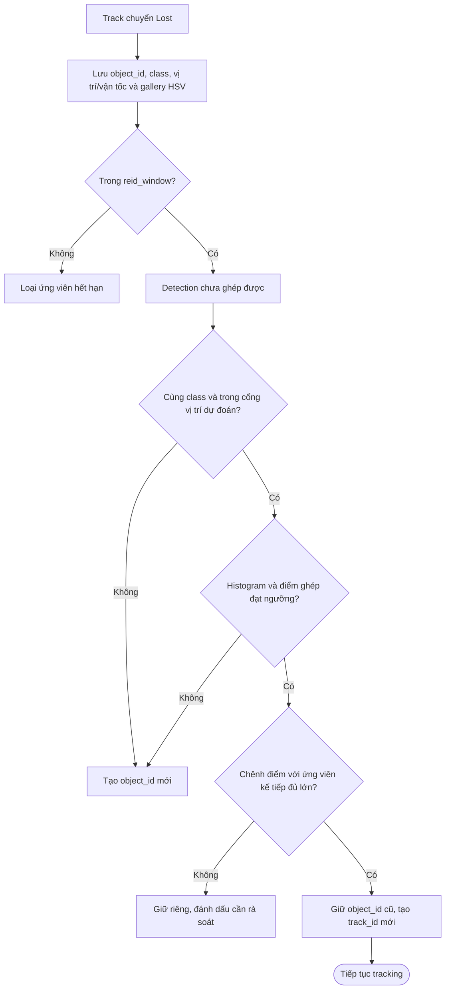

**Tránh báo trùng.** Tập `captured` ngăn cùng một `object_id` tạo nhiều sự kiện trong một lượt phân tích. Nếu tracker đổi ID mà không nối lại được object identity, cơ chế này không bảo đảm nhận ra đó là cùng một phương tiện và có thể phát sinh sự kiện trùng; kết quả vẫn cần người vận hành rà soát.

### 2.4.4. Bảng tham số và cách chọn tham số

Các giá trị dưới đây là mặc định của `TrackerConfig`, trừ các giá trị ghi rõ cho web; chúng chưa được tối ưu hóa bằng validation. Web đặt `track_buffer=60` và bật `appearance_reid` khi dùng tracker tự cài; cấu hình CLI mặc định không bật ReID. Chưa có quy trình quét tham số trên tập validation có ground truth; khoảng quét do đó chưa được xác định.

**Bảng 2.4. Tham số tracker mặc định**

| Tham số | Mặc định | Ý nghĩa | Khoảng quét đã thực hiện |
|---|---:|---|---|
| `track_high_thresh` | 0,25 | Ngưỡng detection cho lượt ghép điểm cao | Chưa thực hiện |
| `track_low_thresh` | 0,10 | Ngưỡng thấp cho lượt ghép thứ hai | Chưa thực hiện |
| `new_track_thresh` | 0,25 | Ngưỡng tạo track mới | Chưa thực hiện |
| `track_buffer` | 30 frame | Tuổi track giữ ở trạng thái mất dấu | Chưa thực hiện |
| `match_thresh` | 0,80 | Ngưỡng chi phí association | Chưa thực hiện |
| `biou_b1`, `biou_b2` | 1,2; 1,1 | Hệ số mở rộng hộp cho hai giai đoạn ghép | Chưa thực hiện |
| `max_age_red` | 120 frame | Tuổi track tối đa khi lifecycle theo đèn được bật | Chưa thực hiện |
| `green_grace_frames` | 30 frame | Grace period sau khi chuyển xanh | Chưa thực hiện |
| `stitch_window` | 60 frame | Cửa sổ tìm track Lost để nối | Chưa thực hiện |
| `stitch_distance_threshold` | 80 px | Khoảng cách ground point tối đa | Chưa thực hiện |
| `stitch_histogram_threshold` | 0,55 | Tương đồng histogram tối thiểu | Chưa thực hiện |
| `stitch_score_threshold` | 0,65 | Điểm nối tối thiểu | Chưa thực hiện |
| `stitch_margin` | 40 px | Dải quanh vạch để tìm ứng viên nối | Chưa thực hiện |
| `reid_window` | 60 frame | Thời gian giữ ứng viên ReID | Chưa thực hiện |
| `reid_distance_threshold` | 80 px ảnh gốc | Cổng vị trí ban đầu, được quy đổi sang hệ tọa độ tracker | Chưa thực hiện |
| `reid_histogram_threshold` | 0,60 | Tương đồng tối thiểu với gallery HSV | Chưa thực hiện |
| `reid_match_threshold` | 0,60 | Điểm ghép tối thiểu | Chưa thực hiện |
| `reid_score_margin` | 0,08 | Chênh điểm tối thiểu để tránh ghép mơ hồ | Chưa thực hiện |

**Bảng 2.5. Cờ và preset ablation A–F**

| Preset | Tracker | Điểm đại diện | BIoU / hướng | Lifecycle đèn | Stitch | NSA Kalman |
|---|---|---|---|---|---|---|
| A | Ultralytics | Theo cấu hình | Tắt | Tắt | Tắt | Tắt |
| B | Tự cài | Theo cấu hình | Tắt | Tắt | Tắt | Tắt |
| C | Tự cài | `bottom_center` | Tắt | Tắt | Tắt | Tắt |
| D | Tự cài | `bottom_center` | Bật | Tắt | Tắt | Tắt |
| E | Tự cài | `bottom_center` | Bật | Bật | Tắt | Tắt |
| F | Tự cài | `bottom_center` | Bật | Bật | Bật | Tắt |

## 2.5. Thiết kế dữ liệu và giao diện

### 2.5.1. Cấu trúc dữ liệu đầu vào, đầu ra

Đầu vào gồm video, checkpoint YOLO và cấu hình JSON theo đúng độ phân giải video (ROI phương tiện, ROI đèn, hai đầu vạch và hướng cắt). Đầu ra chính gồm video đã chú thích, `tracks.txt` lưu hộp và ID theo frame ở dạng MOT, `summary.json` lưu thông số lượt chạy và sự kiện, `violations.csv` lưu sự kiện AI, cùng ảnh crop/toàn cảnh khi có sự kiện. Tên file, định dạng và trường dữ liệu được tổng hợp tại Bảng 2.3; mỗi phiên web có thư mục job riêng. Đây là đầu ra hỗ trợ rà soát, không phải kết luận pháp lý.

### 2.5.2. Thiết kế giao diện người dùng

Ứng dụng VIA chạy cục bộ qua Flask/Waitress. Người dùng tải video, đánh dấu vùng xe/đèn và hai đầu vạch, rồi theo dõi tiến độ. Bốn mục cấu hình nâng cao — hướng phương tiện qua vạch, điểm đại diện, bộ theo dõi phương tiện và tinh chỉnh độ tin cậy — là bốn phần thu gọn độc lập, mặc định đóng; lựa chọn được lưu cùng job. Người dùng có thể chọn ByteTrack Ultralytics hoặc ByteTrack tự cài. Worker riêng nhận cấu hình tracker, ngưỡng và ROI để chạy pipeline, cập nhật ảnh xem trước và trạng thái job. Các cải tiến ablation nâng cao của tracker tự cài hiện chỉ cấu hình qua CLI. Video đầu ra được mã hóa H.264 để phát trên trình duyệt. Mỗi job có thư mục riêng trong `.webdata/jobs/`, tránh ghi đè kết quả CLI trong `Output/`.

Giao diện có trang rà soát sự kiện AI để đánh dấu xác nhận, không vi phạm, chưa chắc hoặc chưa xem và ghi chú. Trạng thái rà soát là thông tin người dùng bổ sung; nó không thay đổi sự kiện gốc trong `violations.csv` và không phát hiện các sự kiện mà mô hình bỏ sót.

**Hình 2.13. Giao diện cấu hình và rà soát kết quả**

Giao diện web cho phép chọn tracker, cấu hình điểm tham chiếu bbox, đặt ROI/vạch và rà soát sự kiện. Ảnh chụp giao diện chưa được lưu trong hồ sơ job; các video đã xử lý và đầu ra trực quan được dùng làm bằng chứng triển khai ở Chương 3.


### 2.5.3. Sơ đồ tuần tự luồng chính

Luồng web gồm trình duyệt gửi video/cấu hình tới Flask, worker gọi pipeline dùng chung, callback cập nhật trạng thái/ảnh xem trước, sau đó worker lưu video và báo cáo để giao diện hiển thị.

**Hình 2.14. Sơ đồ tuần tự trình duyệt – Flask – worker – pipeline – kho job**

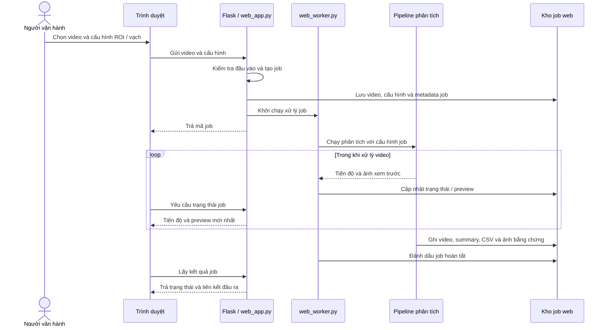

## 2.6. Tổng kết chương

Chương này đã xác định yêu cầu của hệ thống, mô tả kiến trúc xử lý video và thiết kế các module phát hiện, theo dõi, nhận diện đèn, kiểm tra giao cắt, lưu kết quả và giao diện. Trọng tâm của thiết kế là chỉ ghi nhận sự kiện ứng viên khi có track đi qua đoạn vạch theo hướng đã cấu hình và trạng thái đèn tại thời điểm giao cắt là đỏ. Các thiết kế này là cơ sở cho phần cài đặt và kiểm thử ở Chương 3.
---

# CHƯƠNG 3. XÂY DỰNG, TRIỂN KHAI VÀ KIỂM THỬ HỆ THỐNG

## 3.1. Môi trường phát triển và công nghệ sử dụng

Các công nghệ được lựa chọn theo vai trò trong sản phẩm. YOLO/PyTorch phục vụ huấn luyện và phát hiện; OpenCV xử lý video, ROI và ảnh; NumPy/SciPy hỗ trợ hình học và ghép cặp trong tracker tự cài; Flask/Waitress cung cấp giao diện web cục bộ. Ultralytics cung cấp API YOLO và ByteTrack baseline. Bảng 3.12 trình bày cấu trúc mã nguồn tích hợp.

| Công nghệ | Vai trò triển khai |
|---|---|
| Python | Ngôn ngữ chính cho pipeline, tracker, công cụ dữ liệu và web worker |
| PyTorch, Ultralytics YOLO | Huấn luyện/validation và suy luận phát hiện đối tượng |
| OpenCV, NumPy | Đọc/ghi video, tiền xử lý, ROI, HSV và phép tính hình học |
| SciPy | Thuật toán Hungarian trong tracker tự cài |
| Flask, Waitress | API và giao diện web chạy cục bộ |
| Roboflow | Quản lý/gán nhãn và export dữ liệu YOLO |

**Môi trường thực nghiệm:** phần cứng/phần mềm đối chiếu được và giới hạn về thời điểm ghi nhận được trình bày tại Bảng 3.9.

## 3.2. Xây dựng bộ dữ liệu

### 3.2.1. Nguồn dữ liệu và chuẩn bị dữ liệu

Theo thông tin của sinh viên, thư mục làm việc xử lý dữ liệu và huấn luyện là `TRAIN_DATA_ROOT`; dữ liệu dùng để train nằm trong thư mục con `Train`. Các thư mục dataset đặt trong repository trên ổ D chỉ để tham chiếu/minh họa, không được dùng làm nguồn dữ liệu huấn luyện.

Sinh viên tự tìm các đoạn CCTV giao thông từ một số tỉnh miền Nam và CCTV Đà Nẵng trên YouTube, cắt thành 2.078 ảnh, gán nhãn trên Roboflow, áp dụng lật ngang (flip H) để tăng số lượng và resize về 640×640. Kiểm đếm tên file có `flip` trong `NhanDienGiaoThong.v3i.yolo11` cho thấy có 732 ảnh flip: 515 ở train, 148 ở valid và 69 ở test. Project tự thu thập này được ghép với dataset `KLTN-vehicles` có 2.310 ảnh; kết quả hơn 4.300 ảnh được lưu thành `NhanDienGiaoThong.3i.yolo11`. Sau đó, sinh viên bổ sung dữ liệu Bus và Truck để tăng mẫu cho hai lớp còn ít, rồi ghép khoảng một nửa bộ Traffic Light Detection từ Roboflow để tạo bộ sáu lớp. Bộ dữ liệu sau ghép là `Final Merge`; sau bước clean thành `Final Cleaned`, sinh viên tải dữ liệu lên project Roboflow `DATADOANNEW`. Theo xác nhận của sinh viên, một số file gặp lỗi khi tải lên, nên bản còn lại có 11.668 ảnh; phiên bản này được tải lại vào thư mục `Train` trên ổ C để huấn luyện.

Workspace không lưu đủ metadata về số clip gốc, độ phân giải/FPS của từng nguồn hay điều kiện thời tiết/ánh sáng; không suy ra các trường này từ số ảnh.

**Bảng 3.1. Quy mô và vai trò các project dữ liệu theo ảnh chụp Roboflow**

| Project hiển thị trên Roboflow | Số ảnh hiển thị | Vai trò trong quy trình |
|---|---:|---|
| NhanDienGiaoThong | 2.078 | Ảnh CCTV sinh viên tự thu thập, cắt, gán nhãn; áp dụng lật ngang (flip H) và resize 640×640; thư mục `NhanDienGiaoThong.v3i.yolo11` có 732 ảnh tên chứa `flip` |
| KLTN-vehicles | 2.310 | Dataset có sẵn; ghép với bộ tự thu thập thành hơn 4.300 ảnh (`NhanDienGiaoThong.3i.yolo11`) |
| Bus | 1.000 | Bổ sung mẫu xe buýt |
| Truck | 1.016 | Bổ sung mẫu xe tải |
| Traffic Light Detection | 9.710 | Nguồn dữ liệu đèn; sử dụng khoảng một nửa |
| DATADOANNEW | 11.668 | Project Roboflow lưu bộ dữ liệu tổng hợp sau clean |

Các số nguồn là số hiển thị trên ảnh chụp Roboflow, không cộng thành tổng dataset vì `DATADOANNEW` là project đích sau tổng hợp. Ảnh chụp ghi project Traffic Light Detection có 9.710 ảnh. README và số file đếm được trong bản dataset đặt ở repository ổ D lần lượt ghi 1.176 và 10.886 ảnh/nhãn; theo xác nhận của sinh viên, các thư mục dataset ở ổ D chỉ là bản tham chiếu/minh họa, không phải nguồn dùng để train. Vì vậy, không dùng số đếm của bản ổ D để suy ra số ảnh Traffic Light đã thực sự lấy trong quy trình trên ổ C. Sinh viên xác nhận đã dùng khoảng một nửa bộ dữ liệu Roboflow, nhưng số chính xác của phiên bản nguồn được dùng chưa có manifest để đối soát. Dữ liệu huấn luyện thực tế được tải từ `DATADOANNEW` vào thư mục `Train` trên ổ C với 11.668 ảnh.

**Hình 3.1. Ví dụ ảnh từ các góc camera/điều kiện thu thập**
*Cần chọn ảnh CCTV được phép sử dụng, làm mờ biển số và thông tin nhận dạng trước khi đưa vào báo cáo.*

**Bảng 3.2. Metadata kỹ thuật và điều kiện thu thập cần hoàn thiện**

| Trường | Thông tin hiện có |
|---|---|
| Nguồn | CCTV giao thông và CCTV công khai trên YouTube |
| Số ảnh theo project | Có số liệu Roboflow tại Bảng 3.1 |
| Số clip gốc | Chưa thống kê |
| Độ phân giải/FPS từng nguồn | Chưa thống kê |
| Điều kiện thời tiết, thời gian, góc camera | Chưa lập bảng tổng hợp |

### 3.2.2. Tiền xử lý và gán nhãn

Sơ đồ thể hiện quy trình do sinh viên xác nhận. Các bản dataset trong repository ổ D chỉ dùng tham chiếu/minh họa; dữ liệu xử lý và train thực tế nằm dưới `TRAIN_DATA_ROOT`, trong đó bản tải từ Roboflow dùng train nằm trong `Train`.

```mermaid
flowchart TD
    A[2.078 ảnh CCTV tự thu thập, gán nhãn Roboflow<br/>lật ngang (flip H), resize 640x640]
    A --> B[Ghép 2.310 ảnh KLTN-vehicles]
    B --> C[NhanDienGiaoThong.3i.yolo11<br/>hơn 4.300 ảnh]
    C --> D[Bổ sung dữ liệu Bus và Truck]
    D --> E[Ghép khoảng một nửa bộ Traffic Light Detection]
    TL[Traffic Light Detection trên Roboflow] --> E
    E --> F[Final Merge<br/>bộ dữ liệu sáu lớp]
    F --> G[Clean dữ liệu]
    G --> H[Final Cleaned]
    H --> I[Tải lên Roboflow DATADOANNEW<br/>một số file lỗi]
    I --> J[Tải phiên bản 11.668 ảnh về<br/>C:\\Users\\ADMIN\\Downloads\\DATA\\XuLyData\\Train]
    J --> K[Huấn luyện YOLO26s<br/>70 epoch]
    R[Dataset trong repository ổ D<br/>chỉ tham chiếu/minh họa] -. không dùng train .-> H
```

#### Chuẩn hóa thứ tự lớp trong bộ dữ liệu gộp

Trong `TRAIN_DATA_ROOT\Final_cleaned\data.yaml`, thứ tự lớp trên máy là:

**Bảng 3.3. Thứ tự lớp trong YAML gộp và làm sạch**

| ID trên YAML gộp/làm sạch | Tên lớp | Ý nghĩa |
|---:|---|---|
| 0 | bus | Xe buýt |
| 1 | car | Ô tô con |
| 2 | truck | Xe tải |
| 3 | green | Đèn xanh |
| 4 | red | Đèn đỏ |
| 5 | yellow | Đèn vàng |

Đây là thứ tự dùng để mô tả các bước gộp và clean trên máy. Các script xử lý trong `TRAIN_DATA_ROOT` tạo `Final_merged` và `Final_cleaned` theo mapping này.

#### Ghép bộ dữ liệu giao thông ban đầu

Bộ dữ liệu phương tiện ban đầu được tạo bằng cách ghép project `NhanDienGiaoThong` do sinh viên tự thu thập/gán nhãn với project `KLTN-vehicles` tải từ Roboflow. Hai nguồn có các lớp phương tiện chung; riêng KLTN có thêm lớp xe máy nên lớp này được loại khỏi phạm vi bộ dữ liệu, sau đó nhãn được chuẩn hóa theo tên lớp trước khi ghép. Tên lớp và ID nguồn phải được đối chiếu bằng YAML của từng phiên bản, không mặc định ID giống nhau chỉ vì tên lớp giống nhau.

Trong thư mục xử lý hiện có, các script được lưu phục vụ những bước bổ sung Bus/Truck, ghép Traffic Light và clean; không thấy script riêng cho thao tác ghép ban đầu giữa `NhanDienGiaoThong` và `KLTN-vehicles`. Vì vậy, mô tả bước ghép ban đầu ở đây dựa trên quy trình do sinh viên cung cấp, chưa thể tái lập đầy đủ chỉ từ các script hiện lưu.

#### Bổ sung bus và truck

Do số lượng mẫu bus và truck trong bộ phương tiện ban đầu còn thấp, hai nguồn `Bus` và `Truck` được bổ sung riêng. Script `Code/01_merge_truck_bus_into_nhandien.py` giữ mapping `bus=0`, `car=1`, `truck=2` của bộ nền, remap `bus=0 → 0` và `truck=0 → 2`, đồng thời thêm prefix theo nguồn vào tên file để hạn chế trùng tên. Script giữ nguyên split train/valid/test của từng nguồn, không hoán đổi ảnh giữa các split. YAML của các nguồn Bus và Truck đều có một lớp ID 0; YAML của bộ nền có ba lớp `bus`, `car`, `truck`. Bước gộp ban đầu giữa `NhanDienGiaoThong` và `KLTN-vehicles` không có script trong workspace nên không thể tái lập chỉ từ các file hiện lưu.

#### Bổ sung và lấy mẫu dữ liệu đèn

`Code/02_merge_with_traffic_light.py` đọc từng split của thư mục nguồn cục bộ, không chuyển ảnh qua lại giữa train/valid/test. Trong mỗi split, script nhóm file nhãn theo tập class ID xuất hiện trong ảnh, đặt mục tiêu chọn \(\lceil N/2\rceil\) file, rồi phân bổ gần một nửa cho từng nhóm class-combination. Phần làm tròn được chọn để tổng bình phương sai lệch giữa số instance từng lớp được chọn và mục tiêu tỷ lệ gần một nửa là nhỏ nhất. Sau đó, file trong từng nhóm được xáo trộn bằng `random.Random` với seed lần lượt là 0 cho train, 1 cho valid và 2 cho test; cùng đầu vào và cùng mã sẽ cho cùng lựa chọn.

ID nguồn của Traffic Light được ánh xạ sang thứ tự trên máy: `green=0 → 3`, `red=1 → 4`, `yellow=2 → 5`. Các dòng nhãn được remap, ảnh và label được thêm prefix `TL_`. Bộ gốc không bị thay đổi. Cách lấy một nửa theo nhóm nhãn giúp giảm lượng ảnh đèn nhưng vẫn giữ gần tương quan lớp; nó không bảo đảm số instance từng lớp chính xác bằng một nửa do ảnh có thể chứa nhiều nhãn, file lỗi hoặc thiếu ảnh.

Script lưu trong hồ sơ có quy tắc lấy mục tiêu xấp xỉ một nửa số ảnh theo từng split và phân bổ theo nhóm class-combination. Bản dataset đặt trong repository ổ D có một số đếm nguồn/lấy mẫu riêng, nhưng đây chỉ là bản tham chiếu/minh họa, không phải bản xử lý dùng để train; vì vậy các số đếm đó không được dùng làm thống kê xác nhận số ảnh đèn thực tế trong `Final Merge` trên ổ C. Số lượng chính xác được lấy từ phiên bản Traffic Light Detection đã dùng trên ổ C hiện chưa có manifest để đối soát.

#### Làm sạch nhãn YOLO

Sau khi ghép dữ liệu phương tiện với dữ liệu đèn, script `03_data_cleaning.py` làm sạch `Final_merged` và ghi kết quả riêng vào `Final_cleaned`; dữ liệu nguồn không bị ghi đè. Quy trình này loại các dòng nhãn không hợp lệ, các ảnh/nhãn không còn cặp hợp lệ và chỉ giữ ảnh còn ít nhất một bbox hợp lệ. Việc clean kiểm tra cấu trúc, class ID, tọa độ và cặp file; không đồng nghĩa với việc kiểm duyệt lại tính đúng đắn ngữ nghĩa của từng nhãn.

Script kiểm tra ba split và từng cặp ảnh–nhãn:

1. Tìm ảnh và file label cùng stem; cặp thiếu ảnh hoặc thiếu label được ghi nhận và không đưa vào danh sách cặp hợp lệ.
2. Bỏ dòng trắng; mỗi dòng nhãn phải có đúng năm trường theo định dạng YOLO detection: `class_id x_center y_center width height`.
3. Kiểm tra class ID là số nguyên trong `[0,5]`; bốn tọa độ phải là số hữu hạn.
4. Kiểm tra tâm nằm trong `[0,1]`, width/height thuộc `(0,1]`, và toàn bộ hộp không vượt biên ảnh.
5. Dòng hợp lệ được giữ nguyên. Dòng không hợp lệ bị loại và ghi nguyên nhân vào `cleaning_report.csv`.
6. Hộp có diện tích dưới `0,0005` (0,05% diện tích ảnh) hoặc trên `0,90` (90%) chỉ được cảnh báo, không tự xóa. Quy tắc này đặc biệt quan trọng với đèn nhỏ: kích thước nhỏ không đủ căn cứ để bỏ nhãn.
7. Ảnh chỉ được sao chép khi sau lọc còn ít nhất một dòng nhãn hợp lệ. File nhãn rỗng hoặc toàn dòng sai định dạng không được đưa sang bộ clean.

Kết quả kiểm đếm từ các CSV clean hiện có:

**Bảng 3.4. Số liệu hồ sơ clean tham chiếu và quy mô bộ train**

| Split | `Final Merge` trong bản tham chiếu | `Final Cleaned` theo CSV tham chiếu | Bản Roboflow tải về train | Bbox hợp lệ theo hồ sơ clean |
|---|---:|---:|---:|---:|
| Train | 8.182 | 8.166 | Chưa đối soát theo split | 21.945 |
| Valid | 2.342 | 2.335 | Chưa đối soát theo split | 6.394 |
| Test | 1.175 | 1.171 | Chưa đối soát theo split | 3.170 |
| **Tổng** | **11.699** | **11.672** | **11.668** | **31.509** |

Các số `Final Merge`/`Final Cleaned` và bbox trong bảng được lấy từ CSV/bản dữ liệu tham chiếu hiện có trong repository ổ D; theo xác nhận của sinh viên, các thư mục này không phải đầu vào huấn luyện. Tổng 11.668 ảnh của bản Roboflow tải về dùng train được xác nhận riêng; chưa có bảng đối soát độc lập để phân bổ số lượng đó theo split. Tỷ lệ split 70%/20%/10% là của hồ sơ clean tham chiếu, không được xem là thống kê đã xác minh của bản train ở ổ C. Trong `cleaning_report.csv` có 87 dòng nhãn bị loại và 27 cặp mà mọi dòng đều không hợp lệ; cả 87 dòng bị loại đều sai số trường so với định dạng detection năm trường (21 dòng từ file có prefix `MERGED_`, 66 từ `TL_`). Một số dòng có rất nhiều tọa độ, phù hợp với khả năng nhãn polygon/segmentation hoặc định dạng khác; script clean không chuyển polygon thành bbox mà loại dòng đó. Cần xác minh nguồn nhãn trước khi kết luận đó là lỗi gán nhãn. Báo cáo còn có 2.232 bản ghi cảnh báo kích thước bbox được giữ nguyên; đây là số bản ghi cảnh báo, không phải số ảnh độc nhất.

CSV clean trong bản tham chiếu ghi 11.672 cặp ảnh–nhãn; bản tải về từ Roboflow dùng train còn 11.668 ảnh. Theo xác nhận của sinh viên, chênh lệch xuất phát từ một số file lỗi khi upload; chưa có log hoặc danh sách tên file để đối soát từng file lỗi. Vì vậy, 11.672 là số trong CSV clean được lưu để tham chiếu, còn 11.668 là quy mô bản Roboflow thực tế được tải về train.

Trong bản sao `Final_cleaned` đặt trong repository ổ D có ba ảnh JPG không có nhãn cùng stem (một ở train, hai ở test) và ba file `.txt` nằm trong `test/images`. Đây là tình trạng riêng của bản tham chiếu/minh họa ở ổ D, không được dùng để mô tả nội dung chính xác của export huấn luyện trên ổ C.

Phân bố bbox theo YAML/CSV của bản clean tham chiếu:

**Bảng 3.5. Phân bố bbox sau clean theo lớp và split**

| Lớp | Train | Valid | Test | Tổng |
|---|---:|---:|---:|---:|
| bus | 2.408 | 691 | 330 | 3.429 |
| car | 11.344 | 3.317 | 1.682 | 16.343 |
| truck | 3.052 | 915 | 445 | 4.412 |
| green | 1.953 | 587 | 263 | 2.803 |
| red | 2.065 | 587 | 296 | 2.948 |
| yellow | 1.123 | 297 | 154 | 1.574 |
| **Tổng** | **21.945** | **6.394** | **3.170** | **31.509** |

Lớp `car` chiếm khoảng 51–53% bbox trong mỗi split; lớp `yellow` ít hơn các lớp khác. Bởi vậy phân bố dữ liệu không đồng đều hoàn toàn. Script clean chỉ kiểm tra cấu trúc và phạm vi hình học; nó không thể khẳng định nhãn đúng ngữ nghĩa, phát hiện ảnh trùng lặp, hoặc biết một bbox có ôm đúng vật thể hay không. Các bước này cần rà soát trực quan bổ sung.

**Hình 3.2. Phân bố bbox theo lớp trong bộ dữ liệu clean**
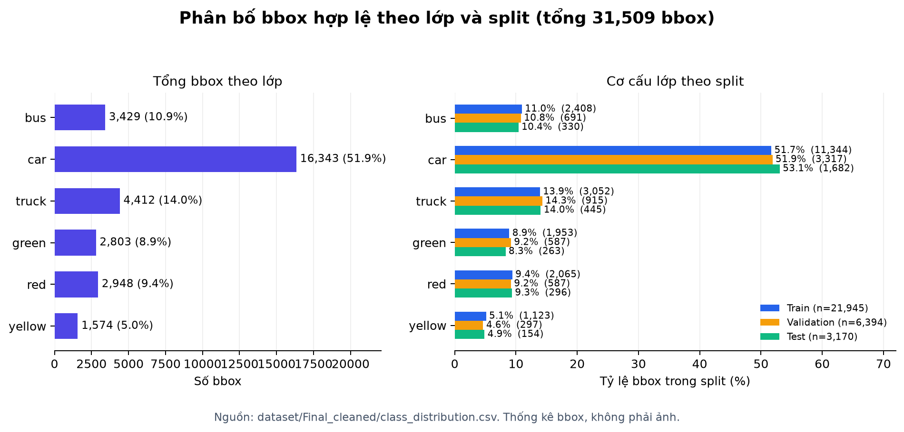

*Nguồn: `dataset/Final_cleaned/class_distribution.csv` trong bản tham chiếu ở repository ổ D; biểu đồ thể hiện số bbox của bản clean này, không phải số ảnh hay độ chính xác của mô hình. Không dùng biểu đồ này như thống kê độc lập của export đã train.*

#### Gán nhãn dữ liệu

Sinh viên tự gán nhãn bằng Roboflow hơn 2.000 ảnh trong project `NhanDienGiaoThong`. Project `KLTN-vehicles` và các nguồn Bus, Truck, Traffic Light Detection được dùng theo nhãn có sẵn sau khi loại lớp ngoài phạm vi và chuẩn hóa class mapping theo tên. Bộ lớp thống nhất sau cùng gồm `bus`, `car`, `truck`, `green`, `red`, `yellow`. Nhãn detection YOLO mô tả class và bounding box; dữ liệu hiện có không chứa nhãn ID liên tục kiểu MOT hoặc nhãn frame vi phạm để đánh giá sự kiện.

**Bảng 3.6. Quy tắc lớp detection trong dataset**

| Nhãn | Đối tượng được gán | Ghi chú |
|---|---|---|
| `bus` | Xe buýt | Phương tiện |
| `car` | Ô tô con | Phương tiện |
| `truck` | Xe tải | Phương tiện |
| `green` | Tín hiệu đèn xanh | Trạng thái đèn |
| `red` | Tín hiệu đèn đỏ | Trạng thái đèn |
| `yellow` | Tín hiệu đèn vàng | Trạng thái đèn |

**Hình 3.3. Ví dụ nhãn bbox cho phương tiện và đèn tín hiệu**
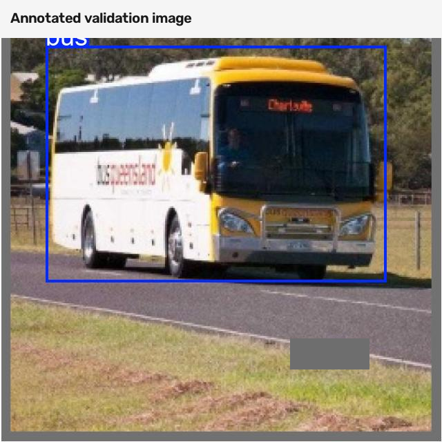

*Nguồn: ảnh `val_batch0_labels.jpg` trong hồ sơ train. Hình minh họa nhãn detection ở cấp ảnh; dữ liệu này không có ID MOT theo chuỗi.*

Không có hồ sơ về việc hai người gán độc lập, đo IoU giữa người gán hoặc quy trình phân xử bất đồng. Vì vậy không báo cáo độ đồng thuận gán nhãn; kiểm tra clean xác nhận cú pháp/tọa độ, không chứng minh tính đúng đắn ngữ nghĩa.

#### Định dạng và lưu trữ dữ liệu

Nhãn lưu theo định dạng YOLO detection gồm `class_id x_center y_center width height`, với tọa độ chuẩn hóa theo kích thước ảnh. Thư mục làm việc xử lý dữ liệu là `TRAIN_DATA_ROOT`; phiên bản Roboflow 11.668 ảnh tải về phục vụ huấn luyện nằm trong `TRAIN_DATA_ROOT\Train`. Các thư mục dataset trong repository ổ D chỉ là bản tham chiếu/minh họa.

Sau khi clean, dữ liệu được tải lên project Roboflow `DATADOANNEW`; theo xác nhận của sinh viên, một số file gặp lỗi trong quá trình tải. Phiên bản còn 11.668 ảnh được tải lại từ Roboflow vào thư mục `Train` trên ổ C để huấn luyện. README của bản export ghi định dạng YOLO26, auto-orientation, resize 640×640 kiểu Stretch và không augmentation. YAML export ghi:

```yaml
nc: 6
names:
  - bus
  - car
  - green
  - red
  - truck
  - yellow
```

Sau khi đưa bộ clean lên project Roboflow `DATADOANNEW` và tải phiên bản export về để train, thứ tự lớp trong YAML export khác với thứ tự trong `Final_cleaned/data.yaml`. Mapping theo **tên lớp** từ YAML trên máy sang YAML export dùng khi train là:

**Bảng 3.7. Mapping class ID từ YAML clean sang export train**

| Tên lớp | ID YAML gộp/clean trên máy | ID YAML export dùng train |
|---|---:|---:|
| bus | 0 | 0 |
| car | 1 | 1 |
| truck | 2 | 4 |
| green | 3 | 2 |
| red | 4 | 3 |
| yellow | 5 | 5 |

ID số của một lớp có thể khác giữa hai phiên bản mà không làm thay đổi ý nghĩa lớp, miễn là nhãn đã được export/remap nhất quán theo tên. Vì vậy, khi mô tả thao tác gộp/clean phải dùng thứ tự lớp trên máy như các bảng ở trên; khi mô tả huấn luyện phải nêu thứ tự của `export-yolo26/data.yaml`. Không được lấy ID số từ giai đoạn này gán thẳng cho giai đoạn kia nếu chưa đối chiếu tên. `train.py` kiểm tra thứ tự export đúng bằng danh sách `bus, car, green, red, truck, yellow`, và model trả tên lớp theo thứ tự export. Pipeline inference lấy tên từ checkpoint nên lớp `truck` vẫn được gọi theo tên dù ID đổi.

README của bản export `DATADOANNEW` ghi 11.668 ảnh. CSV clean được lưu trong bản tham chiếu ghi 11.672 cặp ảnh–nhãn (8.166 train, 2.335 valid và 1.171 test); đây là số liệu của bản clean, không phải thống kê độc lập từ thư mục train trên ổ C. Sinh viên xác nhận một số file lỗi khi upload, dẫn đến bản Roboflow tải về còn 11.668 ảnh; chưa có log/tên file để đối soát từng file lỗi.

### 3.2.3. Chia tập dữ liệu

Theo script và CSV của bản clean tham chiếu, các split Train/Valid/Test được giữ riêng trong bước lấy mẫu dữ liệu đèn, không chuyển ảnh qua lại; tỷ lệ ảnh clean xấp xỉ 70%/20%/10%. Đây không phải phép kiểm kê độc lập dữ liệu export trên ổ C. Chưa xác minh được toàn bộ nguồn được chia theo clip/giao lộ, vì vậy không khẳng định độc lập theo camera hoặc không rò rỉ cảnh giữa các split.

Thống kê số ảnh và bbox từng split trình bày tại Bảng 3.4.

### 3.2.4. Tăng cường dữ liệu

Workspace có script `Code/04_preprocessing.py` để tạo bản ngoại tuyến `dataset/Final_preprocessed`, nhưng thư mục đầu ra này hiện chưa tồn tại và `args.yaml` của lần train trỏ tới export Roboflow `export-yolo26`; vì vậy không có bằng chứng script ngoại tuyến được dùng để tạo dữ liệu của lần train. Script dự kiến giữ nguyên validation/test và tạo tối đa năm biến thể cho mỗi ảnh train có ít nhất một lớp thuộc `{bus, truck, green, red, yellow}`: lật ngang với xác suất 0,5, xoay trong khoảng \(-15^\circ\) đến \(15^\circ\) với xác suất 0,7, rồi điều chỉnh độ sáng/tương phản. Bounding box được biến đổi theo ảnh và cắt về biên; cả các nhãn trong ảnh đủ điều kiện đều được giữ/biến đổi, kể cả `car` nếu ảnh đó có nhiều lớp. Seed ngoại tuyến là 42. Đây là mô tả khả năng của script, không phải số mẫu đã thực sự sinh.

README của export `DATADOANNEW` ghi auto-orientation và resize 640×640 kiểu Stretch, không áp dụng augmentation ngoại tuyến. Trong lần train, tăng cường trực tuyến do Ultralytics thực hiện theo `args.yaml`, gồm HSV, lật ngang, scale/translate và mosaic; mosaic có giá trị 1,0 và đóng ở 10 epoch cuối. Không diễn giải `mosaic=1,0` thành tỷ lệ ảnh cuối cùng đã tăng cường. Cần phân biệt resize Stretch trong dữ liệu train với letterbox/crop ROI dùng ở pipeline suy luận.

**Bảng 3.8. Các tham số tăng cường chính trong hồ sơ huấn luyện**

| Tham số | Giá trị |
|---|---:|
| HSV hue / saturation / value | 0,015 / 0,7 / 0,4 |
| Translate / scale | 0,1 / 0,5 |
| Horizontal flip (`fliplr`) | 0,5 |
| Mosaic | 1,0; đóng mosaic 10 epoch cuối |
| MixUp / CutMix | 0 / 0 |

**Hình 3.4. Sơ đồ phân biệt tiền xử lý dataset và ảnh suy luận**

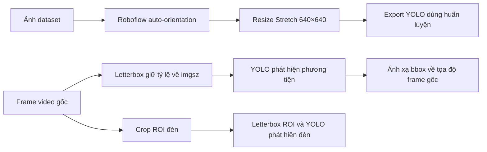

*Sơ đồ thể hiện hai giai đoạn khác nhau theo README export và pipeline suy luận; không dùng resize Stretch của dataset để diễn giải cách tiền xử lý video lúc chạy.*

## 3.3. Huấn luyện mô hình phát hiện

Lần huấn luyện được đối chiếu trong báo cáo sử dụng dataset export YOLO26 từ Roboflow, với sáu lớp theo đúng thứ tự trong YAML export ở Mục 3.2.2.

### 3.3.1. Môi trường phần cứng và phần mềm

Hồ sơ train ghi `device: "0"` và nằm trong thư mục huấn luyện trên máy Windows. Khi đối chiếu trực tiếp môi trường hiện có ngày 16/11/2026, thư mục `Train` có virtual environment riêng với Python 3.11.9, PyTorch 2.5.1+cu121, CUDA runtime 12.1 và Ultralytics 8.4.198; CUDA khả dụng trên NVIDIA GeForce RTX 3050 Laptop GPU 4 GB. Máy lưu hồ sơ hiện báo CPU Intel Core i5-12500H, RAM khả dụng khoảng 15,7 GiB và Windows 11 Pro build 26200. Tuy nhiên, không có snapshot hệ điều hành/driver tại đúng thời điểm chạy train ngày 03/11/2026; các phiên bản phần mềm được đọc từ virtual environment hiện còn trong thư mục train, còn thông tin máy chủ được đọc từ máy hiện tại. Vì vậy, báo cáo ghi rõ nguồn và thời điểm đối chiếu, không khẳng định đây là log lịch sử độc lập.

**Bảng 3.9. Môi trường máy lưu hồ sơ huấn luyện và virtual environment**

| Thành phần | Thông tin đã đối chiếu | Nguồn/giới hạn |
|---|---|---|
| GPU | NVIDIA GeForce RTX 3050 Laptop GPU, VRAM 4 GB; `args.yaml` chọn GPU 0 | CUDA khả dụng; thông tin đọc trên máy hiện tại |
| CPU/RAM | Intel Core i5-12500H; RAM khả dụng khoảng 15,7 GiB | Đọc từ hệ điều hành hiện tại |
| Hệ điều hành | Windows 11 Pro, build 26200 | Không có bản ghi snapshot tại thời điểm train |
| Python | 3.11.9 | Đọc từ `Train\.venv` |
| PyTorch/CUDA | PyTorch 2.5.1+cu121; CUDA runtime 12.1 | Đọc từ `Train\.venv`; CUDA khả dụng |
| Ultralytics | 8.4.198 | Đọc từ `Train\.venv` |
| Dữ liệu/model | `export-yolo26/data.yaml`, khởi tạo `yolo26s.pt` | Xác nhận từ `args.yaml` |

### 3.3.2. Siêu tham số huấn luyện

Hồ sơ `args.yaml` ghi training script dùng `export-yolo26/data.yaml`, với `train/images`, `valid/images`, `test/images`; split validation được dùng trong quá trình huấn luyện. Script tìm `data.yaml` theo thứ tự `export-yolo26`, `export-yolov11`, `export-yolov8`, còn hồ sơ lần chạy xác nhận lựa chọn `export-yolo26`.

**Bảng 3.10. Siêu tham số huấn luyện theo `args.yaml`**

| Tham số | Giá trị ghi trong hồ sơ |
|---|---|
| Mô hình khởi tạo | `yolo26s.pt` |
| Số epoch | 70 |
| Kích thước ảnh | 640 |
| Batch | 4 |
| Thiết bị train | GPU 0 |
| Optimizer | AdamW |
| Learning rate ban đầu (`lr0`) | 0,005 |
| Learning rate cuối (`lrf`) | 0,1 |
| Patience | 200 |
| Workers | 4 |
| Seed | 0; deterministic bật |
| Mosaic | 1,0 |
| Resume | False |
| Dữ liệu | `datasets/export-yolo26/data.yaml` |

Script `train.py` lưu trong thư mục Train kiểm tra class order và thay BCE loss bằng `BCEWithLogitsLoss` có `pos_weight`: bus 1,000; car 0,458; green 1,106; red 1,079; truck 0,881; yellow 1,476. Đây là trọng số loss, không phải confidence lúc suy luận. Script in dòng `[Custom BCE] pos_weight` khi hàm loss được khởi tạo. Tuy nhiên, trong hồ sơ lượt train hiện chỉ có `args.yaml`, `results.csv`, checkpoint và ảnh biểu đồ/batch; không tìm thấy log console gốc. Vì thế có thể xác nhận mã train được cấu hình để dùng trọng số này, nhưng chưa thể xác nhận bằng log rằng monkeypatch đã được gọi trong chính lượt tạo checkpoint. Báo cáo không xem riêng kết quả validation là bằng chứng cho việc trọng số đã được áp dụng.

### 3.3.3. Kết quả huấn luyện và validation

Từ `results.csv`, có 70 dòng kết quả tương ứng 70 epoch. Epoch 70 có mAP50–95 cao nhất trong file:

**Bảng 3.11. Kết quả detector tổng hợp tại epoch 70**

| Epoch | Precision | Recall | mAP50 | mAP50–95 |
|---:|---:|---:|---:|---:|
| 70 | 0,92017 | 0,84876 | 0,91845 | 0,68871 |

Đây là các số đo trên validation theo pipeline Ultralytics. Precision và Recall là chỉ số tổng hợp, không thể dùng để suy ra trực tiếp xác suất một sự kiện vượt đèn được xác nhận đúng. mAP50–95 thấp hơn mAP50 cho thấy điểm số giảm khi yêu cầu hộp dự đoán khớp chặt hơn ở các ngưỡng IoU cao hơn.

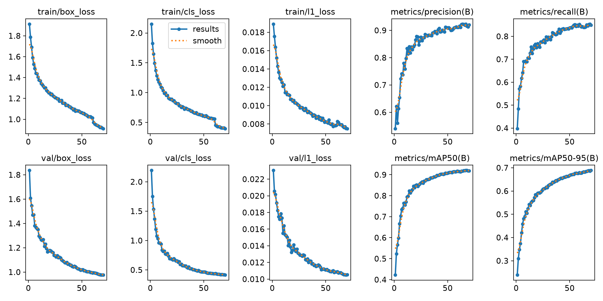

**Hình 3.5. Đường cong loss và các chỉ số validation theo epoch**
*Nguồn: `runs/do_an_tn/results.png` từ hồ sơ huấn luyện.*

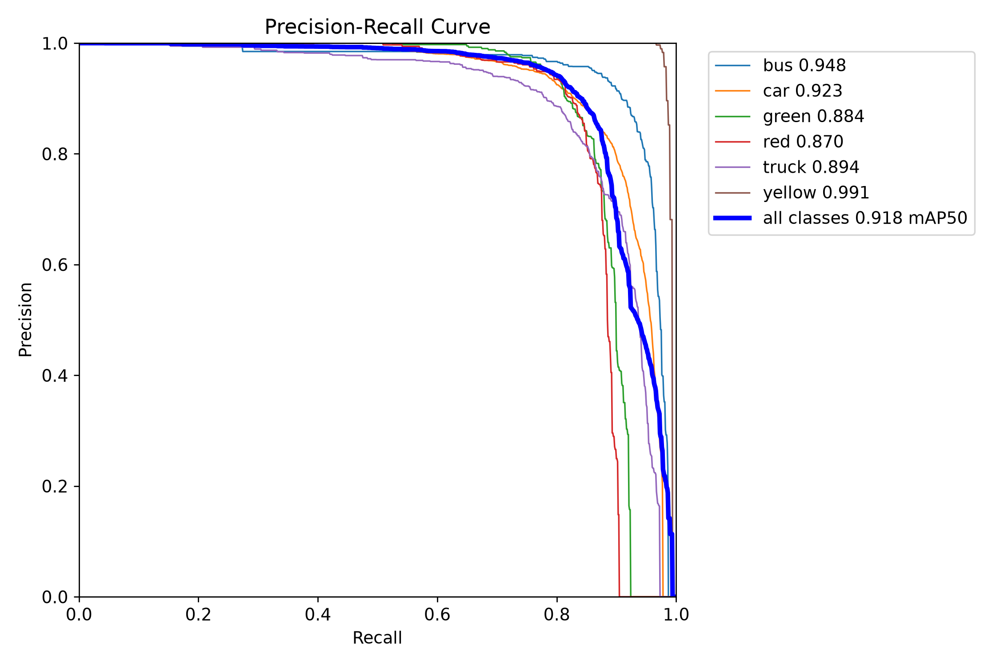

**Hình 3.6. Đường cong Precision–Recall của detector trên validation**
*Nguồn: `runs/do_an_tn/BoxPR_curve.png` từ hồ sơ huấn luyện.*

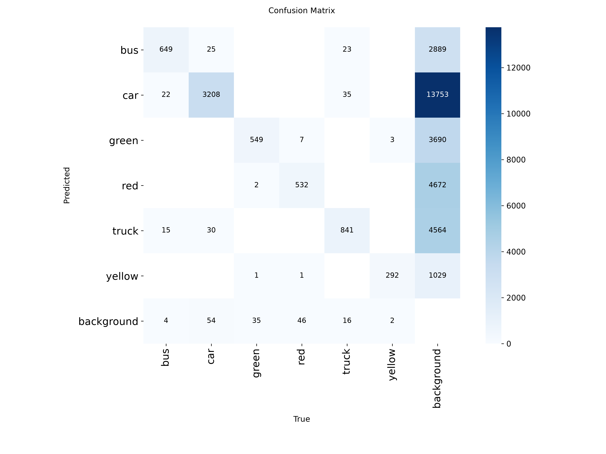

**Hình 3.7. Ma trận nhầm lẫn của detector trên validation**
*Nguồn: `runs/do_an_tn/confusion_matrix.png` từ hồ sơ huấn luyện.*

Chưa có bảng Precision/Recall/mAP tách riêng theo từng lớp trong bản ghi được đối chiếu; cần chạy hoặc khôi phục báo cáo validation per-class nếu muốn đưa bảng này vào bản nộp.

**Chưa có căn cứ để báo cáo mAP trên tập test:** hồ sơ hiện có xác nhận validation trong quá trình train, nhưng chưa tìm thấy báo cáo đánh giá độc lập trên split `test`. Không trình bày chỉ số validation như chỉ số test.

## 3.4. Cài đặt và tích hợp hệ thống

### 3.4.1. Cấu trúc mã nguồn

Các tệp chính:

**Bảng 3.12. Cấu trúc mã nguồn chính**

| Tệp/thư mục | Chức năng |
|---|---|
| `main.py` | Điểm vào ứng dụng CLI |
| `Code/05_roi_config.py` | GUI cấu hình đa giác xe, đa giác đèn và vạch |
| `Code/06_run_detection.py` | Pipeline suy luận, ByteTrack, đèn, giao cắt và ghi kết quả |
| `tracking/custom_bytetrack/` | Triển khai ByteTrack tự cài, association, lifecycle, stitching và preset |
| `tracking/reid/` | Trích xuất và so sánh histogram màu HSV |
| `tracking/ultralytics_tracker/` | Adapter gọi ByteTrack tích hợp của Ultralytics |
| `scripts/run_ablation.py` | Chạy tuần tự các preset A–F trên CPU và tổng hợp kết quả |
| `project_paths.py` | Các đường dẫn project dùng chung |
| `web_app.py` | API và giao diện web cục bộ |
| `web_worker.py` | Worker chạy model, tiến độ và mã hóa video kết quả |
| `web/` | HTML, CSS, JavaScript cho ứng dụng VIA |
| `config/roi_config.json` | ROI của video mẫu trên máy |
| `models/best.pt` | Checkpoint dùng mặc định trong project |
| `TRAIN_DATA_ROOT\Final_cleaned\` | Dataset clean trên máy và báo cáo thống kê |

### 3.4.2. Cài đặt các module chính

Các module được phân vai trong Bảng 3.12. Pipeline inference dùng chung cho CLI và web; `web_app.py`/`web_worker.py` xử lý phiên web, còn `tracking/` cung cấp adapter Ultralytics, backend ByteTrack tự cài và đặc trưng appearance.

CLI mặc định dùng `models/best.pt`, CPU, ByteTrack Ultralytics và `config/roi_config.json`; có thể chọn tracker tự cài bằng `--tracker bytetrack`. Giao diện web dùng `models/best.pt`, GPU CUDA 0 và mặc định chọn ByteTrack tự cài với appearance ReID; có thể đổi sang Ultralytics trong cấu hình job. Các tham số CLI gồm `--weights`, `--video`, `--config`, `--device`, `--imgsz`, `--light-conf`, `--vehicle-conf` và `--track-conf`. Nếu không chỉ định `--track-conf`, Ultralytics dùng giá trị nhỏ hơn giữa `light_conf` và `vehicle_conf`, còn tracker tự cài dùng 0,1. Ngưỡng `vehicle_conf` lọc bước xét quỹ đạo/sự kiện, không ẩn hộp track hợp lệ trong ROI.


**Phần việc tự thực hiện và nội dung kế thừa.**

Phần sinh viên trực tiếp thực hiện theo thông tin và hiện vật của dự án:

1. Tìm, cắt và gán nhãn 2.078 ảnh CCTV từ một số tỉnh miền Nam và Đà Nẵng trên YouTube bằng Roboflow; áp dụng lật ngang (flip H) để tăng dữ liệu, với 732 ảnh flip được kiểm đếm theo tên file trong các split train/valid/test; resize 640×640.
2. Ghép với 2.310 ảnh `KLTN-vehicles`, tạo project `NhanDienGiaoThong.3i.yolo11` có hơn 4.300 ảnh; sau đó bổ sung dữ liệu Bus và Truck.
3. Ghép khoảng một nửa bộ Traffic Light Detection từ Roboflow để tạo bộ sáu lớp `Final Merge`, rồi clean thành `Final Cleaned`.
4. Tải bộ đã clean lên Roboflow `DATADOANNEW`; một số file tải lên lỗi nên phiên bản còn 11.668 ảnh. Tải phiên bản này vào thư mục `Train` trên ổ C để huấn luyện; các bản dataset trong repository ổ D chỉ dùng tham chiếu/minh họa.
5. Đối chiếu thứ tự lớp theo tên và điều chỉnh mã train để kiểm tra class order, thiết lập trọng số loss theo lớp.
6. Tích hợp checkpoint vào pipeline phát hiện, ROI, logic trạng thái đèn, giao cắt vạch và lưu bằng chứng; triển khai thêm baseline ByteTrack bằng NumPy/SciPy và công cụ đối chiếu hai tracker.
7. Xây dựng giao diện cục bộ để cấu hình, chọn tracker, theo dõi, xem và rà soát kết quả.

Phần kế thừa gồm kiến trúc và trọng số khởi tạo YOLO, API YOLO/ByteTrack của Ultralytics ở chế độ mặc định, thư viện OpenCV/PyTorch và các công cụ Roboflow. Module ByteTrack tự cài là phần triển khai lại thuật toán nền để học tập và đối chiếu; báo cáo không xem ByteTrack gốc là thuật toán do sinh viên tự phát minh.

**Bảng 3.13. Phân loại phần tự thiết kế, dùng lại có điều chỉnh và dùng nguyên**

| Hạng mục | Phân loại | Mô tả |
|---|---|---|
| Quy trình gộp/remap/clean dữ liệu | Tự xây dựng và điều chỉnh | Script theo nguồn, class map và quy tắc clean của dự án |
| Training script và mapping class | Dùng lại có điều chỉnh | Dựa trên Ultralytics, thêm kiểm tra class order và trọng số loss |
| Detector YOLO và weights khởi tạo | Dùng lại | Kiến trúc/pretrained model từ Ultralytics |
| ByteTrack baseline | Dùng lại | API tracking của Ultralytics |
| ByteTrack tự cài | Tự triển khai theo thuật toán đã công bố | Association, trạng thái và các tùy chọn mở rộng; không tuyên bố thuật toán nền là phát minh mới |
| Luật giao cắt, ROI và đầu ra sự kiện | Tự xây dựng cho pipeline | Cấu hình pixel theo camera và luật hình học |
| Giao diện VIA/web | Tự xây dựng trên thư viện nền | Quản lý job cục bộ, lựa chọn tracker và rà soát sự kiện |

---

### 3.4.3. Giao diện hệ thống

Giao diện web có luồng tải video, cấu hình ROI/vạch, lựa chọn các mục tùy chọn, tiến độ xử lý, xem đầu ra và rà soát sự kiện. CLI cho phép chạy pipeline theo tham số dòng lệnh và công cụ ROI riêng. Hồ sơ hiện có video đầu ra và ảnh bằng chứng theo job, nhưng chưa lưu ảnh chụp riêng của giao diện.


## 3.5. Kiểm thử phần mềm

### 3.5.1. Kiểm thử đơn vị và kiểm thử chức năng

Trong mã nguồn có các kiểm thử đơn vị cho parser/cấu hình, detector, association, lifecycle, geometry, stitching, preset, API web, worker và giao diện. Lần xác minh ngày 15/11/2026 chạy `.\.venv\Scripts\python.exe -m unittest discover -s tests -v` đạt 52/52 kiểm thử Python; `npm run test:ui` đạt 11/11 kiểm thử giao diện. Đây là kết quả kiểm thử hồi quy trên workspace tại ngày chạy, không phải đánh giá độ chính xác phát hiện vi phạm.

**Bảng 3.14. Phạm vi kiểm thử phần mềm**

| Nhóm | Nội dung kiểm thử | Trạng thái |
|---|---|---|
| Pipeline detection | Lọc ROI/confidence, giao cắt, đầu ra | Có trong bộ 52 kiểm thử Python; toàn bộ đạt |
| Tracker tự cài | Association, Kalman, lifecycle, stitching, preset | Có trong bộ 52 kiểm thử Python; toàn bộ đạt |
| Web/API/worker | Lưu cấu hình, truyền tracker, tiến độ và job | Có trong bộ 52 kiểm thử Python; toàn bộ đạt |
| UI | Các luồng tương tác và lựa chọn tracker | 11/11 kiểm thử giao diện đạt |

### 3.5.2. Kiểm tra tính đúng đắn của bộ theo dõi

Phép kiểm tra baseline đã lưu trước đây báo cáo hai chế độ cho kết quả ghép ID/hộp tương đương trên một lần chạy Test 6 với confidence được cố định. Đây là kiểm tra tương đương giữa các triển khai, không phải xác nhận ID đúng theo ground truth. Chi tiết và hạn chế được nêu ở Mục 3.7.1.

## 3.6. Thiết lập thực nghiệm và tiêu chí đánh giá

### 3.6.1. Bộ video thử nghiệm

Các lần chạy dưới đây là lượt xử lý phần mềm. Ground truth Test 6 mới được bổ sung ngày 15/11/2026; các job cũ không mặc nhiên dùng cùng checkpoint/ROI/ngưỡng với ground truth. Smoke A–F chỉ xử lý 30 frame.

**Bảng 3.15. Bộ video và vai trò các lần chạy được lưu**

| Video/lượt chạy | Số frame | Thiết bị | Vai trò | Ground truth |
|---|---:|---|---|---|
| `samples/video.mp4` | 950 | GPU 0 | Kiểm tra đầu ra pipeline mẫu | Không có |
| `Test 6.mp4`, job ngày 03/11/2026 | 1.771 | GPU 0 | Kết quả lịch sử, checkpoint không còn | Không có |
| `Test 6.mp4`, job web ngày 09/11/2026 | 1.771 | GPU 0 | Kết quả lịch sử dùng `models/best.pt` | Có ba nhãn sự kiện dương tính; chưa có xác nhận trực quan cho lượt này |
| `Test 6.mp4`, chạy CLI ngày 15/11/2026 | 1.771 | GPU 0 | Kết quả lịch sử trước appearance ReID | Có ba nhãn sự kiện dương tính; chưa có xác nhận trực quan riêng cho lượt này |
| Smoke A–F | 30 mỗi preset | CPU | Kiểm tra pipeline có chạy hết | Không có |
| `test_videos/ground_truth/test6_violation_events.json` | 1.771 | — | Ba sự kiện dương tính được chép từ bảng XLSX đã ghi trong báo cáo | Dùng làm ground truth giới hạn; chưa đủ nhãn âm tính/track |

Các job web đã được người dùng xem lại trực quan và đánh giá sơ bộ là khá ổn. Những lượt có đủ metadata xác nhận dùng tracker tự cài được tổng hợp dưới đây; `center` là điểm tâm bbox, còn ROI/vạch được cấu hình riêng theo từng video.

**Bảng 3.15a. Các lượt kiểm thử web dùng tracker tự cài và điểm tâm bbox**

| Video/job đã lưu | Kích thước; frame xử lý | Cấu hình theo dõi | Track/object duy nhất | Sự kiện AI (frame được ghi) | FPS |
|---|---|---|---:|---|---:|
| Test 6 Demo che khuất, job `79c15e908a3f4e3ca2c61254ac49f3c0` | 1542×1080; 1771/1771 | ByteTrack tự cài, `center`, `track_conf=0,1`, directional gating bật; ReID không được ghi trong artifacts | 30 track | 3 (227, 315, 1327) | 10,58 |
| Test 6 Demo che khuất, job `8c897bd0952d4910a83b0c5945f15075` | 1542×1080; 1771/1771 | ByteTrack tự cài, `center`, `track_conf=0,1`, ReID bật (`track_buffer=60`, `reid_window=60`), directional gating bật | 39 track / 33 object | 3 (233, 329, 1328) | 10,82 |
| Test 7, job `596cfc7e51db46a08e40e30da26228f0` | 886×618; 2163/2163 | ByteTrack tự cài, `center`, `track_conf=0,1`, ReID bật, directional gating bật | 36 track / 29 object | 1 (1370) | 12,81 |
| Test 8, job `ba2cf850cf254b948d4fb76c9aa3dc8b` | 886×608; 2424/2424 | ByteTrack tự cài, `center`, `track_conf=0,1`, ReID bật, directional gating bật | 29 track / 21 object | 0 | 12,70 |

Các số sự kiện là đầu ra của từng job, không phải số vi phạm đã được xác nhận. Hai job Test 6 Demo dùng cùng video nguồn nhưng cấu hình khác nhau nên không dùng chênh lệch số track/FPS để kết luận ReID tốt hơn. Test 6 Demo có kích thước và SHA-256 khác video `test_videos/Test 6.mp4` trong ground truth; không ghép các nhãn frame 221/317/1304 vào video Demo. Test 7 và Test 8 chưa có ground truth sự kiện. Toàn bộ job giữ `input.mp4`, `config.json`, `summary.json` và video kết quả trong thư mục `.webdata/jobs/<job-id>/`, cho phép xem lại đầu ra và cấu hình.

Các job hoàn tất Test 1–4 cũng còn `summary.json` và video kết quả: Test 1 (2768 frame, 10,74 FPS, 82 track), Test 2 (2176, 11,30 FPS, 17 track), Test 3 (2346, 13,54 FPS, 17 track) và Test 4 (2372, 13,80 FPS, 25 track); mỗi summary ghi 0 sự kiện AI. Tuy nhiên, các artifacts này không ghi tracker và `GROUND_POINT_MODE`, nên chỉ được xem là lịch sử chạy pipeline, không gộp vào kết quả xác nhận ByteTrack tự cài + `center`. Thư mục Test 5 hiện chỉ có video tải lên, poster và trạng thái job, chưa có summary/video kết quả hoàn tất.

### 3.6.2. Gán nhãn ground truth cấp sự kiện vi phạm

Bảng sự kiện độc lập của Test 6 ghi ba lần xe đi hướng `up` qua vạch khi đèn `red`, tại các frame 221, 317 và 1304; các mã track trong XLSX lần lượt là 9, 11 và 22. Người dùng đã xác nhận cho phép dùng ba nhãn sự kiện này làm ground truth. Các nhãn đã được chuẩn hóa vào `test_videos/ground_truth/test6_violation_events.json`; SHA-256 trong file xác nhận video là `test_videos/Test 6.mp4` (886 × 620, 1.771 frame).

Gói nguồn `GROUND_TRUTH_TRAFFIC_VIDEO_01/` và workbook gốc hiện không có trong workspace; file JSON được chép lại từ số liệu đã ghi trong báo cáo. Quy ước đánh số frame 0-based hay 1-based chưa thể đối chiếu lại với XLSX; các mã track XLSX (9, 11, 22) cũng chưa được ánh xạ xác nhận sang ID CVAT XML. Tuy vậy, người dùng đã xem trực tiếp video của lượt chạy bổ sung và xác nhận ba sự kiện hệ thống đều tương ứng với ba sự kiện đã gán nhãn; chênh lệch frame đến từ thời điểm giao cắt theo ROI/vạch cấu hình. Ground truth vẫn chỉ có ba sự kiện dương tính, chưa rà hết các đoạn không vi phạm và chưa gồm nhãn đầy đủ trạng thái đèn/toàn bộ track.

Người dùng đã đối chiếu trực quan lượt bổ sung với video và xác nhận ba sự kiện phát hiện đều tương ứng với ba sự kiện dương tính trong nhãn. Kết quả hỗ trợ xác nhận đúng ba trường hợp này dù frame giao cắt khác nhau do cấu hình ROI/vạch. Tuy nhiên, ground truth chưa rà hết các đoạn không có sự kiện, do đó chưa đủ để tính precision/recall, FP/FN toàn video hoặc HOTA/IDF1/MOTA.

### 3.6.3. Các chỉ số đánh giá (phát hiện, theo dõi, cấp sự kiện)

Detector có Precision, Recall, mAP50 và mAP50–95 trên validation như Bảng 3.11. Trong lượt Test 6 bổ sung, người dùng xác nhận trực quan cả ba sự kiện dương tính được hệ thống phát hiện. Vì ground truth chưa rà hết các đoạn không có sự kiện và chưa có nhãn ID theo toàn bộ frame, chưa thể tính precision/recall, FP/FN toàn video hoặc HOTA/IDF1/MOTA/IDSW. FPS là tốc độ xử lý của từng lần chạy, không phải thước đo độ chính xác.

**Bảng 3.16. Chỉ số có thể báo cáo và tình trạng dữ liệu**

| Cấp đánh giá | Chỉ số | Tình trạng |
|---|---|---|
| Detector | Precision, Recall, mAP50, mAP50–95 | Có trên validation; chưa có báo cáo test độc lập |
| Tracking | HOTA, IDF1, MOTA, IDSW | Chưa tính; cần xác nhận ID và hoàn thiện nhãn |
| Sự kiện | TP, FN, FP, trùng, precision, recall | Lượt bổ sung Test 6: 3/3 sự kiện dương tính được người dùng xác nhận trực quan; chưa đủ nhãn âm tính để tính chỉ số toàn video |
| Tốc độ | FPS, thời gian xử lý, số frame | Có cho một số job; phải gắn với cấu hình cụ thể |

`Output/summary.json` và `Output/RUN_REPORT.md` lưu lần chạy CLI trước khi bật appearance ReID; `Output/` được giữ nguyên và không đại diện cho lượt ReID cuối:

**Bảng 3.17. Kết quả CLI Test 6 trước ReID, ngày 15/11/2026**

| Chỉ số | Giá trị ghi nhận |
|---|---:|
| Độ phân giải | 886 × 620 |
| FPS nguồn | 30 |
| Tổng frame / đã xử lý | 1.771 / 1.771 |
| Thời lượng video | 59,03 giây |
| Thiết bị | GPU 0 |
| Thời gian xử lý | 68,50 giây |
| Tốc độ trung bình | 25,86 FPS |
| ID phương tiện duy nhất | 19 |
| Frame phát hiện đỏ / xanh / vàng | 565 / 425 / 90 |
| Trạng thái đỏ / xanh / vàng / unknown | 961 / 718 / 90 / 2 |
| Sự kiện được ghi nhận | 3 |

Lệnh đã dùng cho lượt chạy này:

```powershell
.\.venv\Scripts\python.exe -X utf8 .\main.py `
  --weights .\models\best.pt `
  --video ".\test_videos\Test 6.mp4" `
  --config .\config\roi_config.sample.json `
  --output .\Output `
  --device 0 --headless
```

Ba sự kiện AI được ghi tại frame 233, 329 và 1333. Ground truth ghi các frame 221, 317 và 1304; sai khác lần lượt là +12, +12 và +29 frame. Người dùng đã xác nhận khi xem video rằng cả ba sự kiện đều đúng; vị trí cấu hình ROI/vạch ảnh hưởng đến frame hệ thống ghi nhận giao cắt. Đây là xác nhận trực quan cho ba sự kiện có nhãn, không đủ để xác định các sự kiện bị bỏ sót hoặc tính precision/recall toàn video.

Lượt chạy ReID cuối được lưu riêng tại `.webdata/reid-validation-test6-20261115-final/summary.json`, không ghi đè `Output/`:

**Bảng 3.17a. Kết quả Test 6 khi bật appearance ReID, ngày 15/11/2026**

| Chỉ số | Giá trị ghi nhận |
|---|---:|
| Tổng frame / đã xử lý | 1.771 / 1.771 |
| Thời gian xử lý | 72,65 giây |
| Tốc độ trung bình | 24,38 FPS |
| Tracker / ngưỡng detection | ByteTrack tự cài / 0,1 |
| Track / object ID duy nhất | 29 / 23 |
| Sự kiện AI | 3 |
| Định danh xe xanh | `object_id=1`, các `track_id` 1, 65, 67 |
| Phương pháp / điểm hai lần nối | `hsv_reid` / 0,877 và 0,624 |

Đây là kết quả chức năng trên một video, không phải đánh giá định lượng độ chính xác. Chưa có ground truth được đối chiếu với lượt này.

**Bảng 3.17b. Lượt đối chiếu bổ sung trên video Test 6 có ground truth, ngày 16/11/2026**

| Chỉ số | Giá trị ghi nhận |
|---|---:|
| Video / SHA-256 | `test_videos/Test 6.mp4` / `b1acbe9e2959b2b58f1a45a73778505713da1d7b5cf3ddb7c3051d8f90c35b82` |
| Checkpoint / SHA-256 | `models/best.pt` / `507b5d3ccbad663b780a120d275329f9367053d4500c4e2a918298539f9fb6ce` |
| Tổng frame / đã xử lý | 1.771 / 1.771 |
| Tracker / điểm vượt vạch | ByteTrack tự cài, `track_conf=0,1` / tâm bbox (`center`) |
| Appearance ReID | Bật; `track_buffer=60`, `reid_window=60` |
| Track / object ID duy nhất | 18 / 18 |
| Thời gian / tốc độ xử lý | 75,93 giây / 23,32 FPS |
| Sự kiện AI | 3, tại frame 233, 329, 1333 |
| Đầu ra | `Output/report_test6_custom_center_reid_20261116/summary.json` và `annotated.mp4` |

Ground truth ghi frame 221, 317 và 1304; hệ thống ghi frame giao cắt lần lượt là 233, 329 và 1333, chênh +12, +12 và +29 frame. Sau khi xem video kết quả, người dùng xác nhận cả ba sự kiện đều đúng; độ lệch thời điểm phụ thuộc vị trí ROI/vạch được cấu hình và thời điểm điểm tâm bbox được xác định là đã qua vạch. Vì vậy, ở phạm vi ba sự kiện dương tính đã có nhãn, lượt này khớp trực quan 3/3 sự kiện. Đây không phải phép đo precision/recall toàn video: ground truth chưa rà hết các đoạn không có sự kiện và chưa có nhãn ID MOT đầy đủ. Lượt này chạy bằng virtual environment của project hiện tại; không dùng để thay thế số liệu huấn luyện hoặc các job web người dùng đã rà soát.

#### Lượt chạy Test 6 và khả năng tái lập

Trong `.webdata/jobs/` có một job Test 6 hoàn tất ngày 03/11/2026, ghi đủ 1.771 frame, 19 track, ba sự kiện tại các frame 233, 316 và 1333, tốc độ 13,25 FPS. `summary.json` của job này trỏ đến checkpoint `D:\DoAnNhanDienXeVuotDenDo\best.pt`, hiện không còn; job không lưu hash checkpoint, backend tracker hay `track_conf` thực tế. Vì vậy đây chỉ là số liệu lịch sử, không được xem là lần chạy có thể tái lập bằng checkpoint hiện tại.

Một job web được lưu ngày 09/11/2026 dùng `models/best.pt`, ByteTrack Ultralytics, `track_conf=0,25`, xử lý 1.771/1.771 frame ở 10,95 FPS, ghi nhận 19 track và ba sự kiện tại các frame 227, 311, 1333. Đây là kết quả mô tả một lần chạy, không có ground truth để xác nhận sự kiện đúng hay sai. Các job Test 6 khác trong kho có kết quả khác (có job ghi 28 track hoặc bốn sự kiện) và dùng cấu hình ROI/ngưỡng khác nhau; không thể xem chênh lệch đó là bằng chứng cải thiện của model hay tracker.

Trong các lần phân tích khác, ROI đèn thay đổi giữa các job; số frame `unknown` vì thế khác nhau đáng kể. Để đánh giá hợp lệ, phải cố định video, checkpoint, config ROI, confidence, thiết bị và phiên bản code. Không so sánh số sự kiện giữa các lần chạy nếu một trong các điều kiện này thay đổi.

## 3.7. Đánh giá bộ theo dõi

### 3.7.1. So sánh các thuật toán theo dõi

Ở phép so sánh baseline được lưu từ giai đoạn trước, hai chế độ chạy cùng `Test 6.mp4` (1.771 frame), GPU 0, cấu hình ROI và `--track-conf 0.1`. Kết quả được ghi trong báo cáo cũ như sau; job không lưu hash checkpoint, vì vậy đây là số liệu lịch sử. Số ID ghép khớp qua các frame không thay cho ground truth.

**Bảng 3.18. Kết quả so sánh baseline hai tracker trong một lần chạy lịch sử**

| Chỉ số | Ultralytics | ByteTrack tự cài |
|---|---:|---:|
| ID đủ điều kiện xét sự kiện | 19 | 19 |
| Số sự kiện ứng viên | 3 | 3 |
| Frame sự kiện được ghi trong phép so sánh | 233, 329, 1333 | 233, 329, 1333 |
| ID MOT duy nhất | 28 | 28 |
| Frame có ghép hộp cùng ID, IoU > 0,5 | 1.771/1.771 | 1.771/1.771 |
| FPS ghi nhận | 22,79 | 12,04 |

Đây là phép kiểm tra tính tương đương giữa hai triển khai theo một lần chạy; không tính IDF1/MOTA/HOTA và không chứng minh ID chính xác ngoài video thử. Tracker tự cài chậm hơn API trong phép đo được ghi nhận.

### 3.7.2. Thiết kế ablation (cấu hình A–F) và kết quả

Cấu hình chi tiết A–F được nêu tại Bảng 2.5; trong chuỗi preset, NSA Kalman được giữ tắt. Lượt smoke hiện có chỉ chạy tối đa 30 frame trên CPU, do đó chưa phải ablation đánh giá chất lượng.

**Bảng 3.19. Kết quả smoke A–F trên 30 frame CPU**

| Preset | Frame | ID duy nhất | Sự kiện | FPS CPU |
|---|---:|---:|---:|---:|
| A | 30 | 4 | 0 | 2,60 |
| B | 30 | 4 | 0 | 2,65 |
| C | 30 | 4 | 0 | 2,59 |
| D | 30 | 4 | 0 | 2,67 |
| E | 30 | 4 | 0 | 2,63 |
| F | 30 | 4 | 0 | 2,63 |

Cấu hình thử không có `QUEUE_ZONE_POLYGON`; E/F phát cảnh báo và không kiểm tra được phần kéo dài vòng đời track theo vùng chờ. Kết quả chỉ xác nhận các preset chạy hết số frame đã đặt; không chứng minh preset nào có chất lượng tốt hơn.

**Hình 3.8. Biểu đồ cột so sánh A–F**
*Chỉ vẽ sau khi có full run với video, config và thiết bị cố định; smoke 30 frame không nên trình bày như so sánh chất lượng.*

## 3.8. Đánh giá sự kiện vượt đèn đỏ

### 3.8.1. Kết quả tổng thể

Các con số dưới đây là số sự kiện AI sinh ra. Người dùng đã rà soát trực quan các video job Test 6 Demo, Test 7 và Test 8; đây là kiểm tra định tính, không phải gán nhãn đầy đủ. Ba sự kiện dương tính trong ground truth thuộc `test_videos/Test 6.mp4` 886×620; người dùng đã xác nhận trực quan cả ba sự kiện của lượt bổ sung trên video này. Chưa rà hết sự kiện âm tính hoặc gán track ID đầy đủ, nên không thể tính TP/FN/FP, precision/recall hoặc độ chính xác tổng thể từ ba nhãn này.

**Bảng 3.20. Số sự kiện AI ghi nhận và giới hạn xác minh**

| Lượt chạy | Sự kiện AI | Số đúng | Số bỏ sót | Số báo giả/trùng |
|---|---:|---|---|---|
| Video mẫu 950 frame | 0 | Chưa xác minh | Chưa xác minh | Chưa xác minh |
| Test 6 job web 09/11/2026 | 3 | Chưa xác minh | Chưa xác minh | Chưa xác minh |
| Test 6 Demo web, job ReID 15/11/2026 | 3 | Người dùng đã xem trực quan; chưa có ground truth cho video Demo | Chưa xác minh | Chưa xác minh |
| Test 7 web, job 16/11/2026 | 1 | Người dùng đã xem trực quan; chưa có ground truth | Chưa xác minh | Chưa xác minh |
| Test 8 web, job 16/11/2026 | 0 | Không có sự kiện AI; chưa có ground truth để xác định bỏ sót | Chưa xác minh | Chưa xác minh |
| Test 6 CLI 15/11/2026, trước ReID | 3 | Chưa xác minh; frame gần nhãn nhưng ID cần đối chiếu | Chưa xác minh | Chưa xác minh |
| Test 6 ReID cuối 15/11/2026 | 3 | Chưa xác minh; object/track ID chưa đối chiếu ground truth | Chưa xác minh | Chưa xác minh |
| Test 6 ByteTrack tự cài + center, chạy bổ sung 16/11/2026 | 3 | 3/3 sự kiện có nhãn được người dùng xác nhận đúng qua video; thời điểm lệch +12, +12, +29 frame | Chưa xác minh toàn video | Chưa xác minh toàn video |
| Test 6 job lịch sử 03/11/2026 | 3 | Chưa xác minh | Chưa xác minh | Chưa xác minh |

**Đối chiếu các lượt cũ:** nhãn sự kiện ghi frame 221, 317, 1304; lượt CLI trước ReID ghi 233, 329, 1333 và lượt ReID ngày 15/11 ghi 227, 315, 1329. Người dùng xác nhận cả ba sự kiện trong lượt chạy bổ sung tại Bảng 3.17b đều đúng; xác nhận này không tự động áp dụng cho các lượt cũ có cấu hình/đầu ra khác. Không suy ra độ chính xác tracking từ việc `object_id` được giữ qua các đoạn track.

Trong lượt ReID cuối, object xe xanh `object_id=1` liên kết các `track_id` 1, 65 và 67; hai lần ghép lại dùng `hsv_reid`, có điểm lần lượt khoảng 0,877 và 0,624. Đây là bằng chứng chức năng trên một video cụ thể, không phải độ chính xác định lượng hay xác nhận ground truth.

**Hình 3.9. Sự kiện điển hình: khung toàn cảnh và ảnh crop phương tiện**


*Nguồn: đầu ra job Test 6 ReID ngày 15/11/2026. Đây là sự kiện AI đề xuất, chưa được xác nhận là vi phạm theo ground truth; biển số đã được che. Dòng chữ “DEMO CHE KHUẤT XE” là watermark có sẵn trong video nguồn, không phải kết quả nhận dạng của hệ thống.*

**Hình 3.10. Quỹ đạo tâm bbox của `object_id=1` và vạch dừng cấu hình**
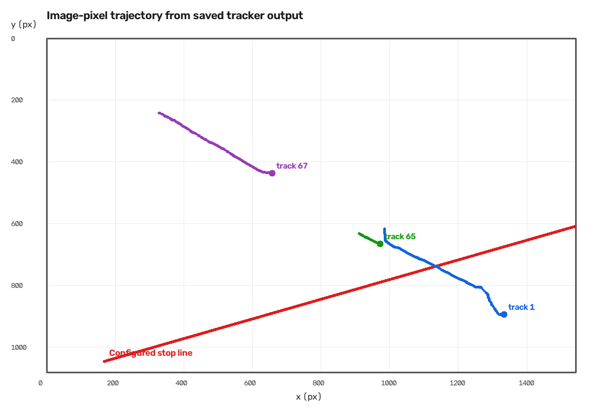

*Nguồn: `object_tracks.csv` và `config.json` của job Test 6 ReID. Hình biểu diễn tọa độ pixel và các ID track được hệ thống liên kết; không phải ground truth MOT.*

**Hình 3.11. Chuỗi ReID của `object_id=1` qua các `track_id`**
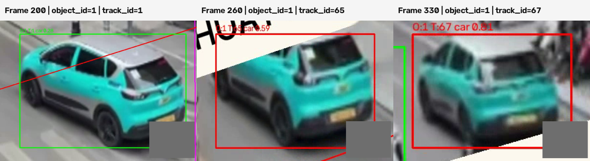

*Nguồn: video đầu ra và `object_tracks.csv` của lượt ReID cuối. Biển số được che; chuỗi này minh họa hoạt động của thuật toán trên một xe, không chứng minh độ chính xác tổng quát.*

Mã nguồn không ghi tệp `stitches.csv`. Kết quả hiện lưu quan hệ định danh trong `object_tracks.csv` theo từng frame và liệt kê các `identity_track_ids` trong sự kiện của `violations.csv`/`summary.json`; có thể dùng các trường này làm nhật ký nối, nhưng chưa có đánh giá tự động đúng/sai bằng ground truth.

### 3.8.2. Giới hạn đánh giá theo điều kiện video

Ground truth Test 6 mới chưa kèm metadata đủ để phân nhóm kết quả theo ngày/đêm, mật độ xe hoặc góc quay và chưa được xác nhận ID/frame. Không thể suy ra tỷ lệ đúng theo điều kiện chỉ từ số sự kiện AI. Muốn báo cáo theo nhóm, cần chuẩn hóa nhãn, cố định checkpoint/ROI/ngưỡng và ghi metadata cho từng clip; nếu thiếu mẫu của nhóm nào thì ghi rõ “chưa có dữ liệu”, không ngoại suy.

- Ngày/đêm: chưa có thống kê theo clip và nhãn sự kiện.
- Mật độ phương tiện: chưa có ngưỡng phân nhóm hoặc số liệu đối chiếu.
- Góc quay/giao lộ: chưa có metadata chuẩn hóa để so sánh.

### 3.8.3. Phân tích độ nhạy tham số

Chưa có sweep tham số trên tập validation có ground truth. Các ngưỡng hiện dùng là giá trị mặc định hoặc giá trị khởi đầu; không gọi chúng là tối ưu.

**Bảng 3.21. Các tham số cần khảo sát và trạng thái thí nghiệm**

| Tham số | Giá trị mặc định/khởi đầu | Kết quả quét |
|---|---:|---|
| `biou_b1`, `biou_b2` | 1,2; 1,1 | Chưa thực hiện |
| `max_age_red` | 120 frame | Chưa thực hiện |
| `green_grace_frames` | 30 frame | Chưa thực hiện |
| `stitch_distance_threshold` | 80 px | Chưa thực hiện |
| `stitch_histogram_threshold` | 0,55 | Chưa thực hiện |
| `stitch_score_threshold` | 0,65 | Chưa thực hiện |
| `reid_window` | 60 frame | Chưa thực hiện |
| `reid_distance_threshold` | 80 px ảnh gốc | Chưa thực hiện |
| `reid_histogram_threshold`, `reid_match_threshold` | 0,60; 0,60 | Chưa thực hiện |
| `reid_score_margin` | 0,08 | Chưa thực hiện |

**Hình 3.12. Độ nhạy theo BIoU, max_age_red, stitch và ReID**
*Chỉ bổ sung sau khi chạy sweep với validation có ground truth; hiện các ngưỡng ReID là cấu hình khởi đầu, chưa được tối ưu.*

## 3.9. Tốc độ xử lý và khả năng triển khai

**Bảng 3.22. FPS của các lượt chạy đã lưu**

| Lượt chạy | Thiết bị | FPS | Ghi chú |
|---|---|---:|---|
| Test 6 ReID cuối 15/11/2026 | GPU 0 | 24,38 | 1.771/1.771 frame; 72,65 giây; 29 track, 23 object |
| Test 6 CLI 15/11/2026, trước ReID | GPU 0 | 25,86 | Kết quả lịch sử; 1.771 frame |
| Test 6 job web 09/11/2026 | GPU 0 | 10,95 | 1.771 frame, Ultralytics |
| Test 6 ByteTrack tự cài + center, chạy bổ sung 16/11/2026 | GPU 0 | 23,32 | 1.771 frame; ReID bật; xem Bảng 3.17b |
| Test 6 Demo web, job `79c15e908a3f4e3ca2c61254ac49f3c0` | GPU 0 | 10,58 | 1.771 frame; tracker tự cài, center; ReID không được ghi trong artifacts |
| Test 6 Demo web, job `8c897bd0952d4910a83b0c5945f15075` | GPU 0 | 10,82 | 1.771 frame, tracker tự cài, center, appearance ReID |
| Test 7 web, job `596cfc7e51db46a08e40e30da26228f0` | GPU 0 | 12,81 | 2.163 frame, tracker tự cài, center, appearance ReID |
| Test 8 web, job `ba2cf850cf254b948d4fb76c9aa3dc8b` | GPU 0 | 12,70 | 2.424 frame, tracker tự cài, center, appearance ReID |
| Baseline Ultralytics | GPU 0 | 22,79 | Phép so sánh lịch sử; cấu hình không lưu hash |
| ByteTrack tự cài | GPU 0 | 12,04 | Cùng lượt so sánh lịch sử |
| Smoke A–F | CPU | 2,59–2,67 | 30 frame/preset |

Các số FPS không nên so sánh trực tiếp nếu khác phiên bản mã, ROI, ngưỡng, checkpoint, cấu hình máy hoặc kích thước đầu vào. Ứng dụng web chạy cục bộ và yêu cầu CUDA; CLI có thể dùng CPU. Chưa có kiểm thử triển khai nhiều camera hoặc đo tải đồng thời.

## 3.10. Phân tích lỗi và thảo luận

### 3.10.1. Phân loại các trường hợp lỗi

**Bảng 3.23. Nhóm lỗi/rủi ro và tình trạng thống kê**

| Nhóm nguyên nhân | Biểu hiện có thể gặp | Bằng chứng hiện có | Thống kê lỗi |
|---|---|---|---|
| Detector/đèn | Mất detection đèn, nhầm màu do ROI/ánh sáng | Có frame `unknown` trong summary một số job | Chưa gán nhãn chuẩn |
| Nhãn dữ liệu | Một bbox có thể gộp nhiều đối tượng | Đã rà một tile validation: nhãn tham chiếu bao hai xe buýt, dự đoán tách thành hai hộp; cần kiểm tra lại annotation nguồn | Một ví dụ quan sát, chưa thống kê toàn bộ |
| Tracking | Mất ID/đổi ID khi che khuất | Test 6 ReID nối xe xanh qua `track_id` 1, 65, 67; chưa có GT MOT | Chưa định lượng |
| Cấu hình hình học | ROI/vạch/hướng không khớp góc camera | Config được vẽ riêng theo video | Chưa tổng hợp lỗi theo clip |
| Quyết định sự kiện | Bỏ sót/báo giả/trùng | Có sự kiện AI trong summary | Chưa phân loại vì thiếu GT |

**Hình 3.13. Ví dụ sai khác giữa nhãn validation và dự đoán**
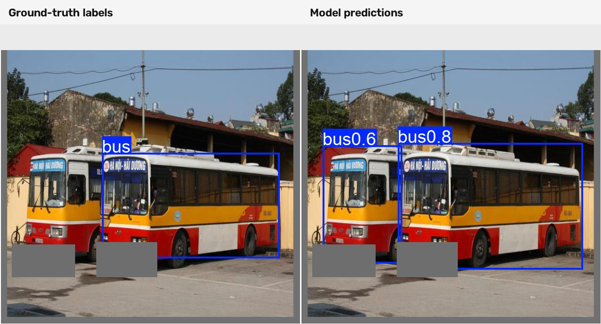

*Quan sát một tile cho thấy một bbox nhãn tham chiếu bao hai xe buýt, trong khi mô hình dự đoán hai bbox riêng. Đây là sai khác cần rà soát lại với dữ liệu gán nhãn nguồn, có thể là lỗi annotation; chưa được tính thành lỗi detector hay dùng để suy rộng chất lượng mô hình.*


### 3.10.2. Ưu điểm và nhược điểm

#### Ưu điểm

- Có quy trình xử lý dữ liệu tái hiện được bằng script, có mapping class rõ và log clean.
- Lớp đèn nhỏ được giữ lại nếu nhãn hợp lệ; các hộp rất nhỏ chỉ cảnh báo thay vì xóa theo diện tích.
- Detector, tracker, trạng thái đèn, ROI và luật giao cắt được tách thành các bước có thể kiểm tra.
- ROI được lưu theo độ phân giải gốc, giúp video đầu ra thể hiện trực quan cấu hình.
- Web lưu riêng từng job, có tiến độ, đầu ra video và quy trình rà soát sự kiện.
- Web cho phép chọn riêng tracker Ultralytics hoặc tracker tự cài; bốn nhóm cấu hình hướng, điểm đại diện, tracker và confidence có thể mở/đóng độc lập.

#### Hạn chế

- Dữ liệu thu thập từ nhiều nguồn có khác biệt về góc camera, độ phân giải, ánh sáng, chất lượng nén và quy tắc nhãn; làm sạch cú pháp không thay được kiểm duyệt ngữ nghĩa.
- Lớp car chiếm tỷ lệ bbox cao hơn rõ rệt; lớp yellow ít hơn. Trọng số loss giảm phần nào ảnh hưởng mất cân bằng nhưng không thay thế việc bổ sung dữ liệu khó và đánh giá per-class.
- Ở giai đoạn Roboflow, thứ tự lớp khác YAML clean trên máy; nếu không đối chiếu theo tên, sai ID có thể làm hỏng huấn luyện/inference. Training script hiện kiểm tra export order, nhưng bản báo cáo và quy trình phát hành dataset cần lưu mapping và version.
- Đèn nhỏ, ROI lệch, crop quá chặt hoặc ánh sáng thay đổi có thể làm detector không trả tín hiệu; sau hai giây mất detection, trạng thái chủ động chuyển sang `unknown`.
- Cả hai tracker kế thừa giới hạn của detector và có thể đổi ID khi che khuất hoặc xe đi gần nhau. Web hiện bật heuristic appearance ReID khi dùng tracker tự cài; lượt Test 6 cuối đã nối một xe qua ba `track_id`. Tuy nhiên, histogram HSV không phải mô hình ReID đã huấn luyện, có thể nhầm xe cùng màu, và chưa có ground truth MOT để định lượng IDF1/IDSW hoặc kết luận mức cải thiện tổng quát. Directional gating, BIoU và NSA Kalman vẫn chưa được đánh giá định lượng trên ground truth.
- Kết quả smoke A–F chỉ chạy 30 frame trên CPU; các cải tiến ablation chưa được đánh giá trên tập video dài có ground truth. Giao diện web dùng appearance ReID với tracker tự cài, nhưng các cờ BIoU, directional gating, NSA Kalman, signal lifecycle và stitch vẫn không bật mặc định.
- Lượt ReID cuối xử lý đủ 1.771 frame Test 6 và khôi phục `object_id=1` qua các track 1, 65, 67. Đây mới là kiểm chứng chức năng trên một clip, không chứng minh độ chính xác đối tượng hoặc giảm ID switch trên các tình huống khác. ROI Test 6 không có `QUEUE_ZONE_POLYGON`, nên vòng đời theo tín hiệu chưa được kiểm chứng trong video.
- Điểm kiểm tra mặc định là tâm hộp; có thể chọn tâm cạnh dưới để gần điểm tiếp xúc mặt đường hơn, nhưng điểm này vẫn chỉ là xấp xỉ và có thể chưa phản ánh chính xác vị trí bánh trước.
- Luật giao cắt phụ thuộc vào hai đầu vạch và hướng cấu hình bằng tay. Camera rung, thay đổi khung hoặc vạch bị che có thể làm sai kết quả.
- Chưa có số liệu test mAP độc lập và bộ ground truth vi phạm; do đó chưa thể tuyên bố hệ thống đạt một tỷ lệ chính xác cụ thể.

### 3.10.3. Khả năng ứng dụng thực tế, quyền riêng tư và đạo đức dữ liệu

Hệ thống phù hợp vai trò công cụ hỗ trợ tìm đoạn video để con người rà soát trong điều kiện camera cố định, ROI và vạch được thiết lập thủ công. Chưa đủ căn cứ để triển khai như hệ thống tự động ra quyết định hoặc xử phạt.

Video giao thông có thể chứa biển số và thông tin nhận dạng cá nhân. Khi đưa hình vào báo cáo hoặc chia sẻ kết quả, cần chỉ sử dụng dữ liệu có quyền khai thác, làm mờ biển số/người không liên quan, giới hạn quyền truy cập vào video và thư mục job, đồng thời quy định thời hạn lưu/xóa dữ liệu theo yêu cầu của đơn vị quản lý. Hệ thống hiện không nhận dạng biển số; sự kiện do AI đề xuất phải được người có thẩm quyền kiểm tra độc lập.

## 3.11. Tổng hợp và đánh giá kết quả

Hệ thống đã có các thành phần chính theo yêu cầu: nhận video, cấu hình ROI/vạch, phát hiện phương tiện và đèn, theo dõi track, duy trì `object_id` qua một số lần mất dấu bằng appearance ReID, kiểm tra điều kiện giao cắt, xuất video/báo cáo và hỗ trợ rà soát qua CLI/web. Trong lượt Test 6 ReID cuối, xe xanh được nối với `object_id=1` qua `track_id` 1, 65, 67; toàn bộ 1.771 frame được xử lý ở 24,38 FPS và có ba sự kiện AI. Ở lượt đối chiếu bổ sung dùng tâm bbox, người dùng xác nhận trực quan cả ba sự kiện đều đúng; tuy vậy, nhãn hiện có chưa bao phủ các đoạn âm tính và chưa đủ ID MOT để tính chỉ số toàn video. Chất lượng theo điều kiện camera, độ nhạy tham số và tỷ lệ lỗi cũng chưa được đánh giá. Vì vậy, kết quả phù hợp với nguyên mẫu hỗ trợ rà soát, chưa đủ căn cứ cho triển khai tự động ra quyết định.

# KẾT LUẬN VÀ HƯỚNG PHÁT TRIỂN

## 1. Kết quả đạt được

Đồ án đã xây dựng được pipeline phân tích video giao thông gồm phát hiện xe/đèn, theo dõi track và duy trì `object_id` qua appearance ReID khi dùng tracker ByteTrack tự cài, cấu hình ROI, kiểm tra giao cắt vạch và lưu bằng chứng. Web bật ReID mặc định cho tracker tự cài; các cải tiến association/lifecycle khác vẫn được cấu hình riêng. Trên Test 6, lượt ReID cuối nối xe xanh qua ba `track_id` và xử lý đủ 1.771 frame; phép so sánh baseline trước đó ghi nhận hai tracker cho cùng 19 ID đủ điều kiện và cùng ba frame sự kiện trong một cấu hình thử. Cả hai kết quả không phải đánh giá theo ground truth. Bộ dữ liệu sáu lớp được gộp theo YAML trên máy, kiểm tra annotation YOLO và tạo báo cáo clean. Bộ clean có 11.672 ảnh gắn nhãn với 31.509 bbox hợp lệ; sau đó dữ liệu được lưu trên Roboflow và export lại để train với class order của export.

Checkpoint được huấn luyện 70 epoch. Hồ sơ validation ghi Precision 0,92017, Recall 0,84876, mAP50 0,91845 và mAP50–95 0,68871 ở epoch 70. Lượt CLI trước ReID trong `Output/` xử lý 1.771/1.771 frame ở 25,86 FPS, ghi nhận 19 ID và ba sự kiện AI. Lượt ReID cuối xử lý đủ 1.771 frame ở 24,38 FPS, ghi nhận 29 track, 23 object và ba sự kiện AI; xe xanh giữ `object_id=1` qua các track 1, 65, 67. Riêng lượt bổ sung dùng tracker tự cài và tâm bbox, người dùng xác nhận trực quan 3/3 sự kiện dương tính đã gán nhãn; xác nhận này không áp dụng cho lượt ReID cuối hay các lần chạy khác, và chưa thay thế đánh giá toàn video.

**Bảng K.1. Việc đã hoàn thành và nội dung chưa hoàn thành**

| Hạng mục | Trạng thái |
|---|---|
| Gộp/remap/clean dataset sáu lớp | Hoàn thành theo báo cáo clean hiện có |
| Huấn luyện detector và validation | Hoàn thành; chưa có đánh giá test độc lập |
| Pipeline CLI/web, ROI và event output | Đã triển khai |
| Tracker tự cài và preset A–F | Đã triển khai; smoke 30 frame, chưa đánh giá MOT ground truth |
| Ground truth Test 6 | Có ba sự kiện dương tính; lượt bổ sung được xác nhận trực quan 3/3, nhưng cần hoàn thiện nhãn âm tính/track trước khi tính chỉ số toàn video |
| Quét độ nhạy tham số và thống kê lỗi | Chưa thực hiện |
| Đối chiếu hiệu lực pháp luật, biểu mẫu và hình minh họa | Cần hoàn thiện trước khi nộp |

## 2. Hạn chế

Các hạn chế chính là ground truth Test 6 mới chỉ có ba sự kiện dương tính; lượt bổ sung được xác nhận trực quan đúng cả ba, nhưng chưa đủ để đánh giá bỏ sót/báo giả toàn video hoặc chất lượng MOT. Chất lượng nhận diện đèn còn nhạy với ROI/crop, class order khác giữa YAML clean và export, phân bố lớp chưa cân bằng, tracker có thể đổi ID, và tọa độ tâm hộp chưa phản ánh điểm tiếp xúc của xe với mặt đường. Cấu hình ROI được vẽ thủ công, nên cần được kiểm tra trên toàn video trước khi chạy chính thức.

## 3. Hướng phát triển

1. Khóa version dữ liệu và checkpoint; lưu mapping class ID xuyên suốt từ nguồn, clean, Roboflow export đến model.
2. Thiết lập tập test độc lập và ground truth theo frame cho trạng thái đèn, bbox/ID xe và sự kiện giao cắt.
3. Tăng dữ liệu đèn đỏ/yellow ở điều kiện khó; rà soát nhãn có box nhỏ, box trùng, ảnh nén và trường hợp đèn bị che.
4. Thử so sánh phát hiện đèn trên full-frame và crop ROI với cùng checkpoint/cùng video/cùng config; chọn cách ổn định dựa trên kết quả đo, không dựa vào một vài frame.
5. Xem xét điểm tham chiếu bottom-center hoặc vùng bánh trước, nhưng chỉ thay đổi sau khi định nghĩa nhãn chuẩn và kiểm thử trên video.
6. Đánh giá tracker bằng IDF1/MOTA và ground truth; lưu các lần đổi ID, mất track và lỗi nối đối tượng.
7. Mở rộng lớp xe máy, nhận dạng biển số hoặc triển khai Jetson/TensorRT khi có dữ liệu, yêu cầu pháp lý và thiết bị phù hợp.
8. Cải thiện quy trình rà soát người dùng; các sự kiện AI cần được con người xác nhận trước khi dùng trong bất kỳ quy trình nghiệp vụ nhạy cảm nào.

---

# TÀI LIỆU THAM KHẢO

> Cần đối chiếu năm, phiên bản và mẫu trích dẫn theo Phụ lục tài liệu tham khảo của Khoa trước khi nộp.

[1] G. Jocher, A. Chaurasia, and J. Qiu, “Ultralytics YOLO,” tài liệu và mã nguồn Ultralytics, https://docs.ultralytics.com/, truy cập ngày 09/11/2026.

[2] Y. Zhang, P. Sun, Y. Jiang, D. Yu, F. Weng, Z. Yuan, P. Luo, W. Liu, and X. Wang, “ByteTrack: Multi-Object Tracking by Associating Every Detection Box,” in *European Conference on Computer Vision (ECCV)*, 2022.

[3] A. Bewley, Z. Ge, L. Ott, F. Ramos, and B. Upcroft, “Simple Online and Realtime Tracking,” in *2016 IEEE International Conference on Image Processing (ICIP)*, 2016.

[4] R. E. Kalman, “A New Approach to Linear Filtering and Prediction Problems,” *Journal of Basic Engineering*, vol. 82, no. 1, pp. 35–45, 1960.

[5] H. W. Kuhn, “The Hungarian Method for the Assignment Problem,” *Naval Research Logistics Quarterly*, vol. 2, pp. 83–97, 1955.

[6] OpenCV, “OpenCV Documentation,” https://docs.opencv.org/, truy cập ngày 09/11/2026.

[7] Roboflow, “Roboflow Documentation: Datasets, Annotation, and Export Formats,” https://docs.roboflow.com/, truy cập ngày 09/11/2026.

[8] Python Software Foundation, “Python Documentation,” https://docs.python.org/3/, truy cập ngày 09/11/2026.

[9] Quốc hội nước Cộng hòa xã hội chủ nghĩa Việt Nam, *Luật Trật tự, an toàn giao thông đường bộ số 36/2024/QH15*, 2024. Cần kiểm tra hiệu lực và quy định áp dụng tại thời điểm hoàn thiện báo cáo.

[10] Chính phủ nước Cộng hòa xã hội chủ nghĩa Việt Nam, *Nghị định số 168/2024/NĐ-CP quy định xử phạt vi phạm hành chính về trật tự, an toàn giao thông trong lĩnh vực giao thông đường bộ*, 2024. Cần kiểm tra văn bản sửa đổi/thay thế và cách viện dẫn theo yêu cầu của giảng viên.

---

# PHỤ LỤC

## PHỤ LỤC A. MÃ NGUỒN CHÍNH VÀ LỆNH CHẠY

### A.1. Các module mã nguồn chính

| Tệp/thư mục | Phần mã nguồn nên trích hoặc tham chiếu |
|---|---|
| `Code/06_run_detection.py` | Pipeline detector, tracking, trạng thái đèn, giao cắt, summary/CSV |
| `tracking/custom_bytetrack/` | Kalman, association, trạng thái track, lifecycle, stitching và preset |
| `tracking/reid/` | Histogram HSV phục vụ appearance matching |
| `tracking/ultralytics_tracker/` | Adapter cho tracker ByteTrack tích hợp Ultralytics |
| `scripts/run_ablation.py` | Điều phối chạy A–F và lưu kết quả từng preset |
| `web_app.py`, `web_worker.py` | API, job, worker và luồng tiến độ của web |
| `Code/05_roi_config.py` | Công cụ cấu hình ROI/vạch trên frame |
| `TRAIN_DATA_ROOT\01_merge_truck_bus_into_nhandien.py` | Ghép nguồn bus/truck vào bộ dữ liệu phương tiện và chuẩn hóa class ID |
| `TRAIN_DATA_ROOT\02_merge_with_traffic_light.py` | Lấy mẫu dữ liệu đèn, ghép thành bộ sáu lớp và remap nhãn |
| `TRAIN_DATA_ROOT\03_data_cleaning.py` | Kiểm tra và làm sạch nhãn YOLO, xuất báo cáo clean |

Không chép toàn bộ source code vào nội dung chính; lựa chọn các đoạn tiêu biểu, ghi rõ tên tệp, phiên bản và vị trí trong phụ lục theo yêu cầu của Khoa.

### A.2. Các đường dẫn quan trọng

- Thư mục làm việc xử lý dữ liệu: `TRAIN_DATA_ROOT\`
- Dữ liệu huấn luyện tải từ Roboflow: `TRAIN_DATA_ROOT\Train\`
- Các thư mục dataset trong repository ổ D: bản tham chiếu/minh họa, không dùng làm đầu vào train.
- Thư mục xử lý và script ghép/clean: `TRAIN_DATA_ROOT\` (`01_merge_truck_bus_into_nhandien.py`, `02_merge_with_traffic_light.py`, `03_data_cleaning.py`)
- Project Roboflow lưu dataset sau clean: `DATADOANNEW`
- Dataset Roboflow export dùng train: `TRAIN_DATA_ROOT\Train\datasets\export-yolo26\`
- YAML train: `TRAIN_DATA_ROOT\Train\datasets\export-yolo26\data.yaml`
- Hồ sơ train: `TRAIN_DATA_ROOT\Train\runs\do_an_tn\args.yaml`
- Kết quả theo epoch: `TRAIN_DATA_ROOT\Train\runs\do_an_tn\results.csv`
- Checkpoint train: `TRAIN_DATA_ROOT\Train\runs\do_an_tn\weights\best.pt`
- Checkpoint project: `models/best.pt`

### A.3. Chạy CLI

```powershell
.\.venv\Scripts\python.exe main.py `
  --weights .\models\best.pt `
  --video .\samples\video.mp4 `
  --config .\config\roi_config.json `
  --output .\Output\run_01 `
  --device 0 --headless
```

Với video mới, tạo config riêng từ video đó:

```powershell
.\.venv\Scripts\python.exe Code\05_roi_config.py `
  --video ".\test_videos\Test 6.mp4" `
  --output .\config\Test_6.json
```

Sau đó dùng đúng config:

```powershell
.\.venv\Scripts\python.exe main.py `
  --weights .\models\best.pt `
  --video ".\test_videos\Test 6.mp4" `
  --config .\config\Test_6.json `
  --output .\Output\Test_6 `
  --device 0 --headless
```

### A.4. Thông tin cần bổ sung trước khi nộp

- Họ tên, mã sinh viên, lớp và giảng viên hướng dẫn.
- Phiếu giao nhiệm vụ, kế hoạch, theo dõi tiến độ và chữ ký theo yêu cầu Khoa.
- Ảnh chụp/log môi trường tại đúng thời điểm huấn luyện để xác nhận lịch sử OS/driver và cấu hình máy; hiện Bảng 3.9 chỉ ghi thông tin đọc từ máy lưu artifacts và virtual environment hiện còn.
- Ảnh chụp riêng giao diện web/công cụ cấu hình ROI; báo cáo hiện đã có sơ đồ, ảnh đầu ra video và hình kết quả detector, nhưng chưa có screenshot giao diện.
- Bổ sung ground truth đầy đủ và quy ước frame/ID nếu muốn tính chỉ số test, TP/FN/FP hoặc chỉ số MOT; các video web hiện đã được rà soát trực quan nhưng chưa có bộ nhãn chuẩn tương ứng.
- Xác nhận với giảng viên về trích dẫn pháp lý, tên đề tài và quy định trình bày hiện hành.

## PHỤ LỤC B. CẤU HÌNH HUẤN LUYỆN VÀ ROI MẪU

Hồ sơ đầy đủ `args.yaml` và YAML dataset nằm trong thư mục Train nêu tại Phụ lục A. Các siêu tham số chính được tóm tắt tại Bảng 3.10; trích kèm `args.yaml` nguyên gốc khi đóng gói báo cáo cuối.

ROI mẫu chỉ phù hợp với `samples/video.mp4` có kích thước 2568×1440; không áp dụng trực tiếp cho camera khác:

```json
{
  "FRAME_SIZE": [2568, 1440],
  "VEHICLE_DETECT_ROI_POLYGON": [[850, 100], [1570, 100], [2000, 450], [2550, 1240], [2567, 1439], [150, 1439], [450, 700]],
  "RED_LIGHT_DETECT_ROI_POLYGON": [[2440, 55], [2567, 55], [2567, 365], [2440, 365]],
  "STOP_LINE_COORDS": [150, 1245, 2550, 1305],
  "CROSSING_DIRECTION": "up",
  "GROUND_POINT_MODE": "center",
  "STITCH_MARGIN": 40,
  "VIOLATION_THRESHOLD": 20,
  "NOTE": "Sample configuration for samples/video.mp4 at 2568x1440. Reconfigure for another camera. Vehicles already beyond the line at the start are not counted."
}
```

## PHỤ LỤC C. BẢNG KẾT QUẢ CHI TIẾT TỪ CÁC JOB ĐÃ LƯU

Các số liệu sau lấy từ summary và metrics đã lưu trong workspace. Checkpoint, ROI, confidence hoặc phiên bản code giữa các job có thể khác; bảng chỉ là kiểm kê đầu ra, không phải so sánh công bằng và không có nhãn chuẩn để đánh giá đúng/sai.

**Bảng C.1. Tóm tắt các lượt chạy đã được đối chiếu trong báo cáo**

| Video/job | Frame | FPS | ID/track được báo cáo | Sự kiện AI | Trạng thái |
|---|---:|---:|---:|---:|---|
| `samples/video.mp4` | 950 | 11,49 | 7 | 0 | Summary project hiện hành |
| Test 6, 03/11/2026 | 1.771 | 13,25 | 19 | 3 | Checkpoint đường dẫn cũ không còn |
| Test 6, web 09/11/2026 | 1.771 | 10,95 | 19 | 3 | Ultralytics, `track_conf=0,25` |
| Test 6, ReID cuối 15/11/2026 | 1.771 | 24,38 | 29 track / 23 object | 3 | ByteTrack tự cài, `track_conf=0,1`, `appearance_reid`; xe xanh `object_id=1` liên kết track 1/65/67 |
| Test 6 Demo, web ReID 15/11/2026 | 1.771 | 10,82 | 39 track / 33 object | 3 | ByteTrack tự cài, điểm `center`; người dùng đã xem trực quan |
| Test 7, web ReID 16/11/2026 | 2.163 | 12,81 | 36 track / 29 object | 1 | ByteTrack tự cài, điểm `center`; người dùng đã xem trực quan |
| Test 8, web ReID 16/11/2026 | 2.424 | 12,70 | 29 track / 21 object | 0 | ByteTrack tự cài, điểm `center`; người dùng đã xem trực quan |
| Test 6 có ground truth, ByteTrack tự cài + center 16/11/2026 | 1.771 | 23,32 | 18 track / 18 object | 3 | Lượt bổ sung; sự kiện lệch nhãn +12, +12, +29 frame, chưa phân loại đúng/sai |

Các kết quả chi tiết của smoke A–F nằm ở Bảng 3.19 (30 frame cho mỗi preset). Các sự kiện trong bảng này là đầu ra AI, không phải số vi phạm đã được xác nhận.

## PHỤ LỤC D. HÌNH ẢNH BỔ SUNG

Các hình được dùng trong nội dung báo cáo lưu tại `docs/figures/`, gồm sơ đồ kiến trúc, phân bố dữ liệu, kết quả detector, ví dụ nhãn, sự kiện/track Test 6 và sai khác validation. Ảnh chụp giao diện web chưa được lưu; trước khi phát hành báo cáo cần xác nhận quyền sử dụng video nguồn và rà soát che biển số/thông tin nhận dạng trong mọi hình CCTV.
