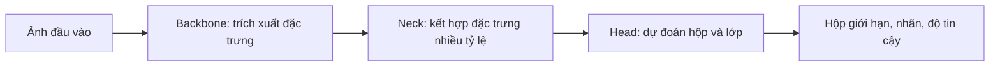
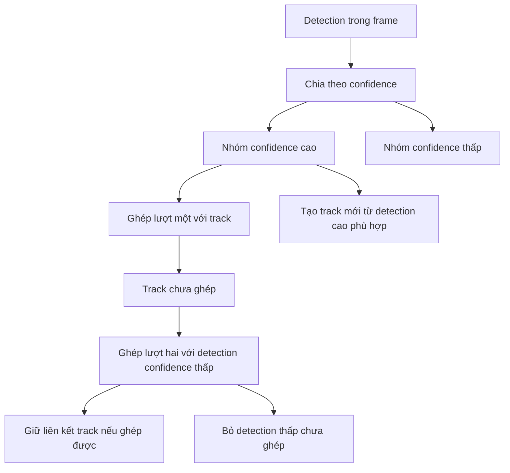
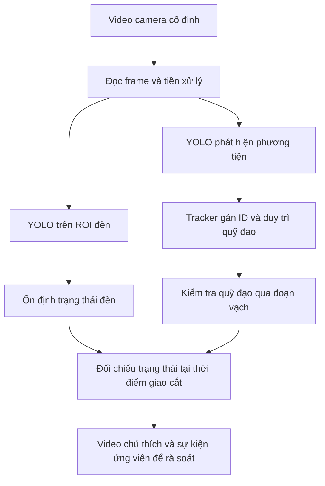

# CHƯƠNG 1. TỔNG QUAN VÀ CƠ SỞ LÝ THUYẾT

## 1.1. Giới thiệu về thị giác máy tính

### 1.1.1. Khái niệm thị giác máy tính

Thị giác máy tính (Computer Vision) là lĩnh vực nghiên cứu các phương pháp giúp máy tính tiếp nhận và phân tích ảnh hoặc video để trích xuất thông tin có ý nghĩa. Một hệ thống thị giác máy tính thường chuyển đổi dữ liệu pixel thành các biểu diễn như lớp đối tượng, hộp giới hạn, vùng phân đoạn, quỹ đạo hoặc sự kiện. Kết quả phụ thuộc vào dữ liệu đầu vào, góc quan sát, điều kiện ánh sáng, chất lượng cảm biến và thuật toán được lựa chọn.

Trong đề tài này, dữ liệu đầu vào là video từ camera cố định. Hệ thống phân tích từng khung hình để nhận diện phương tiện và trạng thái đèn, sau đó liên kết kết quả theo thời gian và đối chiếu quỹ đạo với vạch dừng. Do đó, đầu ra không phải một dự đoán ảnh đơn lẻ mà là chuỗi track cùng các sự kiện ứng viên có thời điểm và bằng chứng đi kèm.

### 1.1.2. Vai trò và ý nghĩa trong giao thông thông minh

Trong giao thông thông minh, thị giác máy tính có thể hỗ trợ thống kê lưu lượng, phân loại phương tiện, theo dõi dòng xe, phân tích tình trạng ùn tắc và hỗ trợ phát hiện một số sự kiện cần con người xem xét. Khả năng phân tích video giúp tận dụng hạ tầng camera sẵn có, nhưng độ tin cậy phụ thuộc vào vị trí lắp đặt, trường nhìn, độ phân giải, ánh sáng và điều kiện vận hành.

Với bài toán giám sát đèn đỏ, lợi ích tiềm năng là hỗ trợ người vận hành tìm nhanh các đoạn video cần xem lại. Hệ thống tự động chỉ đưa ra gợi ý kỹ thuật; việc xác minh sự kiện và quyết định nghiệp vụ thuộc về con người/cơ quan có thẩm quyền. Cần bảo vệ dữ liệu hình ảnh, giới hạn quyền truy cập và tránh sử dụng dự đoán tự động như bằng chứng kết luận duy nhất.

### 1.1.3. Các bài toán cơ bản trong thị giác máy tính

Các tác vụ thường gặp gồm phân loại ảnh, phát hiện đối tượng, phân đoạn ảnh, ước lượng tư thế, theo dõi đối tượng và nhận dạng sự kiện. Phân loại gán nhãn cho toàn ảnh; phát hiện đối tượng tìm đồng thời nhãn và vị trí từng vật thể; phân đoạn xác định vùng pixel thuộc vật thể; theo dõi liên kết phát hiện qua nhiều khung hình để duy trì danh tính. Nhận dạng sự kiện tổng hợp tín hiệu theo thời gian để mô tả một hành vi hoặc trạng thái.

Đề tài sử dụng phát hiện để tìm phương tiện và đèn tín hiệu; theo dõi đa đối tượng để duy trì ID phương tiện; xử lý ảnh để giới hạn vùng quan sát, ước lượng màu đèn và kiểm tra vị trí xe so với vạch. Các tác vụ này được ghép thành pipeline thay vì xem một nhãn phát hiện đơn lẻ là đủ để kết luận xe vừa vượt vạch.

## 1.2. Các bài toán sử dụng trong đề tài

### 1.2.1. Bài toán phát hiện đối tượng

Phát hiện đối tượng dự đoán hộp giới hạn, lớp và độ tin cậy cho từng vật thể trong một ảnh. Với hộp dự đoán \(B_p\) và hộp chuẩn \(B_g\), giao trên hợp được tính bằng:

\[
\operatorname{IoU}(B_p,B_g)=\frac{|B_p \cap B_g|}{|B_p \cup B_g|}.
\]

Precision đo tỷ lệ dự đoán đúng trong số dự đoán được đưa ra; Recall đo tỷ lệ đối tượng chuẩn được tìm thấy. Average Precision (AP) là diện tích dưới đường Precision–Recall cho một lớp. mAP50 là AP tại ngưỡng IoU 0,50; mAP50–95 lấy trung bình AP ở các ngưỡng IoU từ 0,50 đến 0,95. Trong báo cáo, các chỉ số này được tính ở cấp detector trên validation; chúng không thể thay thế đánh giá độ chính xác sự kiện vi phạm.

Các lớp detector của dự án là `bus`, `car`, `truck`, `green`, `red`, `yellow`. Đèn giao thông có kích thước nhỏ so với ảnh tổng thể, vì vậy hệ thống cắt vùng ROI đèn để suy luận riêng; phương tiện được phát hiện trên khung hình đã tiền xử lý.

### 1.2.2. Bài toán theo dõi đa đối tượng

Theo dõi đa đối tượng (MOT) liên kết các hộp phát hiện giữa các khung hình thành các track có ID. Cách tiếp cận tracking-by-detection dùng kết quả detector làm đầu vào, dự đoán vị trí tiếp theo của track, tính chi phí ghép giữa track và detection rồi giải bài toán gán cặp. Che khuất, detection bị bỏ lỡ, xe chạy gần nhau và thay đổi kích thước có thể gây mất track hoặc ID switch.

Bộ lọc Kalman thường được dùng để dự đoán trạng thái chuyển động từ lịch sử quan sát; thuật toán Hungarian tìm cách gán cặp có tổng chi phí nhỏ nhất. Chất lượng MOT cần được đo bằng nhãn danh tính theo từng frame và các chỉ số như IDF1, MOTA, HOTA, IDSW. Bộ dữ liệu hiện có chủ yếu là nhãn detection YOLO, do đó các chỉ số MOT không được tự suy diễn từ số ID do hệ thống xuất ra.

Ở cấp sự kiện, TP là sự kiện hệ thống khớp với ground truth theo video, hướng xe và dung sai thời gian đã định; FP là dự đoán không có nhãn sự kiện tương ứng; FN là sự kiện chuẩn bị bỏ sót. Từ đó tính Precision = TP/(TP+FP), Recall = TP/(TP+FN), F1 = 2×Precision×Recall/(Precision+Recall). Test 6 hiện có ba nhãn sự kiện dương tính; cần chốt quy ước frame/dung sai ghép và rà soát toàn video để xác định FP/FN trước khi báo cáo chỉ số tổng thể.

### 1.2.3. Bài toán xử lý ảnh hỗ trợ

ROI (Region of Interest) là vùng ảnh được chọn cho một nhiệm vụ. ROI phương tiện giới hạn khu vực cần theo dõi; ROI đèn tập trung suy luận vào cụm tín hiệu nhỏ. Trong hệ thống, các ROI và vạch dừng được thiết lập thủ công theo từng camera và lưu theo độ phân giải gốc.

Không gian màu HSV biểu diễn sắc độ, độ bão hòa và độ sáng; dự án sử dụng HSV để kiểm tra heuristic màu trong patch quanh hộp đèn và tính histogram màu hỗ trợ nối track. Tín hiệu HSV nhạy với ánh sáng, vùng nền và chất lượng ảnh, vì vậy không thay thế dự đoán của mô hình.

Hình học vạch dừng được biểu diễn bằng một đoạn thẳng hữu hạn trên ảnh. Một điểm tham chiếu của xe được so sánh với đường có hướng để xác định track đang ở phía tiếp cận hay phía sau vạch. Phép chiếu homography có thể ánh xạ giữa mặt phẳng ảnh và mặt phẳng đường khi có các cặp điểm tương ứng/hiệu chuẩn phù hợp; phiên bản hiện tại chưa hiệu chuẩn camera và chưa dùng homography, nên mọi tọa độ và ngưỡng đều tính theo pixel, không suy ra khoảng cách thực địa.

## 1.3. Các thuật toán sử dụng

### 1.3.1. Họ mô hình YOLO

YOLO là họ mô hình phát hiện một giai đoạn, dự đoán trực tiếp vị trí và lớp đối tượng từ ảnh. Kiến trúc thường được mô tả khái quát qua Backbone trích xuất đặc trưng, Neck kết hợp đặc trưng nhiều tỷ lệ và Head dự đoán hộp/lớp; cấu trúc cụ thể thay đổi theo phiên bản. Hồ sơ train ghi mô hình khởi tạo `yolo26s.pt`, kích thước ảnh 640. Không suy diễn biến thể model chỉ từ tên hiển thị trên giao diện.

**Hình 1.1. Sơ đồ khái quát Backbone–Neck–Head của detector YOLO**

*Sơ đồ khái quát; không mô tả chi tiết nội bộ riêng của YOLO26s.*

### 1.3.2. Bộ lọc Kalman và ghép cặp Hungarian

Bộ lọc Kalman ước lượng trạng thái ẩn qua hai bước lặp. Bước dự đoán ngoại suy trạng thái từ mô hình chuyển động; bước cập nhật hiệu chỉnh dự đoán khi nhận được detection mới. Trong tracker tự cài, trạng thái bbox được biểu diễn theo tâm, tỷ lệ khung và chiều cao (XYAH), sau đó cập nhật theo quan sát. Bộ lọc làm mượt quỹ đạo nhưng không tự nhận diện danh tính và có thể trôi khi đối tượng bị mất dấu lâu.

Sau dự đoán, chi phí liên kết giữa track và detection được lập từ độ chồng lấp IoU cùng các điều kiện bổ sung nếu được bật. Thuật toán Hungarian tìm phép gán một-một có tổng chi phí tối ưu; các cặp không đạt ngưỡng bị từ chối, track còn lại có thể chuyển sang Lost và detection chưa ghép có thể tạo track mới. Kết quả phụ thuộc detector, ngưỡng và mô hình chuyển động.

### 1.3.3. Các thuật toán theo dõi: SORT, DeepSORT, ByteTrack

SORT kết hợp Kalman, IoU và Hungarian để liên kết track với detection; DeepSORT bổ sung đặc trưng ngoại hình nhằm hỗ trợ liên kết khi chuyển động/che khuất gây khó khăn; ByteTrack dùng detection confidence cao ở lượt liên kết chính và tận dụng detection confidence thấp ở lượt tiếp theo. Đây là mô tả cơ chế định tính, không phải kết quả benchmark trên dữ liệu của đồ án.

**Bảng 1.1. So sánh định tính các thuật toán theo dõi**

| Phương pháp | Cơ chế nổi bật | Điểm mạnh | Giới hạn liên quan |
|---|---|---|---|
| SORT | Kalman và gán theo IoU | Đơn giản, chi phí thấp | Dễ mất liên kết khi che khuất hoặc detection gián đoạn |
| DeepSORT | SORT kết hợp đặc trưng ngoại hình | Có thêm tín hiệu nhận dạng khi đối tượng gần nhau | Cần trích đặc trưng, tăng chi phí tính toán |
| ByteTrack | Hai lượt ghép, có dùng detection confidence thấp | Có thể duy trì track khi confidence suy giảm | Vẫn phụ thuộc detector và ngưỡng association |
| ByteTrack tự cài trong đồ án | Kalman XYAH, association hai lượt, quản lý vòng đời track | Cho phép kiểm tra/tùy biến logic | Chưa có ground truth MOT để khẳng định cải thiện |

Dự án dùng ByteTrack của Ultralytics làm baseline và có triển khai tùy chọn riêng. Buffered IoU, directional gating, NSA Kalman, signal-aware lifecycle và stitching là các hướng thử nghiệm trong tracker tự cài; chúng không mặc định bật và chưa được chứng minh cải thiện bằng ground truth.

**Hình 1.2. Hai giai đoạn liên kết detection của ByteTrack**

*Sơ đồ khái quát hóa; chi tiết ngưỡng và xử lý track tuân theo cấu hình triển khai.*

### 1.3.4. Phép chiếu homography

Homography là phép biến đổi phối cảnh giữa hai mặt phẳng, thường được biểu diễn bằng ma trận \(H\) xác định từ tối thiểu bốn cặp điểm tương ứng không thẳng hàng. Với điểm ảnh thuần nhất \(p=(x,y,1)^T\), điểm trên mặt phẳng đích tỷ lệ với \(Hp\), sau đó chuẩn hóa theo tọa độ thuần nhất. Có thể dùng phép biến đổi để biểu diễn mặt đường ở góc nhìn bird-eye view hoặc so sánh vị trí theo đơn vị mặt phẳng nếu đã hiệu chuẩn.

Trong đồ án, homography là kiến thức nền và hướng phát triển; code hiện tại xét vạch, ROI và quỹ đạo trực tiếp bằng pixel, chưa ước lượng ma trận H và chưa quy đổi sang mét. Vì vậy không báo cáo vận tốc/khoảng cách vật lý từ video.

## 1.4. Tổng quan về giám sát vi phạm giao thông

### 1.4.1. Quy định pháp luật về dừng xe khi đèn đỏ

Hệ thống chỉ tạo sự kiện kỹ thuật để hỗ trợ rà soát. Việc xác định hành vi vi phạm, chủ thể và chế tài thuộc thẩm quyền của cơ quan/người có thẩm quyền. Các văn bản cần đối chiếu tại thời điểm nộp gồm Luật Trật tự, an toàn giao thông đường bộ số 36/2024/QH15 và Nghị định số 168/2024/NĐ-CP cùng văn bản sửa đổi, bổ sung hoặc thay thế nếu có.

**Bảng 1.2. Văn bản pháp luật cần đối chiếu khi hoàn thiện báo cáo**

| Văn bản | Phạm vi liên quan | Nội dung cần xác minh |
|---|---|---|
| Luật số 36/2024/QH15 | Quy tắc chấp hành tín hiệu và vạch dừng | Điều, khoản áp dụng và hiệu lực tại ngày nộp |
| Nghị định số 168/2024/NĐ-CP | Chế tài hành vi không chấp hành đèn tín hiệu | Điều khoản, đối tượng và mức phạt hiện hành |
| Văn bản sửa đổi/thay thế (nếu có) | Tình trạng pháp lý hiện hành | Cần kiểm tra trên nguồn pháp luật chính thức |

Không đưa mức phạt cụ thể vào báo cáo trước khi xác nhận điều khoản, đối tượng áp dụng và hiệu lực của văn bản. Kết quả AI không phải kết luận pháp lý.

### 1.4.2. Vấn đề tồn tại trong giám sát hiện nay

Giám sát video giao thông gặp các khó khăn về ánh sáng ngày/đêm, mưa và phản xạ, độ phân giải, góc nhìn, xe nhỏ hoặc bị che khuất, mật độ phương tiện, và sai số cấu hình ROI/vạch. Đèn tín hiệu thường chỉ chiếm ít pixel; màu có thể đổi do cháy sáng hoặc nền lẫn vào ROI. Tracker có thể mất track hoặc đổi ID khi detection gián đoạn, xe đi gần nhau hoặc bị che khuất.

Một hộp xe nằm phía sau vạch trong một frame không cho biết xe vừa vượt vạch; cần theo dõi trạng thái trước–sau và xét đèn tại đúng thời điểm giao cắt. Camera rung, thay đổi góc hoặc vạch bị che có thể làm sai phép kiểm tra hình học. Các hệ thống hiện hành cũng cần xử lý quyền riêng tư, chất lượng bằng chứng và bước xác nhận của con người. Đây là các lý do hệ thống phải được đánh giá theo detector, tracking và sự kiện riêng biệt, với video/ground truth phù hợp.

## 1.5. Giới thiệu đề tài và giải pháp đề xuất

Đề tài xây dựng hệ thống phân tích video từ camera cố định, tập trung vào ô tô và vạch dừng tại khu vực tín hiệu giao thông. Mục tiêu là phát hiện phương tiện và màu đèn, theo dõi phương tiện qua thời gian, cấu hình ROI/vạch theo góc quay, rồi tạo sự kiện ứng viên khi track đi từ phía tiếp cận qua đoạn vạch trong thời gian trạng thái đèn là đỏ.

Pipeline gồm đọc và tiền xử lý frame; YOLO phát hiện phương tiện và đèn trên ROI; ByteTrack gán ID; module trạng thái đèn làm ổn định dự đoán; luật hình học kiểm tra quỹ đạo cắt đoạn vạch; cuối cùng lưu video chú thích, `summary.json`, `violations.csv` và ảnh bằng chứng nếu có. Sơ đồ chi tiết module được trình bày ở Chương 2.

**Hình 1.3. Hướng tiếp cận tổng quát của đề tài**
*Nguồn: tổng hợp theo pipeline hiện thực.*

Phạm vi hiện tại giới hạn ở video đã ghi từ camera cố định, các lớp `bus`, `car`, `truck`, `green`, `red`, `yellow`; ROI và vạch được thiết lập thủ công. Hệ thống chưa nhận dạng biển số, chưa hiệu chuẩn phối cảnh, chưa tính tốc độ thực địa, và không thay thế việc con người xác minh sự kiện. Số liệu validation của detector không đại diện cho độ chính xác sự kiện; hiện chưa có ground truth MOT/sự kiện để kết luận chất lượng tổng quát.

## 1.6. Tổng kết chương

Chương này đã giới thiệu bài toán giám sát giao thông bằng thị giác máy tính, các thành phần phát hiện và theo dõi đối tượng, cùng những khó khăn khi xác định sự kiện xe vượt đèn đỏ từ video. Hướng tiếp cận của đề tài kết hợp mô hình YOLO, theo dõi đa đối tượng, nhận diện trạng thái đèn và kiểm tra giao cắt vạch dừng theo thời gian. Các cơ sở này được dùng để phân tích yêu cầu và thiết kế hệ thống ở Chương 2.

---
