# CHƯƠNG 2. PHÂN TÍCH VÀ THIẾT KẾ HỆ THỐNG

## 2.1. Phân tích yêu cầu

### 2.1.1. Mô tả bài toán và các khó khăn kỹ thuật

Đầu vào là video từ camera cố định tại khu vực giao lộ có đèn tín hiệu và vạch dừng. Hệ thống cần phát hiện phương tiện và trạng thái đèn, duy trì ID qua các frame, rồi xác định liệu track có đi từ phía tiếp cận qua đoạn vạch trong thời gian đèn đỏ hay không. Một phát hiện đơn lẻ phía sau vạch không đủ để xác định hành vi, do đó quyết định phải dựa trên quỹ đạo, thời điểm giao cắt, hướng xe và trạng thái tín hiệu tương ứng.

Các khó khăn chính gồm đèn nhỏ/khó nhìn, thay đổi ánh sáng, xe che khuất hoặc đi sát nhau, detector bỏ sót làm track mất/đổi ID, sai lệch ROI/vạch theo từng góc camera và việc phân biệt xe dừng chờ với xe đã đi qua vạch. Chất lượng còn phụ thuộc vào độ phân giải, góc quay và cấu hình thủ công; thiếu ground truth sự kiện khiến chưa thể định lượng độ chính xác cuối của hệ thống.

### 2.1.2. Yêu cầu chức năng

1. Nhận một video và đọc độ phân giải, FPS, số frame.
2. Nạp checkpoint YOLO có các lớp phương tiện và màu đèn phù hợp.
3. Cho phép cấu hình ROI phương tiện, ROI đèn, hai đầu vạch dừng và hướng đi qua vạch.
4. Phát hiện đèn và phương tiện; gán ID track cho phương tiện.
5. Làm ổn định trạng thái đèn và kiểm tra điều kiện giao cắt theo ID.
6. Ghi video có hộp, ID, ROI, vạch và trạng thái đèn; xuất báo cáo JSON/CSV và ảnh bằng chứng nếu có sự kiện.
7. Cho phép chạy bằng CLI hoặc giao diện web cục bộ; hỗ trợ theo dõi tiến độ và lưu từng phiên phân tích.

**Hình 2.1. Biểu đồ use case của hệ thống**

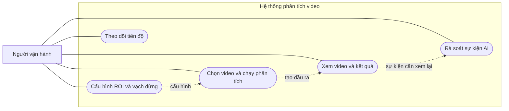

### 2.1.3. Yêu cầu phi chức năng

- Cấu hình ROI phải đúng độ phân giải của video; không tái sử dụng ROI chỉ vì hai video có cùng kích thước.
- Lỗi thiếu video, checkpoint, config hoặc không mở được đầu ra phải được thông báo.
- Có thể chạy CLI trên CPU hoặc thiết bị được chỉ định; web hiện yêu cầu GPU CUDA.
- Video tải lên web tối đa 500 MB; các phiên và kết quả được lưu trong `.webdata/jobs/<id>/`.
- Kết quả phải giữ được mối liên hệ giữa video, config, checkpoint, sự kiện và ảnh bằng chứng.

**Bảng 2.1. Yêu cầu chức năng và phi chức năng**

| Mã | Loại | Yêu cầu | Ưu tiên |
|---|---|---|---|
| F01 | Chức năng | Nhận video và đọc metadata khung hình | Cao |
| F02 | Chức năng | Phát hiện phương tiện/đèn và gán ID track | Cao |
| F03 | Chức năng | Cấu hình ROI, vạch dừng, hướng và điểm đại diện | Cao |
| F04 | Chức năng | Ghi video, summary, CSV và ảnh bằng chứng | Cao |
| F05 | Chức năng | Cung cấp CLI và giao diện web cục bộ | Trung bình |
| NF01 | Phi chức năng | Kiểm tra cấu hình ROI đúng kích thước video | Cao |
| NF02 | Phi chức năng | Thông báo lỗi khi thiếu đầu vào hoặc không mở được đầu ra | Cao |
| NF03 | Phi chức năng | Giữ liên hệ giữa job, config, checkpoint và kết quả | Cao |
| NF04 | Phi chức năng | Chạy CLI trên CPU; web hiện yêu cầu CUDA | Trung bình |
| NF05 | Phi chức năng | Giới hạn video tải lên web ở 500 MB | Trung bình |

### 2.2. Kiến trúc tổng thể

### 2.2.1. Sơ đồ kiến trúc hệ thống

Hệ thống có ba lớp:

1. **Lớp suy luận:** nạp YOLO, tiền xử lý, phát hiện đèn/phương tiện và theo dõi phương tiện.
2. **Lớp nghiệp vụ:** quản lý trạng thái đèn, kiểm tra quỹ đạo qua đoạn vạch, quyết định tạo sự kiện.
3. **Lớp giao tiếp và lưu trữ:** CLI hoặc web; ghi video, JSON, CSV, ảnh bằng chứng và metadata theo job.

CLI khởi động pipeline qua `main.py` và `Code/06_run_detection.py`. Web tiếp nhận video/cấu hình ở `web_app.py`, sau đó `web_worker.py` gọi cùng pipeline trong tiến trình phân tích riêng. Giao diện web không đưa video lên dịch vụ inference bên ngoài; dữ liệu được xử lý cục bộ theo cấu hình của ứng dụng.

**Hình 2.2. Kiến trúc tổng thể: video → YOLO → tracker → luật vi phạm → đầu ra**

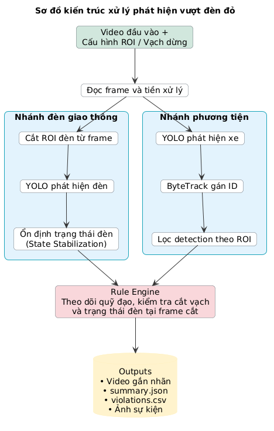

*Nguồn: hình minh họa do sinh viên cung cấp, sắp xếp lại vào phụ lục hình của báo cáo.*

### 2.2.2. Lưu đồ xử lý mỗi khung hình

Mỗi frame được đọc và tiền xử lý; nhánh phương tiện chạy detector và tracker, nhánh đèn phát hiện trạng thái trên ROI. Pipeline sau đó cập nhật quỹ đạo, kiểm tra điều kiện giao cắt, ghi lớp phủ và lưu bằng chứng khi có sự kiện.

**Hình 2.3. Lưu đồ xử lý frame từ đọc ảnh đến ghi bằng chứng**

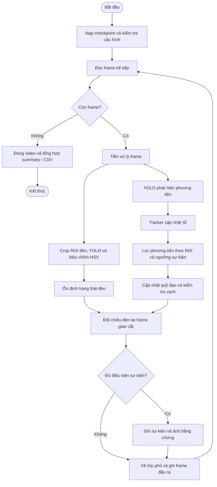

## 2.3. Thiết kế các module

### 2.3.1. Module thu nhận và tiền xử lý video

OpenCV đọc lần lượt từng frame. Ảnh suy luận được resize giữ nguyên tỷ lệ và thêm viền letterbox về kích thước mục tiêu. Sau suy luận, tọa độ hộp phương tiện được ánh xạ từ ảnh đã letterbox về tọa độ video gốc để so sánh với ROI và vạch dừng. Mặc định pipeline không bật bước khử nhiễu NLM/sharpen.

### 2.3.2. Module phát hiện ô tô bằng YOLO

Tên lớp lấy từ checkpoint và được gom thành nhóm xe và nhóm màu đèn. Phương tiện được phát hiện trên ảnh suy luận toàn khung hình. Người dùng có thể chọn ByteTrack YAML của Ultralytics hoặc tracker ByteTrack tự cài qua CLI/web. Trong các job web được dùng làm kết quả thực nghiệm của báo cáo, tracker tự cài chạy với `track_conf=0,1`, `track_buffer=60`, bật `appearance_reid` và cửa sổ tìm lại `reid_window=60` frame; ở video 30 FPS, cửa sổ này tương đương khoảng 2 giây. Web hiện mặc định chọn tracker tự cài và bật ReID; các job cũ dùng Ultralytics vẫn có thể mở nhưng không có tính năng ReID này. CLI vẫn mặc định dùng tracker Ultralytics nếu không chỉ định `--tracker`. Với Ultralytics, nếu không truyền `track_conf`, ngưỡng dự đoán là giá trị nhỏ hơn giữa `light_conf=0,25` và `vehicle_conf=0,6`. `vehicle_conf` là ngưỡng xét quỹ đạo/sự kiện, không quyết định việc vẽ hộp: hộp track thuộc lớp xe có tâm trong ROI vẫn được vẽ khi confidence thấp hơn ngưỡng sự kiện.

Tracker tự cài giữ các trạng thái New/Tracked/Lost/Removed và dùng Kalman xyah cùng Hungarian trên chi phí IoU. Mỗi đối tượng có `object_id` ổn định trong một lượt chạy, tách khỏi `track_id` nội bộ vốn có thể đổi. Khi bật ReID, tracker lưu tối đa 8 mẫu histogram màu HSV của mỗi track; detection mới chưa ghép được sẽ được so với các track vừa mất dấu cùng lớp, trong cửa sổ thời gian và cổng vị trí dự đoán. Nếu ngoại hình đủ giống và không có ứng viên cạnh tranh gần bằng, detection được gán lại `object_id` cũ nhưng tạo `track_id` mới. Cùng khung hình mất dấu cũng được xét; khi mơ hồ, tracker không tự gộp và đánh dấu cần rà soát. Đây là heuristic histogram/vị trí, không phải mô hình ReID đã huấn luyện.

Các tùy chọn association khác gồm BIoU mở rộng hộp theo hệ số riêng cho hai giai đoạn ghép; directional gating cộng chi phí cho dịch chuyển đủ nhanh nhưng ngược hướng luồng xe; NSA Kalman nhân nhiễu đo \(R\) với \(1-\text{conf}\). Các cờ CLI `--biou`, `--dir-gating`, `--nsa-kalman` cho phép bật riêng từng cải tiến. Directional gating tác động lên ghép detection với track đang hoạt động, không phải điều kiện hướng bắt buộc của bước ReID. Tùy chọn `--signal-lifecycle` nối thêm ngữ cảnh đèn và vùng hàng chờ để nới thời gian giữ một track Lost đang dừng khi đèn đỏ, cùng khoảng grace sau khi chuyển xanh. Tùy chọn `--stitch` là cơ chế riêng, chỉ tìm nối trong vùng lân cận vạch.
Suy luận phương tiện được thực hiện trên ảnh toàn khung hình, sau đó các hộp được ánh xạ về tọa độ ảnh gốc để áp dụng ROI. Confidence detector phục vụ việc tạo các phát hiện đầu vào; `vehicle_conf` được dùng ở bước quyết định có cập nhật quỹ đạo và xét sự kiện. Cơ chế này tách việc hiển thị hộp track trong ROI khỏi ngưỡng tạo sự kiện.

### 2.3.3. Module theo dõi đối tượng (bộ theo dõi đề xuất)

Module `tracking/custom_bytetrack/` quản lý các track theo trạng thái New/Tracked/Lost/Removed, dự đoán bằng Kalman xyah và ghép bằng Hungarian trên chi phí IoU. Đặc trưng histogram HSV nằm trong `tracking/reid/`; adapter cho tracker Ultralytics nằm trong `tracking/ultralytics_tracker/`. Web bật appearance ReID mặc định khi dùng tracker tự cài; ở CLI, ReID cần bật bằng `--appearance-reid`. Các cải tiến association/lifecycle như Buffered IoU, directional gating, NSA Kalman, signal-aware lifecycle và stitching là các cơ chế riêng, có cờ CLI tương ứng.

**Hình 2.4. Sơ đồ lớp của module `tracking/custom_bytetrack/`**

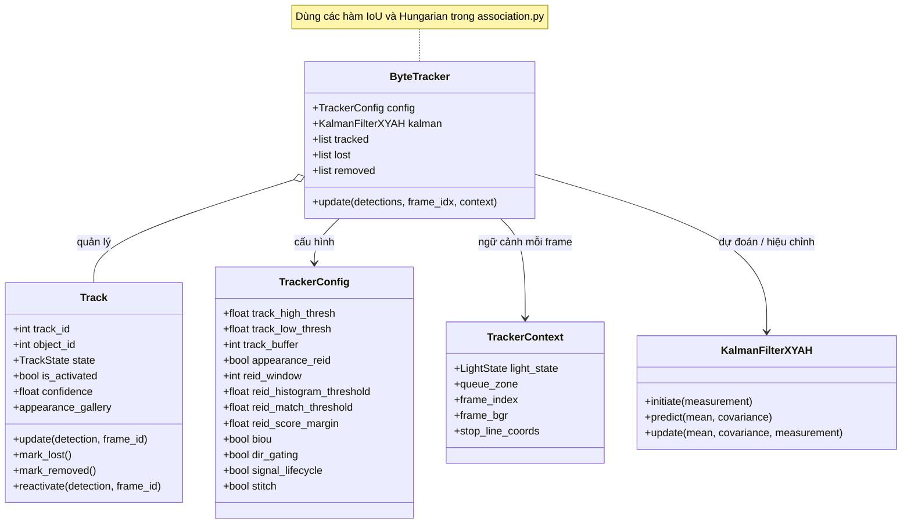

**Hình 2.5. Sơ đồ trạng thái track New/Tracked/Lost/Removed**

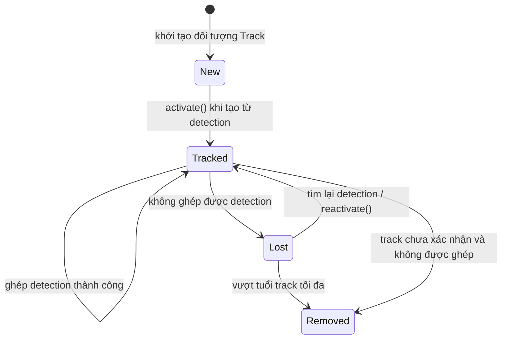

`New` là trạng thái khởi tạo ngắn: `from_detection` gọi `activate()` ngay, nên track mới chuyển sang `Tracked` trong cùng bước tạo. Track chưa xác nhận được biểu diễn bằng cờ `is_activated`, không phải một trạng thái riêng.

Để chạy ablation nhất quán, CLI có sáu preset: A dùng Ultralytics; B dùng tracker tự cài; C thêm điểm tiếp đất `bottom_center`; D thêm biou và directional gating; E thêm signal lifecycle; F thêm stitch. NSA Kalman không nằm trong chuỗi preset và được giữ tắt để các mức so sánh tương ứng đúng các thay đổi đã nêu. `scripts/run_ablation.py` chạy sáu preset tuần tự trên cùng đầu vào bằng CPU, lưu MOT, sự kiện, log và FPS theo từng preset, đồng thời tạo file tổng hợp. Đây là công cụ ghi nhận kết quả chạy, không tự động chứng minh preset nào chính xác hơn; đánh giá chất lượng cần video có ground truth. Với cấu hình Test 6 hiện có, không khai báo `QUEUE_ZONE_POLYGON`, nên E/F cảnh báo và không thể thực hiện phần kéo dài tuổi track theo vùng hàng chờ; tính năng này đã được kiểm tra riêng bằng chuỗi giả.

### 2.3.4. Module nhận diện trạng thái đèn tín hiệu

Vùng bao của đa giác ROI đèn được cắt từ frame gốc, resize/letterbox riêng rồi đưa vào YOLO với ngưỡng `light_conf` mặc định 0,25. Hộp đèn được ánh xạ lại về tọa độ ảnh gốc và kiểm tra tâm hộp nằm trong ROI đa giác. Màu dự đoán được hiệu chỉnh bằng HSV ở patch quanh tâm đèn.

Lịch sử tối đa năm kết quả gần nhất được dùng để ổn định trạng thái. Khi một màu xuất hiện tối thiểu ba lần trong lịch sử, trạng thái được cập nhật theo màu đó. Nếu không có detection mới trong hơn hai giây theo FPS video, trạng thái được đặt thành `unknown`. Vì vậy ROI vẽ thiếu bóng đèn, cắt sát mép hoặc lệch khỏi cụm tín hiệu sẽ làm tăng khoảng thời gian `unknown`; mỗi camera cần được cấu hình và xem lại trên video đầu ra.

**Hình 2.6. Sơ đồ trạng thái đèn red/green/yellow/unknown**

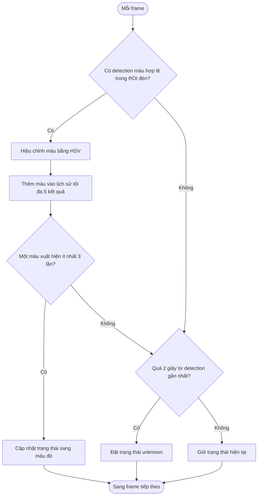

**Bảng 2.2. Quy tắc cập nhật trạng thái đèn**

| Tình huống | Quy tắc theo code | Kết quả |
|---|---|---|
| Có detection màu trong ROI | Hiệu chỉnh dự đoán bằng HSV và thêm vào lịch sử tối đa 5 kết quả | Cập nhật trạng thái khi một màu đạt ít nhất 3 lần |
| Không có detection mới trong thời gian ngắn | Giữ trạng thái gần nhất | Trạng thái không đổi |
| Không có detection mới quá 2 giây theo FPS video | Đánh dấu trạng thái hiện tại không xác định | `unknown` |

### 2.3.5. Module thiết lập vạch dừng và vùng quan tâm

File JSON chứa `FRAME_SIZE`, `VEHICLE_DETECT_ROI_POLYGON`, `RED_LIGHT_DETECT_ROI_POLYGON`, `STOP_LINE_COORDS`, `CROSSING_DIRECTION` và ngưỡng vượt vạch. Các trường tùy chọn gồm `GROUND_POINT_MODE`, `TRAFFIC_FLOW_DIRECTION`, `QUEUE_ZONE_POLYGON` và `STITCH_MARGIN`; giao diện web cho chọn `center` hoặc `bottom_center` ở bước thiết lập ROI, còn config cũ không có `GROUND_POINT_MODE` tiếp tục mặc định dùng `center`. Nếu không có hướng luồng xe, hệ thống suy ra vector đơn vị từ pháp tuyến vạch dừng và `CROSSING_DIRECTION`. `QUEUE_ZONE_POLYGON` là đa giác vùng xe dừng, được kiểm tra nằm trong ảnh; muốn bật vòng đời theo tín hiệu phải khai báo trường này. `STITCH_MARGIN` xác định dải pixel quanh đoạn vạch để xét nối, mặc định 40 pixel ảnh gốc. Bộ cấu hình có giao diện GUI chọn đa giác xe, đa giác đèn và hai điểm vạch. `load_config` kiểm tra cấu hình có đúng kích thước ảnh, các điểm nằm trong khung hình và chiều cắt thuộc `up` hoặc `down`.

**Hình 2.7. Một phần đầu ra video tại sự kiện ứng viên**
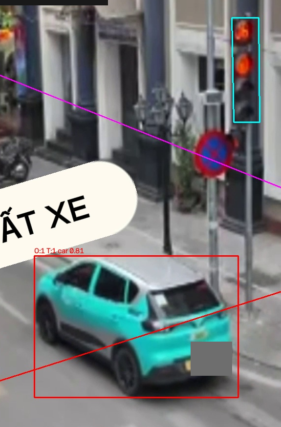

*Nguồn: job Test 6 Demo che khuất đã lưu trong `.webdata/jobs/`. Hình cho thấy lớp phủ khi xử lý, không phải ảnh chụp giao diện công cụ cấu hình hoặc toàn bộ đa giác ROI.*

Khi bật `signal_lifecycle`, mỗi lần cập nhật tracker nhận `TrackerContext` gồm trạng thái đèn, vùng chờ đổi sang tọa độ inference và frame index. Track Lost đủ điều kiện khi điểm đại diện cuối còn trong polygon và tốc độ Kalman nhỏ hơn `stationary_speed_threshold`; lúc đèn đỏ dùng `max_age_red` thay vì `track_buffer`. Track đứng yên đủ điều kiện cũng được đặt các vận tốc Kalman về 0 khi dự đoán. Khi chuyển xanh, mức tuổi kéo dài duy trì `green_grace_frames`, sau đó trở lại giới hạn bình thường.

Khi bật `stitch`, module lưu snapshot track Lost trong `stitch_window` frame. Track mới phải nằm trong dải `STITCH_MARGIN` quanh vạch; ứng viên được lọc theo khoảng cách ground point và tương đồng histogram H-S tính bằng `cv2.compareHist`, rồi xếp hạng bằng điểm kết hợp khoảng cách, thời gian và histogram. Nếu đạt các ngưỡng cấu hình, track mới kế thừa ID cũ. Ngưỡng khoảng cách mặc định 80 pixel ảnh gốc, tương đồng histogram 0,55, điểm ghép 0,65 và cửa sổ 60 frame; đây là giá trị khởi đầu, không phải kết quả tối ưu hóa.

Vạch dừng được biểu diễn bởi hai đầu mút, tạo thành một đoạn hữu hạn. Quy ước hướng `up`/`down` phải được chọn theo góc nhìn camera, không suy ra chỉ từ hướng xe trên bản đồ.

### 2.3.6. Module phát hiện vi phạm

Với vạch có điểm đầu \(A\), vector hướng \(v=B-A\), hệ thống tính pháp tuyến đơn vị \(n\). Điểm đại diện \(p_t\) được lấy từ tâm bbox hoặc tâm cạnh dưới theo `GROUND_POINT_MODE`; nếu trường cấu hình không có thì mặc định là `center`. Khoảng cách có dấu:

\[
d_t=(p_t-A)\cdot n.
\]

Một track được “armed” khi từng quan sát ở phía tiếp cận với \(d_t\) vượt ngưỡng dương. Khi hai điểm liên tiếp đổi dấu qua đường chứa vạch, hệ thống nội suy giao điểm và chiếu nó lên đoạn \(AB\). Chỉ giao điểm có hình chiếu nằm trong đoạn hữu hạn mới được giữ. Track được xác nhận vượt qua khi đi quá ngưỡng âm; frame sự kiện được gắn với frame nội suy giao cắt.

Sự kiện chỉ được tạo nếu trạng thái tại frame giao cắt được lưu là đỏ và ID chưa được ghi nhận trước đó. Cơ chế này hạn chế tính nhầm xe đã ở phía sau vạch từ đầu video và tránh ghi trùng một ID trong cùng lượt xử lý. Tuy nhiên, mất track, đổi ID, ROI không đúng hoặc trạng thái đèn `unknown` tại frame giao cắt đều có thể làm bỏ sót sự kiện.

### 2.3.7. Module lưu bằng chứng và dữ liệu đầu ra

**Bảng 2.3. Các tệp đầu ra của pipeline**

| Tệp | Nội dung |
|---|---|
| `annotated.mp4` | Video có lớp phủ ROI, vạch, hộp, ID và trạng thái đèn |
| `summary.json` | Video/checkpoint/config, tracker và ngưỡng tracking, FPS, frame, thống kê màu/trạng thái và sự kiện |
| `violations.csv` | Bảng sự kiện; chỉ có header nếu không có sự kiện |
| `tracks.txt` | Hộp và ID theo từng frame ở dạng MOT để rà soát track |
| `preview.jpg` | Khung hình dùng làm ảnh xem trước |
| `id*_crop.jpg` | Ảnh cắt phương tiện khi tạo sự kiện |
| `id*_full.jpg` | Ảnh toàn cảnh tại thời điểm lưu bằng chứng |

**Hình 2.8. Cấu trúc tệp đầu ra và quan hệ giữa video, track, summary, CSV và ảnh bằng chứng**

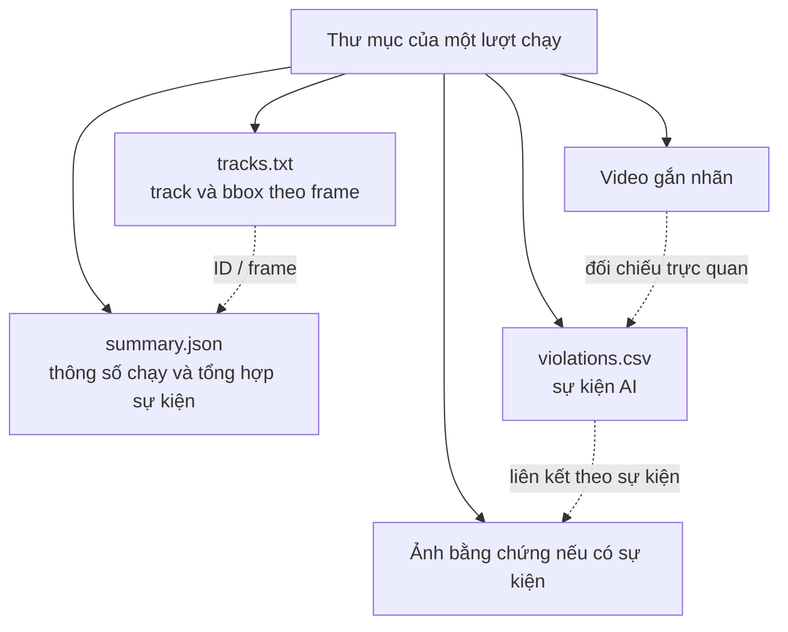

## 2.4. Thiết kế thuật toán phát hiện vi phạm

### 2.4.1. Điều kiện vi phạm và điểm tham chiếu của xe

Một sự kiện ứng viên chỉ được tạo khi có track hợp lệ đạt `vehicle_conf`, quỹ đạo đã được “armed” ở phía tiếp cận, quỹ đạo cắt qua đoạn vạch hữu hạn theo đúng hướng, vượt qua ngưỡng xác nhận và trạng thái đèn tại frame giao cắt là đỏ. Mỗi ID chỉ được ghi nhận một lần trong cùng lượt xử lý. Đây là quy tắc kỹ thuật của hệ thống, không phải kết luận pháp lý.

Điểm kiểm tra được lấy từ tâm bbox (`center`) hoặc tâm cạnh dưới (`bottom_center`). Hai lựa chọn đều là xấp xỉ vị trí xe trên mặt đường; `bottom_center` không khẳng định chính xác vị trí bánh trước. Vạch là đoạn hữu hạn \(AB\); hệ thống tính pháp tuyến đơn vị \(n\), sau đó dùng khoảng cách có dấu:

\[
d_t=(p_t-A)\cdot n.
\]

**Hình 2.9. Minh họa quỹ đạo xe, vạch dừng và khoảng cách có dấu ở hai phía ngưỡng**
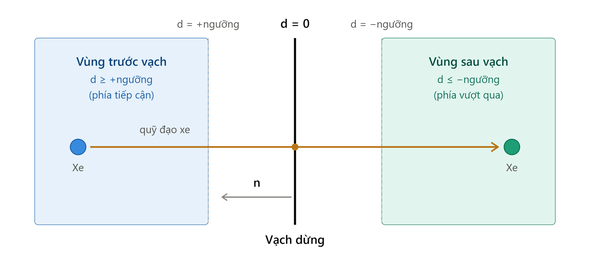

*Nguồn: hình minh họa do sinh viên cung cấp. Hình giải thích quy ước hình học, không phải ảnh CCTV hay kết quả thực nghiệm.*

### 2.4.2. Phân biệt xe chờ, xe vượt vạch, xe trong giao lộ

Track chỉ được “armed” sau khi quan sát ở phía tiếp cận vạch đủ ngưỡng. Khi điểm tham chiếu đổi dấu, giao điểm được nội suy và kiểm tra có nằm trên đoạn hữu hạn \(AB\) hay không; track chỉ được xác nhận sau khi đi qua ngưỡng phía bên kia. Xe xuất hiện ngay từ đầu video ở phía sau vạch không tự động bị tính là vừa vượt vạch.

**Hình 2.10. Lưu đồ điều kiện armed → cắt đoạn → vượt ngưỡng → kiểm tra đèn đỏ**

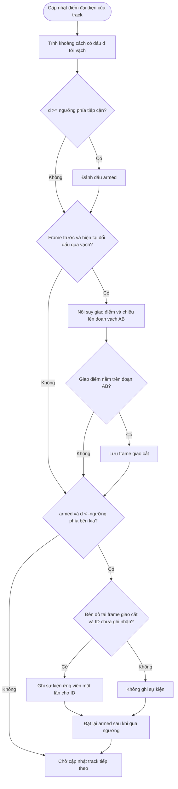

Xe đã ở phía sau vạch ngay từ đầu không được armed; giao cắt ngoài đoạn hữu hạn \(AB\) không được tính. `threshold` là ngưỡng cấu hình của `LineCrossing` (mặc định 20 pixel trong CLI).

### 2.4.3. Xử lý che khuất, mất ID và tránh báo trùng

Tracker tự cài duy trì track Lost theo `track_buffer`; khi bật `signal_lifecycle`, track Lost có điểm cuối trong `QUEUE_ZONE_POLYGON`, tốc độ thấp và bối cảnh đèn phù hợp có thể được giữ lâu hơn. Appearance ReID là cơ chế riêng: snapshot track Lost được giữ trong `reid_window=60` frame; gallery lưu tối đa 8 histogram HSV, lấy mẫu mỗi 5 frame. Detection mới được so với track cùng lớp, dựa trên histogram và vị trí dự đoán từ vận tốc. Mặc định ngưỡng histogram và điểm ghép là 0,6, khoảng cách điểm ghép tốt nhất với ứng viên thứ hai phải đạt ít nhất 0,08. Cổng vị trí nới thêm 4 pixel hệ tọa độ tracker cho mỗi frame mất dấu, tối đa 60 frame. Cho phép khoảng cách thời gian bằng 0; nếu ứng viên mơ hồ, không gộp tự động.

Khi ReID ghép thành công, `object_id` cũ được giữ nhưng `track_id` của đoạn track mới vẫn khác. Đây là heuristic appearance + vị trí, không phải mô hình ReID đã huấn luyện; histogram màu có thể nhầm các xe cùng màu. Directional gating chỉ tác động lên association của track đang hoạt động, không bắt buộc xe đi theo một chiều riêng trong ReID. BIoU và NSA Kalman cũng tác động ở association thông thường. `--stitch` là cơ chế tùy chọn khác, giới hạn quanh vạch và dùng khoảng cách ground point cùng histogram; cần rà soát khả năng ghép nhầm.

**Hình 2.11. Lưu đồ vòng đời track theo trạng thái đèn và vùng chờ**

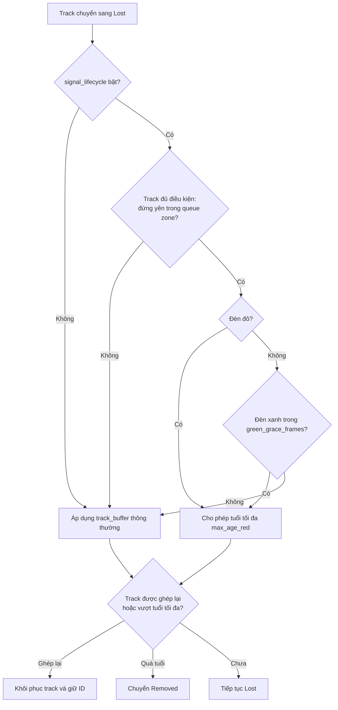

Phần kéo dài tuổi chỉ áp dụng cho track đủ điều kiện theo vùng chờ; nếu không khai báo `QUEUE_ZONE_POLYGON`, không có track nào được hưởng phần mở rộng này.

**Hình 2.12. Lưu đồ appearance ReID khi track mất dấu**

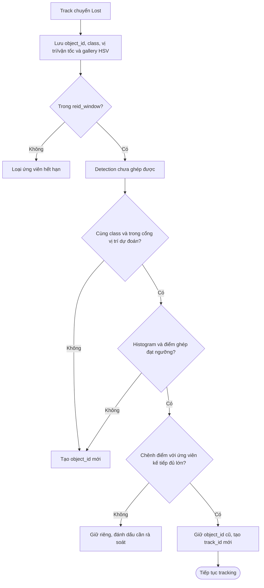

**Tránh báo trùng.** Tập `captured` ngăn cùng một `object_id` tạo nhiều sự kiện trong một lượt phân tích. Nếu tracker đổi ID mà không nối lại được object identity, cơ chế này không bảo đảm nhận ra đó là cùng một phương tiện và có thể phát sinh sự kiện trùng; kết quả vẫn cần người vận hành rà soát.

### 2.4.4. Bảng tham số và cách chọn tham số

Các giá trị dưới đây là mặc định của `TrackerConfig`, trừ các giá trị ghi rõ cho web; chúng chưa được tối ưu hóa bằng validation. Web đặt `track_buffer=60` và bật `appearance_reid` khi dùng tracker tự cài; cấu hình CLI mặc định không bật ReID. Chưa có quy trình quét tham số trên tập validation có ground truth; khoảng quét do đó chưa được xác định.

**Bảng 2.4. Tham số tracker mặc định**

| Tham số | Mặc định | Ý nghĩa | Khoảng quét đã thực hiện |
|---|---:|---|---|
| `track_high_thresh` | 0,25 | Ngưỡng detection cho lượt ghép điểm cao | Chưa thực hiện |
| `track_low_thresh` | 0,10 | Ngưỡng thấp cho lượt ghép thứ hai | Chưa thực hiện |
| `new_track_thresh` | 0,25 | Ngưỡng tạo track mới | Chưa thực hiện |
| `track_buffer` | 30 frame | Tuổi track giữ ở trạng thái mất dấu | Chưa thực hiện |
| `match_thresh` | 0,80 | Ngưỡng chi phí association | Chưa thực hiện |
| `biou_b1`, `biou_b2` | 1,2; 1,1 | Hệ số mở rộng hộp cho hai giai đoạn ghép | Chưa thực hiện |
| `max_age_red` | 120 frame | Tuổi track tối đa khi lifecycle theo đèn được bật | Chưa thực hiện |
| `green_grace_frames` | 30 frame | Grace period sau khi chuyển xanh | Chưa thực hiện |
| `stitch_window` | 60 frame | Cửa sổ tìm track Lost để nối | Chưa thực hiện |
| `stitch_distance_threshold` | 80 px | Khoảng cách ground point tối đa | Chưa thực hiện |
| `stitch_histogram_threshold` | 0,55 | Tương đồng histogram tối thiểu | Chưa thực hiện |
| `stitch_score_threshold` | 0,65 | Điểm nối tối thiểu | Chưa thực hiện |
| `stitch_margin` | 40 px | Dải quanh vạch để tìm ứng viên nối | Chưa thực hiện |
| `reid_window` | 60 frame | Thời gian giữ ứng viên ReID | Chưa thực hiện |
| `reid_distance_threshold` | 80 px ảnh gốc | Cổng vị trí ban đầu, được quy đổi sang hệ tọa độ tracker | Chưa thực hiện |
| `reid_histogram_threshold` | 0,60 | Tương đồng tối thiểu với gallery HSV | Chưa thực hiện |
| `reid_match_threshold` | 0,60 | Điểm ghép tối thiểu | Chưa thực hiện |
| `reid_score_margin` | 0,08 | Chênh điểm tối thiểu để tránh ghép mơ hồ | Chưa thực hiện |

**Bảng 2.5. Cờ và preset ablation A–F**

| Preset | Tracker | Điểm đại diện | BIoU / hướng | Lifecycle đèn | Stitch | NSA Kalman |
|---|---|---|---|---|---|---|
| A | Ultralytics | Theo cấu hình | Tắt | Tắt | Tắt | Tắt |
| B | Tự cài | Theo cấu hình | Tắt | Tắt | Tắt | Tắt |
| C | Tự cài | `bottom_center` | Tắt | Tắt | Tắt | Tắt |
| D | Tự cài | `bottom_center` | Bật | Tắt | Tắt | Tắt |
| E | Tự cài | `bottom_center` | Bật | Bật | Tắt | Tắt |
| F | Tự cài | `bottom_center` | Bật | Bật | Bật | Tắt |

## 2.5. Thiết kế dữ liệu và giao diện

### 2.5.1. Cấu trúc dữ liệu đầu vào, đầu ra

Đầu vào gồm video, checkpoint YOLO và cấu hình JSON theo đúng độ phân giải video (ROI phương tiện, ROI đèn, hai đầu vạch và hướng cắt). Đầu ra chính gồm video đã chú thích, `tracks.txt` lưu hộp và ID theo frame ở dạng MOT, `summary.json` lưu thông số lượt chạy và sự kiện, `violations.csv` lưu sự kiện AI, cùng ảnh crop/toàn cảnh khi có sự kiện. Tên file, định dạng và trường dữ liệu được tổng hợp tại Bảng 2.3; mỗi phiên web có thư mục job riêng. Đây là đầu ra hỗ trợ rà soát, không phải kết luận pháp lý.

### 2.5.2. Thiết kế giao diện người dùng

Ứng dụng VIA chạy cục bộ qua Flask/Waitress. Người dùng tải video, đánh dấu vùng xe/đèn và hai đầu vạch, rồi theo dõi tiến độ. Bốn mục cấu hình nâng cao — hướng phương tiện qua vạch, điểm đại diện, bộ theo dõi phương tiện và tinh chỉnh độ tin cậy — là bốn phần thu gọn độc lập, mặc định đóng; lựa chọn được lưu cùng job. Người dùng có thể chọn ByteTrack Ultralytics hoặc ByteTrack tự cài. Worker riêng nhận cấu hình tracker, ngưỡng và ROI để chạy pipeline, cập nhật ảnh xem trước và trạng thái job. Các cải tiến ablation nâng cao của tracker tự cài hiện chỉ cấu hình qua CLI. Video đầu ra được mã hóa H.264 để phát trên trình duyệt. Mỗi job có thư mục riêng trong `.webdata/jobs/`, tránh ghi đè kết quả CLI trong `Output/`.

Giao diện có trang rà soát sự kiện AI để đánh dấu xác nhận, không vi phạm, chưa chắc hoặc chưa xem và ghi chú. Trạng thái rà soát là thông tin người dùng bổ sung; nó không thay đổi sự kiện gốc trong `violations.csv` và không phát hiện các sự kiện mà mô hình bỏ sót.

**Hình 2.13. Giao diện cấu hình và rà soát kết quả**

Giao diện web cho phép chọn tracker, cấu hình điểm tham chiếu bbox, đặt ROI/vạch và rà soát sự kiện. Ảnh chụp giao diện chưa được lưu trong hồ sơ job; các video đã xử lý và đầu ra trực quan được dùng làm bằng chứng triển khai ở Chương 3.

### 2.5.3. Sơ đồ tuần tự luồng chính

Luồng web gồm trình duyệt gửi video/cấu hình tới Flask, worker gọi pipeline dùng chung, callback cập nhật trạng thái/ảnh xem trước, sau đó worker lưu video và báo cáo để giao diện hiển thị.

**Hình 2.14. Sơ đồ tuần tự trình duyệt – Flask – worker – pipeline – kho job**

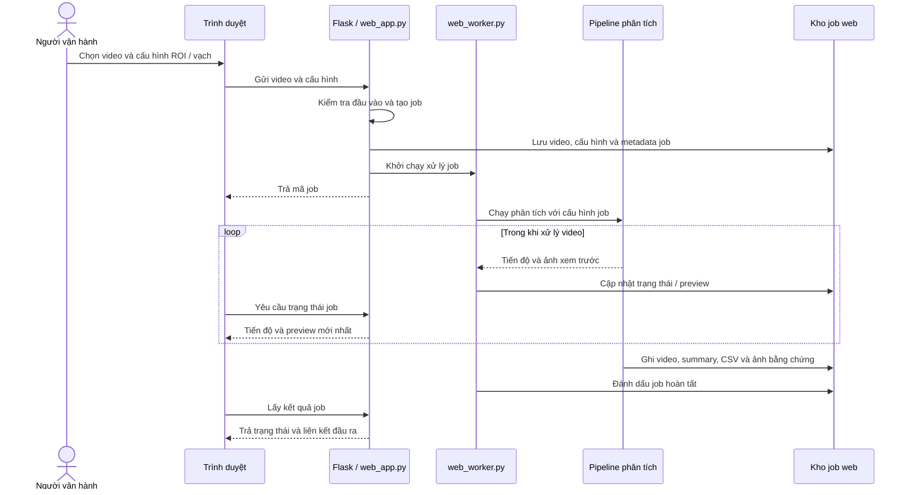

## 2.6. Tổng kết chương

Chương này đã xác định yêu cầu của hệ thống, mô tả kiến trúc xử lý video và thiết kế các module phát hiện, theo dõi, nhận diện đèn, kiểm tra giao cắt, lưu kết quả và giao diện. Trọng tâm của thiết kế là chỉ ghi nhận sự kiện ứng viên khi có track đi qua đoạn vạch theo hướng đã cấu hình và trạng thái đèn tại thời điểm giao cắt là đỏ. Các thiết kế này là cơ sở cho phần cài đặt và kiểm thử ở Chương 3.
---
