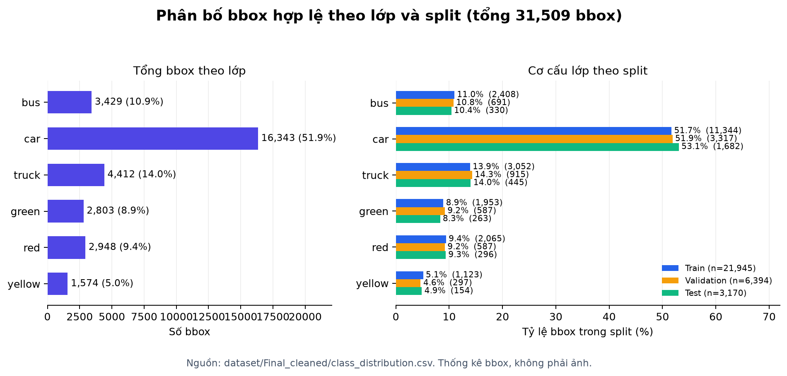
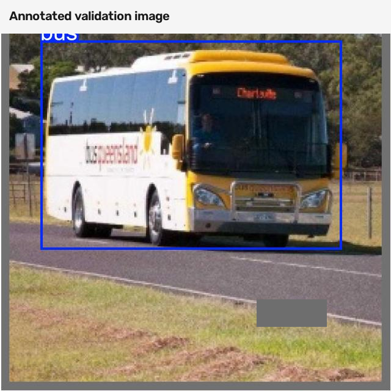
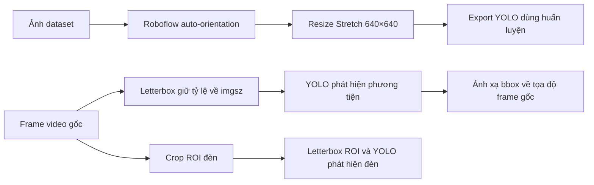
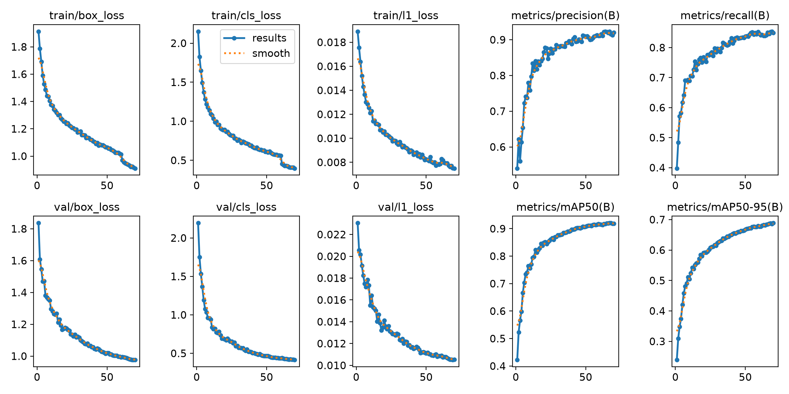
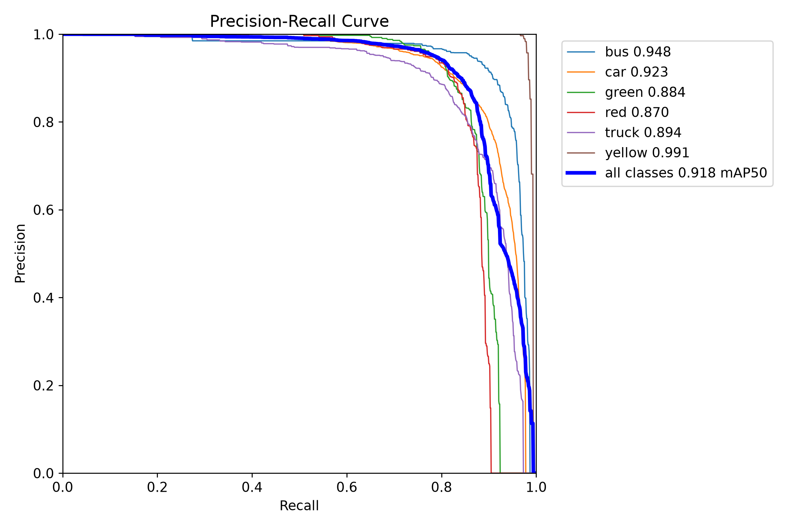
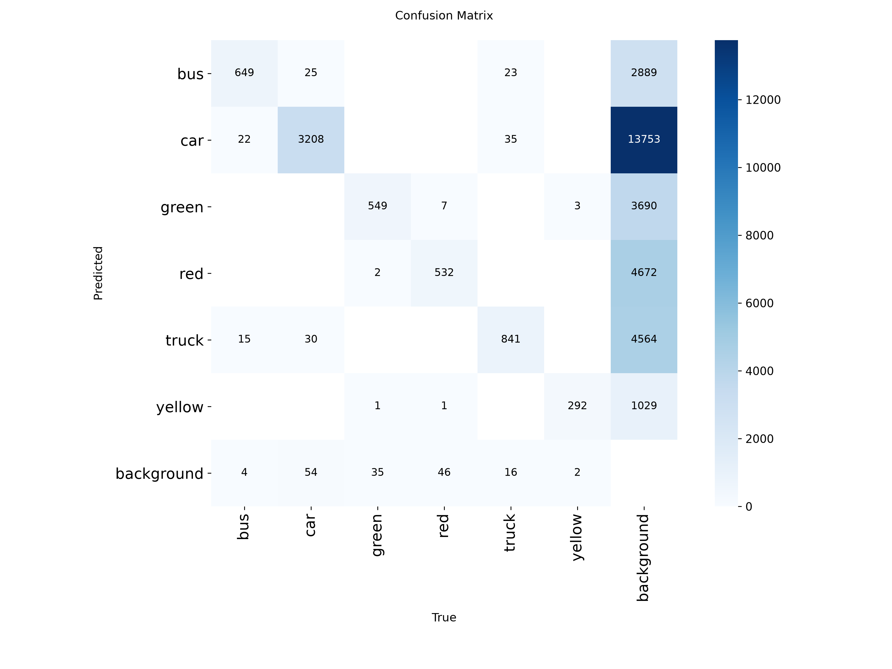
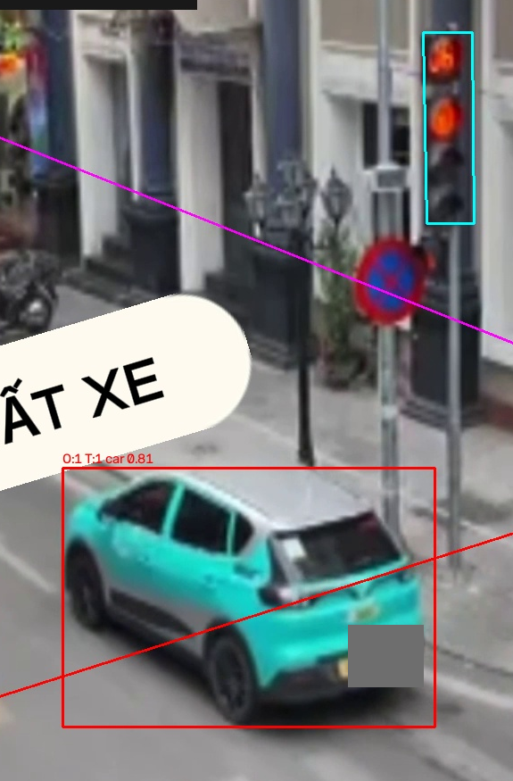
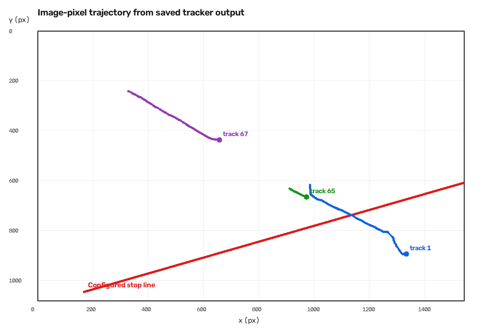
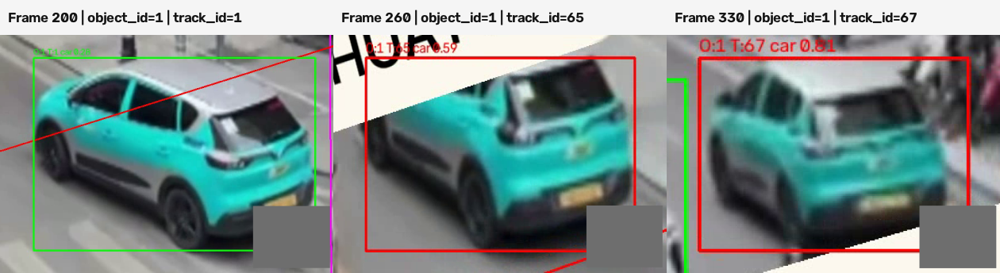
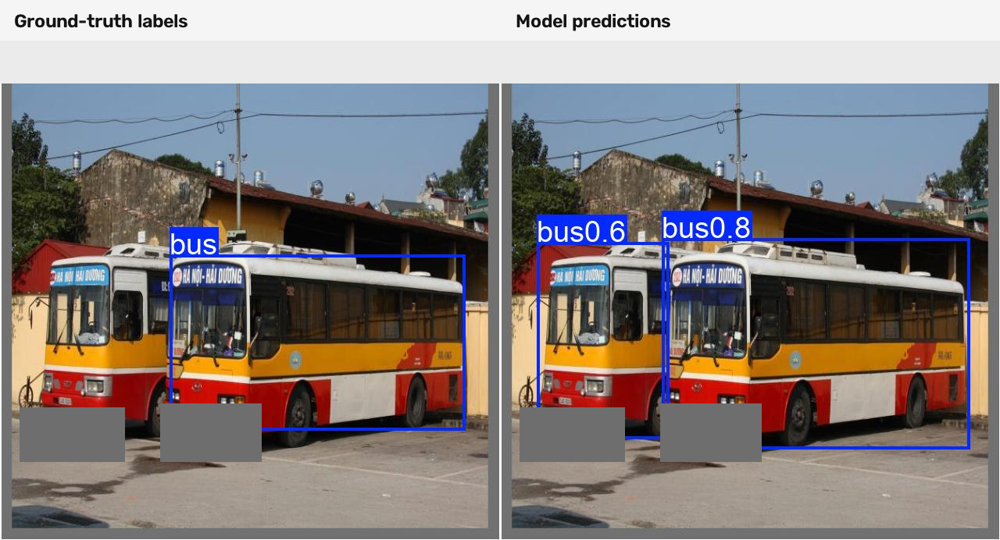

# CHƯƠNG 3. XÂY DỰNG, TRIỂN KHAI VÀ KIỂM THỬ HỆ THỐNG

## 3.1. Môi trường phát triển và công nghệ sử dụng

Các công nghệ được lựa chọn theo vai trò trong sản phẩm. YOLO/PyTorch phục vụ huấn luyện và phát hiện; OpenCV xử lý video, ROI và ảnh; NumPy/SciPy hỗ trợ hình học và ghép cặp trong tracker tự cài; Flask/Waitress cung cấp giao diện web cục bộ. Ultralytics cung cấp API YOLO và ByteTrack baseline. Bảng 3.12 trình bày cấu trúc mã nguồn tích hợp.

| Công nghệ | Vai trò triển khai |
|---|---|
| Python | Ngôn ngữ chính cho pipeline, tracker, công cụ dữ liệu và web worker |
| PyTorch, Ultralytics YOLO | Huấn luyện/validation và suy luận phát hiện đối tượng |
| OpenCV, NumPy | Đọc/ghi video, tiền xử lý, ROI, HSV và phép tính hình học |
| SciPy | Thuật toán Hungarian trong tracker tự cài |
| Flask, Waitress | API và giao diện web chạy cục bộ |
| Roboflow | Quản lý/gán nhãn và export dữ liệu YOLO |

**Môi trường thực nghiệm:** phần cứng/phần mềm đối chiếu được và giới hạn về thời điểm ghi nhận được trình bày tại Bảng 3.9.

## 3.2. Xây dựng bộ dữ liệu

### 3.2.1. Nguồn dữ liệu và chuẩn bị dữ liệu

Theo thông tin của sinh viên, thư mục làm việc xử lý dữ liệu và huấn luyện là `TRAIN_DATA_ROOT`; dữ liệu dùng để train nằm trong thư mục con `Train`. Các thư mục dataset đặt trong repository trên ổ D chỉ để tham chiếu/minh họa, không được dùng làm nguồn dữ liệu huấn luyện.

Sinh viên tự tìm các đoạn CCTV giao thông từ một số tỉnh miền Nam và CCTV Đà Nẵng trên YouTube, cắt thành 2.078 ảnh, gán nhãn trên Roboflow, áp dụng lật ngang (flip H) để tăng số lượng và resize về 640×640. Kiểm đếm tên file có `flip` trong `NhanDienGiaoThong.v3i.yolo11` cho thấy có 732 ảnh flip: 515 ở train, 148 ở valid và 69 ở test. Project tự thu thập này được ghép với dataset `KLTN-vehicles` có 2.310 ảnh; kết quả hơn 4.300 ảnh được lưu thành `NhanDienGiaoThong.3i.yolo11`. Sau đó, sinh viên bổ sung dữ liệu Bus và Truck để tăng mẫu cho hai lớp còn ít, rồi ghép khoảng một nửa bộ Traffic Light Detection từ Roboflow để tạo bộ sáu lớp. Bộ dữ liệu sau ghép là `Final Merge`; sau bước clean thành `Final Cleaned`, sinh viên tải dữ liệu lên project Roboflow `DATADOANNEW`. Theo xác nhận của sinh viên, một số file gặp lỗi khi tải lên, nên bản còn lại có 11.668 ảnh; phiên bản này được tải lại vào thư mục `Train` trên ổ C để huấn luyện.

Workspace không lưu đủ metadata về số clip gốc, độ phân giải/FPS của từng nguồn hay điều kiện thời tiết/ánh sáng; không suy ra các trường này từ số ảnh.

**Bảng 3.1. Quy mô và vai trò các project dữ liệu theo ảnh chụp Roboflow**

| Project hiển thị trên Roboflow | Số ảnh hiển thị | Vai trò trong quy trình |
|---|---:|---|
| NhanDienGiaoThong | 2.078 | Ảnh CCTV sinh viên tự thu thập, cắt, gán nhãn; áp dụng lật ngang (flip H) và resize 640×640; thư mục `NhanDienGiaoThong.v3i.yolo11` có 732 ảnh tên chứa `flip` |
| KLTN-vehicles | 2.310 | Dataset có sẵn; ghép với bộ tự thu thập thành hơn 4.300 ảnh (`NhanDienGiaoThong.3i.yolo11`) |
| Bus | 1.000 | Bổ sung mẫu xe buýt |
| Truck | 1.016 | Bổ sung mẫu xe tải |
| Traffic Light Detection | 9.710 | Nguồn dữ liệu đèn; sử dụng khoảng một nửa |
| DATADOANNEW | 11.668 | Project Roboflow lưu bộ dữ liệu tổng hợp sau clean |

Các số nguồn là số hiển thị trên ảnh chụp Roboflow, không cộng thành tổng dataset vì `DATADOANNEW` là project đích sau tổng hợp. Ảnh chụp ghi project Traffic Light Detection có 9.710 ảnh. README và số file đếm được trong bản dataset đặt ở repository ổ D lần lượt ghi 1.176 và 10.886 ảnh/nhãn; theo xác nhận của sinh viên, các thư mục dataset ở ổ D chỉ là bản tham chiếu/minh họa, không phải nguồn dùng để train. Vì vậy, không dùng số đếm của bản ổ D để suy ra số ảnh Traffic Light đã thực sự lấy trong quy trình trên ổ C. Sinh viên xác nhận đã dùng khoảng một nửa bộ dữ liệu Roboflow, nhưng số chính xác của phiên bản nguồn được dùng chưa có manifest để đối soát. Dữ liệu huấn luyện thực tế được tải từ `DATADOANNEW` vào thư mục `Train` trên ổ C với 11.668 ảnh.

**Hình 3.1. Ví dụ ảnh từ các góc camera/điều kiện thu thập**
*Cần chọn ảnh CCTV được phép sử dụng, làm mờ biển số và thông tin nhận dạng trước khi đưa vào báo cáo.*

**Bảng 3.2. Metadata kỹ thuật và điều kiện thu thập cần hoàn thiện**

| Trường | Thông tin hiện có |
|---|---|
| Nguồn | CCTV giao thông và CCTV công khai trên YouTube |
| Số ảnh theo project | Có số liệu Roboflow tại Bảng 3.1 |
| Số clip gốc | Chưa thống kê |
| Độ phân giải/FPS từng nguồn | Chưa thống kê |
| Điều kiện thời tiết, thời gian, góc camera | Chưa lập bảng tổng hợp |

### 3.2.2. Tiền xử lý và gán nhãn

Sơ đồ thể hiện quy trình do sinh viên xác nhận. Các bản dataset trong repository ổ D chỉ dùng tham chiếu/minh họa; dữ liệu xử lý và train thực tế nằm dưới `TRAIN_DATA_ROOT`, trong đó bản tải từ Roboflow dùng train nằm trong `Train`.

```mermaid
flowchart TD
    A[2.078 ảnh CCTV tự thu thập, gán nhãn Roboflow<br/>lật ngang (flip H), resize 640x640]
    A --> B[Ghép 2.310 ảnh KLTN-vehicles]
    B --> C[NhanDienGiaoThong.3i.yolo11<br/>hơn 4.300 ảnh]
    C --> D[Bổ sung dữ liệu Bus và Truck]
    D --> E[Ghép khoảng một nửa bộ Traffic Light Detection]
    TL[Traffic Light Detection trên Roboflow] --> E
    E --> F[Final Merge<br/>bộ dữ liệu sáu lớp]
    F --> G[Clean dữ liệu]
    G --> H[Final Cleaned]
    H --> I[Tải lên Roboflow DATADOANNEW<br/>một số file lỗi]
    I --> J[Tải phiên bản 11.668 ảnh về<br/>C:\\Users\\ADMIN\\Downloads\\DATA\\XuLyData\\Train]
    J --> K[Huấn luyện YOLO26s<br/>70 epoch]
    R[Dataset trong repository ổ D<br/>chỉ tham chiếu/minh họa] -. không dùng train .-> H
```

#### Chuẩn hóa thứ tự lớp trong bộ dữ liệu gộp

Trong `TRAIN_DATA_ROOT\Final_cleaned\data.yaml`, thứ tự lớp trên máy là:

**Bảng 3.3. Thứ tự lớp trong YAML gộp và làm sạch**

| ID trên YAML gộp/làm sạch | Tên lớp | Ý nghĩa |
|---:|---|---|
| 0 | bus | Xe buýt |
| 1 | car | Ô tô con |
| 2 | truck | Xe tải |
| 3 | green | Đèn xanh |
| 4 | red | Đèn đỏ |
| 5 | yellow | Đèn vàng |

Đây là thứ tự dùng để mô tả các bước gộp và clean trên máy. Các script xử lý trong `TRAIN_DATA_ROOT` tạo `Final_merged` và `Final_cleaned` theo mapping này.

#### Ghép bộ dữ liệu giao thông ban đầu

Bộ dữ liệu phương tiện ban đầu được tạo bằng cách ghép project `NhanDienGiaoThong` do sinh viên tự thu thập/gán nhãn với project `KLTN-vehicles` tải từ Roboflow. Hai nguồn có các lớp phương tiện chung; riêng KLTN có thêm lớp xe máy nên lớp này được loại khỏi phạm vi bộ dữ liệu, sau đó nhãn được chuẩn hóa theo tên lớp trước khi ghép. Tên lớp và ID nguồn phải được đối chiếu bằng YAML của từng phiên bản, không mặc định ID giống nhau chỉ vì tên lớp giống nhau.

Trong thư mục xử lý hiện có, các script được lưu phục vụ những bước bổ sung Bus/Truck, ghép Traffic Light và clean; không thấy script riêng cho thao tác ghép ban đầu giữa `NhanDienGiaoThong` và `KLTN-vehicles`. Vì vậy, mô tả bước ghép ban đầu ở đây dựa trên quy trình do sinh viên cung cấp, chưa thể tái lập đầy đủ chỉ từ các script hiện lưu.

#### Bổ sung bus và truck

Do số lượng mẫu bus và truck trong bộ phương tiện ban đầu còn thấp, hai nguồn `Bus` và `Truck` được bổ sung riêng. Script `Code/01_merge_truck_bus_into_nhandien.py` giữ mapping `bus=0`, `car=1`, `truck=2` của bộ nền, remap `bus=0 → 0` và `truck=0 → 2`, đồng thời thêm prefix theo nguồn vào tên file để hạn chế trùng tên. Script giữ nguyên split train/valid/test của từng nguồn, không hoán đổi ảnh giữa các split. YAML của các nguồn Bus và Truck đều có một lớp ID 0; YAML của bộ nền có ba lớp `bus`, `car`, `truck`. Bước gộp ban đầu giữa `NhanDienGiaoThong` và `KLTN-vehicles` không có script trong workspace nên không thể tái lập chỉ từ các file hiện lưu.

#### Bổ sung và lấy mẫu dữ liệu đèn

`Code/02_merge_with_traffic_light.py` đọc từng split của thư mục nguồn cục bộ, không chuyển ảnh qua lại giữa train/valid/test. Trong mỗi split, script nhóm file nhãn theo tập class ID xuất hiện trong ảnh, đặt mục tiêu chọn \(\lceil N/2\rceil\) file, rồi phân bổ gần một nửa cho từng nhóm class-combination. Phần làm tròn được chọn để tổng bình phương sai lệch giữa số instance từng lớp được chọn và mục tiêu tỷ lệ gần một nửa là nhỏ nhất. Sau đó, file trong từng nhóm được xáo trộn bằng `random.Random` với seed lần lượt là 0 cho train, 1 cho valid và 2 cho test; cùng đầu vào và cùng mã sẽ cho cùng lựa chọn.

ID nguồn của Traffic Light được ánh xạ sang thứ tự trên máy: `green=0 → 3`, `red=1 → 4`, `yellow=2 → 5`. Các dòng nhãn được remap, ảnh và label được thêm prefix `TL_`. Bộ gốc không bị thay đổi. Cách lấy một nửa theo nhóm nhãn giúp giảm lượng ảnh đèn nhưng vẫn giữ gần tương quan lớp; nó không bảo đảm số instance từng lớp chính xác bằng một nửa do ảnh có thể chứa nhiều nhãn, file lỗi hoặc thiếu ảnh.

Script lưu trong hồ sơ có quy tắc lấy mục tiêu xấp xỉ một nửa số ảnh theo từng split và phân bổ theo nhóm class-combination. Bản dataset đặt trong repository ổ D có một số đếm nguồn/lấy mẫu riêng, nhưng đây chỉ là bản tham chiếu/minh họa, không phải bản xử lý dùng để train; vì vậy các số đếm đó không được dùng làm thống kê xác nhận số ảnh đèn thực tế trong `Final Merge` trên ổ C. Số lượng chính xác được lấy từ phiên bản Traffic Light Detection đã dùng trên ổ C hiện chưa có manifest để đối soát.

#### Làm sạch nhãn YOLO

Sau khi ghép dữ liệu phương tiện với dữ liệu đèn, script `03_data_cleaning.py` làm sạch `Final_merged` và ghi kết quả riêng vào `Final_cleaned`; dữ liệu nguồn không bị ghi đè. Quy trình này loại các dòng nhãn không hợp lệ, các ảnh/nhãn không còn cặp hợp lệ và chỉ giữ ảnh còn ít nhất một bbox hợp lệ. Việc clean kiểm tra cấu trúc, class ID, tọa độ và cặp file; không đồng nghĩa với việc kiểm duyệt lại tính đúng đắn ngữ nghĩa của từng nhãn.

Script kiểm tra ba split và từng cặp ảnh–nhãn:

1. Tìm ảnh và file label cùng stem; cặp thiếu ảnh hoặc thiếu label được ghi nhận và không đưa vào danh sách cặp hợp lệ.
2. Bỏ dòng trắng; mỗi dòng nhãn phải có đúng năm trường theo định dạng YOLO detection: `class_id x_center y_center width height`.
3. Kiểm tra class ID là số nguyên trong `[0,5]`; bốn tọa độ phải là số hữu hạn.
4. Kiểm tra tâm nằm trong `[0,1]`, width/height thuộc `(0,1]`, và toàn bộ hộp không vượt biên ảnh.
5. Dòng hợp lệ được giữ nguyên. Dòng không hợp lệ bị loại và ghi nguyên nhân vào `cleaning_report.csv`.
6. Hộp có diện tích dưới `0,0005` (0,05% diện tích ảnh) hoặc trên `0,90` (90%) chỉ được cảnh báo, không tự xóa. Quy tắc này đặc biệt quan trọng với đèn nhỏ: kích thước nhỏ không đủ căn cứ để bỏ nhãn.
7. Ảnh chỉ được sao chép khi sau lọc còn ít nhất một dòng nhãn hợp lệ. File nhãn rỗng hoặc toàn dòng sai định dạng không được đưa sang bộ clean.

Kết quả kiểm đếm từ các CSV clean hiện có:

**Bảng 3.4. Số liệu hồ sơ clean tham chiếu và quy mô bộ train**

| Split | `Final Merge` trong bản tham chiếu | `Final Cleaned` theo CSV tham chiếu | Bản Roboflow tải về train | Bbox hợp lệ theo hồ sơ clean |
|---|---:|---:|---:|---:|
| Train | 8.182 | 8.166 | Chưa đối soát theo split | 21.945 |
| Valid | 2.342 | 2.335 | Chưa đối soát theo split | 6.394 |
| Test | 1.175 | 1.171 | Chưa đối soát theo split | 3.170 |
| **Tổng** | **11.699** | **11.672** | **11.668** | **31.509** |

Các số `Final Merge`/`Final Cleaned` và bbox trong bảng được lấy từ CSV/bản dữ liệu tham chiếu hiện có trong repository ổ D; theo xác nhận của sinh viên, các thư mục này không phải đầu vào huấn luyện. Tổng 11.668 ảnh của bản Roboflow tải về dùng train được xác nhận riêng; chưa có bảng đối soát độc lập để phân bổ số lượng đó theo split. Tỷ lệ split 70%/20%/10% là của hồ sơ clean tham chiếu, không được xem là thống kê đã xác minh của bản train ở ổ C. Trong `cleaning_report.csv` có 87 dòng nhãn bị loại và 27 cặp mà mọi dòng đều không hợp lệ; cả 87 dòng bị loại đều sai số trường so với định dạng detection năm trường (21 dòng từ file có prefix `MERGED_`, 66 từ `TL_`). Một số dòng có rất nhiều tọa độ, phù hợp với khả năng nhãn polygon/segmentation hoặc định dạng khác; script clean không chuyển polygon thành bbox mà loại dòng đó. Cần xác minh nguồn nhãn trước khi kết luận đó là lỗi gán nhãn. Báo cáo còn có 2.232 bản ghi cảnh báo kích thước bbox được giữ nguyên; đây là số bản ghi cảnh báo, không phải số ảnh độc nhất.

CSV clean trong bản tham chiếu ghi 11.672 cặp ảnh–nhãn; bản tải về từ Roboflow dùng train còn 11.668 ảnh. Theo xác nhận của sinh viên, chênh lệch xuất phát từ một số file lỗi khi upload; chưa có log hoặc danh sách tên file để đối soát từng file lỗi. Vì vậy, 11.672 là số trong CSV clean được lưu để tham chiếu, còn 11.668 là quy mô bản Roboflow thực tế được tải về train.

Trong bản sao `Final_cleaned` đặt trong repository ổ D có ba ảnh JPG không có nhãn cùng stem (một ở train, hai ở test) và ba file `.txt` nằm trong `test/images`. Đây là tình trạng riêng của bản tham chiếu/minh họa ở ổ D, không được dùng để mô tả nội dung chính xác của export huấn luyện trên ổ C.

Phân bố bbox theo YAML/CSV của bản clean tham chiếu:

**Bảng 3.5. Phân bố bbox sau clean theo lớp và split**

| Lớp | Train | Valid | Test | Tổng |
|---|---:|---:|---:|---:|
| bus | 2.408 | 691 | 330 | 3.429 |
| car | 11.344 | 3.317 | 1.682 | 16.343 |
| truck | 3.052 | 915 | 445 | 4.412 |
| green | 1.953 | 587 | 263 | 2.803 |
| red | 2.065 | 587 | 296 | 2.948 |
| yellow | 1.123 | 297 | 154 | 1.574 |
| **Tổng** | **21.945** | **6.394** | **3.170** | **31.509** |

Lớp `car` chiếm khoảng 51–53% bbox trong mỗi split; lớp `yellow` ít hơn các lớp khác. Bởi vậy phân bố dữ liệu không đồng đều hoàn toàn. Script clean chỉ kiểm tra cấu trúc và phạm vi hình học; nó không thể khẳng định nhãn đúng ngữ nghĩa, phát hiện ảnh trùng lặp, hoặc biết một bbox có ôm đúng vật thể hay không. Các bước này cần rà soát trực quan bổ sung.

**Hình 3.2. Phân bố bbox theo lớp trong bộ dữ liệu clean**


*Nguồn: `dataset/Final_cleaned/class_distribution.csv` trong bản tham chiếu ở repository ổ D; biểu đồ thể hiện số bbox của bản clean này, không phải số ảnh hay độ chính xác của mô hình. Không dùng biểu đồ này như thống kê độc lập của export đã train.*

#### Gán nhãn dữ liệu

Sinh viên tự gán nhãn bằng Roboflow hơn 2.000 ảnh trong project `NhanDienGiaoThong`. Project `KLTN-vehicles` và các nguồn Bus, Truck, Traffic Light Detection được dùng theo nhãn có sẵn sau khi loại lớp ngoài phạm vi và chuẩn hóa class mapping theo tên. Bộ lớp thống nhất sau cùng gồm `bus`, `car`, `truck`, `green`, `red`, `yellow`. Nhãn detection YOLO mô tả class và bounding box; dữ liệu hiện có không chứa nhãn ID liên tục kiểu MOT hoặc nhãn frame vi phạm để đánh giá sự kiện.

**Bảng 3.6. Quy tắc lớp detection trong dataset**

| Nhãn | Đối tượng được gán | Ghi chú |
|---|---|---|
| `bus` | Xe buýt | Phương tiện |
| `car` | Ô tô con | Phương tiện |
| `truck` | Xe tải | Phương tiện |
| `green` | Tín hiệu đèn xanh | Trạng thái đèn |
| `red` | Tín hiệu đèn đỏ | Trạng thái đèn |
| `yellow` | Tín hiệu đèn vàng | Trạng thái đèn |

**Hình 3.3. Ví dụ nhãn bbox cho phương tiện và đèn tín hiệu**


*Nguồn: ảnh `val_batch0_labels.jpg` trong hồ sơ train. Hình minh họa nhãn detection ở cấp ảnh; dữ liệu này không có ID MOT theo chuỗi.*

Không có hồ sơ về việc hai người gán độc lập, đo IoU giữa người gán hoặc quy trình phân xử bất đồng. Vì vậy không báo cáo độ đồng thuận gán nhãn; kiểm tra clean xác nhận cú pháp/tọa độ, không chứng minh tính đúng đắn ngữ nghĩa.

#### Định dạng và lưu trữ dữ liệu

Nhãn lưu theo định dạng YOLO detection gồm `class_id x_center y_center width height`, với tọa độ chuẩn hóa theo kích thước ảnh. Thư mục làm việc xử lý dữ liệu là `TRAIN_DATA_ROOT`; phiên bản Roboflow 11.668 ảnh tải về phục vụ huấn luyện nằm trong `TRAIN_DATA_ROOT\Train`. Các thư mục dataset trong repository ổ D chỉ là bản tham chiếu/minh họa.

Sau khi clean, dữ liệu được tải lên project Roboflow `DATADOANNEW`; theo xác nhận của sinh viên, một số file gặp lỗi trong quá trình tải. Phiên bản còn 11.668 ảnh được tải lại từ Roboflow vào thư mục `Train` trên ổ C để huấn luyện. README của bản export ghi định dạng YOLO26, auto-orientation, resize 640×640 kiểu Stretch và không augmentation. YAML export ghi:

```yaml
nc: 6
names:
  - bus
  - car
  - green
  - red
  - truck
  - yellow
```

Sau khi đưa bộ clean lên project Roboflow `DATADOANNEW` và tải phiên bản export về để train, thứ tự lớp trong YAML export khác với thứ tự trong `Final_cleaned/data.yaml`. Mapping theo **tên lớp** từ YAML trên máy sang YAML export dùng khi train là:

**Bảng 3.7. Mapping class ID từ YAML clean sang export train**

| Tên lớp | ID YAML gộp/clean trên máy | ID YAML export dùng train |
|---|---:|---:|
| bus | 0 | 0 |
| car | 1 | 1 |
| truck | 2 | 4 |
| green | 3 | 2 |
| red | 4 | 3 |
| yellow | 5 | 5 |

ID số của một lớp có thể khác giữa hai phiên bản mà không làm thay đổi ý nghĩa lớp, miễn là nhãn đã được export/remap nhất quán theo tên. Vì vậy, khi mô tả thao tác gộp/clean phải dùng thứ tự lớp trên máy như các bảng ở trên; khi mô tả huấn luyện phải nêu thứ tự của `export-yolo26/data.yaml`. Không được lấy ID số từ giai đoạn này gán thẳng cho giai đoạn kia nếu chưa đối chiếu tên. `train.py` kiểm tra thứ tự export đúng bằng danh sách `bus, car, green, red, truck, yellow`, và model trả tên lớp theo thứ tự export. Pipeline inference lấy tên từ checkpoint nên lớp `truck` vẫn được gọi theo tên dù ID đổi.

README của bản export `DATADOANNEW` ghi 11.668 ảnh. CSV clean được lưu trong bản tham chiếu ghi 11.672 cặp ảnh–nhãn (8.166 train, 2.335 valid và 1.171 test); đây là số liệu của bản clean, không phải thống kê độc lập từ thư mục train trên ổ C. Sinh viên xác nhận một số file lỗi khi upload, dẫn đến bản Roboflow tải về còn 11.668 ảnh; chưa có log/tên file để đối soát từng file lỗi.

### 3.2.3. Chia tập dữ liệu

Theo script và CSV của bản clean tham chiếu, các split Train/Valid/Test được giữ riêng trong bước lấy mẫu dữ liệu đèn, không chuyển ảnh qua lại; tỷ lệ ảnh clean xấp xỉ 70%/20%/10%. Đây không phải phép kiểm kê độc lập dữ liệu export trên ổ C. Chưa xác minh được toàn bộ nguồn được chia theo clip/giao lộ, vì vậy không khẳng định độc lập theo camera hoặc không rò rỉ cảnh giữa các split.

Thống kê số ảnh và bbox từng split trình bày tại Bảng 3.4.

### 3.2.4. Tăng cường dữ liệu

Workspace có script `Code/04_preprocessing.py` để tạo bản ngoại tuyến `dataset/Final_preprocessed`, nhưng thư mục đầu ra này hiện chưa tồn tại và `args.yaml` của lần train trỏ tới export Roboflow `export-yolo26`; vì vậy không có bằng chứng script ngoại tuyến được dùng để tạo dữ liệu của lần train. Script dự kiến giữ nguyên validation/test và tạo tối đa năm biến thể cho mỗi ảnh train có ít nhất một lớp thuộc `{bus, truck, green, red, yellow}`: lật ngang với xác suất 0,5, xoay trong khoảng \(-15^\circ\) đến \(15^\circ\) với xác suất 0,7, rồi điều chỉnh độ sáng/tương phản. Bounding box được biến đổi theo ảnh và cắt về biên; cả các nhãn trong ảnh đủ điều kiện đều được giữ/biến đổi, kể cả `car` nếu ảnh đó có nhiều lớp. Seed ngoại tuyến là 42. Đây là mô tả khả năng của script, không phải số mẫu đã thực sự sinh.

README của export `DATADOANNEW` ghi auto-orientation và resize 640×640 kiểu Stretch, không áp dụng augmentation ngoại tuyến. Trong lần train, tăng cường trực tuyến do Ultralytics thực hiện theo `args.yaml`, gồm HSV, lật ngang, scale/translate và mosaic; mosaic có giá trị 1,0 và đóng ở 10 epoch cuối. Không diễn giải `mosaic=1,0` thành tỷ lệ ảnh cuối cùng đã tăng cường. Cần phân biệt resize Stretch trong dữ liệu train với letterbox/crop ROI dùng ở pipeline suy luận.

**Bảng 3.8. Các tham số tăng cường chính trong hồ sơ huấn luyện**

| Tham số | Giá trị |
|---|---:|
| HSV hue / saturation / value | 0,015 / 0,7 / 0,4 |
| Translate / scale | 0,1 / 0,5 |
| Horizontal flip (`fliplr`) | 0,5 |
| Mosaic | 1,0; đóng mosaic 10 epoch cuối |
| MixUp / CutMix | 0 / 0 |

**Hình 3.4. Sơ đồ phân biệt tiền xử lý dataset và ảnh suy luận**



*Sơ đồ thể hiện hai giai đoạn khác nhau theo README export và pipeline suy luận; không dùng resize Stretch của dataset để diễn giải cách tiền xử lý video lúc chạy.*

## 3.3. Huấn luyện mô hình phát hiện

Lần huấn luyện được đối chiếu trong báo cáo sử dụng dataset export YOLO26 từ Roboflow, với sáu lớp theo đúng thứ tự trong YAML export ở Mục 3.2.2.

### 3.3.1. Môi trường phần cứng và phần mềm

Hồ sơ train ghi `device: "0"` và nằm trong thư mục huấn luyện trên máy Windows. Khi đối chiếu trực tiếp môi trường hiện có ngày 16/11/2026, thư mục `Train` có virtual environment riêng với Python 3.11.9, PyTorch 2.5.1+cu121, CUDA runtime 12.1 và Ultralytics 8.4.198; CUDA khả dụng trên NVIDIA GeForce RTX 3050 Laptop GPU 4 GB. Máy lưu hồ sơ hiện báo CPU Intel Core i5-12500H, RAM khả dụng khoảng 15,7 GiB và Windows 11 Pro build 26200. Tuy nhiên, không có snapshot hệ điều hành/driver tại đúng thời điểm chạy train ngày 03/11/2026; các phiên bản phần mềm được đọc từ virtual environment hiện còn trong thư mục train, còn thông tin máy chủ được đọc từ máy hiện tại. Vì vậy, báo cáo ghi rõ nguồn và thời điểm đối chiếu, không khẳng định đây là log lịch sử độc lập.

**Bảng 3.9. Môi trường máy lưu hồ sơ huấn luyện và virtual environment**

| Thành phần | Thông tin đã đối chiếu | Nguồn/giới hạn |
|---|---|---|
| GPU | NVIDIA GeForce RTX 3050 Laptop GPU, VRAM 4 GB; `args.yaml` chọn GPU 0 | CUDA khả dụng; thông tin đọc trên máy hiện tại |
| CPU/RAM | Intel Core i5-12500H; RAM khả dụng khoảng 15,7 GiB | Đọc từ hệ điều hành hiện tại |
| Hệ điều hành | Windows 11 Pro, build 26200 | Không có bản ghi snapshot tại thời điểm train |
| Python | 3.11.9 | Đọc từ `Train\.venv` |
| PyTorch/CUDA | PyTorch 2.5.1+cu121; CUDA runtime 12.1 | Đọc từ `Train\.venv`; CUDA khả dụng |
| Ultralytics | 8.4.198 | Đọc từ `Train\.venv` |
| Dữ liệu/model | `export-yolo26/data.yaml`, khởi tạo `yolo26s.pt` | Xác nhận từ `args.yaml` |

### 3.3.2. Siêu tham số huấn luyện

Hồ sơ `args.yaml` ghi training script dùng `export-yolo26/data.yaml`, với `train/images`, `valid/images`, `test/images`; split validation được dùng trong quá trình huấn luyện. Script tìm `data.yaml` theo thứ tự `export-yolo26`, `export-yolov11`, `export-yolov8`, còn hồ sơ lần chạy xác nhận lựa chọn `export-yolo26`.

**Bảng 3.10. Siêu tham số huấn luyện theo `args.yaml`**

| Tham số | Giá trị ghi trong hồ sơ |
|---|---|
| Mô hình khởi tạo | `yolo26s.pt` |
| Số epoch | 70 |
| Kích thước ảnh | 640 |
| Batch | 4 |
| Thiết bị train | GPU 0 |
| Optimizer | AdamW |
| Learning rate ban đầu (`lr0`) | 0,005 |
| Learning rate cuối (`lrf`) | 0,1 |
| Patience | 200 |
| Workers | 4 |
| Seed | 0; deterministic bật |
| Mosaic | 1,0 |
| Resume | False |
| Dữ liệu | `datasets/export-yolo26/data.yaml` |

Script `train.py` lưu trong thư mục Train kiểm tra class order và thay BCE loss bằng `BCEWithLogitsLoss` có `pos_weight`: bus 1,000; car 0,458; green 1,106; red 1,079; truck 0,881; yellow 1,476. Đây là trọng số loss, không phải confidence lúc suy luận. Script in dòng `[Custom BCE] pos_weight` khi hàm loss được khởi tạo. Tuy nhiên, trong hồ sơ lượt train hiện chỉ có `args.yaml`, `results.csv`, checkpoint và ảnh biểu đồ/batch; không tìm thấy log console gốc. Vì thế có thể xác nhận mã train được cấu hình để dùng trọng số này, nhưng chưa thể xác nhận bằng log rằng monkeypatch đã được gọi trong chính lượt tạo checkpoint. Báo cáo không xem riêng kết quả validation là bằng chứng cho việc trọng số đã được áp dụng.

### 3.3.3. Kết quả huấn luyện và validation

Từ `results.csv`, có 70 dòng kết quả tương ứng 70 epoch. Epoch 70 có mAP50–95 cao nhất trong file:

**Bảng 3.11. Kết quả detector tổng hợp tại epoch 70**

| Epoch | Precision | Recall | mAP50 | mAP50–95 |
|---:|---:|---:|---:|---:|
| 70 | 0,92017 | 0,84876 | 0,91845 | 0,68871 |

Đây là các số đo trên validation theo pipeline Ultralytics. Precision và Recall là chỉ số tổng hợp, không thể dùng để suy ra trực tiếp xác suất một sự kiện vượt đèn được xác nhận đúng. mAP50–95 thấp hơn mAP50 cho thấy điểm số giảm khi yêu cầu hộp dự đoán khớp chặt hơn ở các ngưỡng IoU cao hơn.



**Hình 3.5. Đường cong loss và các chỉ số validation theo epoch**
*Nguồn: `runs/do_an_tn/results.png` từ hồ sơ huấn luyện.*



**Hình 3.6. Đường cong Precision–Recall của detector trên validation**
*Nguồn: `runs/do_an_tn/BoxPR_curve.png` từ hồ sơ huấn luyện.*



**Hình 3.7. Ma trận nhầm lẫn của detector trên validation**
*Nguồn: `runs/do_an_tn/confusion_matrix.png` từ hồ sơ huấn luyện.*

Chưa có bảng Precision/Recall/mAP tách riêng theo từng lớp trong bản ghi được đối chiếu; cần chạy hoặc khôi phục báo cáo validation per-class nếu muốn đưa bảng này vào bản nộp.

**Chưa có căn cứ để báo cáo mAP trên tập test:** hồ sơ hiện có xác nhận validation trong quá trình train, nhưng chưa tìm thấy báo cáo đánh giá độc lập trên split `test`. Không trình bày chỉ số validation như chỉ số test.

## 3.4. Cài đặt và tích hợp hệ thống

### 3.4.1. Cấu trúc mã nguồn

Các tệp chính:

**Bảng 3.12. Cấu trúc mã nguồn chính**

| Tệp/thư mục | Chức năng |
|---|---|
| `main.py` | Điểm vào ứng dụng CLI |
| `Code/05_roi_config.py` | GUI cấu hình đa giác xe, đa giác đèn và vạch |
| `Code/06_run_detection.py` | Pipeline suy luận, ByteTrack, đèn, giao cắt và ghi kết quả |
| `tracking/custom_bytetrack/` | Triển khai ByteTrack tự cài, association, lifecycle, stitching và preset |
| `tracking/reid/` | Trích xuất và so sánh histogram màu HSV |
| `tracking/ultralytics_tracker/` | Adapter gọi ByteTrack tích hợp của Ultralytics |
| `scripts/run_ablation.py` | Chạy tuần tự các preset A–F trên CPU và tổng hợp kết quả |
| `project_paths.py` | Các đường dẫn project dùng chung |
| `web_app.py` | API và giao diện web cục bộ |
| `web_worker.py` | Worker chạy model, tiến độ và mã hóa video kết quả |
| `web/` | HTML, CSS, JavaScript cho ứng dụng VIA |
| `config/roi_config.json` | ROI của video mẫu trên máy |
| `models/best.pt` | Checkpoint dùng mặc định trong project |
| `TRAIN_DATA_ROOT\Final_cleaned\` | Dataset clean trên máy và báo cáo thống kê |

### 3.4.2. Cài đặt các module chính

Các module được phân vai trong Bảng 3.12. Pipeline inference dùng chung cho CLI và web; `web_app.py`/`web_worker.py` xử lý phiên web, còn `tracking/` cung cấp adapter Ultralytics, backend ByteTrack tự cài và đặc trưng appearance.

CLI mặc định dùng `models/best.pt`, CPU, ByteTrack Ultralytics và `config/roi_config.json`; có thể chọn tracker tự cài bằng `--tracker bytetrack`. Giao diện web dùng `models/best.pt`, GPU CUDA 0 và mặc định chọn ByteTrack tự cài với appearance ReID; có thể đổi sang Ultralytics trong cấu hình job. Các tham số CLI gồm `--weights`, `--video`, `--config`, `--device`, `--imgsz`, `--light-conf`, `--vehicle-conf` và `--track-conf`. Nếu không chỉ định `--track-conf`, Ultralytics dùng giá trị nhỏ hơn giữa `light_conf` và `vehicle_conf`, còn tracker tự cài dùng 0,1. Ngưỡng `vehicle_conf` lọc bước xét quỹ đạo/sự kiện, không ẩn hộp track hợp lệ trong ROI.


**Phần việc tự thực hiện và nội dung kế thừa.**

Phần sinh viên trực tiếp thực hiện theo thông tin và hiện vật của dự án:

1. Tìm, cắt và gán nhãn 2.078 ảnh CCTV từ một số tỉnh miền Nam và Đà Nẵng trên YouTube bằng Roboflow; áp dụng lật ngang (flip H) để tăng dữ liệu, với 732 ảnh flip được kiểm đếm theo tên file trong các split train/valid/test; resize 640×640.
2. Ghép với 2.310 ảnh `KLTN-vehicles`, tạo project `NhanDienGiaoThong.3i.yolo11` có hơn 4.300 ảnh; sau đó bổ sung dữ liệu Bus và Truck.
3. Ghép khoảng một nửa bộ Traffic Light Detection từ Roboflow để tạo bộ sáu lớp `Final Merge`, rồi clean thành `Final Cleaned`.
4. Tải bộ đã clean lên Roboflow `DATADOANNEW`; một số file tải lên lỗi nên phiên bản còn 11.668 ảnh. Tải phiên bản này vào thư mục `Train` trên ổ C để huấn luyện; các bản dataset trong repository ổ D chỉ dùng tham chiếu/minh họa.
5. Đối chiếu thứ tự lớp theo tên và điều chỉnh mã train để kiểm tra class order, thiết lập trọng số loss theo lớp.
6. Tích hợp checkpoint vào pipeline phát hiện, ROI, logic trạng thái đèn, giao cắt vạch và lưu bằng chứng; triển khai thêm baseline ByteTrack bằng NumPy/SciPy và công cụ đối chiếu hai tracker.
7. Xây dựng giao diện cục bộ để cấu hình, chọn tracker, theo dõi, xem và rà soát kết quả.

Phần kế thừa gồm kiến trúc và trọng số khởi tạo YOLO, API YOLO/ByteTrack của Ultralytics ở chế độ mặc định, thư viện OpenCV/PyTorch và các công cụ Roboflow. Module ByteTrack tự cài là phần triển khai lại thuật toán nền để học tập và đối chiếu; báo cáo không xem ByteTrack gốc là thuật toán do sinh viên tự phát minh.

**Bảng 3.13. Phân loại phần tự thiết kế, dùng lại có điều chỉnh và dùng nguyên**

| Hạng mục | Phân loại | Mô tả |
|---|---|---|
| Quy trình gộp/remap/clean dữ liệu | Tự xây dựng và điều chỉnh | Script theo nguồn, class map và quy tắc clean của dự án |
| Training script và mapping class | Dùng lại có điều chỉnh | Dựa trên Ultralytics, thêm kiểm tra class order và trọng số loss |
| Detector YOLO và weights khởi tạo | Dùng lại | Kiến trúc/pretrained model từ Ultralytics |
| ByteTrack baseline | Dùng lại | API tracking của Ultralytics |
| ByteTrack tự cài | Tự triển khai theo thuật toán đã công bố | Association, trạng thái và các tùy chọn mở rộng; không tuyên bố thuật toán nền là phát minh mới |
| Luật giao cắt, ROI và đầu ra sự kiện | Tự xây dựng cho pipeline | Cấu hình pixel theo camera và luật hình học |
| Giao diện VIA/web | Tự xây dựng trên thư viện nền | Quản lý job cục bộ, lựa chọn tracker và rà soát sự kiện |

---

### 3.4.3. Giao diện hệ thống

Giao diện web có luồng tải video, cấu hình ROI/vạch, lựa chọn các mục tùy chọn, tiến độ xử lý, xem đầu ra và rà soát sự kiện. CLI cho phép chạy pipeline theo tham số dòng lệnh và công cụ ROI riêng. Hồ sơ hiện có video đầu ra và ảnh bằng chứng theo job, nhưng chưa lưu ảnh chụp riêng của giao diện.


## 3.5. Kiểm thử phần mềm

### 3.5.1. Kiểm thử đơn vị và kiểm thử chức năng

Trong mã nguồn có các kiểm thử đơn vị cho parser/cấu hình, detector, association, lifecycle, geometry, stitching, preset, API web, worker và giao diện. Lần xác minh ngày 15/11/2026 chạy `.\.venv\Scripts\python.exe -m unittest discover -s tests -v` đạt 52/52 kiểm thử Python; `npm run test:ui` đạt 11/11 kiểm thử giao diện. Đây là kết quả kiểm thử hồi quy trên workspace tại ngày chạy, không phải đánh giá độ chính xác phát hiện vi phạm.

**Bảng 3.14. Phạm vi kiểm thử phần mềm**

| Nhóm | Nội dung kiểm thử | Trạng thái |
|---|---|---|
| Pipeline detection | Lọc ROI/confidence, giao cắt, đầu ra | Có trong bộ 52 kiểm thử Python; toàn bộ đạt |
| Tracker tự cài | Association, Kalman, lifecycle, stitching, preset | Có trong bộ 52 kiểm thử Python; toàn bộ đạt |
| Web/API/worker | Lưu cấu hình, truyền tracker, tiến độ và job | Có trong bộ 52 kiểm thử Python; toàn bộ đạt |
| UI | Các luồng tương tác và lựa chọn tracker | 11/11 kiểm thử giao diện đạt |

### 3.5.2. Kiểm tra tính đúng đắn của bộ theo dõi

Phép kiểm tra baseline đã lưu trước đây báo cáo hai chế độ cho kết quả ghép ID/hộp tương đương trên một lần chạy Test 6 với confidence được cố định. Đây là kiểm tra tương đương giữa các triển khai, không phải xác nhận ID đúng theo ground truth. Chi tiết và hạn chế được nêu ở Mục 3.7.1.

## 3.6. Thiết lập thực nghiệm và tiêu chí đánh giá

### 3.6.1. Bộ video thử nghiệm

Các lần chạy dưới đây là lượt xử lý phần mềm. Ground truth Test 6 mới được bổ sung ngày 15/11/2026; các job cũ không mặc nhiên dùng cùng checkpoint/ROI/ngưỡng với ground truth. Smoke A–F chỉ xử lý 30 frame.

**Bảng 3.15. Bộ video và vai trò các lần chạy được lưu**

| Video/lượt chạy | Số frame | Thiết bị | Vai trò | Ground truth |
|---|---:|---|---|---|
| `samples/video.mp4` | 950 | GPU 0 | Kiểm tra đầu ra pipeline mẫu | Không có |
| `Test 6.mp4`, job ngày 03/11/2026 | 1.771 | GPU 0 | Kết quả lịch sử, checkpoint không còn | Không có |
| `Test 6.mp4`, job web ngày 09/11/2026 | 1.771 | GPU 0 | Kết quả lịch sử dùng `models/best.pt` | Có ba nhãn sự kiện dương tính; chưa có xác nhận trực quan cho lượt này |
| `Test 6.mp4`, chạy CLI ngày 15/11/2026 | 1.771 | GPU 0 | Kết quả lịch sử trước appearance ReID | Có ba nhãn sự kiện dương tính; chưa có xác nhận trực quan riêng cho lượt này |
| Smoke A–F | 30 mỗi preset | CPU | Kiểm tra pipeline có chạy hết | Không có |
| `test_videos/ground_truth/test6_violation_events.json` | 1.771 | — | Ba sự kiện dương tính được chép từ bảng XLSX đã ghi trong báo cáo | Dùng làm ground truth giới hạn; chưa đủ nhãn âm tính/track |

Các job web đã được người dùng xem lại trực quan và đánh giá sơ bộ là khá ổn. Những lượt có đủ metadata xác nhận dùng tracker tự cài được tổng hợp dưới đây; `center` là điểm tâm bbox, còn ROI/vạch được cấu hình riêng theo từng video.

**Bảng 3.15a. Các lượt kiểm thử web dùng tracker tự cài và điểm tâm bbox**

| Video/job đã lưu | Kích thước; frame xử lý | Cấu hình theo dõi | Track/object duy nhất | Sự kiện AI (frame được ghi) | FPS |
|---|---|---|---:|---|---:|
| Test 6 Demo che khuất, job `79c15e908a3f4e3ca2c61254ac49f3c0` | 1542×1080; 1771/1771 | ByteTrack tự cài, `center`, `track_conf=0,1`, directional gating bật; ReID không được ghi trong artifacts | 30 track | 3 (227, 315, 1327) | 10,58 |
| Test 6 Demo che khuất, job `8c897bd0952d4910a83b0c5945f15075` | 1542×1080; 1771/1771 | ByteTrack tự cài, `center`, `track_conf=0,1`, ReID bật (`track_buffer=60`, `reid_window=60`), directional gating bật | 39 track / 33 object | 3 (233, 329, 1328) | 10,82 |
| Test 7, job `596cfc7e51db46a08e40e30da26228f0` | 886×618; 2163/2163 | ByteTrack tự cài, `center`, `track_conf=0,1`, ReID bật, directional gating bật | 36 track / 29 object | 1 (1370) | 12,81 |
| Test 8, job `ba2cf850cf254b948d4fb76c9aa3dc8b` | 886×608; 2424/2424 | ByteTrack tự cài, `center`, `track_conf=0,1`, ReID bật, directional gating bật | 29 track / 21 object | 0 | 12,70 |

Các số sự kiện là đầu ra của từng job, không phải số vi phạm đã được xác nhận. Hai job Test 6 Demo dùng cùng video nguồn nhưng cấu hình khác nhau nên không dùng chênh lệch số track/FPS để kết luận ReID tốt hơn. Test 6 Demo có kích thước và SHA-256 khác video `test_videos/Test 6.mp4` trong ground truth; không ghép các nhãn frame 221/317/1304 vào video Demo. Test 7 và Test 8 chưa có ground truth sự kiện. Toàn bộ job giữ `input.mp4`, `config.json`, `summary.json` và video kết quả trong thư mục `.webdata/jobs/<job-id>/`, cho phép xem lại đầu ra và cấu hình.

Các job hoàn tất Test 1–4 cũng còn `summary.json` và video kết quả: Test 1 (2768 frame, 10,74 FPS, 82 track), Test 2 (2176, 11,30 FPS, 17 track), Test 3 (2346, 13,54 FPS, 17 track) và Test 4 (2372, 13,80 FPS, 25 track); mỗi summary ghi 0 sự kiện AI. Tuy nhiên, các artifacts này không ghi tracker và `GROUND_POINT_MODE`, nên chỉ được xem là lịch sử chạy pipeline, không gộp vào kết quả xác nhận ByteTrack tự cài + `center`. Thư mục Test 5 hiện chỉ có video tải lên, poster và trạng thái job, chưa có summary/video kết quả hoàn tất.

### 3.6.2. Gán nhãn ground truth cấp sự kiện vi phạm

Bảng sự kiện độc lập của Test 6 ghi ba lần xe đi hướng `up` qua vạch khi đèn `red`, tại các frame 221, 317 và 1304; các mã track trong XLSX lần lượt là 9, 11 và 22. Người dùng đã xác nhận cho phép dùng ba nhãn sự kiện này làm ground truth. Các nhãn đã được chuẩn hóa vào `test_videos/ground_truth/test6_violation_events.json`; SHA-256 trong file xác nhận video là `test_videos/Test 6.mp4` (886 × 620, 1.771 frame).

Gói nguồn `GROUND_TRUTH_TRAFFIC_VIDEO_01/` và workbook gốc hiện không có trong workspace; file JSON được chép lại từ số liệu đã ghi trong báo cáo. Quy ước đánh số frame 0-based hay 1-based chưa thể đối chiếu lại với XLSX; các mã track XLSX (9, 11, 22) cũng chưa được ánh xạ xác nhận sang ID CVAT XML. Tuy vậy, người dùng đã xem trực tiếp video của lượt chạy bổ sung và xác nhận ba sự kiện hệ thống đều tương ứng với ba sự kiện đã gán nhãn; chênh lệch frame đến từ thời điểm giao cắt theo ROI/vạch cấu hình. Ground truth vẫn chỉ có ba sự kiện dương tính, chưa rà hết các đoạn không vi phạm và chưa gồm nhãn đầy đủ trạng thái đèn/toàn bộ track.

Người dùng đã đối chiếu trực quan lượt bổ sung với video và xác nhận ba sự kiện phát hiện đều tương ứng với ba sự kiện dương tính trong nhãn. Kết quả hỗ trợ xác nhận đúng ba trường hợp này dù frame giao cắt khác nhau do cấu hình ROI/vạch. Tuy nhiên, ground truth chưa rà hết các đoạn không có sự kiện, do đó chưa đủ để tính precision/recall, FP/FN toàn video hoặc HOTA/IDF1/MOTA.

### 3.6.3. Các chỉ số đánh giá (phát hiện, theo dõi, cấp sự kiện)

Detector có Precision, Recall, mAP50 và mAP50–95 trên validation như Bảng 3.11. Trong lượt Test 6 bổ sung, người dùng xác nhận trực quan cả ba sự kiện dương tính được hệ thống phát hiện. Vì ground truth chưa rà hết các đoạn không có sự kiện và chưa có nhãn ID theo toàn bộ frame, chưa thể tính precision/recall, FP/FN toàn video hoặc HOTA/IDF1/MOTA/IDSW. FPS là tốc độ xử lý của từng lần chạy, không phải thước đo độ chính xác.

**Bảng 3.16. Chỉ số có thể báo cáo và tình trạng dữ liệu**

| Cấp đánh giá | Chỉ số | Tình trạng |
|---|---|---|
| Detector | Precision, Recall, mAP50, mAP50–95 | Có trên validation; chưa có báo cáo test độc lập |
| Tracking | HOTA, IDF1, MOTA, IDSW | Chưa tính; cần xác nhận ID và hoàn thiện nhãn |
| Sự kiện | TP, FN, FP, trùng, precision, recall | Lượt bổ sung Test 6: 3/3 sự kiện dương tính được người dùng xác nhận trực quan; chưa đủ nhãn âm tính để tính chỉ số toàn video |
| Tốc độ | FPS, thời gian xử lý, số frame | Có cho một số job; phải gắn với cấu hình cụ thể |

`Output/summary.json` và `Output/RUN_REPORT.md` lưu lần chạy CLI trước khi bật appearance ReID; `Output/` được giữ nguyên và không đại diện cho lượt ReID cuối:

**Bảng 3.17. Kết quả CLI Test 6 trước ReID, ngày 15/11/2026**

| Chỉ số | Giá trị ghi nhận |
|---|---:|
| Độ phân giải | 886 × 620 |
| FPS nguồn | 30 |
| Tổng frame / đã xử lý | 1.771 / 1.771 |
| Thời lượng video | 59,03 giây |
| Thiết bị | GPU 0 |
| Thời gian xử lý | 68,50 giây |
| Tốc độ trung bình | 25,86 FPS |
| ID phương tiện duy nhất | 19 |
| Frame phát hiện đỏ / xanh / vàng | 565 / 425 / 90 |
| Trạng thái đỏ / xanh / vàng / unknown | 961 / 718 / 90 / 2 |
| Sự kiện được ghi nhận | 3 |

Lệnh đã dùng cho lượt chạy này:

```powershell
.\.venv\Scripts\python.exe -X utf8 .\main.py `
  --weights .\models\best.pt `
  --video ".\test_videos\Test 6.mp4" `
  --config .\config\roi_config.sample.json `
  --output .\Output `
  --device 0 --headless
```

Ba sự kiện AI được ghi tại frame 233, 329 và 1333. Ground truth ghi các frame 221, 317 và 1304; sai khác lần lượt là +12, +12 và +29 frame. Người dùng đã xác nhận khi xem video rằng cả ba sự kiện đều đúng; vị trí cấu hình ROI/vạch ảnh hưởng đến frame hệ thống ghi nhận giao cắt. Đây là xác nhận trực quan cho ba sự kiện có nhãn, không đủ để xác định các sự kiện bị bỏ sót hoặc tính precision/recall toàn video.

Lượt chạy ReID cuối được lưu riêng tại `.webdata/reid-validation-test6-20261115-final/summary.json`, không ghi đè `Output/`:

**Bảng 3.17a. Kết quả Test 6 khi bật appearance ReID, ngày 15/11/2026**

| Chỉ số | Giá trị ghi nhận |
|---|---:|
| Tổng frame / đã xử lý | 1.771 / 1.771 |
| Thời gian xử lý | 72,65 giây |
| Tốc độ trung bình | 24,38 FPS |
| Tracker / ngưỡng detection | ByteTrack tự cài / 0,1 |
| Track / object ID duy nhất | 29 / 23 |
| Sự kiện AI | 3 |
| Định danh xe xanh | `object_id=1`, các `track_id` 1, 65, 67 |
| Phương pháp / điểm hai lần nối | `hsv_reid` / 0,877 và 0,624 |

Đây là kết quả chức năng trên một video, không phải đánh giá định lượng độ chính xác. Chưa có ground truth được đối chiếu với lượt này.

**Bảng 3.17b. Lượt đối chiếu bổ sung trên video Test 6 có ground truth, ngày 16/11/2026**

| Chỉ số | Giá trị ghi nhận |
|---|---:|
| Video / SHA-256 | `test_videos/Test 6.mp4` / `b1acbe9e2959b2b58f1a45a73778505713da1d7b5cf3ddb7c3051d8f90c35b82` |
| Checkpoint / SHA-256 | `models/best.pt` / `507b5d3ccbad663b780a120d275329f9367053d4500c4e2a918298539f9fb6ce` |
| Tổng frame / đã xử lý | 1.771 / 1.771 |
| Tracker / điểm vượt vạch | ByteTrack tự cài, `track_conf=0,1` / tâm bbox (`center`) |
| Appearance ReID | Bật; `track_buffer=60`, `reid_window=60` |
| Track / object ID duy nhất | 18 / 18 |
| Thời gian / tốc độ xử lý | 75,93 giây / 23,32 FPS |
| Sự kiện AI | 3, tại frame 233, 329, 1333 |
| Đầu ra | `Output/report_test6_custom_center_reid_20261116/summary.json` và `annotated.mp4` |

Ground truth ghi frame 221, 317 và 1304; hệ thống ghi frame giao cắt lần lượt là 233, 329 và 1333, chênh +12, +12 và +29 frame. Sau khi xem video kết quả, người dùng xác nhận cả ba sự kiện đều đúng; độ lệch thời điểm phụ thuộc vị trí ROI/vạch được cấu hình và thời điểm điểm tâm bbox được xác định là đã qua vạch. Vì vậy, ở phạm vi ba sự kiện dương tính đã có nhãn, lượt này khớp trực quan 3/3 sự kiện. Đây không phải phép đo precision/recall toàn video: ground truth chưa rà hết các đoạn không có sự kiện và chưa có nhãn ID MOT đầy đủ. Lượt này chạy bằng virtual environment của project hiện tại; không dùng để thay thế số liệu huấn luyện hoặc các job web người dùng đã rà soát.

#### Lượt chạy Test 6 và khả năng tái lập

Trong `.webdata/jobs/` có một job Test 6 hoàn tất ngày 03/11/2026, ghi đủ 1.771 frame, 19 track, ba sự kiện tại các frame 233, 316 và 1333, tốc độ 13,25 FPS. `summary.json` của job này trỏ đến checkpoint `D:\DoAnNhanDienXeVuotDenDo\best.pt`, hiện không còn; job không lưu hash checkpoint, backend tracker hay `track_conf` thực tế. Vì vậy đây chỉ là số liệu lịch sử, không được xem là lần chạy có thể tái lập bằng checkpoint hiện tại.

Một job web được lưu ngày 09/11/2026 dùng `models/best.pt`, ByteTrack Ultralytics, `track_conf=0,25`, xử lý 1.771/1.771 frame ở 10,95 FPS, ghi nhận 19 track và ba sự kiện tại các frame 227, 311, 1333. Đây là kết quả mô tả một lần chạy, không có ground truth để xác nhận sự kiện đúng hay sai. Các job Test 6 khác trong kho có kết quả khác (có job ghi 28 track hoặc bốn sự kiện) và dùng cấu hình ROI/ngưỡng khác nhau; không thể xem chênh lệch đó là bằng chứng cải thiện của model hay tracker.

Trong các lần phân tích khác, ROI đèn thay đổi giữa các job; số frame `unknown` vì thế khác nhau đáng kể. Để đánh giá hợp lệ, phải cố định video, checkpoint, config ROI, confidence, thiết bị và phiên bản code. Không so sánh số sự kiện giữa các lần chạy nếu một trong các điều kiện này thay đổi.

## 3.7. Đánh giá bộ theo dõi

### 3.7.1. So sánh các thuật toán theo dõi

Ở phép so sánh baseline được lưu từ giai đoạn trước, hai chế độ chạy cùng `Test 6.mp4` (1.771 frame), GPU 0, cấu hình ROI và `--track-conf 0.1`. Kết quả được ghi trong báo cáo cũ như sau; job không lưu hash checkpoint, vì vậy đây là số liệu lịch sử. Số ID ghép khớp qua các frame không thay cho ground truth.

**Bảng 3.18. Kết quả so sánh baseline hai tracker trong một lần chạy lịch sử**

| Chỉ số | Ultralytics | ByteTrack tự cài |
|---|---:|---:|
| ID đủ điều kiện xét sự kiện | 19 | 19 |
| Số sự kiện ứng viên | 3 | 3 |
| Frame sự kiện được ghi trong phép so sánh | 233, 329, 1333 | 233, 329, 1333 |
| ID MOT duy nhất | 28 | 28 |
| Frame có ghép hộp cùng ID, IoU > 0,5 | 1.771/1.771 | 1.771/1.771 |
| FPS ghi nhận | 22,79 | 12,04 |

Đây là phép kiểm tra tính tương đương giữa hai triển khai theo một lần chạy; không tính IDF1/MOTA/HOTA và không chứng minh ID chính xác ngoài video thử. Tracker tự cài chậm hơn API trong phép đo được ghi nhận.

### 3.7.2. Thiết kế ablation (cấu hình A–F) và kết quả

Cấu hình chi tiết A–F được nêu tại Bảng 2.5; trong chuỗi preset, NSA Kalman được giữ tắt. Lượt smoke hiện có chỉ chạy tối đa 30 frame trên CPU, do đó chưa phải ablation đánh giá chất lượng.

**Bảng 3.19. Kết quả smoke A–F trên 30 frame CPU**

| Preset | Frame | ID duy nhất | Sự kiện | FPS CPU |
|---|---:|---:|---:|---:|
| A | 30 | 4 | 0 | 2,60 |
| B | 30 | 4 | 0 | 2,65 |
| C | 30 | 4 | 0 | 2,59 |
| D | 30 | 4 | 0 | 2,67 |
| E | 30 | 4 | 0 | 2,63 |
| F | 30 | 4 | 0 | 2,63 |

Cấu hình thử không có `QUEUE_ZONE_POLYGON`; E/F phát cảnh báo và không kiểm tra được phần kéo dài vòng đời track theo vùng chờ. Kết quả chỉ xác nhận các preset chạy hết số frame đã đặt; không chứng minh preset nào có chất lượng tốt hơn.

**Hình 3.8. Biểu đồ cột so sánh A–F**
*Chỉ vẽ sau khi có full run với video, config và thiết bị cố định; smoke 30 frame không nên trình bày như so sánh chất lượng.*

## 3.8. Đánh giá sự kiện vượt đèn đỏ

### 3.8.1. Kết quả tổng thể

Các con số dưới đây là số sự kiện AI sinh ra. Người dùng đã rà soát trực quan các video job Test 6 Demo, Test 7 và Test 8; đây là kiểm tra định tính, không phải gán nhãn đầy đủ. Ba sự kiện dương tính trong ground truth thuộc `test_videos/Test 6.mp4` 886×620; người dùng đã xác nhận trực quan cả ba sự kiện của lượt bổ sung trên video này. Chưa rà hết sự kiện âm tính hoặc gán track ID đầy đủ, nên không thể tính TP/FN/FP, precision/recall hoặc độ chính xác tổng thể từ ba nhãn này.

**Bảng 3.20. Số sự kiện AI ghi nhận và giới hạn xác minh**

| Lượt chạy | Sự kiện AI | Số đúng | Số bỏ sót | Số báo giả/trùng |
|---|---:|---|---|---|
| Video mẫu 950 frame | 0 | Chưa xác minh | Chưa xác minh | Chưa xác minh |
| Test 6 job web 09/11/2026 | 3 | Chưa xác minh | Chưa xác minh | Chưa xác minh |
| Test 6 Demo web, job ReID 15/11/2026 | 3 | Người dùng đã xem trực quan; chưa có ground truth cho video Demo | Chưa xác minh | Chưa xác minh |
| Test 7 web, job 16/11/2026 | 1 | Người dùng đã xem trực quan; chưa có ground truth | Chưa xác minh | Chưa xác minh |
| Test 8 web, job 16/11/2026 | 0 | Không có sự kiện AI; chưa có ground truth để xác định bỏ sót | Chưa xác minh | Chưa xác minh |
| Test 6 CLI 15/11/2026, trước ReID | 3 | Chưa xác minh; frame gần nhãn nhưng ID cần đối chiếu | Chưa xác minh | Chưa xác minh |
| Test 6 ReID cuối 15/11/2026 | 3 | Chưa xác minh; object/track ID chưa đối chiếu ground truth | Chưa xác minh | Chưa xác minh |
| Test 6 ByteTrack tự cài + center, chạy bổ sung 16/11/2026 | 3 | 3/3 sự kiện có nhãn được người dùng xác nhận đúng qua video; thời điểm lệch +12, +12, +29 frame | Chưa xác minh toàn video | Chưa xác minh toàn video |
| Test 6 job lịch sử 03/11/2026 | 3 | Chưa xác minh | Chưa xác minh | Chưa xác minh |

**Đối chiếu các lượt cũ:** nhãn sự kiện ghi frame 221, 317, 1304; lượt CLI trước ReID ghi 233, 329, 1333 và lượt ReID ngày 15/11 ghi 227, 315, 1329. Người dùng xác nhận cả ba sự kiện trong lượt chạy bổ sung tại Bảng 3.17b đều đúng; xác nhận này không tự động áp dụng cho các lượt cũ có cấu hình/đầu ra khác. Không suy ra độ chính xác tracking từ việc `object_id` được giữ qua các đoạn track.

Trong lượt ReID cuối, object xe xanh `object_id=1` liên kết các `track_id` 1, 65 và 67; hai lần ghép lại dùng `hsv_reid`, có điểm lần lượt khoảng 0,877 và 0,624. Đây là bằng chứng chức năng trên một video cụ thể, không phải độ chính xác định lượng hay xác nhận ground truth.

**Hình 3.9. Sự kiện điển hình: khung toàn cảnh và ảnh crop phương tiện**


*Nguồn: đầu ra job Test 6 ReID ngày 15/11/2026. Đây là sự kiện AI đề xuất, chưa được xác nhận là vi phạm theo ground truth; biển số đã được che. Dòng chữ “DEMO CHE KHUẤT XE” là watermark có sẵn trong video nguồn, không phải kết quả nhận dạng của hệ thống.*

**Hình 3.10. Quỹ đạo tâm bbox của `object_id=1` và vạch dừng cấu hình**


*Nguồn: `object_tracks.csv` và `config.json` của job Test 6 ReID. Hình biểu diễn tọa độ pixel và các ID track được hệ thống liên kết; không phải ground truth MOT.*

**Hình 3.11. Chuỗi ReID của `object_id=1` qua các `track_id`**


*Nguồn: video đầu ra và `object_tracks.csv` của lượt ReID cuối. Biển số được che; chuỗi này minh họa hoạt động của thuật toán trên một xe, không chứng minh độ chính xác tổng quát.*

Mã nguồn không ghi tệp `stitches.csv`. Kết quả hiện lưu quan hệ định danh trong `object_tracks.csv` theo từng frame và liệt kê các `identity_track_ids` trong sự kiện của `violations.csv`/`summary.json`; có thể dùng các trường này làm nhật ký nối, nhưng chưa có đánh giá tự động đúng/sai bằng ground truth.

### 3.8.2. Giới hạn đánh giá theo điều kiện video

Ground truth Test 6 mới chưa kèm metadata đủ để phân nhóm kết quả theo ngày/đêm, mật độ xe hoặc góc quay và chưa được xác nhận ID/frame. Không thể suy ra tỷ lệ đúng theo điều kiện chỉ từ số sự kiện AI. Muốn báo cáo theo nhóm, cần chuẩn hóa nhãn, cố định checkpoint/ROI/ngưỡng và ghi metadata cho từng clip; nếu thiếu mẫu của nhóm nào thì ghi rõ “chưa có dữ liệu”, không ngoại suy.

- Ngày/đêm: chưa có thống kê theo clip và nhãn sự kiện.
- Mật độ phương tiện: chưa có ngưỡng phân nhóm hoặc số liệu đối chiếu.
- Góc quay/giao lộ: chưa có metadata chuẩn hóa để so sánh.

### 3.8.3. Phân tích độ nhạy tham số

Chưa có sweep tham số trên tập validation có ground truth. Các ngưỡng hiện dùng là giá trị mặc định hoặc giá trị khởi đầu; không gọi chúng là tối ưu.

**Bảng 3.21. Các tham số cần khảo sát và trạng thái thí nghiệm**

| Tham số | Giá trị mặc định/khởi đầu | Kết quả quét |
|---|---:|---|
| `biou_b1`, `biou_b2` | 1,2; 1,1 | Chưa thực hiện |
| `max_age_red` | 120 frame | Chưa thực hiện |
| `green_grace_frames` | 30 frame | Chưa thực hiện |
| `stitch_distance_threshold` | 80 px | Chưa thực hiện |
| `stitch_histogram_threshold` | 0,55 | Chưa thực hiện |
| `stitch_score_threshold` | 0,65 | Chưa thực hiện |
| `reid_window` | 60 frame | Chưa thực hiện |
| `reid_distance_threshold` | 80 px ảnh gốc | Chưa thực hiện |
| `reid_histogram_threshold`, `reid_match_threshold` | 0,60; 0,60 | Chưa thực hiện |
| `reid_score_margin` | 0,08 | Chưa thực hiện |

**Hình 3.12. Độ nhạy theo BIoU, max_age_red, stitch và ReID**
*Chỉ bổ sung sau khi chạy sweep với validation có ground truth; hiện các ngưỡng ReID là cấu hình khởi đầu, chưa được tối ưu.*

## 3.9. Tốc độ xử lý và khả năng triển khai

**Bảng 3.22. FPS của các lượt chạy đã lưu**

| Lượt chạy | Thiết bị | FPS | Ghi chú |
|---|---|---:|---|
| Test 6 ReID cuối 15/11/2026 | GPU 0 | 24,38 | 1.771/1.771 frame; 72,65 giây; 29 track, 23 object |
| Test 6 CLI 15/11/2026, trước ReID | GPU 0 | 25,86 | Kết quả lịch sử; 1.771 frame |
| Test 6 job web 09/11/2026 | GPU 0 | 10,95 | 1.771 frame, Ultralytics |
| Test 6 ByteTrack tự cài + center, chạy bổ sung 16/11/2026 | GPU 0 | 23,32 | 1.771 frame; ReID bật; xem Bảng 3.17b |
| Test 6 Demo web, job `79c15e908a3f4e3ca2c61254ac49f3c0` | GPU 0 | 10,58 | 1.771 frame; tracker tự cài, center; ReID không được ghi trong artifacts |
| Test 6 Demo web, job `8c897bd0952d4910a83b0c5945f15075` | GPU 0 | 10,82 | 1.771 frame, tracker tự cài, center, appearance ReID |
| Test 7 web, job `596cfc7e51db46a08e40e30da26228f0` | GPU 0 | 12,81 | 2.163 frame, tracker tự cài, center, appearance ReID |
| Test 8 web, job `ba2cf850cf254b948d4fb76c9aa3dc8b` | GPU 0 | 12,70 | 2.424 frame, tracker tự cài, center, appearance ReID |
| Baseline Ultralytics | GPU 0 | 22,79 | Phép so sánh lịch sử; cấu hình không lưu hash |
| ByteTrack tự cài | GPU 0 | 12,04 | Cùng lượt so sánh lịch sử |
| Smoke A–F | CPU | 2,59–2,67 | 30 frame/preset |

Các số FPS không nên so sánh trực tiếp nếu khác phiên bản mã, ROI, ngưỡng, checkpoint, cấu hình máy hoặc kích thước đầu vào. Ứng dụng web chạy cục bộ và yêu cầu CUDA; CLI có thể dùng CPU. Chưa có kiểm thử triển khai nhiều camera hoặc đo tải đồng thời.

## 3.10. Phân tích lỗi và thảo luận

### 3.10.1. Phân loại các trường hợp lỗi

**Bảng 3.23. Nhóm lỗi/rủi ro và tình trạng thống kê**

| Nhóm nguyên nhân | Biểu hiện có thể gặp | Bằng chứng hiện có | Thống kê lỗi |
|---|---|---|---|
| Detector/đèn | Mất detection đèn, nhầm màu do ROI/ánh sáng | Có frame `unknown` trong summary một số job | Chưa gán nhãn chuẩn |
| Nhãn dữ liệu | Một bbox có thể gộp nhiều đối tượng | Đã rà một tile validation: nhãn tham chiếu bao hai xe buýt, dự đoán tách thành hai hộp; cần kiểm tra lại annotation nguồn | Một ví dụ quan sát, chưa thống kê toàn bộ |
| Tracking | Mất ID/đổi ID khi che khuất | Test 6 ReID nối xe xanh qua `track_id` 1, 65, 67; chưa có GT MOT | Chưa định lượng |
| Cấu hình hình học | ROI/vạch/hướng không khớp góc camera | Config được vẽ riêng theo video | Chưa tổng hợp lỗi theo clip |
| Quyết định sự kiện | Bỏ sót/báo giả/trùng | Có sự kiện AI trong summary | Chưa phân loại vì thiếu GT |

**Hình 3.13. Ví dụ sai khác giữa nhãn validation và dự đoán**


*Quan sát một tile cho thấy một bbox nhãn tham chiếu bao hai xe buýt, trong khi mô hình dự đoán hai bbox riêng. Đây là sai khác cần rà soát lại với dữ liệu gán nhãn nguồn, có thể là lỗi annotation; chưa được tính thành lỗi detector hay dùng để suy rộng chất lượng mô hình.*


### 3.10.2. Ưu điểm và nhược điểm

#### Ưu điểm

- Có quy trình xử lý dữ liệu tái hiện được bằng script, có mapping class rõ và log clean.
- Lớp đèn nhỏ được giữ lại nếu nhãn hợp lệ; các hộp rất nhỏ chỉ cảnh báo thay vì xóa theo diện tích.
- Detector, tracker, trạng thái đèn, ROI và luật giao cắt được tách thành các bước có thể kiểm tra.
- ROI được lưu theo độ phân giải gốc, giúp video đầu ra thể hiện trực quan cấu hình.
- Web lưu riêng từng job, có tiến độ, đầu ra video và quy trình rà soát sự kiện.
- Web cho phép chọn riêng tracker Ultralytics hoặc tracker tự cài; bốn nhóm cấu hình hướng, điểm đại diện, tracker và confidence có thể mở/đóng độc lập.

#### Hạn chế

- Dữ liệu thu thập từ nhiều nguồn có khác biệt về góc camera, độ phân giải, ánh sáng, chất lượng nén và quy tắc nhãn; làm sạch cú pháp không thay được kiểm duyệt ngữ nghĩa.
- Lớp car chiếm tỷ lệ bbox cao hơn rõ rệt; lớp yellow ít hơn. Trọng số loss giảm phần nào ảnh hưởng mất cân bằng nhưng không thay thế việc bổ sung dữ liệu khó và đánh giá per-class.
- Ở giai đoạn Roboflow, thứ tự lớp khác YAML clean trên máy; nếu không đối chiếu theo tên, sai ID có thể làm hỏng huấn luyện/inference. Training script hiện kiểm tra export order, nhưng bản báo cáo và quy trình phát hành dataset cần lưu mapping và version.
- Đèn nhỏ, ROI lệch, crop quá chặt hoặc ánh sáng thay đổi có thể làm detector không trả tín hiệu; sau hai giây mất detection, trạng thái chủ động chuyển sang `unknown`.
- Cả hai tracker kế thừa giới hạn của detector và có thể đổi ID khi che khuất hoặc xe đi gần nhau. Web hiện bật heuristic appearance ReID khi dùng tracker tự cài; lượt Test 6 cuối đã nối một xe qua ba `track_id`. Tuy nhiên, histogram HSV không phải mô hình ReID đã huấn luyện, có thể nhầm xe cùng màu, và chưa có ground truth MOT để định lượng IDF1/IDSW hoặc kết luận mức cải thiện tổng quát. Directional gating, BIoU và NSA Kalman vẫn chưa được đánh giá định lượng trên ground truth.
- Kết quả smoke A–F chỉ chạy 30 frame trên CPU; các cải tiến ablation chưa được đánh giá trên tập video dài có ground truth. Giao diện web dùng appearance ReID với tracker tự cài, nhưng các cờ BIoU, directional gating, NSA Kalman, signal lifecycle và stitch vẫn không bật mặc định.
- Lượt ReID cuối xử lý đủ 1.771 frame Test 6 và khôi phục `object_id=1` qua các track 1, 65, 67. Đây mới là kiểm chứng chức năng trên một clip, không chứng minh độ chính xác đối tượng hoặc giảm ID switch trên các tình huống khác. ROI Test 6 không có `QUEUE_ZONE_POLYGON`, nên vòng đời theo tín hiệu chưa được kiểm chứng trong video.
- Điểm kiểm tra mặc định là tâm hộp; có thể chọn tâm cạnh dưới để gần điểm tiếp xúc mặt đường hơn, nhưng điểm này vẫn chỉ là xấp xỉ và có thể chưa phản ánh chính xác vị trí bánh trước.
- Luật giao cắt phụ thuộc vào hai đầu vạch và hướng cấu hình bằng tay. Camera rung, thay đổi khung hoặc vạch bị che có thể làm sai kết quả.
- Chưa có số liệu test mAP độc lập và bộ ground truth vi phạm; do đó chưa thể tuyên bố hệ thống đạt một tỷ lệ chính xác cụ thể.

### 3.10.3. Khả năng ứng dụng thực tế, quyền riêng tư và đạo đức dữ liệu

Hệ thống phù hợp vai trò công cụ hỗ trợ tìm đoạn video để con người rà soát trong điều kiện camera cố định, ROI và vạch được thiết lập thủ công. Chưa đủ căn cứ để triển khai như hệ thống tự động ra quyết định hoặc xử phạt.

Video giao thông có thể chứa biển số và thông tin nhận dạng cá nhân. Khi đưa hình vào báo cáo hoặc chia sẻ kết quả, cần chỉ sử dụng dữ liệu có quyền khai thác, làm mờ biển số/người không liên quan, giới hạn quyền truy cập vào video và thư mục job, đồng thời quy định thời hạn lưu/xóa dữ liệu theo yêu cầu của đơn vị quản lý. Hệ thống hiện không nhận dạng biển số; sự kiện do AI đề xuất phải được người có thẩm quyền kiểm tra độc lập.

## 3.11. Tổng hợp và đánh giá kết quả

Hệ thống đã có các thành phần chính theo yêu cầu: nhận video, cấu hình ROI/vạch, phát hiện phương tiện và đèn, theo dõi track, duy trì `object_id` qua một số lần mất dấu bằng appearance ReID, kiểm tra điều kiện giao cắt, xuất video/báo cáo và hỗ trợ rà soát qua CLI/web. Trong lượt Test 6 ReID cuối, xe xanh được nối với `object_id=1` qua `track_id` 1, 65, 67; toàn bộ 1.771 frame được xử lý ở 24,38 FPS và có ba sự kiện AI. Ở lượt đối chiếu bổ sung dùng tâm bbox, người dùng xác nhận trực quan cả ba sự kiện đều đúng; tuy vậy, nhãn hiện có chưa bao phủ các đoạn âm tính và chưa đủ ID MOT để tính chỉ số toàn video. Chất lượng theo điều kiện camera, độ nhạy tham số và tỷ lệ lỗi cũng chưa được đánh giá. Vì vậy, kết quả phù hợp với nguyên mẫu hỗ trợ rà soát, chưa đủ căn cứ cho triển khai tự động ra quyết định.
